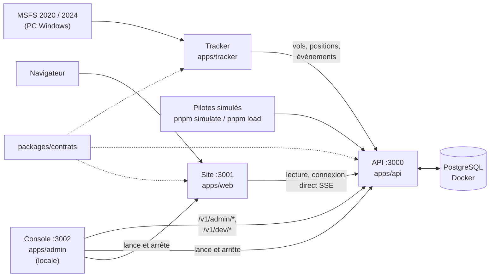
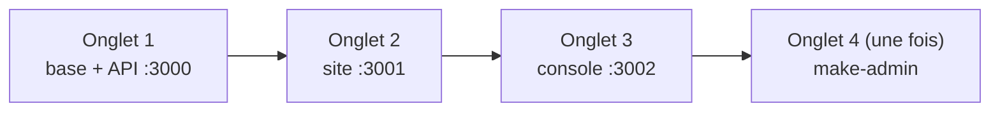

# Weems

Écosystème d'outils pour passionnés de simulation de vol : tracker, API, suivi des vols (web et iPad), gestion de compagnie virtuelle. Ne jamais utiliser pour la navigation réelle.

## Organisation

| Dossier | Contenu | État sur `main` |
| --- | --- | --- |
| `apps/tracker` | Tracker de bureau pour MSFS 2020/2024 (TypeScript, Electron) | Phases, enregistrement, envoi hors ligne ; connecteur MSFS (`pnpm fly`) ; fenêtre Electron et installateur Windows ; départ et arrivée obligatoires avant tout vol ; pilotes simulés sur de vraies pistes, avec virages et pente de 3° (`pnpm simulate`) ; activité simulée de comptes fictifs (`pnpm populate`) ; trajectoire enrichie (carburant, volets, train, N1, pilote automatique, feux) |
| `apps/api` | API centrale (Fastify, PostgreSQL, Drizzle) | Vols, trajectoires enrichies, carte en direct (SSE) avec trajets et événements, comptes et invitations, profil public, catégories d'avion, aéroports, compteurs de l'accueil (`GET /v1/stats`), images de l'accueil, catalogue des formules (`GET /v1/plans`, `GET /v1/me/plan`), carnet privé (`/v1/me/logbook/*` : résumé, vols, bandes de vol, statistiques), supervision et base de données pour la console |
| `apps/web` | Site (Next.js), français et anglais | Accueil public (tableau des départs), Découvrir, Fonctionnalités (générée depuis le catalogue), Offres et tableau comparatif, carte en direct `/live` publique ; pour le pilote : Mon carnet de bord (Résumé, Vols, Statistiques, Ma page publique), Mes vols et page de vol, réglages du profil ; profils publics `/pilots/<nom>` référencés ; une seule barre flottante sur tout le site |
| `apps/admin` | Console d'administration locale (Next.js, jamais déployée) | Supervision (accueil), Services, Trafic simulé, Activité simulée (comptes fictifs), Comptes et invitations, Personnalisation (images de l'accueil), Librairies (versions, alertes), Base de données (tailles, migrations, sauvegardes, nettoyage) |
| `packages/contrats` | Formats échangés entre le tracker, l'API et le site (Zod) | En place |
| `packages/ui` | Composants React communs au site et à la console d'administration (formulaires du modèle C, fiche 008 ; bouton ; jetons d'arrondi, fiche 014) | En place |
| `packages/notation` | Règles et calcul de la note, communs au tracker et à l'API | À écrire avec un pilote |
| `docs/` | Cadrage, cahiers des charges, décisions (`docs/decisions/`), revues, schémas | Voir « Documents clés » |

Un seul dépôt pour tout : le code partagé est dans `packages/` et n'existe qu'en un exemplaire.

## Documents clés

L'index complet de `docs/`, avec l'état de chaque document, est dans [docs/README.md](docs/README.md).

**Cadrage**

- [Parc applicatif et positionnement](docs/cadrage/01-parc-et-positionnement.md)
- [Architecture et flux](docs/cadrage/02-architecture-et-flux.md) : API, données, flux, hébergement, décisions ouvertes
- [Fondamentaux](docs/cadrage/03-fondamentaux.md) : moyens, objectif, gratuit et payant, statut juridique, environnements
- [Lots et feuille de route](docs/cadrage/04-lots-et-feuille-de-route.md) : lots 1 à 4, jalons J0 à J5 du lot 1, état au 13/11/2026
- [Formules d'abonnement](docs/cadrage/05-formules-abonnement.md) : Pilot Free, Pilot Pro, Company, Holding ; droits décidés par l'API

**Développement**

- [Règles de développement](docs/developpement/regles-de-developpement.md) : définition de « terminé », tests, branches, garde-fous Claude Code, règles permanentes des pages Offres et Fonctionnalités
- [Démarrage sur le Mac](docs/developpement/demarrage-mac.md) : icônes Weems Start et Weems Stop
- [Guide PC Windows (J2)](docs/developpement/guide-pc-windows-j2.md) : installer le PC, lancer `pnpm fly`, les 10 vols de référence
- [Fiches de décision](docs/decisions/) : une fiche par choix structurant (look, navigation, formulaires, console, arrondis, catalogue des formules…)
- [Revues](docs/revues/) : revue de fin de J3, mesure du direct, rapports de mise à jour de la documentation

**Cahiers des charges**

- [API, J0](docs/cahiers-des-charges/api/spec-J0-api.md) : conventions, modèle de données, routes
- Jalons : [J1 pilotes simulés](docs/cahiers-des-charges/spec-J1-pilotes-simules.md), [J2 premier vrai vol](docs/cahiers-des-charges/spec-J2-premier-vrai-vol.md), [J3 alpha fermée](docs/cahiers-des-charges/spec-J3-alpha-fermee.md)
- Site : [site minimal (J2)](docs/cahiers-des-charges/web/spec-J2-site-minimal.md), [accueil](docs/cahiers-des-charges/web/spec-J4-accueil.md), [personnalisation de l'accueil](docs/cahiers-des-charges/web/spec-J4-personnalisation.md), [carnet de vol privé](docs/cahiers-des-charges/web/spec-carnet-prive.md), [profil public](docs/cahiers-des-charges/spec-J4-profil-public.md), [catégories d'avion](docs/cahiers-des-charges/spec-J4-categories-avion.md)
- Carte en direct : [trajets et progression](docs/cahiers-des-charges/web/spec-J4-trajectoire-direct.md), [pilote, survol, vol suivi et enrichissements](docs/cahiers-des-charges/web/spec-J4-direct-pilote.md), [montée en charge](docs/cahiers-des-charges/api/spec-J4-montee-en-charge-direct.md)
- Offres et Fonctionnalités : [fiche 015 — catalogue des formules](docs/decisions/015-catalogue-des-formules.md)
- [Console d'administration](docs/cahiers-des-charges/admin/spec-admin.md) : Supervision, Services, Trafic, Activité, Comptes, Personnalisation, Librairies, Base de données
- Tracker : [cahier des charges](docs/cahiers-des-charges/tracker/CDC-Tracker.md) (exigences, contrat avec l'API, lots T0 à T4), [architecture interne](docs/cahiers-des-charges/tracker/architecture-interne.md), [spécification T0](docs/cahiers-des-charges/tracker/spec-T0.md), [référence MSFS](apps/tracker/CLAUDE.md)

**Suivi et alpha**

- [À voir avec Houssine](docs/suivi/a-voir-avec-houssine.md) : questions en attente pour la communauté (dont les critères provisoires des repères du carnet)
- [À voir avec Thibault](docs/suivi/a-voir-avec-thibault.md) : questions techniques en attente
- [Reste à faire pour le traqueur](docs/suivi/reste-a-faire-tracker.md) : travaux décidés, pas encore faits (adresse `weems://`)
- [Idées de fonctionnalités](docs/suivi/idees-fonctionnalites.md) : idées validées sur le principe, sans lot
- [Guide d'entretien pilotes](docs/suivi/guide-entretien-pilotes.md) : valider le produit avec 5 pilotes avant l'alpha
- [Alpha fermée : guide du testeur](docs/alpha/guide-testeur.md) (à envoyer aux pilotes) et [guide de l'organisateur](docs/alpha/guide-organisateur.md)
- [Vérification de la marque « Weems »](docs/identite/verification-marque-weems.md) : risque Weems & Plath, décision avant toute publication

## Règles permanentes

Elles valent pour toute PR, quel que soit le fil de travail (détail dans les [règles de développement](docs/developpement/regles-de-developpement.md), section 1, et la [fiche 015](docs/decisions/015-catalogue-des-formules.md)).

1. **Grille des offres tenue à jour** : toute fonction visible par le pilote, nouvelle ou modifiée, met à jour le catalogue des formules dans la même PR (clé `FeatureKey` dans `packages/contrats`, ligne dans `apps/api/src/modules/plans/catalog.ts`, textes FR et EN). La page Offres et le tableau comparatif suivent seuls.
2. **Page Fonctionnalités automatique** : `/features` n'a aucune liste écrite à la main, elle est générée depuis `GET /v1/plans`. Une nouvelle fonction ajoute son explication FR et EN et son illustration ; une fonction livrée passe de « bientôt » (`soon`) à « disponible » (`available`) dans la PR qui la livre.
3. **Le code teste une fonction, jamais un nom de formule** : l'API décide ce qui est verrouillé ; une carte Pilot Pro verrouillée montre un aperçu fictif, jamais le vrai chiffre.
4. **Jamais de rayon d'arrondi en dur** : jetons de `packages/ui/src/radius.css` (fiche 014).
5. **Jamais de secret ni de donnée personnelle dans le dépôt** : il est public.

## Travailler sur le projet

### Installer (une fois)

1. Cloner le dépôt : `git clone https://github.com/tetardo/weems`
2. Installer Node.js 24 (version fixée dans `.nvmrc`, avec `mise` ou `nvm`) et pnpm 10 (`corepack enable`, ou `mise`)
3. Installer les dépendances : `pnpm install`
4. Créer le fichier de configuration de l'API : `cp apps/api/.env.example apps/api/.env` (valeurs de développement, aucun secret)
5. Documentation SDK MSFS (copie locale, non versionnée) : `cd apps/tracker && bash scripts/update-msfs-docs.sh`
6. Ouvrir le dossier dans VS Code avec Claude Code : les fichiers `CLAUDE.md` donnent le contexte à l'agent, et Claude ne peut pas annoncer une tâche terminée si `pnpm check` échoue (réglage dans `.claude/settings.json`).

### Démarrer en local

**Le plus simple : deux icônes sur le bureau du Mac**, Weems Start et Weems Stop (installation une fois : `bash scripts/mac/install-desktop-icons.sh`). Start lance Docker Desktop, la base, la console, l'API et le site, puis ouvre la console ; Stop arrête tout, base comprise, sans effacer de données. Détails : [docs/developpement/demarrage-mac.md](docs/developpement/demarrage-mac.md).

À la main : Docker Desktop doit être lancé. Un onglet de Terminal par programme, depuis la racine du dépôt.

| Onglet | Commandes | Vérifier |
| --- | --- | --- |
| 1. Base et API | `docker compose -f apps/api/docker-compose.yml up -d db` puis `pnpm --filter @weems/api dev` | http://localhost:3000/v1/health ; documentation sur http://localhost:3000/docs |
| 2. Site | `pnpm --filter @weems/web dev` | http://localhost:3001, carte en direct sur http://localhost:3001/live |
| 3. Console d'administration | `pnpm admin` | http://127.0.0.1:3002 ; l'API et le site y apparaissent « Lancés hors console », c'est normal |
| 4. Premier administrateur (une seule fois, API lancée) | `pnpm --filter @weems/api make-admin pilote@weems.local` | La page Comptes de la console s'ouvre ensuite sans connexion : elle se connecte seule avec le compte de développement `pilote@weems.local` (hors production seulement) |

Les migrations de la base sont appliquées au démarrage de l'API (`WEEMS_MIGRATE_ON_START=true` dans `apps/api/.env`) ; sinon `pnpm --filter @weems/api db:migrate`, aussi proposé par la page Base de données de la console. La console peut aussi démarrer elle-même la base, l'API et le site depuis sa page Services.

Pièges connus :

- Port 3000 déjà pris : c'est presque toujours un conteneur `weems-api-1` (invisible à `lsof`) : `docker rm -f weems-api-1`. Il a été supprimé du Mac le 12/11/2026 ; il ne revient que si l'on choisit le mode Docker de l'API dans la console. En local, seule la base `weems-db-1` tourne dans Docker.
- Ne jamais lancer `docker compose down -v` : `-v` efface le volume de la base, donc les vols MSFS enregistrés.
- `DATABASE_URL` de `apps/api/.env` doit pointer sur la base `weems` (les tests utilisent `weems_test` par `TEST_DATABASE_URL`).

### Commandes

| Commande | Rôle |
| --- | --- |
| `pnpm check` | Tout : types, style, structure, tests. Doit passer avant toute fusion |
| `pnpm format` | Remet le code en forme automatiquement |
| `pnpm structure` | Frontières entre modules, code dupliqué, code inutilisé |
| `pnpm test` | Tests de toutes les applications et de tous les paquets, et le test de bout en bout `e2e/` (tracker → API → base) ; base `weems_test` nécessaire |
| `pnpm test:j1` · `pnpm test:j2` · `pnpm test:j3` · `pnpm test:tracker-app` | Tests de sortie des jalons et de l'application tracker (plus longs, navigateur sans écran pour le site) ; base `weems_test` nécessaire. En CI, J1 ne tourne sur une PR que si elle touche la chaîne tracker → API → direct, et toujours sur main et chaque nuit (fiche 013) |
| `pnpm admin` | Console d'administration sur http://127.0.0.1:3002 : services, trafic simulé, comptes et invitations |
| `pnpm --filter @weems/tracker simulate --count 10 --speed 10` | Pilotes simulés sur la carte en direct (API lancée) |
| `pnpm --filter @weems/tracker populate create` | Comptes fictifs et leurs vols passés, ou vols en direct (`live`) : aussi depuis la page Activité de la console (fiche 011) |
| `pnpm --filter @weems/tracker fly` | Vol réel depuis MSFS (PC Windows, voir le guide PC) |
| `pnpm load --pilots 50 --viewers 100` | Mesure de la montée en charge du direct |
| `pnpm --filter @weems/api make-admin <e-mail>` | Donne le rôle Administrateur à un compte existant |
| `pnpm --filter @weems/api invite <e-mail>` | Crée une invitation (aussi faisable depuis la console) |
| `docker compose -f apps/api/docker-compose.yml up` | Variante : API complète dans Docker sur http://localhost:3000 |

Autres commandes de l'API (migrations, aéroports, catégories d'avion, rapport de l'alpha) : voir [apps/api/CLAUDE.md](apps/api/CLAUDE.md).

**Schémas** : sources Mermaid dans `docs/schemas/`, images régénérées par `bash scripts/render-schemas.sh`.

**Règles du dépôt** : une branche et une pull request par changement, même seul, fusion en squash ; détail dans les [règles de développement](docs/developpement/regles-de-developpement.md).

## Feuille de route

Détail dans [Lots et feuille de route](docs/cadrage/04-lots-et-feuille-de-route.md). Pas de dates : on passe à l'étape suivante quand son critère de sortie est atteint.

| Jalon du lot 1 | Objectif | Où | État |
| --- | --- | --- | --- |
| J0 | Fondations : tracker T0, squelette de l'API | Mac | Fusionné ; restent les 20 scénarios de test et les critères de notation, à faire avec un pilote |
| J1 | 10 pilotes simulés suivis sur la carte en direct | Mac | Fusionné |
| J2 | Premier vrai vol affiché sur le site | Mac + PC Windows | Fusionné ; restent les 10 vols de référence sur PC |
| J3 | Alpha fermée, 5 pilotes | Serveur de Greg | Fonctions fusionnées ; critère de sortie en attente de la mise en ligne (reportée, tout se fait en local pour l'instant) |
| J4 | Bêta, environ 50 pilotes, Store limité | Production | En cours, en local : fusionnés la montée en charge du direct, le profil public, les catégories d'avion, la carte en direct enrichie, l'accueil public, la console d'administration (8 pages), les formules et les pages Offres, Découvrir et Fonctionnalités, le carnet privé (Résumé, Vols, Statistiques). À faire : Objectifs du carnet, débriefing, mise en ligne |
| J5 | Version 1.0 publique sur le Store | Production | À venir |

Ensuite : lot 2 abonnement pilote (catalogue des formules et cartes Pilot Pro déjà en place, sans paiement), lot 3 gestion de compagnie, lot 4 app iPad.
