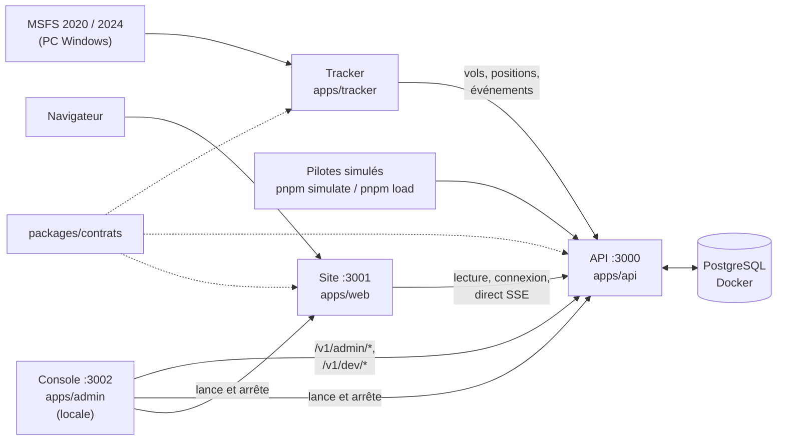
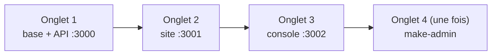

# Weems

Écosystème d'outils pour passionnés de simulation de vol : tracker, API, suivi des vols (web et iPad), gestion de compagnie virtuelle. Ne jamais utiliser pour la navigation réelle.

## Organisation

| Dossier | Contenu | État sur `main` |
| --- | --- | --- |
| `apps/tracker` | Tracker de bureau pour MSFS 2020/2024 (TypeScript, Electron) | Phases, enregistrement, envoi hors ligne ; connecteur MSFS (`pnpm fly`) ; fenêtre Electron et installateur Windows ; départ et arrivée obligatoires avant tout vol ; pilotes simulés sur de vraies pistes, avec virages et pente de 3° (`pnpm simulate`) |
| `apps/api` | API centrale (Fastify, PostgreSQL, Drizzle) | Vols, trajectoires, carte en direct (SSE) avec trajet du vol sélectionné, comptes et invitations, profil public, catégories d'avion, aéroports (`GET /v1/airports`), routes d'administration |
| `apps/web` | Site (Next.js), français et anglais | Carte en direct `/live` (silhouette et couleur par catégorie, trajets, progression), liste et page de vol, connexion, profil public `/pilots/<nom>` et ses réglages, formulaires en cartes (fiche 008) ; cartes claires ou sombres selon le thème |
| `apps/admin` | Console d'administration locale (Next.js, jamais déployée) | Services (base, API, site), trafic simulé, comptes et invitations |
| `packages/contrats` | Formats échangés entre le tracker, l'API et le site (Zod) | En place |
| `packages/ui` | Composants React communs au site et à la console d'administration (formulaires, modèle C, fiche 008) | En place |
| `packages/notation` | Règles et calcul de la note, communs au tracker et à l'API | À écrire avec un pilote |
| `docs/` | Cadrage, cahiers des charges, décisions (`docs/decisions/`), revues, schémas | Voir « Documents clés » |

Un seul dépôt pour tout : le code partagé est dans `packages/` et n'existe qu'en un exemplaire.

## Documents clés

- [Parc applicatif et positionnement](docs/cadrage/01-parc-et-positionnement.md)
- [Architecture et flux](docs/cadrage/02-architecture-et-flux.md) : API, données, flux, hébergement, décisions ouvertes
- [Fondamentaux](docs/cadrage/03-fondamentaux.md) : moyens, objectif, gratuit et payant, statut juridique, environnements
- [Lots et feuille de route](docs/cadrage/04-lots-et-feuille-de-route.md) : lots 1 à 4, jalons J0 à J5 du lot 1
- [Règles de développement](docs/developpement/regles-de-developpement.md) : définition de « terminé », tests, branches, garde-fous Claude Code
- [Spécification J0 de l'API](docs/cahiers-des-charges/api/spec-J0-api.md) : conventions, modèle de données, routes
- [Site web minimal](docs/cahiers-des-charges/web/spec-J2-site-minimal.md) : liste des vols, page de vol, connexion (J2 et J3)
- [Spécification J1](docs/cahiers-des-charges/spec-J1-pilotes-simules.md) : 10 pilotes simulés sur la carte en direct
- [Spécification J2](docs/cahiers-des-charges/spec-J2-premier-vrai-vol.md) : premier vrai vol dans MSFS, trajectoire, liste et page de vol
- [Spécification J3](docs/cahiers-des-charges/spec-J3-alpha-fermee.md) : alpha fermée, comptes, connexion du site et du tracker
- [Profil public (J4)](docs/cahiers-des-charges/spec-J4-profil-public.md), [catégories d'avion (J4)](docs/cahiers-des-charges/spec-J4-categories-avion.md), [trajets sur la carte en direct (J4)](docs/cahiers-des-charges/web/spec-J4-trajectoire-direct.md), [montée en charge du direct (J4)](docs/cahiers-des-charges/api/spec-J4-montee-en-charge-direct.md)
- [Console d'administration](docs/cahiers-des-charges/admin/spec-admin.md) : services, trafic simulé, comptes
- [Fiches de décision](docs/decisions/) : une fiche par choix structurant (look du site, aéroports, formulaires, console, vols simulés…)
- [Revues](docs/revues/) : revue de fin de J3, mesure du direct
- [Cahier des charges du tracker](docs/cahiers-des-charges/tracker/CDC-Tracker.md) : exigences, contrat avec l'API, lots T0 à T4
- [Architecture interne du tracker](docs/cahiers-des-charges/tracker/architecture-interne.md) : cœur indépendant, connecteurs, enregistreur, envoi hors ligne
- [Spécification T0 du tracker](docs/cahiers-des-charges/tracker/spec-T0.md) : données reçues et règles des phases
- [Guide PC Windows (J2)](docs/developpement/guide-pc-windows-j2.md) : installer le PC, lancer `pnpm fly`, les 10 vols de référence
- [Guide d'entretien pilotes](docs/suivi/guide-entretien-pilotes.md) : valider le produit avec 5 pilotes avant l'alpha
- [Alpha fermée : guide du testeur](docs/alpha/guide-testeur.md) (à envoyer aux pilotes) et [guide de l'organisateur](docs/alpha/guide-organisateur.md) : invitations, publier une version du tracker
- [À voir avec Houssine](docs/suivi/a-voir-avec-houssine.md) : questions en attente pour la communauté
- [À voir avec Thibault](docs/suivi/a-voir-avec-thibault.md) : questions techniques en attente
- [Référence MSFS du tracker](apps/tracker/CLAUDE.md) : quelles données lire et comment

## Travailler sur le projet

### Installer (une fois)

1. Cloner le dépôt : `git clone https://github.com/tetardo/weems`
2. Installer Node.js 24 (version fixée dans `.nvmrc`, avec `mise` ou `nvm`) et pnpm 10 (`corepack enable`, ou `mise`)
3. Installer les dépendances : `pnpm install`
4. Créer le fichier de configuration de l'API : `cp apps/api/.env.example apps/api/.env` (valeurs de développement, aucun secret)
5. Documentation SDK MSFS (copie locale, non versionnée) : `cd apps/tracker && bash scripts/update-msfs-docs.sh`
6. Ouvrir le dossier dans VS Code avec Claude Code : les fichiers `CLAUDE.md` donnent le contexte à l'agent, et Claude ne peut pas annoncer une tâche terminée si `pnpm check` échoue (réglage dans `.claude/settings.json`).

### Démarrer en local

**Le plus simple : deux icônes sur le bureau du Mac**, Weems Start et Weems Stop (installation une fois : `bash scripts/mac/install-desktop-icons.sh`). Start lance Docker Desktop, la base, la console, l'API et le site, puis ouvre la console ; Stop arrête tout, base comprise, sans effacer de données. Détails : [docs/developpement/demarrage-mac.md](docs/developpement/demarrage-mac.md).

À la main : Docker Desktop doit être lancé. Un onglet de Terminal par programme, depuis la racine du dépôt.

| Onglet | Commandes | Vérifier |
| --- | --- | --- |
| 1. Base et API | `docker compose -f apps/api/docker-compose.yml up -d db` puis `pnpm --filter @weems/api dev` | http://localhost:3000/v1/health ; documentation sur http://localhost:3000/docs |
| 2. Site | `pnpm --filter @weems/web dev` | http://localhost:3001, carte en direct sur http://localhost:3001/live |
| 3. Console d'administration | `pnpm admin` | http://127.0.0.1:3002 ; l'API et le site y apparaissent « Lancés hors console », c'est normal |
| 4. Premier administrateur (une seule fois, API lancée) | `pnpm --filter @weems/api make-admin pilote@weems.local` | Connexion à la console avec le compte de développement `pilote@weems.local` / `weems-dev-password` (accepté hors production seulement) |

Les migrations de la base sont appliquées au démarrage de l'API. La console peut aussi démarrer elle-même la base, l'API et le site depuis sa page Services.

Pièges connus :

- Port 3000 déjà pris : c'est presque toujours l'ancien conteneur `weems-api-1` (invisible à `lsof`) : `docker rm -f weems-api-1`. Il revient si l'on choisit le mode Docker de l'API dans la console.
- Ne jamais lancer `docker compose down -v` : `-v` efface le volume de la base, donc les vols MSFS enregistrés.
- `DATABASE_URL` de `apps/api/.env` doit pointer sur la base `weems` (les tests utilisent `weems_test` par `TEST_DATABASE_URL`).

### Commandes

| Commande | Rôle |
| --- | --- |
| `pnpm check` | Tout : types, style, structure, tests. Doit passer avant toute fusion |
| `pnpm format` | Remet le code en forme automatiquement |
| `pnpm structure` | Frontières entre modules, code dupliqué, code inutilisé |
| `pnpm test` | Tests de toutes les applications et de tous les paquets, et le test de bout en bout `e2e/` (tracker → API → base) ; base `weems_test` nécessaire |
| `pnpm test:j1` · `pnpm test:j2` · `pnpm test:j3` · `pnpm test:tracker-app` | Tests de sortie des jalons et de l'application tracker (plus longs, navigateur sans écran pour le site) ; base `weems_test` nécessaire |
| `pnpm admin` | Console d'administration sur http://127.0.0.1:3002 : services, trafic simulé, comptes et invitations |
| `pnpm --filter @weems/tracker simulate --count 10 --speed 10` | Pilotes simulés sur la carte en direct (API lancée) |
| `pnpm --filter @weems/tracker fly` | Vol réel depuis MSFS (PC Windows, voir le guide PC) |
| `pnpm load --pilots 50 --viewers 100` | Mesure de la montée en charge du direct |
| `pnpm --filter @weems/api make-admin <e-mail>` | Donne le rôle Administrateur à un compte existant |
| `pnpm --filter @weems/api invite <e-mail>` | Crée une invitation (aussi faisable depuis la console) |
| `docker compose -f apps/api/docker-compose.yml up` | Variante : API complète dans Docker sur http://localhost:3000 |

Autres commandes de l'API (migrations, aéroports, catégories d'avion, rapport de l'alpha) : voir [apps/api/CLAUDE.md](apps/api/CLAUDE.md).

**Schémas** : sources Mermaid dans `docs/schemas/`, images régénérées par `bash scripts/render-schemas.sh`.

**Règles du dépôt** : une branche et une pull request par changement, même seul, fusion en squash ; détail dans les [règles de développement](docs/developpement/regles-de-developpement.md).

## Feuille de route

Détail dans [Lots et feuille de route](docs/cadrage/04-lots-et-feuille-de-route.md). Pas de dates : on passe à l'étape suivante quand son critère de sortie est atteint.

| Jalon du lot 1 | Objectif | Où | État |
| --- | --- | --- | --- |
| J0 | Fondations : tracker T0, squelette de l'API | Mac | Fusionné ; restent les 20 scénarios de test et les critères de notation, à faire avec un pilote |
| J1 | 10 pilotes simulés suivis sur la carte en direct | Mac | Fusionné |
| J2 | Premier vrai vol affiché sur le site | Mac + PC Windows | Fusionné ; restent les 10 vols de référence sur PC |
| J3 | Alpha fermée, 5 pilotes | Serveur de Greg | Fonctions fusionnées ; critère de sortie en attente de la mise en ligne (reportée, tout se fait en local pour l'instant) |
| J4 | Bêta, environ 50 pilotes, Store limité | Production | En cours : montée en charge du direct, profil public, catégories d'avion, trajets sur la carte, console d'administration |
| J5 | Version 1.0 publique sur le Store | Production | À venir |

Ensuite : lot 2 abonnement pilote, lot 3 gestion de compagnie, lot 4 app iPad.
