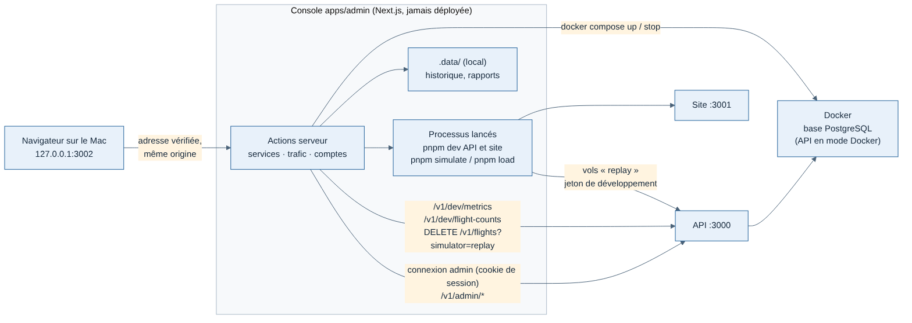

# Weems — console d'administration

Console **locale** de Greg, sur son Mac : démarrer et arrêter les services, lancer du trafic simulé ou de l'activité simulée (comptes fictifs), gérer les comptes. Jamais déployée (fiche `../../docs/decisions/009-console-admin-locale.md`).

Lancement : `pnpm admin` (racine), puis http://127.0.0.1:3002.

## Où trouver quoi

| Besoin | Fichier |
| --- | --- |
| Contenu des pages, décisions, critère de sortie | `../../docs/cahiers-des-charges/admin/spec-admin.md` |
| Pourquoi une console locale, règles d'accès | `../../docs/decisions/009-console-admin-locale.md`, connexion automatique en local : `012-console-connexion-automatique-en-local.md` |
| Maquettes validées | `/mnt/project-files/admin/` (services-v2, trafic-v2, comptes-v2, activite/ proposition A) |
| Comptes fictifs et activité simulée | `../../docs/decisions/011-activite-simulee-comptes-fictifs.md`, `../tracker/tools/populate/` |
| Routes `/v1/admin/*` de l'API | `../api/src/modules/accounts/admin-routes.ts` |
| Formats échangés | `../../packages/contrats` (`api/admin.ts`, `api/dev-metrics.ts`, `tools/simulation-progress.ts`, `tools/activity-progress.ts`, `api/fictitious.ts`) |



## Règles

- La console **n'écrit jamais dans la base** : les comptes passent par l'API (`/v1/admin/*`, session d'un administrateur), les vols simulés et les comptes fictifs par les routes de développement de l'API (jeton de développement).
- Services et Trafic sans connexion, Comptes avec connexion : ne pas changer sans relire la fiche 009.
- Comptes : hors production, la console se connecte seule avec le pilote de développement (`server/accounts/dev-login.ts`, fiche 012) ; son rôle d'administrateur reste donné à la main (`make-admin`). Ne jamais ouvrir `/v1/admin/*` au jeton de développement.
- Écoute sur `127.0.0.1` seulement (`--hostname` du script `dev`) ; `src/proxy.ts` refuse toute autre adresse (test `server/allowed-hosts.test.ts`).
- Français seulement (exception à la règle des deux langues, spec admin question 2) : textes écrits dans les composants.
- Formulaires : modèle C (fiche 008), composants du paquet `@weems/ui` (`Field`, `FormField`, `TextInput`, `Segmented`…), jamais de champ écrit à la main. Tailwind ne sert qu'à eux : `src/app/global.css` importe son thème et ses utilitaires sans remise à zéro, génère seulement les classes de `packages/ui` et relie leurs couleurs aux variables de la console.
- Icônes : Lucide, importé seulement dans `src/ui/icons.ts`.
- Un seul lancement à la fois entre Trafic et Activité : chaque gestionnaire reçoit l'occupation de l'autre (`server/console.ts`).
- Les processus lancés (pnpm dev, simulate, load, populate) sont gardés dans `globalThis` (`server/singleton.ts`) : un rechargement de Next.js ne les perd pas. Ils reçoivent l'environnement de la console sans `PORT` ni `NODE_ENV` (`childEnv`), sinon l'API prendrait le port 3002.
- Fichiers locaux (historique des lancements, rapports de `pnpm load`) dans `apps/admin/.data/`, jamais versionnés.

## Organisation

```
src/
  app/                 routes Next.js : mise en page (barre latérale G), /services, /traffic, /activity, /accounts, styles ;
                       api/lifecycle (tout démarrer / arrêter, appelé par scripts/mac/)
  proxy.ts             refus des requêtes adressées à un autre nom que 127.0.0.1:3002 / localhost:3002
  actions/             actions serveur appelées par les pages (résultat { ok, value | error }, jamais d'exception)
  server/              côté serveur seulement
    console.ts           configuration et instances uniques (services, trafic)
    lifecycle.ts         tout démarrer / tout arrêter pour les icônes du Mac (en-tête des scripts exigé)
    managed-process.ts   commande lancée dans son groupe de processus, journaux, arrêt SIGTERM puis SIGKILL
    services/            Docker (docker compose), sondes de santé, états des cartes, gestionnaire des services
    traffic/             lancement (formulaires → arguments pnpm), suivi, mesures de l'API, résultat, historique
    activity/            lancement de pnpm populate, suivi, résultat, population fictive (/v1/dev/fictitious-pilots)
    accounts/            connexion à l'API, appels /v1/admin/*
  site/                barre latérale, barre du haut, onglets mobiles
  features/            composants des pages : services/, traffic/, activity/, accounts/ (logique pure à part, testée)
  ui/                  icônes, champ numérique, état d'un lancement, pastilles d'état, titre de page, confirmation, sondage périodique
  format/              heures, durées, noms des phases
```

## Commandes

| Commande | Rôle |
| --- | --- |
| `pnpm admin` (racine) | Console sur http://127.0.0.1:3002 |
| Icônes Weems Start / Weems Stop (`scripts/mac/`) | Tout démarrer ou tout arrêter, via `POST /api/lifecycle` (`src/server/lifecycle.ts`, guide `../../docs/developpement/demarrage-mac.md`) |
| `pnpm --filter @weems/api make-admin <e-mail>` | Nomme un administrateur (le compte doit exister) ; avec `pilote@weems.local`, la page Comptes s'ouvre ensuite sans connexion |
| `pnpm check` (racine) | Types, style, structure et tests, console comprise |
