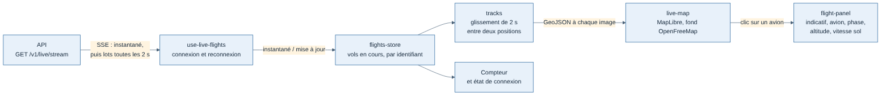

# Weems — site web

Site Next.js de Weems. Client de l'API comme les autres programmes : il ne parle jamais à la base.

J1 : page `/live`, carte des vols en cours alimentée par le flux SSE `/v1/live/stream` de l'API. La page de vol, les comptes et le reste du site arrivent en J2 et J3.

## Où trouver quoi

| Besoin | Fichier |
| --- | --- |
| Règles communes (terminé, tests, branches, sécurité) | `../../docs/developpement/regles-de-developpement.md` |
| Carte en direct (J1) | `../../docs/cahiers-des-charges/spec-J1-pilotes-simules.md` |
| Site minimal (J2) | `../../docs/cahiers-des-charges/web/spec-J2-site-minimal.md` |
| Formats reçus de l'API | `../../packages/contrats` (source unique, ne jamais les redéfinir ici) |

## Stack

- Next.js (App Router), React, TypeScript strict.
- Carte : MapLibre, fond OpenFreeMap (gratuit, sans clé).
- Tests : Vitest sur la logique pure (`src/live/*.test.ts`) ; les composants React restent minces.

## Organisation

```
src/
  app/                 routes Next.js (pages et mise en page), sans logique
  live/                carte en direct
    use-live-flights.ts   connexion SSE et reconnexion
    flights-store.ts      vols en cours (fonctions pures)
    tracks.ts             glissement entre deux positions
    interpolate.ts        calcul du point intermédiaire et du cap
    aircraft-icons.ts     silhouettes d'avion dessinées
    live-map.tsx          carte MapLibre
    flight-panel.tsx      panneau du vol choisi
    live-view.tsx         assemblage de la page
    testing/              données de test
```



## Commandes

| Commande | Rôle |
| --- | --- |
| `pnpm --filter @weems/web dev` | Site sur http://localhost:3001 (l'API doit tourner sur le port 3000) |
| `pnpm --filter @weems/web build` | Construction de production |
| `NEXT_PUBLIC_API_URL=… pnpm --filter @weems/web dev` | Viser une autre API |
