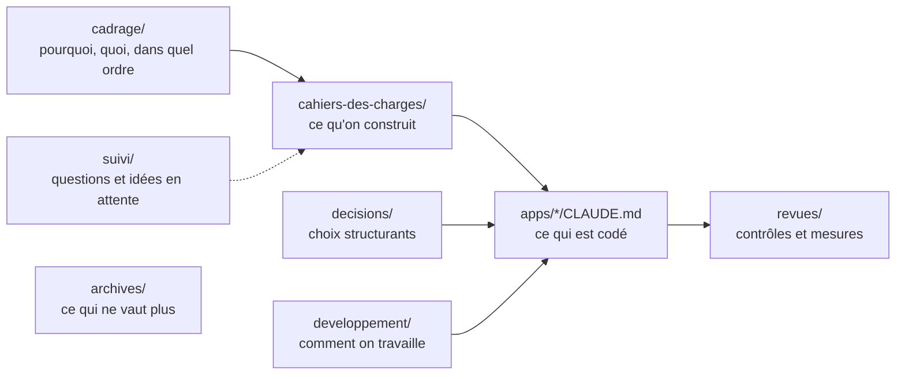

# Documentation de Weems : index

Tenu à jour le 13/11/2026 (rapport : [revues/maj-documentation-2026-11-13.md](revues/maj-documentation-2026-11-13.md)). Chaque document du dossier `docs/` y figure, avec son état. Un document ajouté s'ajoute ici dans la même PR.

États : **À jour** (décrit ce qui existe ou ce qui est décidé), **Référence** (spécification d'un jalon livré : exigences et choix, le détail du code actuel est dans le `CLAUDE.md` de l'application), **Ouvert** (décisions ou travaux en attente), **Liste vivante** (complétée au fil du projet).

## Cadrage (`cadrage/`)

| Document | Contenu | État |
| --- | --- | --- |
| [01 — Parc et positionnement](cadrage/01-parc-et-positionnement.md) | Applications envisagées, concurrents, positionnement | À jour (la « petite compagnie gratuite » est rediscutée dans 05) |
| [02 — Architecture et flux](cadrage/02-architecture-et-flux.md) | API centrale, données, flux, hébergement, sécurité, décisions | À jour ; paiement encore ouvert |
| [03 — Fondamentaux](cadrage/03-fondamentaux.md) | Moyens, objectif, gratuit et payant, statut juridique, environnements | À jour |
| [04 — Lots et feuille de route](cadrage/04-lots-et-feuille-de-route.md) | Lots 1 à 4, jalons J0 à J5, état au 13/11 | À jour |
| [05 — Formules d'abonnement](cadrage/05-formules-abonnement.md) | Pilot Free, Pilot Pro, Company, Holding ; droits par l'API | Ouvert (questions de la section 6) |

## Cahiers des charges (`cahiers-des-charges/`)

| Document | Contenu | État |
| --- | --- | --- |
| [Tracker — cahier des charges](cahiers-des-charges/tracker/CDC-Tracker.md) | Exigences, contrat avec l'API, lots T0 à T4 | Référence |
| [Tracker — architecture interne](cahiers-des-charges/tracker/architecture-interne.md) | Cœur indépendant, connecteurs, enregistreur, envoi hors ligne | Référence |
| [Tracker — spécification T0](cahiers-des-charges/tracker/spec-T0.md) | Télémétrie, 12 phases ; points 3 et 4 à faire avec un pilote | Ouvert |
| [API — J0](cahiers-des-charges/api/spec-J0-api.md) | Conventions, modèle de données, routes de base | Référence |
| [API — montée en charge du direct (J4)](cahiers-des-charges/api/spec-J4-montee-en-charge-direct.md) | Paliers, mesures, corrections | Référence |
| [J1 — pilotes simulés](cahiers-des-charges/spec-J1-pilotes-simules.md) | 10 pilotes simulés sur la carte en direct | Référence |
| [J2 — premier vrai vol](cahiers-des-charges/spec-J2-premier-vrai-vol.md) | Connecteur MSFS, trajectoire ; 10 vols de référence à faire sur PC | Ouvert |
| [J3 — alpha fermée](cahiers-des-charges/spec-J3-alpha-fermee.md) | Comptes, connexion du site et du tracker ; mise en ligne reportée | Ouvert |
| [J4 — profil public](cahiers-des-charges/spec-J4-profil-public.md) | Profil `/pilots/<nom>`, réglages, référencement | Référence |
| [J4 — catégories d'avion](cahiers-des-charges/spec-J4-categories-avion.md) | Catalogue OACI, catégorie de chaque vol | Référence |
| [Site — minimal (J2)](cahiers-des-charges/web/spec-J2-site-minimal.md) | Liste des vols, page de vol, connexion | Référence |
| [Site — accueil (J4)](cahiers-des-charges/web/spec-J4-accueil.md) | Accueil public, tableau des départs, barre v2 | Référence |
| [Site — personnalisation de l'accueil](cahiers-des-charges/web/spec-J4-personnalisation.md) | Image de fond par thème, choisie dans la console | Référence |
| [Site — trajets sur la carte en direct (J4)](cahiers-des-charges/web/spec-J4-trajectoire-direct.md) | Trajets, orthodromie, progression | Référence |
| [Site — pilote et enrichissements du direct (J4)](cahiers-des-charges/web/spec-J4-direct-pilote.md) | Bulle, vol suivi, recherche, nuit, filtres, événements | Référence |
| [Site — page Boarding](cahiers-des-charges/web/spec-boarding.md) | Tableau à palettes des départs et arrivées de tous les membres | Référence |
| [Offre Pilote fondateur et codes d'offre](cahiers-des-charges/web/spec-offre-fondateurs.md) | 500 premiers pilotes, codes, parrainage, ambassadeurs | Référence |
| [Grades des pilotes](cahiers-des-charges/web/spec-grades-des-pilotes.md) | 9 grades sur heures et vols valides, insignes, carnet, profil, Boarding | Référence |
| [Site — carnet de vol privé](cahiers-des-charges/web/spec-carnet-prive.md) | Résumé, Vols, Statistiques livrés ; Objectifs à faire | Ouvert |
| [Console d'administration](cahiers-des-charges/admin/spec-admin.md) | Les 8 pages de la console | À jour |

## Décisions (`decisions/`)

Une fiche par choix structurant, jamais supprimée : une fiche remplacée garde son texte et renvoie à la suivante.

| Fiche | Sujet | État |
| --- | --- | --- |
| [001](decisions/001-look-du-site-gamelab.md) | Look GameLab IA | À jour pour les couleurs et polices ; le menu latéral est remplacé par la fiche 003 |
| [002](decisions/002-icones-lucide-et-carte-sombre.md) | Icônes Lucide, carte sombre | À jour |
| [003](decisions/003-navigation-barre-flottante.md) | Barre flottante unique, menu du téléphone | À jour au 13/11 |
| [004](decisions/004-fuseaux-horaires-hors-ligne.md) | Fuseaux horaires hors ligne | À jour |
| [005](decisions/005-liste-aeroports-ourairports.md) | Aéroports OurAirports | À jour |
| [006](decisions/006-catalogue-des-avions.md) | Catalogue des avions | À jour |
| [007](decisions/007-depart-et-arrivee-obligatoires.md) | Départ et arrivée obligatoires | À jour |
| [008](decisions/008-modele-de-formulaire.md) | Formulaires en cartes (modèle C) | À jour |
| [009](decisions/009-console-admin-locale.md) | Console locale | À jour |
| [010](decisions/010-vols-simules-pistes-et-virages.md) | Vols simulés réalistes | À jour |
| [011 — activité simulée](decisions/011-activite-simulee-comptes-fictifs.md) | Comptes fictifs, vols passés | À jour |
| [011 — démarrage par icônes](decisions/011-demarrage-par-icones.md) | Icônes Weems Start / Stop | À jour (deux fiches portent le numéro 011 ; gardées telles quelles pour ne pas casser les liens, la prochaine fiche est la 018) |
| [012](decisions/012-console-connexion-automatique-en-local.md) | Connexion automatique de la console | À jour |
| [013](decisions/013-ci-j1-seulement-si-chaine-touchee.md) | CI : J1 filtré par chemins | À jour |
| [014](decisions/014-arrondis-des-cadres.md) | 6 jetons d'arrondi | À jour |
| [015](decisions/015-catalogue-des-formules.md) | Catalogue des formules, pages Offres et Fonctionnalités | À jour au 13/11 |
| [016](decisions/016-fond-plan-aeroport.md) | Fond du site : plan d'aéroport inventé, très léger | À jour au 13/11 |
| [017](decisions/017-offre-fondateurs-hors-catalogue.md) | Offre fondateurs : droits offerts, hors catalogue des formules | À jour au 13/11 |
| [018](decisions/018-grades-heures-et-vols-valides.md) | Grades des pilotes : heures et vols valides, calculés à la lecture | À jour au 13/11 |

## Développement (`developpement/`)

| Document | Contenu | État |
| --- | --- | --- |
| [Règles de développement](developpement/regles-de-developpement.md) | Terminé, branches, outils, structure, tests, règles permanentes | À jour |
| [Démarrage sur le Mac](developpement/demarrage-mac.md) | Icônes Weems Start et Weems Stop | À jour |
| [Guide PC Windows (J2)](developpement/guide-pc-windows-j2.md) | Installer le PC, `pnpm fly`, 10 vols de référence | Ouvert (étape E à faire) |

## Revues (`revues/`)

| Document | Contenu |
| --- | --- |
| [Revue de fin de J3](revues/revue-fin-J3.md) | Revue de structure, état du critère de sortie |
| [Mesure du direct (J4)](revues/mesure-direct-J4.md) | Paliers 50/100 et 200/500, corrections H1 et H2 |
| [Mise à jour de la documentation, 13/11/2026](revues/maj-documentation-2026-11-13.md) | Ce qui a changé dans la doc et pourquoi |

## Suivi (`suivi/`)

| Document | Contenu | État |
| --- | --- | --- |
| [À voir avec Houssine](suivi/a-voir-avec-houssine.md) | Questions pour la communauté, dont les critères provisoires des repères du carnet | Liste vivante, à garder |
| [À voir avec Thibault](suivi/a-voir-avec-thibault.md) | Questions techniques | Liste vivante |
| [Reste à faire pour le traqueur](suivi/reste-a-faire-tracker.md) | Adresse `weems://` | Liste vivante |
| [Idées de fonctionnalités](suivi/idees-fonctionnalites.md) | Idées validées sur le principe, sans lot | Liste vivante |
| [Guide d'entretien pilotes](suivi/guide-entretien-pilotes.md) | 5 entretiens avant l'alpha | Ouvert |

## Alpha, identité, schémas

| Document | Contenu | État |
| --- | --- | --- |
| [Guide du testeur](alpha/guide-testeur.md) | À envoyer aux pilotes de l'alpha | À jour |
| [Guide de l'organisateur](alpha/guide-organisateur.md) | Invitations, publier une version du tracker | À jour (attend la mise en ligne) |
| [Vérification de la marque](identite/verification-marque-weems.md) | Risque Weems & Plath | Ouvert (avant toute publication) |
| [Planche de logos v1](identite/planche-logos-v1.html) | Pistes de logo | Ouvert (choix du logo) |
| `schemas/` | Sources Mermaid (`*.mmd`) et images (`img/`), régénérées par `bash scripts/render-schemas.sh` | Chaque source a son image |

## Archives (`archives/`)

Ce qui ne vaut plus y est déplacé, avec la date et la raison : voir [archives/README.md](archives/README.md).
