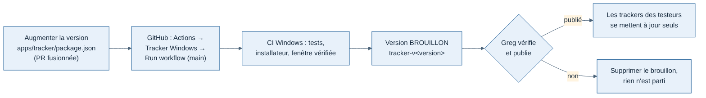

# Alpha fermée — guide de l'organisateur (Greg)

Rédigé le 11/11/2026. Ce que Greg fait pour lancer et faire vivre l'alpha : inviter les testeurs, publier une version du tracker, suivre les critères de sortie. Spécification : [spec J3](../cahiers-des-charges/spec-J3-alpha-fermee.md). Guide à envoyer aux pilotes : [guide du testeur](guide-testeur.md).

**Prérequis** : l'API et le site en ligne (étape « mise en ligne » de J3, bloquée tant que le domaine et la machine virtuelle Hetzner ne sont pas choisis). Avant, tout ceci ne marche qu'en local sur le Mac.

## 1. Une seule fois : l'adresse de l'API dans le tracker

L'installateur contient l'adresse de l'API de l'alpha. Elle se règle dans GitHub, pas dans le code :

1. Dépôt `tetardo/weems` → **Settings** → **Secrets and variables** → **Actions** → onglet **Variables**.
2. **New repository variable** : nom `WEEMS_TRACKER_API_URL`, valeur l'adresse de l'API (par exemple `https://api.[domaine]`).

Sans cette variable, la publication d'une version est refusée (un tracker pointant sur `localhost` ne servirait à rien aux testeurs).

## 2. Publier une version du tracker



1. **Version** : chaque publication a un numéro nouveau. Demander à Claude d'augmenter `version` dans `apps/tracker/package.json` (par exemple 0.1.0 → 0.1.1), puis fusionner la PR.
2. GitHub → onglet **Actions** → **Tracker Windows** → **Run workflow** → branche `main` → **Run workflow**.
3. Environ 10 minutes. La CI passe les tests sur Windows, construit l'installateur et vérifie que l'application installée s'ouvre.
4. GitHub → **Releases** : une version **brouillon** `tracker-v0.1.1` contient « Weems Tracker Setup 0.1.1.exe ». Personne ne la voit encore.
5. Si tout va bien : **Edit** → **Publish release**. Les trackers des testeurs la téléchargent au démarrage suivant et l'installent à la fermeture. Le lien de téléchargement à donner aux nouveaux testeurs est celui de l'`.exe` dans cette version.
6. Si quelque chose cloche : **Delete** sur le brouillon. Rien n'est parti.

Une version publiée ne se retire pas des PC qui l'ont déjà installée : en cas d'erreur, publier vite une version corrigée avec un numéro plus grand.

## 3. Inviter un testeur

Sur le serveur de l'alpha (ou sur le Mac en local), depuis `apps/api` :

```bash
pnpm invite pilote@example.com
```

La commande affiche le code et le lien d'inscription (`[site]/fr/signup?code=…`), valable une fois pour cette adresse. L'envoyer au pilote avec le [guide du testeur](guide-testeur.md) complété (adresse du site, version, moyen de contact).

Mot de passe oublié : pas d'envoi d'e-mails en J3. Supprimer le compte et refaire une invitation (demander à Claude la commande de suppression le moment venu).

## 4. Suivre l'alpha

Critère de sortie de J3 : **5 pilotes, 50 vols, zéro vol perdu, phases correctes sur au moins 95 % des vols vérifiés à la main.**

- Chaque retour de testeur (phase fausse, vol manquant) : le noter avec la date et l'heure du vol, pour que Claude retrouve le vol et corrige les règles.
- Les outils de mesure (bouton « phases incorrectes » sur la page du vol, comptage des vols perdus, page des critères) arrivent dans l'étape suivante de J3.
