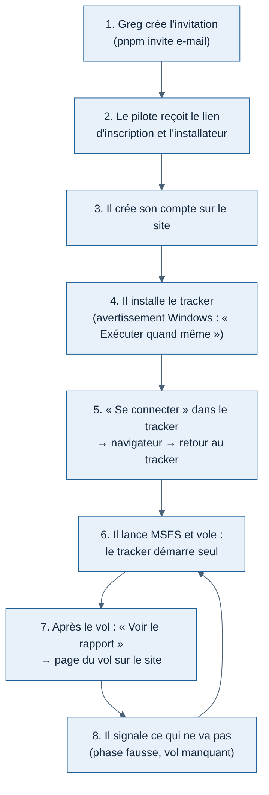

# Weems — guide du pilote testeur (alpha fermée)

Rédigé le 11/11/2026 pour l'alpha fermée (jalon J3). À envoyer à chaque testeur avec son invitation. Les mots entre crochets sont remplis par Greg avant l'envoi.

Merci de tester Weems ! Le tracker enregistre vos vols dans Microsoft Flight Simulator, reconnaît les phases (roulage, décollage, montée, croisière…) et les envoie sur le site, où vous retrouvez votre carnet et le rapport de chaque vol. Il n'y a pas encore de note : on veut d'abord vérifier que rien ne se perd et que les phases sont justes.

## Ce qu'il vous faut

- Un PC Windows 10 ou 11 avec **MSFS 2020 ou MSFS 2024**.
- L'e-mail d'invitation de Greg : il contient votre **lien d'inscription** (valable une fois, pour votre adresse) et le lien de l'**installateur**.

## 1. Créer votre compte

1. Ouvrez le lien d'inscription : le code d'invitation est déjà rempli.
2. Choisissez votre nom de pilote et un mot de passe (10 caractères au moins).
3. Vous arrivez sur « Mes vols », vide pour l'instant.

Le site : [adresse du site].

## 2. Installer le tracker

1. Téléchargez « Weems Tracker Setup [version].exe ».
2. Lancez-le. Windows affiche « Windows a protégé votre ordinateur » : c'est normal pour une alpha, l'application n'est pas encore signée. Cliquez sur **Informations complémentaires**, puis **Exécuter quand même**.
3. L'installation se fait sans droits d'administrateur et ouvre le tracker.

Les mises à jour arrivent seules : au démarrage, le tracker télécharge la nouvelle version et l'installe à la fermeture.

## 3. Se connecter

1. Dans le tracker, cliquez sur **Se connecter**.
2. Votre navigateur s'ouvre sur la page de connexion de Weems : entrez votre e-mail et votre mot de passe.
3. Le navigateur affiche « Connexion terminée, vous pouvez revenir au tracker Weems. » Le tracker indique **Connecté à Weems**.

Le tracker ne voit jamais votre mot de passe. Vous restez connecté tant que vous volez au moins une fois tous les 90 jours.

## 4. Voler

1. Dans **Prochain vol**, mettez votre indicatif et, si vous voulez, les aéroports de départ et d'arrivée (codes OACI : LFPG, LFBO…). Cliquez sur **Enregistrer**.
2. Lancez MSFS et chargez votre vol, moteurs coupés au parking de préférence.
3. Le tracker passe à **MSFS connecté** et ouvre le vol tout seul quand l'avion est prêt. Volez normalement.
4. Le vol se clôt tout seul après l'arrivée au parking. Pour le clore à la main : **Clore le vol**.

À savoir :

- Pause, accélération du temps, téléportation et crash sont repérés et notés dans le journal du vol.
- Si le réseau coupe, ou si vous n'êtes pas connecté, rien n'est perdu : le vol reste sur le PC et part dès que possible. La ligne « message(s) en attente d'envoi » le montre.
- Si le PC ou MSFS s'arrête en plein vol, relancez dans les 30 minutes au même endroit avec le même avion : le tracker reprend le même vol.

## 5. Voir le rapport

Après la clôture, la carte **Dernier vol** du tracker montre l'avion, les heures, la vitesse verticale au toucher et l'état de l'envoi. Une fois le vol envoyé, **Voir le rapport** ouvre la page du vol sur le site : trajectoire, profil vertical, phases et leurs durées, atterrissage, journal des événements.

## 6. Nous dire ce qui ne va pas

C'est le cœur de l'alpha. Pour chaque vol, regardez la liste des phases sur la page du vol. Si une phase est fausse (une montée vue comme une croisière, un atterrissage manqué…), ou si un vol n'apparaît pas, écrivez à Greg [moyen de contact] en donnant :

- la date et l'heure du vol, l'avion, le trajet ;
- ce qui est faux et ce que vous attendiez ;
- si possible, la version de MSFS et l'avion exact (éditeur et modèle).

## Vos données

- Sur le PC, le tracker garde vos vols et une file d'envoi dans son dossier (`%APPDATA%\Weems Tracker`). Vos jetons de connexion y sont chiffrés par Windows.
- Sur le site, vous seul voyez vos vols. Greg peut les consulter directement dans la base, pour analyser l'alpha. La carte en direct montre l'indicatif et la position des vols en cours, sans nom ni e-mail.
- Pour supprimer votre compte et vos vols : demandez à Greg.
