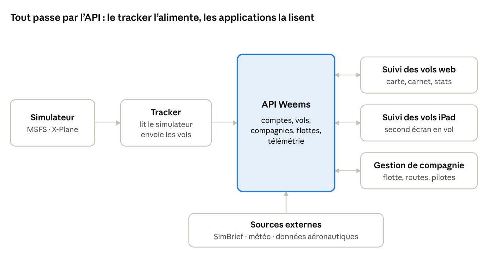

# Weems — Parc applicatif et positionnement

10 novembre 2026 · Étape 1 du cadrage · Version en ligne : https://claude.ai/artifact/3fNdnbLwquwAfWozkqpE6i

## Synthèse

Weems doit se lancer avec **un seul produit phare** : le duo tracker de vol + suivi des vols (le « carnet de vol connecté »), gratuit pour attirer, avec un abonnement pour les fonctions avancées. La gestion de compagnie virtuelle arrive en lot 2, sur la même API.

- **5 briques, pas 4.** Le tracker desktop qui lit le simulateur est la source de toutes les données. Sans lui, aucune autre application n'a rien à afficher.
- **La carto et le suivi iPad forment un seul produit** avec deux interfaces (web et iPad), servies par la même API.
- **Le marché est occupé** (Volanta, vAMSYS, smartCARS, phpVMS, SimBrief, Navigraph). La différenciation proposée : un écosystème unique où le pilote, sa compagnie virtuelle et ses vols partagent les mêmes données, avec un niveau de réalisme opérationnel supérieur.
- **Hypothèse de travail : MSFS 2020/2024 et X-Plane 12** dès la conception, mais MSFS seul au premier lot.

## Le parc

Cinq briques, dont une seule invisible pour l'utilisateur : l'API. Tout le reste est un client de l'API.

| Brique | Rôle | Utilisateur | Plateforme | Gratuit | Payant |
| --- | --- | --- | --- | --- | --- |
| **API Weems** | Source unique de vérité : comptes, vols, compagnies, flottes, télémétrie | Les autres briques (puis des partenaires) | Cloud | — | Accès partenaires, plus tard |
| **Tracker** | Lit le simulateur, enregistre le vol, envoie la position en direct et le rapport de fin de vol | Pilote | Desktop Windows (MSFS), puis Windows/macOS/Linux (X-Plane) | Enregistrement et historique de base | Analyse détaillée (atterrissage, carburant, respect des procédures) |
| **Suivi des vols (web)** | Carte en direct, carnet de vol, statistiques, profil public | Pilote, communauté | Web | Carte live, carnet, profil | Historique illimité, rejeu des vols, statistiques avancées |
| **Suivi des vols (iPad)** | EFB de simulation : suivi en direct, puis cartes, checklists, performances | Pilote | iPadOS | Carte live | Mode cockpit, données avancées |
| **Gestion de compagnie virtuelle** | Créer et gérer une compagnie : flotte, routes, pilotes, grades, validation des rapports de vol | Fondateur et staff de compagnie, pilotes membres | Web | Petite compagnie (plafond de pilotes ou de vols) | Par compagnie, selon la taille |

Le tracker est le seul à écrire les données de vol. Les trois applications lisent et modifient tout via l'API, jamais directement entre elles.

Un point à trancher : le « suivi iPad » peut devenir un EFB (Electronic Flight Bag, la tablette du pilote : cartes, checklists, performances). **Décidé : l'app iPad devient un EFB de simulation**, pour amateurs et semi-pros, jamais pour la navigation réelle. Conséquences : c'est un produit à part entière, plus cher à faire, en concurrence directe avec Navigraph Charts, et les cartes réelles demandent une licence. Je le place après le lot 1 ; le suivi en direct reste sa première fonction.

## Concurrence

Chaque brique a déjà un concurrent installé, souvent gratuit. Personne ne couvre bien l'ensemble pilote + compagnie + suivi avec un vrai niveau de réalisme. C'est là que Weems peut se placer.

| Acteur | Brique concurrençant Weems | Modèle | Faiblesse exploitable |
| --- | --- | --- | --- |
| Volanta | Tracker + suivi | Gratuit, option payante | Pas de gestion de compagnie |
| FSHub | Tracker + suivi + compagnies légères | Gratuit | Gestion de compagnie limitée |
| vAMSYS | Gestion de compagnie | Payant par compagnie | Centré compagnie, peu tourné vers le pilote individuel |
| smartCARS + phpVMS | Tracker + gestion de compagnie | Logiciel libre auto-hébergé + client payant | Installation et maintenance à la charge de la compagnie |
| SimBrief (Navigraph) | Préparation de vol | Gratuit | Pas un concurrent : à intégrer, pas à refaire |
| Navigraph | Cartes et données AIRAC | Abonnement | Pas un concurrent : partenaire ou fournisseur possible |

Le tableau vient de ma connaissance du marché, pas d'une recherche faite aujourd'hui : les modèles et les prix sont à vérifier avant toute décision commerciale.

**Angles de différenciation, du plus solide au plus fragile :**

1. **Un seul compte, un seul tracker** pour voler en solo et dans une ou plusieurs compagnies. Aujourd'hui le pilote jongle entre Volanta et le client de sa compagnie.
2. **Le réalisme opérationnel comme fonction payante** : notation du vol sur des critères réels (stabilisation en approche, taux de chute, limites de vitesse sous le niveau 100, carburant), avec des procédures et des règles de compagnie configurables.
3. **Une compagnie clé en main, sans hébergement**, face à phpVMS.
4. Le marché francophone, qui est un point d'entrée mais pas une différenciation durable.

## Modèle freemium

Le gratuit doit être assez bon pour faire venir les pilotes de Volanta. L'argent vient de deux sources distinctes : le pilote qui veut plus de réalisme, et la compagnie virtuelle qui veut un outil de gestion.

| Segment | Gratuit | Abonnement | Logique |
| --- | --- | --- | --- |
| Pilote amateur | Tracker, carte en direct, carnet de vol, profil public | — | Volume, effet communauté, acquisition |
| Pilote passionné ou semi-pro | Idem | **Weems Pilot** : analyse détaillée des vols, rejeu, statistiques, app iPad complète | Payer pour le réalisme et la progression |
| Compagnie virtuelle | Petite compagnie plafonnée | **Weems VA** : tarif par compagnie selon la taille, domaine et marque personnalisés, règles avancées | Le fondateur paie, les pilotes membres restent gratuits |
| Professionnels (écoles, formateurs) | — | Offre sur devis, plus tard | Pas avant d'avoir prouvé le produit sur les passionnés |

Risque principal : la cible paie peu et a l'habitude du gratuit. Le revenu le plus sûr est probablement côté compagnies (un acheteur, beaucoup d'utilisateurs). Les prix restent à fixer après une étude des tarifs concurrents.

## Données et réalisme

Le réalisme a un coût : les données aéronautiques de qualité sont sous licence. Ce choix se fait dès le départ, parce qu'il pèse sur le prix des abonnements.

| Besoin | Source envisagée | Licence | Point d'attention |
| --- | --- | --- | --- |
| Aéroports, pistes | OurAirports | Domaine public | Qualité variable, suffisant pour démarrer |
| Espaces aériens, balises | OpenAIP | Gratuit hors usage commercial, à vérifier | Un produit payant peut exiger un accord [Confiance moyenne] |
| Procédures, cycle AIRAC, cartes | Navigraph (programme partenaire) | Payante, sur accord | Pas de cartes réelles sans licence. Ne pas les récupérer ailleurs |
| Plan de vol | SimBrief (API) | Gratuit, conditions à respecter | Intégration rapide, très attendue par les pilotes |
| Météo réelle (METAR, TAF) | aviationweather.gov (NOAA) | Domaine public américain | Limites de débit : passer par un cache côté API |
| Lecture du simulateur | SDK SimConnect (MSFS), API UDP/plugins (X-Plane) | Gratuits, sous conditions d'utilisation | Le tracker doit suivre chaque mise à jour des simulateurs |
| Réseaux en ligne | Flux de données VATSIM et IVAO | Publics, avec des règles d'usage | Afficher le trafic en ligne sur la carte |

**Réglementation :** pour le réalisme, Weems s'appuie sur des règles publiques (OACI, SERA, EASA), par exemple 250 kt sous le niveau 100 ou les critères d'approche stabilisée. Weems lui-même n'est pas soumis à la réglementation aéronautique, à condition d'afficher partout « Ne pas utiliser pour la navigation réelle ». Ce point compte pour la cible pro.

**Marques :** les compagnies virtuelles reprennent souvent des noms et logos réels (Air France, etc.). La plateforme doit prévoir des conditions d'utilisation qui laissent cette responsabilité à la compagnie virtuelle.

## Produit phare, risques et questions ouvertes

**Recommandation : lot 1 = tracker MSFS + API + suivi web.** C'est le minimum qui produit de la valeur seul, et toutes les autres briques en dépendent. La gestion de compagnie virtuelle passe en lot 2 : c'est là qu'est l'argent, mais elle a besoin de vols enregistrés pour exister.

Pourquoi ne pas commencer par la gestion de compagnie : sans tracker, une compagnie Weems dépendrait de rapports de vol saisis à la main ou d'un client concurrent. Elle n'aurait alors aucun avantage sur vAMSYS.

**Risques**

| Risque | Impact | Parade |
| --- | --- | --- |
| Dispersion sur 5 briques en parallèle | Rien ne sort, épuisement | Un lot à la fois, chaque lot utilisable seul |
| Tracker cassé par une mise à jour de MSFS | Perte de confiance immédiate | Couche d'abstraction par simulateur, tests sur chaque version |
| Revenus trop faibles face au gratuit | Projet non viable | Valider le prix compagnie auprès de 5 à 10 fondateurs de compagnies virtuelles avant le lot 2 |
| Coût des données sous licence | Marge écrasée | Lot 1 sans données payantes, Navigraph uniquement si l'abonnement le finance |
| Charge serveur du suivi en direct | Coûts d'hébergement | Fréquence d'envoi adaptative, décidée à l'étape 2 |

**Questions ouvertes pour toi**

- [ ] Confirmes-tu MSFS seul au lot 1, avec X-Plane prévu dans l'architecture ? Réponse : oui, MSFS seul au lot 1.
- [x] Le suivi iPad devient un EFB de simulation (réponse du 10/11/2026).
- [ ] Quelles compétences techniques as-tu, et vas-tu développer seul ou avec d'autres ? Ce point décide la stack à l'étape 2. Réponse : chef de projet senior, développement avec Claude et des amis développeurs. Conséquence : une stack répandue et très documentée, la plus petite possible, et un découpage en lots que plusieurs personnes peuvent prendre en parallèle.
- [ ] As-tu déjà accès à une communauté (compagnie virtuelle, Discord, chaîne) pour tester ? Réponse : oui, via ton collègue Houssine. À mobiliser pour les tests du lot 1 et pour valider le prix côté compagnies.
