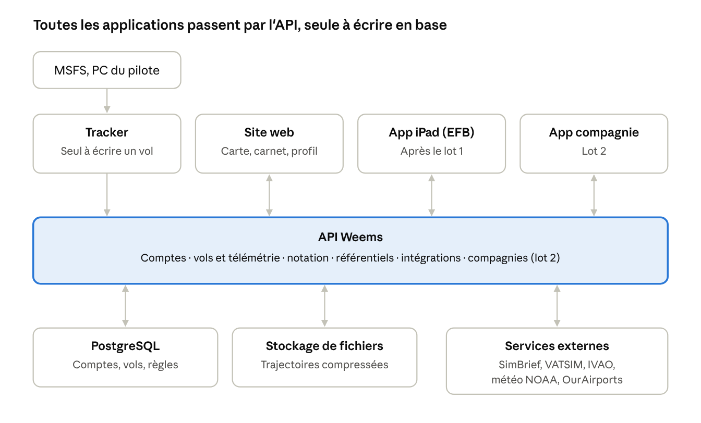
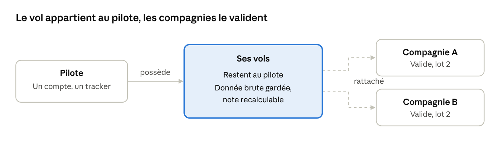
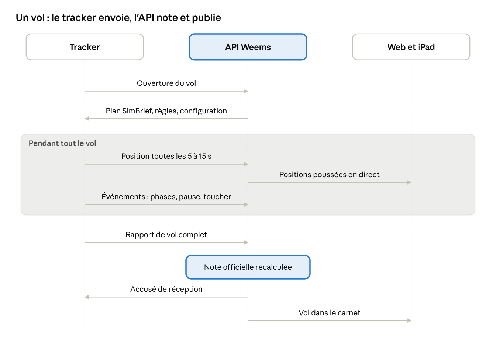

# Weems — Architecture et flux

10 novembre 2026 · Étape 2 du cadrage · Version en ligne : https://claude.ai/artifact/C2kafvm6aSud1K8YQcDrRX

## Synthèse

Une API unique au centre, en TypeScript, hébergée en Europe : c'est l'architecture la plus simple qui tienne le lot 1 et la gestion de compagnie, pour un développeur seul [Confiance élevée].

1. **L'API est la seule à écrire en base.** Tracker, web, iPad et application compagnie sont tous ses clients, jamais en contact direct entre eux.
2. **Le tracker est le seul à créer des vols.** Les autres applications les lisent, les commentent ou les valident.
3. **Le vol appartient au pilote.** Une compagnie le valide sans le posséder : c'est ce qui permet « un seul compte, un seul tracker » pour plusieurs compagnies.
4. **La donnée brute est gardée, la note est recalculée par l'API** avec le même code que le tracker. On peut renoter l'historique et la note résiste à un tracker modifié.
5. **Un monolithe modulaire, pas des microservices**, sur trois services gérés : base PostgreSQL, stockage de fichiers, conteneur pour l'API et le web. Coût de départ estimé entre 30 et 60 € par mois [Confiance faible].

## Vue d'ensemble

Le tracker est le seul à créer des vols ; les autres applications les lisent ou les annotent, toujours via l'API. Aucune application ne parle directement à une autre, ni à la base de données.

## Données : qui possède quoi

Chaque objet a un seul écrivain, et tout passe par l'API : aucune application ne lit la base d'une autre.

Un pilote qui quitte une compagnie garde tout son carnet ; seule la validation de la compagnie disparaît.

| Objet | Contenu | Écrit par | Lu par | Lot |
| --- | --- | --- | --- | --- |
| Compte | Identité, e-mail, abonnement, préférences | Web (inscription) | Toutes | 1 |
| Profil pilote | Pseudo, identifiant SimBrief, identifiant VATSIM ou IVAO, profil public oui ou non | Web | Toutes | 1 |
| Vol | Ouverture, phases, résumé, événements, motif de clôture, note | Tracker (données), API (note officielle) | Web, iPad, compagnie | 1 |
| Trajectoire | Tous les échantillons du vol, compressés | Tracker | API (calcul de la note), web (rejeu) | 1 |
| Position en direct | Dernière position de chaque vol en cours, effacée à l'arrivée | Tracker | Web, iPad (carte) | 1 |
| Jeu de règles | Règles et seuils, versionnés | Weems (règles par défaut), compagnie (lot 2) | Tracker, API | 1 |
| Catalogue avions | Type, catégorie (léger, turbopropulseur, ligne), limites de vitesse | Weems | Tracker, API | 1 |
| Aéroports et pistes | Import d'OurAirports | Import automatique | Toutes | 1 |
| Compagnie | Flotte, routes, rangs, règles propres | Application compagnie | Tracker (règles), web | 2 |
| Adhésion | Lien pilote ↔ compagnie, rang, statut | Application compagnie | Toutes | 2 |
| Validation d'un vol | Décision de la compagnie : accepté, refusé, motif | Application compagnie | Web, pilote | 2 |

**Deux principes qui structurent tout le reste** [Confiance élevée] :

- **Un vol appartient au pilote, pas à la compagnie.** Il peut être rattaché à une ou plusieurs compagnies, qui le valident chacune. Un pilote qui quitte une compagnie garde son carnet de vol. C'est la traduction technique de l'argument « un seul compte, un seul tracker ».
- **La donnée brute est gardée, la note est recalculable.** Quand une règle ou un seuil change, l'historique peut être renoté sans redemander les vols.

## Flux principaux

Cinq flux couvrent le lot 1 et la gestion de compagnie. Le tracker ne parle qu'à l'API ; le web et l'iPad ne parlent qu'à l'API.

Le schéma suit un vol de bout en bout ; le détail de chaque flux est ci-dessous.

**1. Préparation (lot 1)**

1. Le tracker demande à l'API le dernier plan SimBrief du pilote ; l'API l'interroge avec l'identifiant SimBrief du profil et le garde en cache.
2. L'API renvoie aussi le jeu de règles actif (solo, ou celui de la compagnie au lot 2) et la configuration (version minimale, fréquences).

**2. Vol en direct (lot 1)**

1. Le tracker ouvre le vol auprès de l'API avec un identifiant qu'il a lui-même créé.
2. Toutes les 5 à 15 secondes, il envoie une position ; l'API ne garde que la dernière position de chaque vol en cours.
3. Il envoie aussi les événements au fil de l'eau (changement de phase, pause, toucher).
4. Sans réseau, tout est gardé sur le PC et renvoyé plus tard ; les positions anciennes sont alors inutiles pour la carte et ne sont pas renvoyées.

**3. Carte en direct, web et iPad (lot 1)**

1. La page de la carte s'abonne au flux des positions auprès de l'API.
2. L'API pousse les nouvelles positions toutes les quelques secondes à tous les écrans abonnés.
3. Le trafic VATSIM et IVAO est récupéré par l'API, mis en cache, puis ajouté au même flux.

**4. Fin de vol (lot 1)**

1. Le tracker envoie le rapport complet : résumé, trajectoire compressée, événements, détail de l'atterrissage, note provisoire.
2. L'API range la trajectoire dans le stockage de fichiers, recalcule la note officielle avec le même code de notation, puis accuse réception.
3. Le vol apparaît dans le carnet du pilote et, s'il est public, sur son profil.

**5. Validation par une compagnie (lot 2)**

1. Le pilote rattache le vol à sa compagnie (ou c'est automatique si le vol suit une route de la compagnie).
2. L'API applique les règles de la compagnie au vol et propose une décision.
3. Le staff de la compagnie accepte ou refuse dans l'application compagnie ; le pilote est notifié.
4. La compagnie met à jour heures, rang et statistiques du pilote.

## API

Une seule API, en TypeScript, découpée en modules internes, pas en microservices : c'est la bonne taille pour un développeur seul [Confiance élevée].

| Sujet | Choix recommandé | Pourquoi |
| --- | --- | --- |
| Style | REST en JSON, versionné (`/v1`) | Le plus simple à tester, à documenter et à ouvrir plus tard à des partenaires |
| Formats | Décrits une seule fois dans `packages/contrats`, partagés par le tracker, l'API et le web | Impossible que deux applications divergent |
| Documentation | Générée automatiquement depuis ces formats (OpenAPI) | Toujours à jour, utile pour l'iPad et les partenaires |
| Connexion | OAuth 2 avec PKCE via le navigateur, pour le tracker et l'iPad ; session classique pour le web | Le tracker ne voit jamais le mot de passe |
| Temps réel vers les écrans | Flux poussé par le serveur (Server-Sent Events) | Plus simple que les WebSockets pour un flux à sens unique (serveur vers écran) [Confiance moyenne] |
| Temps réel depuis le tracker | Requêtes simples toutes les 5 à 15 s | Robuste derrière les box et les pare-feu, reprend tout seul après une coupure |
| Doublons | Identifiant de vol créé par le tracker ; un message renvoyé n'est jamais compté deux fois | Rend le mode hors ligne sûr |
| Versions | Le tracker annonce sa version ; l'API peut exiger une mise à jour | Indispensable quand une mise à jour de MSFS casse la lecture |
| Partenaires | Plus tard : clés d'API par partenaire, avec un quota | Pas au lot 1 |

**Modules internes de l'API** : comptes, vols et télémétrie, notation (le paquet partagé), référentiels (aéroports, avions), intégrations externes (SimBrief, VATSIM, IVAO, météo), puis compagnies au lot 2. Un module pourra devenir un service séparé le jour où sa charge le justifie, pas avant.

## Hébergement, stockage et coûts

Au démarrage, trois services gérés suffisent, hébergés en Europe pour le RGPD. Aucun serveur à administrer soi-même.

| Besoin | Choix | Ordre de grandeur |
| --- | --- | --- |
| Base de données | PostgreSQL géré : comptes, vols, résumés, règles, référentiels | 15 à 30 €/mois [Confiance faible] |
| Fichiers | Stockage objet compatible S3 pour les trajectoires compressées | Moins de 5 €/mois au lot 1 [Confiance faible] |
| Application | API et site web dans un conteneur, chez un hébergeur européen (Scaleway, OVHcloud, ou la région Europe d'un hébergeur géré) | 10 à 30 €/mois [Confiance faible] |
| Positions en direct | En mémoire dans l'API au lot 1 ; un cache dédié (Redis) seulement quand il faudra plusieurs instances | 0 € au lot 1 |

**Volume des trajectoires** [Confiance faible] : un vol de 2 heures à 1 mesure par seconde fait environ 7 200 échantillons, de l'ordre de 0,3 Mo une fois compressé. Mille vols par mois représentent donc environ 0,3 Go : négligeable.

**Charge en direct** : 1 000 pilotes en vol en même temps, c'est environ 100 requêtes par seconde. Une seule instance de l'API tient cette charge ; le point à surveiller est le nombre d'écrans abonnés à la carte, pas le tracker.

Les montants sont des estimations à confirmer avec les grilles tarifaires au moment du choix de l'hébergeur.

## Sécurité, RGPD et anti-triche

**Sécurité**

- HTTPS partout, jetons de courte durée, aucun mot de passe stocké dans le tracker ni dans l'app iPad.
- Droits vérifiés par l'API sur chaque requête : un pilote ne voit que ses vols privés, un staff de compagnie que les vols rattachés à sa compagnie.
- Paiements délégués à un prestataire (Stripe ou équivalent) : Weems ne voit jamais un numéro de carte.

**RGPD**

- Données hébergées dans l'Union européenne.
- Profil public sur option, désactivé par défaut.
- Export de toutes ses données et suppression du compte par le pilote lui-même.
- Position en direct effacée à la fin du vol ; seule la trajectoire du vol terminé est gardée.
- Les fichiers de vol partagés par la communauté pour les tests (A32NX) restent internes, avec l'accord de chaque pilote.

**Anti-triche**

- La note officielle est calculée par l'API à partir de la trajectoire, pas recopiée depuis le tracker.
- Contrôles de cohérence côté API : vitesses et distances physiquement possibles, durée de vol compatible avec la route, carburant compatible avec la distance.
- Limite assumée [Confiance élevée] : un tricheur déterminé peut fabriquer de fausses données. L'objectif est de rendre la triche coûteuse et visible, pas impossible. C'est surtout un enjeu pour les compagnies et les classements.

## Décisions à prendre

Sept choix restent ouverts. Aucun ne bloque le lot T0 du tracker ; les quatre premiers doivent être pris avant le T2 (API minimale).

| Décision | Options | Recommandation | Quand |
| --- | --- | --- | --- |
| Hébergeur | Scaleway, OVHcloud, région Europe d'un hébergeur géré (Render, Fly.io) | Scaleway : français, base PostgreSQL et stockage S3 gérés au même endroit [Confiance moyenne] | Avant T2 |
| Framework de l'API | Fastify, NestJS, Hono | Fastify : simple, rapide, bien documenté, sans structure imposée [Confiance moyenne] | Avant T2 |
| Connexion des comptes | Service payant (Auth0, Clerk) ou bibliothèque libre dans l'API | Décidé le 10/11/2026 : bibliothèque libre dans l'API (pas de coût par utilisateur, données chez nous) | Avant T2 |
| Framework du site web | Next.js, SvelteKit, React avec Vite | Décidé le 10/11/2026 : Next.js (le plus répandu, pages de profil publiques bien référencées, React partagé avec l'iPad) | Avant T2 |
| Carte | Leaflet ou MapLibre (libres), Mapbox (payant à l'usage) | Décidé le 10/11/2026 : Leaflet. La carte reste isolée dans un seul composant du site pour pouvoir passer à MapLibre si le nombre d'avions affichés le rend lent | Avant T3 |
| Paiement | Stripe, Paddle, Lemon Squeezy | Stripe si Weems gère la TVA ; Paddle s'il faut un vendeur qui la gère pour toi [Confiance moyenne] | Avant l'ouverture des abonnements |
| App iPad | Native (Swift) ou React Native | React Native : reste en TypeScript, réutilise `packages/contrats` [Confiance moyenne] | Après le lot 1 |

Une fiche de décision sera rédigée dans `docs/decisions/` pour chacune au moment où elle est prise.
