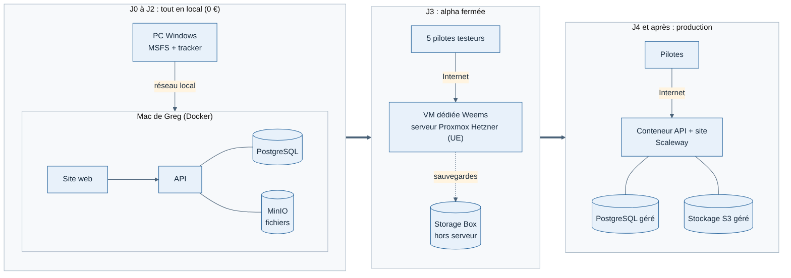

# Weems — Fondamentaux avant le découpage en lots

Réponses de Greg du 11/11/2026, avec les conséquences pour la feuille de route.

## 1. Moyens

| Point | Réponse | Conséquence |
| --- | --- | --- |
| Temps | Greg y consacre tout son temps, sans contrainte de date | Feuille de route en étapes et critères de sortie, sans calendrier |
| Équipe | Greg seul sur le code ; Houssine et Thibault en appui ponctuel | Un lot à la fois, pas de travail en parallèle |
| Environnements | Tout le développement et les tests sur le Mac de Greg, avec Docker (API, PostgreSQL, stockage S3 simulé). Le PC Windows avec MSFS envoie ses vols à l'API du Mac par le réseau local. Le choix d'un serveur en ligne est repoussé à l'arrivée des pilotes testeurs. Option privilégiée pour l'alpha : une machine virtuelle dédiée à Weems sur le serveur Proxmox de Greg chez Hetzner (déjà en service, serveur dédié en Allemagne ou en Finlande, donc dans l'UE, à confirmer), à condition que les sauvegardes partent hors du serveur, par exemple sur une Storage Box Hetzner | Aucun coût d'hébergement avant l'alpha |
| Budget mensuel | Pas de plafond fixé ; hypothèse de travail : moins de 100 €/mois jusqu'aux premiers revenus | Hébergement estimé à 30-60 €/mois (étape 2) ; tout service payant au-delà est signalé avant d'être retenu |
| PC Windows avec MSFS | Disponible sous quelques jours (annoncé le 11/11/2026) | Débloque le lot T1 (prototype de connexion au simulateur) et l'enregistrement de vrais vols |

## 2. Objectif du premier lancement

Contenu : une API en ligne, un tracker et une application web simple qui affiche les premières informations de vol.

**Pas de date imposée** (Greg, 11/11/2026) : le projet avance à son rythme. Janvier 2027 reste un horizon indicatif, pas une échéance. La feuille de route s'exprime donc en étapes ordonnées, chacune avec un critère de sortie vérifiable, et non en dates.

Lecture réaliste (Claude, [Confiance moyenne]) : ce premier jalon il s'agit d'une **alpha fermée** (5 pilotes testeurs, tracker installé à la main, pas encore sur le Microsoft Store). La version publique sur le Store suit après la bêta (lots T3 et T4).

## 3. Gratuit et payant

- Gratuit pour tous les pilotes : tracker et application web de suivi.
- Abonnement : fonctions avancées de l'application web de suivi (liste à définir avec le lot concerné).
- Conséquence : aucun paiement au lancement de janvier 2027. Le choix du service de paiement reste reporté jusqu'au lot qui ouvre les abonnements.

## 4. Structure juridique

- Penchant de Greg : micro-entreprise ou particulier.
- Recommandation : particulier tant que tout est gratuit ; **micro-entreprise avant tout revenu** (un abonnement est une activité commerciale habituelle, à déclarer).
- Point d'attention : le type de compte développeur Microsoft Store (individuel ou entreprise) ne se change pas après coup [Confiance moyenne]. Ouvrir le compte Store au nom de la micro-entreprise, donc la créer avant la publication sur le Store.
