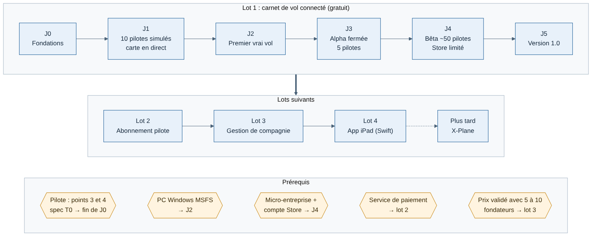

# Weems — Lots et feuille de route

Étape 3 du cadrage, rédigée le 11/11/2026. S'appuie sur le parc (01), l'architecture (02) et les fondamentaux (03).

## Synthèse

- Pas de dates : une suite d'étapes ordonnées. On ne passe à l'étape suivante que lorsque son critère de sortie est atteint.
- **Lot 1 — Carnet de vol connecté** (gratuit) : tracker MSFS + API + site web. Il avance en 6 jalons, J0 à J5, qui alignent les trois applications. Les lots internes du tracker (T0 à T4) s'y rangent, J1 étant un démonstrateur ajouté par Greg.
- Ensuite, un lot par source de valeur : abonnement pilote, gestion de compagnie virtuelle, app iPad. X-Plane vient plus tard.
- Tout se développe et se teste sur le Mac de Greg jusqu'à l'arrivée des pilotes testeurs (J3).

## Vue d'ensemble

| Lot | Contenu | Pour qui | Revenu |
| --- | --- | --- | --- |
| **1 — Carnet de vol connecté** | Tracker MSFS, API, site web de suivi (carnet, page de vol, carte en direct) | Tous les pilotes | Gratuit |
| **2 — Abonnement pilote** | Fonctions avancées du site de suivi, paiement, micro-entreprise | Pilotes exigeants | Abonnement pilote |
| **3 — Gestion de compagnie (VACommunity)** | Compagnies, flottes, routes, validation des vols, classements | Fondateurs de compagnies virtuelles | Abonnement compagnie |
| **4 — App iPad (EFB)** | Cartes, check-lists, performances, suivi en direct (Swift) | Pilotes sur iPad | À définir |
| **Plus tard** | Connecteur X-Plane | Pilotes X-Plane | — |

Ordre des lots 2 et 3 décidé le 11/11/2026 : abonnement pilote d'abord (voir plus bas).

## Lot 1 en 6 jalons

Chaque jalon est utilisable et vérifiable seul. Les colonnes Tracker, API et Web disent ce que chaque application doit apporter au jalon.

| Jalon | Tracker | API | Web | Où ça tourne | Critère de sortie |
| --- | --- | --- | --- | --- | --- |
| **J0 — Fondations** | T0 : modèle de télémétrie, 12 phases, enregistreur, vols synthétiques, règles v0 | Squelette Fastify, base PostgreSQL, réception d'un vol, contrat OpenAPI | — | Mac (Docker) | Les 20 scénarios synthétiques passent ; un vol synthétique envoyé est stocké par l'API |
| **J1 — 10 pilotes simulés** (ajouté par Greg le 11/11/2026) | Connecteur de rejeu : le cœur du tracker lit des vols enregistrés ou synthétiques au lieu de MSFS ; 10 instances en parallèle | Réception des positions en direct, diffusion aux navigateurs (SSE) | Carte en direct (MapLibre) : les 10 avions bougent, clic sur un avion pour voir sa phase | Mac (Docker), sans PC Windows | 10 vols simulés suivis de bout en bout sur la carte, phases affichées correctes, aucun avion perdu ou figé |
| **J2 — Premier vrai vol** | T1 : connecteur MSFS, 10 vols de référence, mesure de l'impact sur les images par seconde | Réception des vols réels | Carnet de vol et page de vol avec trace sur carte, sans compte | Mac + PC Windows en réseau local | Les 10 vols de référence s'affichent sur le site avec leurs phases correctes |
| **J3 — Alpha fermée** | T2 : connexion au compte, envoi, file d'attente hors ligne, rapport de vol | Comptes (OAuth avec PKCE), vols, recalcul de la note | Connexion, carnet personnel, page de vol | Machine virtuelle sur le serveur Hetzner de Greg | 5 pilotes, 50 vols, zéro vol perdu, phases correctes sur au moins 95 % des vols vérifiés |
| **J4 — Bêta** | T3 : capacités différenciantes, débriefing, Store en diffusion limitée | Environnement de test séparé, montée en charge du direct | Débriefing, profil public | Production publique (Scaleway) | Environ 50 pilotes, 500 vols, moins de 1 % de vols en erreur, seuils de notation calés |
| **J5 — Version 1.0** | T4 : Store public, français et anglais | Supervision, procédure de correctif d'urgence | Pages publiques référencées, CGU, confidentialité | Production publique | Exigences du lot 1 validées ; correctif d'urgence testé de bout en bout |

Le « premier jalon » voulu par Greg (une API, un tracker et un site simple qui affiche les premières infos) correspond à **J2**, sur le Mac. Le jalon J1 en est une répétition entièrement simulée : il valide toute la chaîne, carte en direct comprise, avant d'avoir le PC Windows.

**Pourquoi J1 vaut le coup** [Confiance moyenne] : le connecteur de rejeu sert ensuite à tous les tests automatiques du tracker, et la carte en direct est éprouvée avec plusieurs avions bien avant la bêta. Risque : passer trop de temps sur la carte au détriment des vrais vols. Parade : carte minimale, sans habillage, jusqu'à J4.

### Ce qu'il faut avoir défini avant chaque jalon

| Avant | À définir | Besoin d'un pilote |
| --- | --- | --- |
| Fin de J0 | Format de vol enregistré et 20 scénarios de test (point 3 de la spec T0) ; critères de notation et sources officielles (point 4) | Oui |
| J1 | Rédigé le 11/11/2026 : [spécification J1](../cahiers-des-charges/spec-J1-pilotes-simules.md) | Non |
| J2 | Rédigés le 11/11/2026 : [spécification J2](../cahiers-des-charges/spec-J2-premier-vrai-vol.md) et [site minimal](../cahiers-des-charges/web/spec-J2-site-minimal.md) | Non |
| J3 | Organisation du code de l'API (Fastify, réponse de Thibault) ; liste des 5 pilotes testeurs (Houssine) | Non |
| J4 | Contenu du débriefing ; CGU et confidentialité ; vérification de la marque « Weems » ; micro-entreprise créée et compte Store ouvert à son nom. Rédigées le 11/11/2026 : [spécification du profil public](../cahiers-des-charges/spec-J4-profil-public.md) ; [montée en charge du direct](../cahiers-des-charges/api/spec-J4-montee-en-charge-direct.md), mesurée le 11/11/2026 ([compte rendu](../revues/mesure-direct-J4.md)) | Débriefing : oui |
| J5 | Procédure de support et de correctif d'urgence | Non |

## État au 13/11/2026

Tout tourne en local sur le Mac (décision de Greg du 11/11/2026 : mise en ligne reportée). Détail des PR : [rapport de mise à jour de la documentation](../revues/maj-documentation-2026-11-13.md).

| Jalon | Fait | Reste |
| --- | --- | --- |
| J0 | Fusionné | 20 scénarios de test et critères de notation, avec un pilote |
| J1 | Fusionné | — |
| J2 | Fusionné | 10 vols de référence sur le PC Windows |
| J3 | Fonctions fusionnées (comptes, connexion du site et du tracker, installateur, guides de l'alpha, rapport `pnpm alpha-report`) | Mise en ligne, puis 5 pilotes et 50 vols |
| J4 | Montée en charge du direct mesurée ; profil public ; catégories d'avion ; carte en direct enrichie (trajets, bulle, vol suivi, recherche, nuit, filtres, événements) ; accueil public ; console (Supervision, Services, Trafic, Activité, Comptes, Personnalisation, Librairies, Base de données) ; carnet privé (Résumé, Vols avec bandes de vol, Statistiques) | Objectifs du carnet, débriefing (avec un pilote), environnement de test séparé, Store limité, CGU et confidentialité, marque, micro-entreprise |
| J5 | — | Tout |

**Travail du lot 2 avancé dans le lot 1** (choix de Greg du 12/11/2026) : le catalogue des formules (Pilot Free, Pilot Pro, Company, Holding) est dans l'API, les pages Offres, Fonctionnalités et Découvrir sont en ligne sur le site local, et le carnet verrouille déjà les cartes Pilot Pro d'après ce catalogue. Restent pour le lot 2 : le paiement, la table des abonnements, les vraies formules par compte (aujourd'hui Pilot Free pour tous, et un bouton de test Free | Pro hors production).

## Lots suivants

| Lot | Prérequis | Critère d'entrée | À définir au démarrage |
| --- | --- | --- | --- |
| **2 — Abonnement pilote** | Version 1.0 en ligne, micro-entreprise | Assez de pilotes actifs pour mesurer la conversion | Prix définitifs, service de paiement (penchant Paddle). Liste des fonctions : première version dans le catalogue des formules ([cadrage 05](05-formules-abonnement.md), fiche 015) |
| **3 — Gestion de compagnie** | Lot 1 ; paiement en place | Prix validé auprès de 5 à 10 fondateurs de compagnies | Cahier des charges VACommunity, tarif par taille de compagnie |
| **4 — App iPad** | Lot 1 ; développeur Swift ou relecture assurée | — | Cahier des charges EFB, sources de cartes (licences) |

## Décision prise

**Ordre des lots 2 et 3** (décidé par Greg le 11/11/2026) : abonnement pilote d'abord. Il est plus petit, il apporte un premier revenu plus tôt, et il met en place le paiement et la micro-entreprise dont la gestion de compagnie aura aussi besoin. La validation du prix auprès de 5 à 10 fondateurs de compagnies se fait pendant le lot 2.

## Risques de la feuille de route

| Risque | Parade |
| --- | --- |
| Pas d'échéance : le projet peaufine sans jamais arriver en vol réel | Critère de sortie par jalon, vérifié avant de passer au suivant |
| Points 3 et 4 de la spec T0 bloqués faute de pilote | Les traiter dès qu'un collègue pilote est disponible ; J0 ne se clôt pas sans eux |
| Greg seul sur le code | Un jalon à la fois, garde-fous qualité (tests, revue de code par Claude) |
| Mise à jour de MSFS qui casse le tracker | Rejouer les 10 vols de référence à chaque version de MSFS |
