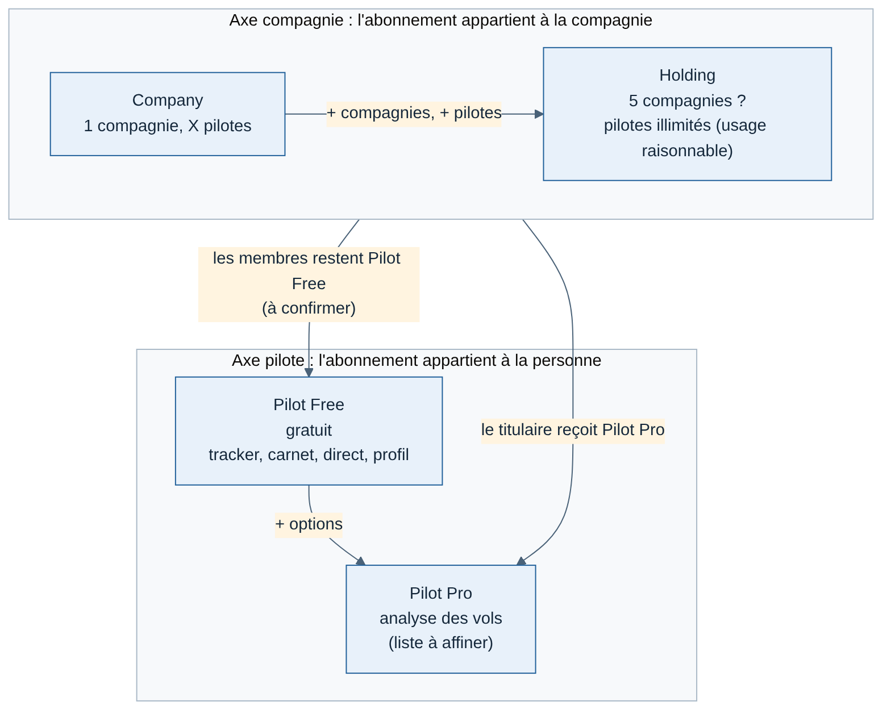
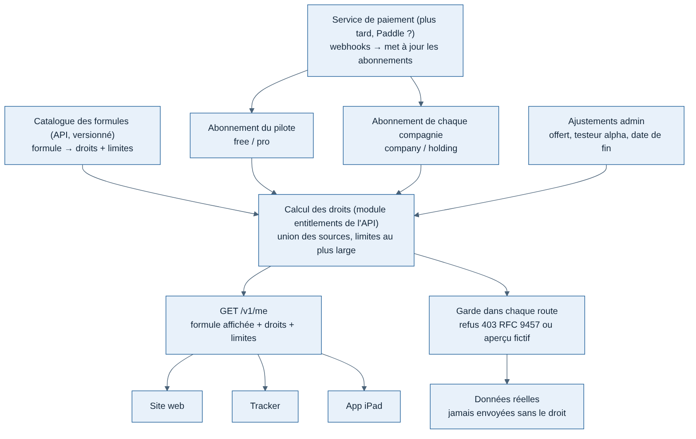

# Étape 5 — Formules d'abonnement et droits dans l'API

Date : 12/11/2026. Base donnée par Greg le 12/11/2026, « à redéfinir au fur et à mesure ». Document de cadrage.

**État au 13/11/2026** : la page Offres, le catalogue et une première vérification des droits sont codés (section 5 bis). Ce qui existe : `GET /v1/plans` (catalogue public) et `GET /v1/me/plan` (formule du pilote, `{ plan, testSwitch }`) ; le site et l'API en déduisent les fonctions incluses à partir du catalogue. La réponse `GET /v1/me` décrite en section 3.2 (droits et limites calculés) n'existe pas encore : elle viendra avec les abonnements (lot 2) et les compagnies (lot 3). Les questions de la section 6 restent ouvertes.

## En bref

- Quatre formules : **Pilot Free**, **Pilot Pro**, **Company**, **Holding**. Le contenu exact et les prix restent ouverts.
- Elles couvrent **deux axes différents** : l'abonnement d'une personne (Free, Pro) et l'abonnement d'une compagnie (Company, Holding). L'API doit les stocker séparément. C'est la principale correction apportée à la base.
- **L'API décide de tout.** Elle traduit les formules en une liste de droits (`features`) et de limites (`limits`), les expose dans `GET /v1/me`, et refuse ou remplace par un aperçu fictif toute donnée non couverte. Le code teste toujours un droit, jamais le nom d'une formule.
- Toutes les données sont enregistrées pour tous dès le premier vol. Payer débloque l'analyse et l'affichage, jamais la collecte.

## 1. Les formules (base du 12/11, provisoire)

| Formule | Porteur | Contenu provisoire | Limites provisoires |
| --- | --- | --- | --- |
| **Pilot Free** | Pilote | Tracker, carnet de vol (données), direct, profil public | Aucune limite sur les vols enregistrés |
| **Pilot Pro** | Pilote | Free + analyse : cartes payantes du carnet, notation détaillée, statistiques avancées, rejeu (liste à affiner avec le lot 2) | — |
| **Company** | Compagnie | Pilot Pro pour le titulaire + gestion d'**1 compagnie** (flotte, routes, validation des vols, classements, lot 3) | X pilotes membres |
| **Holding** | Groupe de compagnies | Company + **4 compagnies de plus** (5 au total ?) | Pilotes « illimités » |



Source : [`05-formules-emboitement.mmd`](../schemas/05-formules-emboitement.mmd).

## 2. Lecture critique de la base

### 2.1 Company n'est pas « Pilot Pro + quelque chose » `[Confiance élevée]`

- **Pourquoi** : la formulation « Company = Pilot Pro + 1 compagnie » colle l'abonnement de la compagnie à une personne. Le jour où le fondateur quitte la compagnie, la cède à son adjoint ou arrête son Pro, la compagnie perd ses droits ou ses pilotes perdent leur historique de compagnie.
- **Alternative** : l'abonnement Company appartient **à la compagnie** (une entité « organisation » dans l'API). Le titulaire reçoit Pilot Pro **en bonus** tant qu'il paie, mais c'est un avantage calculé, pas la même ligne d'abonnement.
- **Inconvénient principal de la base** : transfert de compagnie, départ du fondateur et facturation deviennent des cas particuliers codés à la main.

### 2.2 « Pilotes illimités » `[Confiance élevée]`

- **Pourquoi** : chaque pilote actif coûte (direct en temps réel, stockage des trajectoires, calcul des analyses). « Illimité » sans garde-fou est un engagement que l'hébergement à ~12 €/mois ne tient pas, et un abus suffit.
- **Alternative** : « illimité » en vitrine, **usage raisonnable** dans les conditions (par exemple 1 000 pilotes actifs par compagnie), et une limite technique dans l'API, réglable sans déploiement.
- **Inconvénient principal de la base** : pas de levier si une grosse compagnie arrive avec 3 000 pilotes.

### 2.3 Compter les pilotes : actifs, pas inscrits `[Confiance moyenne]`

Les compagnies virtuelles gardent beaucoup de membres inactifs. Plafonner sur les inscrits pousse les fondateurs à faire le ménage contre leur gré. Recommandation : plafonner sur les **pilotes actifs** (au moins un vol validé sur 30 jours glissants), avec un nombre d'inscrits large. Plus juste, mais un peu plus complexe à expliquer et à calculer.

### 2.4 Holding : un palier ou une quantité ? `[Confiance moyenne]`

Un groupe de compagnies virtuelles (plusieurs marques sous un même fondateur) existe bien dans ce milieu, mais c'est rare. Le modèle de droits doit traiter Holding comme **des limites plus hautes** (`companies.max = 5`, `pilots.maxPerCompany = 1000`), pas comme un cas à part dans le code. Plus tard, on pourra vendre « compagnie supplémentaire » à l'unité sans nouvelle formule.

### 2.5 Pas de compagnie gratuite : point à trancher `[Confiance moyenne]`

Le document 01 prévoyait une « petite compagnie plafonnée » gratuite pour attirer les fondateurs. La base du 12/11 n'en a plus. Les concurrents gratuits (FSHub) occupent ce créneau. Deux options : une mini-compagnie gratuite (par exemple 5 pilotes, sans validation automatique), ou un essai de Company limité dans le temps. Ma recommandation : **essai de 30 jours**, parce qu'une compagnie gratuite permanente coûte en support sans convertir. **12/11 : Greg a retiré l'essai de 30 jours de la page Offres** ; la question d'une compagnie gratuite reste ouverte.

### 2.6 Rôle et droit sont deux choses

Ce que **l'abonnement débloque** (droits) et ce qu'**une personne peut faire dans une compagnie** (rôle : titulaire, encadrement, pilote) sont deux notions distinctes. L'API a déjà un champ `role` sur `users` (pilote, admin du site) : il ne doit pas servir aux formules ni aux rôles de compagnie.

## 3. Modèle de droits côté API



Source : [`05-formules-calcul-des-droits.mmd`](../schemas/05-formules-calcul-des-droits.mmd).

### 3.1 Principes

1. **Catalogue des formules dans l'API**, versionné : chaque formule = une liste de droits + des limites. Changer le contenu d'une formule = changer le catalogue, pas le code des routes.
2. **Le code teste un droit**, jamais un nom de formule : `can(user, "logbook.analysis")`, jamais `plan === "pro"`. Règle à ajouter dans `apps/api/CLAUDE.md` et vérifiable en revue.
3. **Sources de droits** : abonnement du pilote, abonnements des compagnies dont il est titulaire, ajustements faits par l'admin (offert, testeur alpha, date de fin). Les droits sont **l'union** des sources ; pour une limite, la valeur la plus haute gagne.
4. **Exposition** : `GET /v1/me` renvoie la formule affichée (pour l'interface), les droits et les limites. Le site, le tracker et l'app iPad n'en déduisent rien d'autre.
5. **Application** : chaque route protégée vérifie le droit elle-même. Sans le droit : erreur 403 au format RFC 9457 (`type` dédié « droit manquant »), ou aperçu fictif pour les cartes verrouillées du carnet. **Le vrai chiffre ne quitte jamais l'API** sans le droit.
6. **Le paiement ne décide de rien directement** : le service de paiement (Paddle, plus tard) met à jour la table des abonnements par ses notifications ; l'API recalcule les droits. On peut donc tout construire et tester sans paiement.

### 3.2 Exemple de réponse `/v1/me` (illustratif)

```json
{
  "plan": { "pilot": "pilot_pro", "source": "company_owner" },
  "features": ["logbook.data", "logbook.analysis", "flight.replay", "company.manage"],
  "limits": { "companies.max": 1, "pilots.maxPerCompany": 50 },
  "companies": [{ "id": "…", "plan": "company", "role": "owner" }]
}
```

Les noms de droits suivent un format `domaine.action`, en anglais (identifiants de code). Le type de cette réponse va dans `packages/contrats`, partagé par le site, le tracker et le futur client Swift généré depuis OpenAPI.

## 4. Règles de vie des abonnements (à valider)

| Situation | Proposition |
| --- | --- |
| Fin d'abonnement Pro | Les données restent ; les analyses repassent en aperçu verrouillé. Rien n'est supprimé. |
| Compagnie au-dessus de sa limite | Plus de nouveaux membres ; les vols des membres existants continuent d'être enregistrés. Pas de blocage brutal. |
| Fin d'abonnement Company | Compagnie gelée en lecture seule pendant 90 jours, puis archivée. Les vols restent dans le carnet de chaque pilote. |
| Changement de prix ou de contenu | Les abonnés gardent leurs conditions jusqu'à la fin de leur période (version du catalogue enregistrée sur l'abonnement). |
| Testeurs alpha et bêta | Pilot Pro offert par ajustement admin, avec date de fin. |
| Essai | Retiré de la page Offres par Greg le 12/11 ; à rediscuter avec le paiement (lot 2). |

## 5. Mise en place par étapes

1. **Maintenant (lot 1, sans paiement)** : module `entitlements` dans l'API avec Pilot Free et Pilot Pro, catalogue en code, ajustement manuel depuis la console admin. Le carnet l'utilise pour ses cartes verrouillées. Coût faible, et évite de coder `plan === "pro"` partout entre-temps.
2. **Lot 2 (abonnement pilote)** : table des abonnements, service de paiement, essai, pages tarifs et compte.
3. **Lot 3 (VACommunity)** : entité compagnie, rôles dans la compagnie, formules Company et Holding, comptage des pilotes actifs.

## 5 bis. Page Offres et catalogue (12/11/2026)

Greg a choisi la mise en page « 4 cartes » (maquettes `offres/v1` et `v2`) avec un lien vers un tableau comparatif, une bannière dessinée par formule, le prix annuel sous le prix mensuel, des boutons alignés, sans essai. Il a demandé une vraie page, prix fictifs, **entièrement alimentée par l'API** et tenue à jour à chaque nouvelle page du site. Réalisé selon la fiche [015 — Catalogue des formules](../decisions/015-catalogue-des-formules.md) : `GET /v1/plans`, pages `/plans` et `/plans/compare`. L'étape 1 de la section 5 est ainsi commencée (catalogue en code, `GET /v1/me/plan`).

Mise à jour du 13/11/2026 : le carnet privé vérifie les droits sur ses routes, par clé de fonction (jamais par nom de formule) : `flightBandsMarks` (repères des bandes de vol), `statsPeriod` (période « Tout » des statistiques), `categoryTrends`, `phaseTime`, `goodPractices`. Sans le droit, l'API renvoie `null` et le site montre une carte verrouillée avec un aperçu fictif. Pas encore de module `entitlements` séparé ni de réglage par compte dans la console : la formule vient du bouton de test (hors production) ou vaut Pilot Free. Pages liées : Fonctionnalités (`/features`, générée depuis le catalogue) et Découvrir (`/discover`).

## 6. Questions ouvertes pour Greg

1. **Deux axes** (personne / compagnie) : d'accord pour que l'abonnement Company appartienne à la compagnie, avec Pilot Pro offert au titulaire ?
2. **Membres d'une compagnie** : restent-ils Pilot Free, ou Company leur donne-t-il une partie de Pro (par exemple l'analyse de leurs vols de compagnie seulement) ? Recommandation : Free, sinon Pilot Pro perd sa raison d'être pour tous les membres d'une compagnie.
3. **Holding** : « Company + 4 compagnies » = 5 compagnies au total ?
4. **X pilotes de Company** : quelle valeur de départ ? Proposition : 50 pilotes **actifs**.
5. **Pilotes illimités** : d'accord pour un plafond d'usage raisonnable écrit dans les conditions ?
6. **Compagnie gratuite** : mini-compagnie gratuite, ou essai de 30 jours seulement ? Recommandation : essai.
7. **Encadrement de la compagnie** (adjoints, chefs pilotes) : reçoivent-ils aussi Pilot Pro, ou seulement le titulaire ?
8. **Étape 1 de la section 5** : on pose le module de droits dès maintenant pour le carnet, avec Free et Pro réglables à la main dans la console ?

Prix, rythme de facturation (mois / an) et liste précise des fonctions Pro : hors de ce document, à traiter avec le lot 2.
