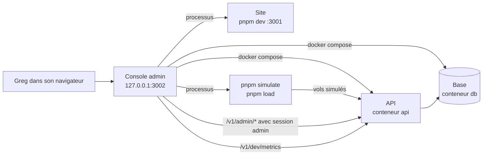

# Espace d'administration : contenu des pages

Rédigée le 11/11/2026, validée par Greg le 11/11/2026 (questions 1 à 6 tranchées ci-dessous). Maquettes : navigation G « barre latérale libellée », choisie le 11/11/2026 ; page Services v2 dans `/mnt/project-files/admin/services-v2/` (5 états, bureau et mobile, sombre et clair).

## Objectif

Donner à Greg, sur son Mac, un seul écran pour faire ce qu'il fait aujourd'hui en ligne de commande : démarrer ou arrêter les services, lancer du trafic simulé, lister les comptes et en créer.

## Ce que c'est, et ce que ce n'est pas

- Une **console locale** : nouvelle application `apps/admin`, ouverte sur http://127.0.0.1:3002, accessible seulement depuis le Mac (jamais depuis le réseau).
- Elle **n'est jamais mise en ligne**. Elle pilote Docker et lance des commandes `pnpm` : ce pouvoir n'a pas sa place dans un site public.
- Elle **n'écrit jamais dans la base** directement. Les comptes passent par de nouvelles routes de l'API, réservées au rôle Administrateur ; elles resserviront le jour où une administration en ligne sera nécessaire.

## Cadre commun à toutes les pages

| Élément | Contenu |
| --- | --- |
| Barre latérale | Logo « Weems Admin ». Groupe **Exploitation** : Services (compteur « 2 / 3 » en marche), Trafic simulé (pastille « en cours » pendant un lancement). Groupe **Utilisateurs** : Comptes (nombre de comptes). Groupe **Raccourcis** : Site (:3001), Carte en direct, Documentation de l'API (:3000/docs), chacun ouvert dans un nouvel onglet. |
| Bloc « État local » | En bas de la barre : Base, API, Site, chacun avec une pastille (en marche, arrêté, en erreur) et son port. Rafraîchi toutes les 5 secondes. |
| Barre du haut | Fil d'Ariane (Admin / page), badge « localhost · Mac », bouton thème clair/sombre, administrateur connecté (s'il l'est). |
| Mobile (moins de 768 px) | La barre latérale devient des onglets en bas : Services, Trafic, Comptes, Site. L'état local devient trois pastilles dans la barre du haut. |
| Thème | Clair ou sombre, mêmes couleurs que le site. |
| Langue | Français seulement (voir question 2). |

**Accès** : pas de connexion pour Services et Trafic, puisque la console n'écoute que sur le Mac (mêmes droits que le Terminal) et doit fonctionner **API arrêtée** (c'est là qu'on en a besoin pour la démarrer). La page Comptes demande la connexion d'un compte Administrateur, car elle passe par l'API (voir question 1).

## Page Services

**But** : voir d'un coup d'œil ce qui tourne, et le démarrer ou l'arrêter sans Terminal.

**En-tête** : titre, phrase d'état (« Docker Desktop · projet weems · 2 sur 3 en marche »), boutons **Tout démarrer** (base, puis API, puis site, chacun après que le précédent répond) et **Tout arrêter** (dans l'ordre inverse).

**Une carte par service**

| | Base de données | API | Site web |
| --- | --- | --- | --- |
| Lancement | Conteneur `db` (Docker) | Processus `pnpm --filter @weems/api dev`, lancé par la console (mode **Développement**, par défaut) ; ou conteneur `api` (mode **Docker**) | Processus `pnpm --filter @weems/web dev`, lancé par la console |
| Port | 5432 | 3000 | 3001 |
| Santé affichée | Contrôle Docker (`pg_isready`) | `GET /v1/health` : code et temps de réponse | La page d'accueil répond |
| Informations | État, depuis quand, image | État, mode, processus, depuis quand | État, depuis quand |
| Actions | Démarrer, Arrêter, Redémarrer, Journaux | Démarrer, Arrêter, Redémarrer, Journaux ; choix du mode Développement / Docker | Démarrer, Arrêter, Redémarrer, Journaux |

- **États possibles** : En marche, Arrêté, Démarre…, En erreur (le conteneur s'arrête tout seul, ou la santé échoue 3 fois de suite), **Lancé hors console** (le port est pris par un programme que la console n'a pas lancé, par exemple `pnpm dev` dans un Terminal : la console l'affiche mais ne l'arrête pas).
- **Mode de l'API** (décidé par Greg le 11/11/2026) : en **Développement**, l'API tourne en `pnpm dev` et se relance seule à chaque modification du code. Le mode **Docker** sert à vérifier l'API telle qu'elle tournera en ligne ; passer en Docker reconstruit l'image avec le code du moment. Changer de mode arrête l'API puis la redémarre dans l'autre mode.
- **Lancé hors console** : la console n'a ni ses journaux ni le droit de l'arrêter ; un message dit d'arrêter le programme dans le Terminal qui l'a lancé.
- **En erreur** : la carte montre la cause en clair, la dernière ligne d'erreur et un bouton **Réessayer**.
- Un service qui dépend d'un autre arrêté ne peut pas démarrer, et la carte dit pourquoi (« Démarrage impossible : la base est arrêtée »).
- **Confirmation** demandée seulement pour arrêter la base quand l'API tourne (« l'API ne répondra plus »). Aucune action ne supprime de données : jamais de `docker compose down -v`.

**Journaux** (sous les cartes) : un onglet par service, les 200 dernières lignes, suivi en direct activable, bouton Copier. Les lignes d'avertissement et d'erreur sont colorées.

**Cas particuliers**
- Docker Desktop n'est pas lancé : bandeau en haut de page, bouton **Ouvrir Docker Desktop**, cartes Base et API grisées.
- Une action échoue : message sous la carte avec la fin de la sortie de la commande.

## Page Trafic simulé

**But** : remplir la carte en direct et mesurer la tenue de l'API, sans Terminal. **Un seul lancement à la fois.** Les boutons Lancer sont désactivés, avec la raison affichée, si l'API ne répond pas.

**Deux modes, côte à côte**

| | Pilotes simulés | Test de charge |
| --- | --- | --- |
| Commande | `pnpm simulate` | `pnpm load` (disponible après la fusion de la PR #34) |
| Réglages | Pilotes : 1 à 10 (les 10 trajets de la flotte J1, en Europe), défaut 10. Vitesse : ×1, ×10, ×50, ×100, défaut ×10. Décalage entre deux départs : en secondes, défaut 30 | Pilotes : défaut 50. Spectateurs : défaut 100. Durée : en minutes, défaut 30. Vitesse : défaut ×1 |
| Avertissement | Les vols sont enregistrés au nom du pilote de développement (`pilote@weems.local`) | Le test commence par **vider les vols du pilote de développement** (rappelé à côté du bouton) |

**Pendant un lancement** (bloc en haut de page)
- État « En cours », réglages, heure de départ, temps écoulé, bouton **Arrêter** (sans confirmation).
- Barre d'avancement : vols terminés sur le total.
- Quatre mesures lues sur `/v1/dev/metrics` toutes les 2 secondes, avec une courbe des 5 dernières minutes : vols en direct, spectateurs connectés, délai de la boucle d'événements (p99), mémoire de l'API.
- Tableau des pilotes (cartes sur mobile) : indicatif, trajet, phase actuelle, avancement, positions envoyées, positions en attente d'envoi.
- Bouton **Ouvrir la carte en direct**.

**À la fin** : résumé « Réussi » ou « Échec » (pilotes simulés : tous les vols clos et plus rien en attente ; test de charge : chaque critère de la spec J4 avec sa valeur et son seuil).

**Derniers lancements** : les 20 derniers, du plus récent au plus ancien : date, mode, réglages, durée, résultat. Un clic ouvre le résumé. Gardés dans un fichier local de la console, ignoré par git.

**Supprimer les vols simulés** : bouton en bas de page, avec confirmation, qui vide les vols du pilote de développement (route existante, absente en production).

## Page Comptes

**But** : savoir qui a un compte et inviter un nouveau pilote.

**En-tête** : titre, phrase « 4 comptes · 1 administrateur · 1 invitation en attente », bouton **Créer un compte**.

**Filtres** : Tous, Pilotes, Administrateurs, Invitations en attente ; recherche sur le nom et l'e-mail. 50 lignes par page, les plus récentes d'abord.

**Colonnes** (cartes sur mobile : nom, e-mail, rôle ou état, nombre de vols)

| Colonne | Contenu |
| --- | --- |
| Compte | Nom et e-mail. Le pilote de développement porte un badge « Développement ». |
| Rôle | Pilote ou Administrateur |
| État | Actif, Invitation en attente (avec « expire dans N j »), ou Invitation expirée. Une invitation n'a pas encore de compte : nom vide |
| Vols | Nombre de vols du compte |
| Créé le | Date de création du compte ou de l'invitation |
| Dernière connexion | Date de la dernière session ouverte, sur le site ou le tracker |

**Actions par ligne**
- Invitation en attente : **Copier le lien**, **Renouveler** (nouveau code, valable 14 jours de plus ; l'ancien lien ne marche plus), **Annuler l'invitation** (avec confirmation).
- Invitation expirée : affichée « Expirée », avec **Renouveler** et **Annuler**.
- Compte : **Changer le rôle** (Pilote ↔ Administrateur). Impossible de retirer son propre rôle d'administrateur, ni le dernier administrateur.

**Connexion** : si personne n'est connecté, la page affiche à la place un formulaire e-mail et mot de passe. Un compte sans le rôle Administrateur est refusé. Le premier administrateur est nommé par une commande : `pnpm make-admin <e-mail>` (même principe que `pnpm invite`).

## Panneau « Créer un compte »

S'ouvre à droite (en bas sur mobile).

| Champ | Règle |
| --- | --- |
| E-mail | Obligatoire, adresse valide. Refusé si un compte existe déjà. Si une invitation est déjà en attente pour cette adresse, le panneau propose de copier son lien au lieu d'en créer une autre. |
| Rôle | Pilote (par défaut) ou Administrateur. Le rôle est appliqué à la création du compte. |
| Langue du lien | Français (par défaut) ou anglais : page d'inscription ouverte par le lien. |

**Résultat** : le code, sa date d'expiration (14 jours) et le lien d'inscription (`http://localhost:3001/fr/signup?code=…`), avec un bouton **Copier**. Aucun e-mail n'est envoyé : Greg transmet le lien lui-même, comme avec `pnpm invite`. Boutons **En créer un autre** et **Terminé**.

## Corrections par rapport à la première maquette

- Il n'existe pas encore de « comptes simulés » : tous les vols simulés appartiennent au pilote de développement. Le filtre « Simulés » disparaît de cette version ; il reviendra avec les comptes simulés (voir hors périmètre).
- Les invitations expirent désormais au bout de 14 jours (question 6).

## Expiration des invitations (nouveau)

Aujourd'hui un code d'invitation reste valable sans limite. Or l'inscription ne vérifie pas l'adresse e-mail : quiconque a le lien peut créer le compte. Un lien oublié dans une messagerie reste donc une porte ouverte.

- Chaque invitation est valable **14 jours** ; passé ce délai, l'inscription est refusée avec le message « Cette invitation a expiré, demandez-en une nouvelle ».
- `pnpm invite` et la console affichent la date d'expiration.
- Les invitations déjà en attente au moment de la mise à jour reçoivent 14 jours à partir de cette date (aucune n'est cassée).
- Renouveler une invitation crée un nouveau code et invalide l'ancien.

## Hors périmètre de cette première version

Comptes simulés (un compte par pilote simulé, prévu plus tard), remise à zéro de la base, migrations, tracker de bureau, envoi d'e-mails, création directe avec mot de passe, suppression ou désactivation d'un compte, réinitialisation de mot de passe, liste des vols de tous les pilotes, modération des compagnies (lot 3), mise en ligne.

## Décisions sur les questions ouvertes

1. **Connexion** : console sans connexion (elle n'écoute que sur le Mac), connexion administrateur seulement pour la page Comptes. Validé par Greg le 11/11/2026.
2. **Langue** : français seulement, par exception à la règle « français et anglais » qui vise les pilotes.
3. **API** : lancée en `pnpm dev` par défaut, mode Docker au choix ; pas de bouton Reconstruire. Pas de carte pour la base de test `weems_test` (même conteneur que la base). Journaux : 200 lignes, sans recherche. Validé par Greg le 11/11/2026.
4. **Supprimer les vols simulés** depuis la page Trafic : oui.
5. **Rôles** : Pilote et Administrateur seulement.
6. **Invitations** : valables 14 jours, renouvelables (section « Expiration des invitations »).

## Critère de sortie

1. Depuis la console, Greg démarre la base, l'API et le site, puis les arrête, sans ouvrir de Terminal.
2. Il lance 10 pilotes simulés à ×10, les voit sur la carte en direct, et lit le résumé à la fin.
3. Une invitation de plus de 14 jours est refusée à l'inscription (test automatique).
4. Il crée une invitation, l'ouvre dans le site, crée le compte, et le voit passer en « Actif » dans la liste.
5. Un compte sans rôle Administrateur ne peut ni lister ni créer de comptes, même en appelant l'API directement (test automatique).
6. La console n'est pas joignable depuis une autre machine du réseau (test automatique de l'adresse d'écoute).
