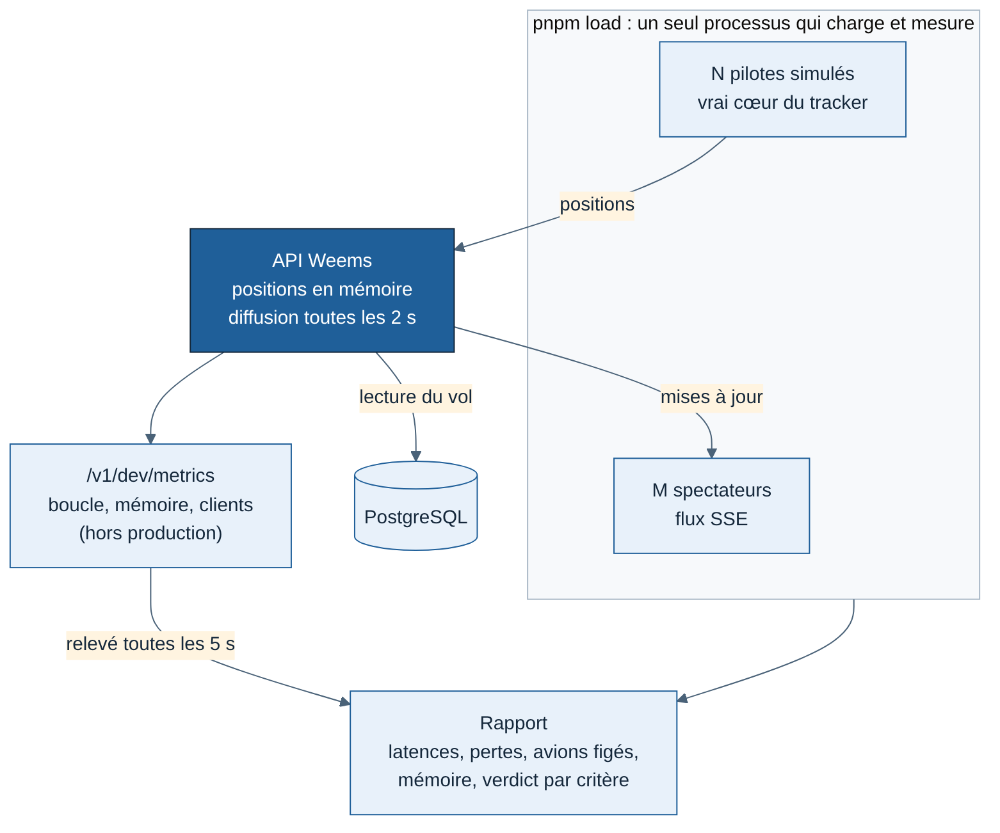

# Spécification J4 — Montée en charge du direct

Rédigée le 11/11/2026. Jalon J4 du lot 1, colonne API : « montée en charge du direct » (voir [Lots et feuille de route](../../cadrage/04-lots-et-feuille-de-route.md)). Choisi par Greg comme premier chantier J4, faisable en local sans pilote ni PC Windows.

## Objectif

Savoir, chiffres à l'appui, si la carte en direct tient la bêta (environ 50 pilotes), avec de la marge, et trouver ce qui casse en premier. La mesure tourne sur le Mac, en une commande.

**Critère de sortie** (tous obligatoires, aux paliers 1 et 2) :

1. Aucune position perdue : chaque position envoyée par un pilote simulé est acceptée par l'API.
2. Délai entre l'envoi d'une position et sa réception par un spectateur : 95 % sous 3 s, aucun au-delà de 5 s (le critère de J1 était un maximum de 3 s avec 10 pilotes).
3. Temps de réponse de l'API aux positions : 95 % sous 200 ms.
4. Aucun avion en vol figé plus de 20 s chez aucun spectateur (comme en J1).
5. Boucle d'événements de l'API : retard sous 100 ms pour 99 % des relevés.
6. Mémoire de l'API stable : moins de 20 % d'écart entre la 10ᵉ minute et la fin. Jugée seulement sur une mesure de 20 min ou plus (paliers 1 et 2) : avant, l'API chauffe encore et l'écart ne veut rien dire ; le rapport l'indique « non mesurée ».
7. La mesure est valide : la boucle du générateur de charge elle-même reste sous 200 ms de retard. Sinon, c'est le générateur qui sature, pas l'API, et le rapport le dit.

## Pourquoi ces paliers

Un pilote envoie une position toutes les 5 à 15 s selon la phase (spec J1). 50 pilotes font donc environ 5 positions par seconde : c'est très peu pour l'API [Confiance élevée]. Le vrai risque est ailleurs : la diffusion, qui envoie chaque mise à jour à chaque spectateur. Le nombre de spectateurs (n'importe quel visiteur de la carte) dépassera vite celui des pilotes.

| Palier | Pilotes | Spectateurs | Accélération | Durée | Rôle |
| --- | --- | --- | --- | --- | --- |
| 1 | 50 | 100 | ×1 | 30 min | Critère de sortie de J4 (environ 50 pilotes) |
| 2 | 200 | 500 | ×1 | 30 min | Marge ×4 |
| 3 | jusqu'à la rupture (500, 1 000…) | ×2 des pilotes | ×1 | 10 min par étape | Exploration, sans critère : connaître la limite et ce qui cède |
| Rapide | 50 | 100 | ×10 | environ 6 min | Équivaut à 500 pilotes en débit de positions ; lancé à la demande, pas dans la CI |

Les chiffres sont mesurés sur le Mac de Greg. Ils ne garantissent pas ceux du serveur de production, mais un goulot trouvé ici existera aussi là-bas.

## Ce qu'on construit

| Élément | Où | Contenu |
| --- | --- | --- |
| Flotte de N vols | `apps/tracker/tools/generate-flights/fleet.ts` | Au-delà des 10 routes de J1, des vols tirés de façon déterministe entre les 20 aéroports existants, avions variés, départs étalés |
| Commande de charge | `e2e/load/` (le paquet `e2e` a déjà accès au tracker et à l'API) | `pnpm load --pilots 50 --viewers 100 --minutes 30 --speed 1` contre une API déjà lancée. Réutilise le simulateur de J1 (`runSimulation`), le client enregistreur et l'observateur du flux |
| Relevés de l'API | `apps/api/src/modules/live/` | `GET /v1/dev/metrics` : retard de la boucle d'événements (p50, p99, max), mémoire, nombre de spectateurs, nombre de vols en direct. Hors production seulement, comme `DELETE /v1/flights` |
| Rapport | Terminal + fichier JSON | Une ligne par critère avec la valeur et le verdict ; fichier JSON pour comparer deux mesures |

Le générateur et l'API tournent dans deux processus séparés. Sinon, on mesure le générateur et pas l'API.

## Points faibles suspectés (à confirmer par la mesure)

| # | Hypothèse | Pourquoi | Correction envisagée si confirmée |
| --- | --- | --- | --- |
| H1 | La diffusion convertit la mise à jour en texte une fois **par spectateur** | `stream.ts` appelle `JSON.stringify` dans la boucle des clients : 500 spectateurs = 500 conversions identiques toutes les 2 s | Convertir une seule fois par lot |
| H2 | Un spectateur lent fait grossir la mémoire | Le résultat de `write` est ignoré : les données s'accumulent pour un client qui ne lit plus (onglet en veille, réseau mobile) | Couper un client dont le tampon dépasse un seuil ; il se reconnecte et reçoit l'instantané |
| H3 | Une vague de reconnexions (redémarrage de l'API, coupure réseau) coûte cher | Chaque connexion reçoit l'instantané complet, construit à chaque fois | Instantané construit une fois par lot et partagé |
| H4 | Une lecture en base à chaque position | `reportPosition` relit le vol (propriétaire, clôture) à chaque position | Garder en mémoire les vols ouverts du tableau en direct ; seulement si la mesure le montre |

On ne corrige que ce que la mesure confirme. Chaque correction reçoit un test qui l'aurait détectée.

## Hors périmètre

| Sujet | Pourquoi |
| --- | --- |
| Plusieurs instances de l'API (partage du direct par Redis ou PostgreSQL) | Inutile en dessous de plusieurs milliers de spectateurs [Confiance moyenne]. À rouvrir seulement si le palier 3 casse sous 1 000 pilotes |
| Rendu de la carte dans le navigateur avec 200 avions | Autre sujet (site web) ; vérifié à la main au palier 2 avec la vraie page `/live` |
| Charge du carnet de vol et des pages de vol | Lectures ponctuelles, pas de flux continu |
| Mesure sur le serveur de production | Mise en ligne reportée (choix de Greg) ; la même commande servira là-bas |

## Livrables

1. Cette spécification.
2. La commande `pnpm load` et la route `/v1/dev/metrics`, avec leurs tests.
3. Un compte rendu de mesure dans `docs/revues/mesure-direct-J4.md` : résultats des paliers 1 à 3, goulots trouvés, corrections, mesures après correction.
