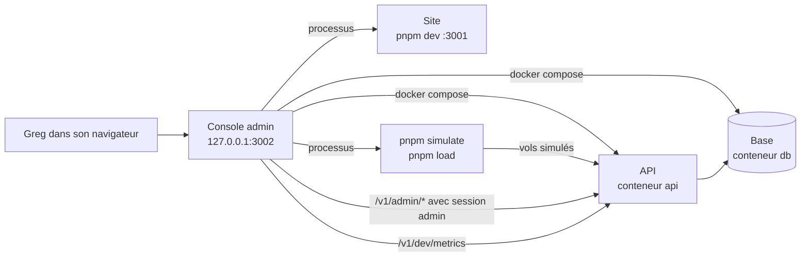
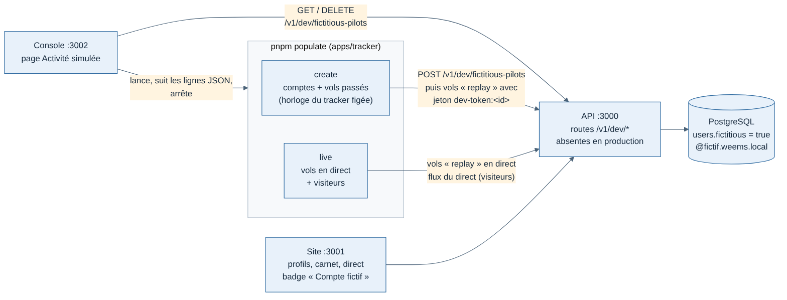
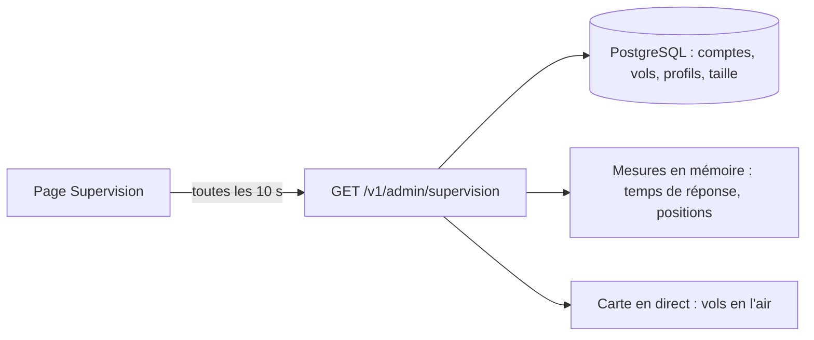
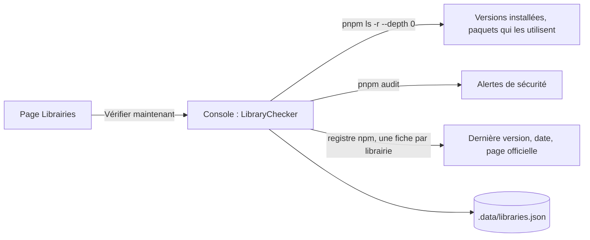
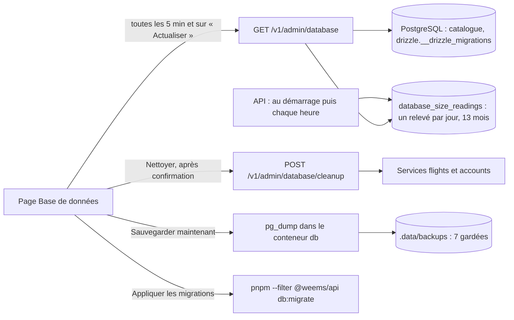

# Espace d'administration : contenu des pages

Rédigée le 11/11/2026, validée par Greg le 11/11/2026 (questions 1 à 6 tranchées ci-dessous). Maquettes : navigation G « barre latérale libellée », choisie le 11/11/2026 ; pages Services, Trafic et Comptes v2 dans `/mnt/project-files/admin/services-v2/`, `trafic-v2/` et `comptes-v2/` (bureau et mobile, sombre et clair).

## Objectif

Donner à Greg, sur son Mac, un seul écran pour faire ce qu'il fait aujourd'hui en ligne de commande : démarrer ou arrêter les services, lancer du trafic simulé, lister les comptes et en créer.

## Ce que c'est, et ce que ce n'est pas

- Une **console locale** : nouvelle application `apps/console`, ouverte sur http://127.0.0.1:3002, accessible seulement depuis le Mac (jamais depuis le réseau).
- Elle **n'est jamais mise en ligne**. Elle pilote Docker et lance des commandes `pnpm` : ce pouvoir n'a pas sa place dans un site public.
- Elle **n'écrit jamais dans la base** directement. Les comptes passent par de nouvelles routes de l'API, réservées au rôle Administrateur ; elles resserviront le jour où une administration en ligne sera nécessaire.

## Cadre commun à toutes les pages

| Élément | Contenu |
| --- | --- |
| Barre latérale | Sous le bandeau du haut. État au 13/11/2026 (#82 ; Greg a refusé une réorganisation plus poussée des sections) : groupe **Exploitation** : Supervision (accueil), Services (compteur « 2 / 3 » en marche), Trafic simulé (pastille « en cours » pendant un lancement), Activité simulée. Groupe **Utilisateurs** : Comptes, Fondateurs, Codes d'offre (ajoutés le 13/11/2026, offre fondateurs, sans réorganiser les sections). Groupe **Site** : Personnalisation. Groupe **Maintenance** : Librairies, Base de données. Groupe **Raccourcis** : Site (:3001) et Doc API (:3000/docs), ouverts dans un nouvel onglet. Titres de section discrets mais lisibles, liste resserrée. |
| Bloc « État local » | En bas de la barre : Base, API, Site, chacun avec une pastille (en marche, arrêté, en erreur) et son port. Rafraîchi toutes les 5 secondes. |
| Bandeau du haut | Un seul bandeau pleine largeur, fixe au défilement, bleu nuit dans les deux thèmes (13/11/2026) : logo « Weems Console » au-dessus de la barre latérale, fil d'Ariane (Console / page), lien « Accéder au site », badge « localhost · Mac », bouton thème clair/sombre, administrateur connecté (s'il l'est). |
| Mobile (moins de 768 px) | La barre latérale devient des onglets en bas : Supervision, Services, Trafic, Activité, Comptes (état au 13/11/2026). L'état local devient trois pastilles dans la barre du haut. |
| Thème | Clair ou sombre, mêmes couleurs que le site (en clair, boutons pleins à texte blanc sur l'accent #0c7f94, contraste WCAG AA, #78). |
| Langue | Français seulement (voir question 2). |

**Accès** : pas de connexion pour Services et Trafic, puisque la console n'écoute que sur le Mac (mêmes droits que le Terminal) et doit fonctionner **API arrêtée** (c'est là qu'on en a besoin pour la démarrer). La page Comptes demande la connexion d'un compte Administrateur, car elle passe par l'API (voir question 1).

## Page Services

**But** : voir d'un coup d'œil ce qui tourne, et le démarrer ou l'arrêter sans Terminal.

**En-tête** : titre, phrase d'état (« Docker Desktop · projet weems · 2 sur 3 en marche »), boutons **Tout démarrer** (base, puis API, puis site, chacun après que le précédent répond) et **Tout arrêter** (dans l'ordre inverse).

**Une carte par service**

| | Base de données | API | Site web |
| --- | --- | --- | --- |
| Lancement | Conteneur `db` (Docker) | Processus `pnpm --filter @weems/api dev`, lancé par la console (mode **Développement**, par défaut) ; ou conteneur `api` (mode **Docker**) | Processus `pnpm --filter @weems/web dev`, lancé par la console |
| Port | 5432 | 3000 | 3001 |
| Santé affichée | Contrôle Docker (`pg_isready`) | `GET /v1/health` : code et temps de réponse | La page d'accueil répond |
| Informations | État, depuis quand, image | État, mode, processus, depuis quand | État, depuis quand |
| Actions | Démarrer, Arrêter, Redémarrer, Journaux | Démarrer, Arrêter, Redémarrer, Journaux ; choix du mode Développement / Docker | Démarrer, Arrêter, Redémarrer, Journaux |

- **États possibles** : En marche, Arrêté, Démarre…, En erreur (le conteneur s'arrête tout seul, ou la santé échoue 3 fois de suite), **Lancé hors console** (le port est pris par un programme que la console n'a pas lancé, par exemple `pnpm dev` dans un Terminal : la console l'affiche mais ne l'arrête pas).
- **Mode de l'API** (décidé par Greg le 11/11/2026) : en **Développement**, l'API tourne en `pnpm dev` et se relance seule à chaque modification du code. Le mode **Docker** sert à vérifier l'API telle qu'elle tournera en ligne ; passer en Docker reconstruit l'image avec le code du moment. Changer de mode arrête l'API puis la redémarre dans l'autre mode.
- **Lancé hors console** : la console n'a ni ses journaux ni le droit de l'arrêter ; un message dit d'arrêter le programme dans le Terminal qui l'a lancé.
- **En erreur** : la carte montre la cause en clair, la dernière ligne d'erreur et un bouton **Réessayer**.
- Un service qui dépend d'un autre arrêté ne peut pas démarrer, et la carte dit pourquoi (« Démarrage impossible : la base est arrêtée »).
- **Confirmation** demandée seulement pour arrêter la base quand l'API tourne (« l'API ne répondra plus »). Aucune action ne supprime de données : jamais de `docker compose down -v`.

**Journaux** (sous les cartes) : un onglet par service, les 200 dernières lignes, suivi en direct activable, bouton Copier. Les lignes d'avertissement et d'erreur sont colorées.

**Cas particuliers**
- Docker Desktop n'est pas lancé : bandeau en haut de page, bouton **Ouvrir Docker Desktop**, cartes Base et API grisées.
- Une action échoue : message sous la carte avec la fin de la sortie de la commande.

## Page Trafic simulé

**But** : remplir la carte en direct et mesurer la tenue de l'API, sans Terminal. **Un seul lancement à la fois.** Les boutons Lancer sont désactivés, avec la raison affichée, si l'API ne répond pas.

**Deux modes, côte à côte**

| | Pilotes simulés | Test de charge |
| --- | --- | --- |
| Commande | `pnpm simulate` | `pnpm load` |
| Réglages | Pilotes : 1 à 10 (les 10 trajets de la flotte J1, en Europe), défaut 10. Vitesse : ×1, ×10, ×50, ×100, défaut ×10. Décalage moyen entre deux départs : en secondes, défaut 30, écarts tirés au hasard autour (fiche 019) | Pilotes : défaut 50. Spectateurs : défaut 100. Durée : en minutes, défaut 30. Vitesse : défaut ×1 |
| Avertissement | Les vols sont enregistrés au nom du pilote de développement (`pilote@weems.local`) | Le test commence par vider les vols simulés (jamais les vols MSFS), rappelé à côté du bouton |

**Pendant un lancement** (bloc en haut de page)
- État « En cours », réglages, heure de départ, temps écoulé, bouton **Arrêter** (sans confirmation).
- Barre d'avancement : vols terminés sur le total.
- Quatre mesures lues sur `/v1/dev/metrics` toutes les 2 secondes, avec une courbe des 5 dernières minutes : vols en direct, spectateurs connectés, délai de la boucle d'événements (p99), mémoire de l'API.
- Tableau des pilotes (cartes sur mobile) : indicatif, trajet, phase actuelle, avancement, positions envoyées, positions en attente d'envoi.
- Bouton **Ouvrir la carte en direct**.

**À la fin** : résumé « Réussi » ou « Échec » (pilotes simulés : tous les vols clos et plus rien en attente ; test de charge : chaque critère de la spec J4 avec sa valeur et son seuil).

**Derniers lancements** : les 20 derniers, du plus récent au plus ancien : date, mode, réglages, durée, résultat. Un clic ouvre le résumé. Gardés dans un fichier local de la console, ignoré par git.

**Vols simulés en base** (bloc à côté de l'historique) : nombre de vols simulés, nombre de vols MSFS conservés, bouton **Supprimer les vols simulés** avec confirmation (« Supprimer 184 vols simulés ? »).

**Règle de suppression** (décidée par Greg le 11/11/2026) : seuls les vols simulés sont supprimés, reconnus à leur simulateur `replay`. Les vols MSFS faits avec `pnpm fly`, qui appartiennent au même pilote de développement, ne sont jamais touchés. La même règle s'applique au nettoyage de départ de `pnpm load` (code déjà dans main, à corriger). La route de suppression reste absente en production.

**Bouton Arrêter** (décidé par Greg le 11/11/2026) : les vols en cours sont clos avec la raison « interrompu » (`interrupted`) ; ils quittent la carte en direct et apparaissent « interrompus » dans la liste des vols. Le lancement est noté « Arrêté » dans l'historique.

## Page Comptes

**But** : savoir qui a un compte et inviter un nouveau pilote.

**En-tête** : titre, phrase « 4 comptes · 1 administrateur · 1 invitation en attente », bouton **Créer un compte**.

**Filtres** : Tous, Pilotes, Administrateurs, Invitations (en attente ou expirées) ; recherche sur le nom et l'e-mail. 50 lignes par page, les plus récentes d'abord.

**Colonnes** (cartes sur mobile : nom, e-mail, rôle ou état, nombre de vols)

| Colonne | Contenu |
| --- | --- |
| Compte | Nom et e-mail. Le pilote de développement porte un badge « Développement ». |
| Rôle | Pilote ou Administrateur |
| Formule | Pilot Free, Pilot Pro, Company ou Holding (ajouté le 13/11/2026, demande de Greg). Tant que les abonnements n'existent pas, tout le monde est en Pilot Free, sauf un Pilot Pro offert (fondateur, code d'offre : spec `../web/spec-offre-fondateurs.md`) ; hors production, la formule choisie avec l'interrupteur de test du site. Onglet Invitations : la colonne devient **Code** (code d'invitation et bouton pour le copier) |
| État | Actif, Désactivé, Invitation en attente (avec « expire dans N j »), ou Invitation expirée. Une invitation n'a pas encore de compte : nom vide |
| Vols | Nombre de vols du compte |
| Créé le | Date de création du compte ou de l'invitation |
| Connexion | Date de la dernière session ouverte, sur le site ou le tracker |

**Actions par ligne**
- Invitation en attente : **Copier le lien** (icône lien à droite du bouton qui copie le code dans l'onglet Invitations, en fin de ligne dans Tous), **Copier le code d'invitation**, **Renouveler** (nouveau code, valable 14 jours de plus ; l'ancien lien ne marche plus), **Annuler l'invitation** (avec confirmation).
- Invitation expirée : affichée « Expirée », avec **Renouveler** et **Annuler**.
- Compte : **Changer le rôle** (Pilote ↔ Administrateur). Impossible de retirer son propre rôle d'administrateur, ni le dernier administrateur.
- Compte : **Désactiver le compte** (décidé par Greg le 11/11/2026), avec confirmation. Le pilote ne peut plus se connecter au site ni envoyer de vols depuis le tracker ; ses sessions et jetons en cours sont révoqués ; ses vols sont gardés. Un compte désactivé affiche l'état « Désactivé » et l'action **Activer le compte**. Impossible de se désactiver soi-même. La suppression définitive (droit à l'effacement) aura sa propre spec.

**Connexion** : si personne n'est connecté, la page affiche à la place un formulaire e-mail et mot de passe. Un compte sans le rôle Administrateur est refusé. Le premier administrateur est nommé par une commande : `pnpm make-admin <e-mail>` (même principe que `pnpm invite`).

## Page Activité simulée

**But** : remplir tout le site (profils publics, carnets, compteurs, graphiques, carte en direct) avec des comptes fictifs. Décision et règles : fiche `../../decisions/011-activite-simulee-comptes-fictifs.md`. Validé par Greg le 12/11/2026 (proposition A).

**Bandeau Population fictive** : comptes, profils publics, vols, liens « Voir dans Comptes » et **Tout supprimer** (avec confirmation).

**Deux blocs, côte à côte**

| | Population fictive (reste en base) | Activité en direct (temporaire) |
| --- | --- | --- |
| Commande | `pnpm populate create` | `pnpm populate live` |
| Réglages | Comptes : 1 à 500, défaut 50. Vols par compte : min–max, défaut 5–40. Historique : 1, 6 ou 12 mois, défaut 6. Profils publics : défaut 75 %. **Couvrir les 9 grades** (13/11/2026, coché par défaut) : les 9 premiers comptes, publics, ont chacun la carrière d'un grade, d'Élève à Légende (fiche 019) | Vols en direct : défaut 12 (avions en l'air au plus). Visiteurs : défaut 100. Durée : défaut 30 min. Vitesse : ×1, ×10, ×50. Départs : premier tiré dans la première minute, puis 5 à 45 min au sol entre deux vols |
| Avertissement | Remplace la population existante | Demande une population |

**Vols** (fiche 019) : 21 types d'avions, de l'aéroclub au long-courrier, sur 71 aéroports, selon le style de chaque pilote ; déclarés `msfs2024` pour compter dans les grades, à part par leur compte fictif. Chaque pilote a un niveau qui progresse (toucher, rebonds, remises de gaz), environ 5 % de vols non comptés (crash, téléportation, interrompu) et vole aux heures de son fuseau. Estimation affichée : vols et heures, ≈ 8 h de vol rejouées par seconde.

**Pendant un lancement** : étapes (nettoyage, comptes, vols, vérification) avec compteurs et débit pour la population ; vols en l'air, partis, visiteurs, temps écoulé pour le direct. Bouton **Arrêter**.

**À la fin** : résultat, puis « Pages remplies » : carte en direct, profil le plus rempli, connexion d'un compte fictif (mot de passe commun affiché).

**Page Comptes** : filtre « Fictifs », badge « Fictif », lien « Voir le profil » sur toute ligne qui a un profil public (comptes réels compris).

## Panneau « Créer un compte »

S'ouvre à droite (en bas sur mobile).

| Champ | Règle |
| --- | --- |
| E-mail | Obligatoire, adresse valide. Refusé si un compte existe déjà. Si une invitation est déjà en attente pour cette adresse, le panneau propose de copier son lien au lieu d'en créer une autre. |
| Rôle | Pilote (par défaut) ou Administrateur. Le rôle est appliqué à la création du compte. |
| Langue du lien | Français (par défaut) ou anglais : page d'inscription ouverte par le lien. |

**Création par invitation seulement** (décidé par Greg le 11/11/2026) : l'administrateur ne manipule jamais de mot de passe.

**Résultat** : le code, sa date d'expiration (14 jours) et le lien d'inscription (`http://localhost:3001/fr/signup?code=…`), avec un bouton **Copier**. Aucun e-mail n'est envoyé : Greg transmet le lien lui-même, comme avec `pnpm invite`. Boutons **En créer un autre** et **Terminé**.

## Page Supervision (12/11/2026)

**But** : la page d'accueil de la console (adresse `/`, premier lien de la barre latérale). En un coup d'œil : ce qui grandit, ce qui casse, ce qui se passe. Maquette validée par Greg (proposition B, tuiles avec tendance) : `/mnt/project-files/admin/supervision/`.

**Accès** : comme la page Comptes (session d'un administrateur, connexion automatique en local, fiche 012) ; une seule route, `GET /v1/admin/supervision`, relue toutes les 10 secondes.

**Réel et simulé** : un vol simulé (`simulator = replay`) ou d'un compte fictif n'est jamais compté comme réel ; il est montré à part (« + N simulés »). Les jours sont coupés à minuit, heure de Paris.

| Section | Contenu |
| --- | --- |
| Sous-titre | Pastilles Base, API, Site ; migrations appliquées ou en retard ; heure de la dernière lecture. |
| Tuiles | Comptes réels, Vols réels, En l'air, Profils publics : nombre, barres des 7 derniers jours, nouveaux sur 7 jours. Bandeau orange « vols suspects » (ouverts depuis plus de 24 h, clos sans trajectoire) seulement s'il y en a. |
| Surveillance | API sur 24 h (p95 par heure, erreurs 5xx, heure lente en orange à partir de 500 ms) ; positions reçues par minute sur 30 min ; versions du tracker (vols réels des 30 derniers jours, la plus récente en bleu) ; taille de la base et ses 3 plus grosses tables. |
| Activité | Vols sur 14 jours (réels et simulés empilés) ; critère de sortie de l'alpha J3 (même calcul que `pnpm alpha-report`) ; 10 derniers événements réels. |
| Communauté | 8 nouveaux comptes ; 8 plus actifs (vols des 30 derniers jours) ; 8 avec le plus d'heures de vol, en attendant les médailles (choix de Greg). |

**Mesures en mémoire** : temps de réponse et positions reçues sont comptés par l'API elle-même depuis son démarrage (« mesuré depuis HH:MM »), sans table ni outil externe ; ils repartent de zéro à chaque redémarrage. Le flux `/v1/live/stream` n'est pas compté (connexion longue).

**Reporté** : visites de la carte en direct (en cours et cumul), à reprendre plus tard (choix de Greg).

## Page Librairies (12/11/2026)

**But** : suivre les mises à jour des librairies npm du dépôt. Groupe « Maintenance » de la barre latérale, adresse `/libraries`. Maquette validée par Greg : https://claude.ai/artifact/6DiyB6NDHeYb2Lbe56mEsX, captures du code dans `/mnt/project-files/admin/librairies/`.

**Lecture seule** (exigence de Greg) : la page vérifie et renvoie vers la page officielle de chaque librairie. Elle n'installe rien et ne modifie aucun fichier du dépôt. Les mises à jour se font à la main, sur une branche, comme toute modification.

**Sans connexion ni API** : la console lit elle-même, sur le Mac. Une vérification prend 5 à 10 secondes. Elle est lancée par le bouton « Vérifier maintenant » et à la première ouverture quand aucun résultat n'est gardé. Le dernier résultat est gardé dans `apps/console/.data/libraries.json`.

| Partie | Contenu |
| --- | --- |
| En-tête | « Lecture seule… », heure de la dernière vérification à gauche, bouton « Vérifier maintenant » à droite. |
| Tuiles | Librairies directes (et nombre de paquets du dépôt) ; à jour ; mises à jour disponibles (majeures, mineures, correctifs) ; alertes de sécurité par gravité. |
| À corriger en priorité | Une carte par librairie vulnérable : gravité, directe ou indirecte, chaque alerte avec son lien, chemin de dépendance et version qui corrige tout. Absent quand l'audit ne trouve rien ; bandeau orange quand l'audit n'a pas pu tourner. |
| Tableau | Librairie (dev, sécurité), paquets qui l'utilisent, installée, dernière, écart, date de sortie de la dernière, icône vers la page officielle. Filtres : à mettre à jour (par défaut), majeures, mineures, correctifs, sécurité, toutes. Regroupement par librairie ou par application. Sur téléphone, une carte par librairie. |

**Règles** :
- Écart selon la gestion sémantique des versions ; en dessous de 1.0, un changement du deuxième chiffre (0.34 → 0.35) compte comme majeur, affiché « majeure (0.x) ».
- Mise à jour **retenue** : une librairie gardée volontairement en arrière porte sa raison (liste dans `apps/console/src/server/libraries/held.ts`, aujourd'hui `@types/node` qui suit Node 24).
- Page officielle : l'adresse `homepage` déclarée sur npm, gardée seulement si c'est une adresse web (http ou https), sinon la page npm de la librairie. Même contrôle pour les liens des alertes.
- Date de sortie : lue dans la fiche complète du registre. L'index de recherche, plus léger, refuse les rafales de requêtes et laissait des dates vides.
- Paquets internes `@weems/*` non listés ; Swift (iPad) et Python hors périmètre pour l'instant.

## Page Base de données (12/11/2026)

**But** : voir ce qui grossit dans la base, vérifier les migrations, sauvegarder, et faire le ménage de ce qui ne sert plus. Groupe « Maintenance » de la barre latérale, adresse `/database`. Maquette validée par Greg : https://claude.ai/artifact/7r2UKxMfheVUJixQ2udnjj, captures du code dans `/mnt/project-files/admin/base-de-donnees/code/`.

**Constats qui ont orienté la page** : il n'existe pas de table de positions (le direct reste en mémoire dans l'API) ; ce qui grossit, c'est `flight_tracks`, la trajectoire complète de chaque vol. Les vols réels ne sont jamais supprimés (EF-14). Aucune sauvegarde n'existait.

**Qui fait quoi** : l'API lit la base, relève sa taille chaque heure et supprime (session d'un administrateur, comme Supervision) ; la console lance les sauvegardes et la commande des migrations. La console n'écrit toujours jamais dans la base.

| Partie | Contenu |
| --- | --- |
| En-tête | Heure de la lecture, nom de la base et version de PostgreSQL à gauche, bouton « Actualiser » à droite. |
| Graphiques (13/11/2026) | Trois cartes sur les 30 derniers jours, sous les tuiles (ordre inversé à la demande de Greg le 13/11) : **Taille totale** (courbe, évolution sur 30 j, date projetée où la base atteint 20 Go, le disque du serveur alpha) ; **Répartition par table** (colonnes empilées : les 3 plus grosses tables et « autres », part de la plus grosse) ; **Vols enregistrés par jour** (colonnes empilées réels / simulés). Le survol d'un jour l'affiche sous le graphique. Maquette validée : `/mnt/project-files/admin/base-de-donnees/graphiques/`. |
| Tuiles | Taille totale (évolution sur 7 jours, part de la plus grosse table) ; migrations appliquées sur celles du code ; dernière sauvegarde (orange si aucune ou plus de 7 jours) ; part simulée des tables des vols. |
| Bandeau | « Aucune sauvegarde » ou « Dernière sauvegarde il y a N jours », avec le bouton « Sauvegarder maintenant ». |
| Tables | Chaque table, la plus grosse d'abord : lignes (estimation de PostgreSQL), données, index, total, barre réel / simulé, part simulée (tables des vols seulement), évolution sur 7 jours. Sur téléphone : table, total et barre. |
| Migrations | Chaque migration avec sa date et son état ; bouton « Appliquer les migrations » actif seulement s'il y en a en attente. |
| Sauvegardes | Les 7 dernières (date, taille), la commande de restauration de la plus récente, bouton « Sauvegarder maintenant ». |
| Nettoyage | Trois cases : vols simulés de plus de 7 jours, sessions expirées, invitations expirées, chacune avec ce qu'elle supprimerait maintenant. « Nettoyer… » ouvre une confirmation qui liste tout ; le résultat s'affiche ensuite. |

**États des migrations** (comparaison du dossier `migrations/` avec `drizzle.__drizzle_migrations`, qui ne garde que la date de création et l'empreinte du fichier) :
- **appliquée** ; **en attente** : plus récente que la dernière appliquée, `db:migrate` l'appliquera ;
- **sautée** : absente de la base mais plus ancienne que la dernière appliquée : Drizzle ne l'appliquera jamais ;
- **modifiée** : appliquée, mais son fichier a changé depuis ;
- **en double** : enregistrée deux fois (le cas des 0006 et 0007 réparé à la main le 12/11) ;
- **inconnue du dépôt** : enregistrée en base, absente du code (une autre branche).
Les trois derniers états et « sautée » se corrigent à la main ; la page le dit.

**Règles** :
- Simulé, pour la taille : vol rejoué (`simulator = replay`) ou d'un compte fictif, comme sur Supervision ; trajectoires pesées par leur taille stockée.
- Nettoyage des vols : seulement `simulator = replay` ouverts depuis plus de 7 jours (`CLEANUP_SIMULATED_AFTER_DAYS`). Les vols des comptes fictifs restent : `pnpm populate` date leur historique dans le passé exprès, les supprimer viderait leurs profils. Ils se suppriment avec les comptes fictifs (page Activité simulée). Écart avec la maquette, qui les incluait.
- Sessions : celles dont la date d'expiration est passée. Invitations : jamais utilisées et expirées (14 jours).
- PostgreSQL ne rend pas l'espace au disque après une suppression : il le réutilise. La taille totale ne baisse donc pas forcément tout de suite.
- Sauvegarde : `docker compose exec -T db pg_dump -U weems -Fc weems`, écrite d'abord dans un fichier `.part` puis renommée ; une seule à la fois ; au-delà de 7, les plus anciennes sont supprimées. La restauration remplace toute la base : jamais de bouton, la commande est affichée.
- Relevés de taille (13/11/2026) : l'API les écrit dans la table `database_size_readings` (une ligne par jour UTC, le dernier relevé du jour gagne) au démarrage, chaque heure et à chaque lecture de la page ; gardés 13 mois. Ils remplacent le fichier `.data/database-sizes.json` de la console, qui ne relevait que quand la page était ouverte (fichier ignoré désormais, non importé : un ou deux jours de données).
- Jour sans relevé (API arrêtée, ou avant la mise en place) : pas de valeur inventée. La courbe de taille passe en pointillés entre deux relevés, la répartition n'a pas de colonne. Les vols par jour se calculent depuis `opened_at` : complets dès le premier jour. Les vols simulés déjà nettoyés n'y figurent plus.
- Projection vers 20 Go : pente entre le premier et le dernier relevé des 30 jours, vols simulés compris ; « plus de 5 ans » au-delà, rien si la base ne grossit pas (après un nettoyage).
- Évolution sur 7 jours (tuile et tableau) : depuis le relevé d'au moins 7 jours ; sans lui, depuis le plus ancien, et la page dit depuis quand.

## Pages Fondateurs et Codes d'offre (13/11/2026)

Spec complète : `../web/spec-offre-fondateurs.md`.

- **Fondateurs** (`/founders`) : compteurs (confirmés, en vérification 48 h, refusés, places libres sur 500), liste par numéro avec pilote, état, date de la place et de la confirmation ; **Confirmer** (avant les 48 h) et **Refuser** (confirmation : le pilote perd badge, Pro offert et codes non utilisés ; le numéro n'est jamais redonné).
- **Codes d'offre** (`/codes`) : cartes des ambassadeurs (code, places utilisées, fin, lien vers la page publique, Modifier) ; panneau « Nouvel ambassadeur » (adresse, nom, accroche, présentation FR/EN, citations, liens https, profil de pilote lié, photo 5 Mo au plus réduite en WebP 256 px, code partagé, mois, places, fin, en ligne) avec **case d'accord écrit obligatoire** avant d'enregistrer ; formulaire « Nouveau lot » (pour qui, mois, nombre, fin) ; tableau des lots, du parrainage et des codes d'ambassadeurs avec **CSV** et **Annuler**.

## Corrections par rapport à la première maquette

- Il n'existe pas encore de « comptes simulés » : tous les vols simulés appartiennent au pilote de développement. Le filtre « Simulés » disparaît de cette version ; il reviendra avec les comptes simulés (voir hors périmètre).
- Les invitations expirent désormais au bout de 14 jours (question 6).

## Expiration des invitations (nouveau)

Aujourd'hui un code d'invitation reste valable sans limite. Or l'inscription ne vérifie pas l'adresse e-mail : quiconque a le lien peut créer le compte. Un lien oublié dans une messagerie reste donc une porte ouverte.

- Chaque invitation est valable **14 jours** ; passé ce délai, l'inscription est refusée avec le message « Cette invitation a expiré, demandez-en une nouvelle ».
- `pnpm invite` et la console affichent la date d'expiration.
- Les invitations déjà en attente au moment de la mise à jour reçoivent 14 jours à partir de cette date (aucune n'est cassée).
- Renouveler une invitation crée un nouveau code et invalide l'ancien.

## Hors périmètre de cette première version

Remise à zéro de la base, migrations, tracker de bureau, envoi d'e-mails, création directe avec mot de passe, suppression définitive d'un compte, réinitialisation de mot de passe, liste des vols de tous les pilotes, modération des compagnies (lot 3), mise en ligne.

## Décisions sur les questions ouvertes

1. **Connexion** : console sans connexion (elle n'écoute que sur le Mac), connexion administrateur seulement pour la page Comptes. Validé par Greg le 11/11/2026.
2. **Langue** : français seulement, par exception à la règle « français et anglais » qui vise les pilotes.
3. **API** : lancée en `pnpm dev` par défaut, mode Docker au choix ; pas de bouton Reconstruire. Pas de carte pour la base de test `weems_test` (même conteneur que la base). Journaux : 200 lignes, sans recherche. Validé par Greg le 11/11/2026.
4. **Supprimer les vols simulés** depuis la page Trafic : oui.
5. **Rôles** : Pilote et Administrateur seulement.
6. **Invitations** : valables 14 jours, renouvelables (section « Expiration des invitations »).

## Écarts du développement (11/11/2026)

Ce qui diffère des maquettes validées, et pourquoi :

- **Thème** : suit le réglage du système, sans bouton. Un bouton demanderait de garder un choix pour une console d'un seul utilisateur.
- **Barre latérale** : pas de nombre de comptes à côté de « Comptes » (il demande la connexion administrateur) ; « Carte en direct » est un bouton de la page Trafic plutôt qu'un raccourci. Sur mobile, quatre onglets (Services, Trafic, Activité, Comptes), sans pastilles dans la barre du haut.
- **Administrateur connecté** : son nom est sur le bouton de déconnexion de la page Comptes, pas dans la barre du haut.
- **Trafic** : la colonne « Positions envoyées » n'existe pas (le tracker ne les compte pas par vol) ; le tableau par pilote existe pour `pnpm simulate` seulement, le test de charge montre ses mesures puis son rapport à la fin.
- **Formulaires** : alignés sur le modèle C choisi par Greg pour tous les formulaires (champs de 44 px, choix segmenté dans un cadre).

## Critère de sortie

1. Depuis la console, Greg démarre la base, l'API et le site, puis les arrête, sans ouvrir de Terminal.
2. Il lance 10 pilotes simulés à ×10, les voit sur la carte en direct, et lit le résumé à la fin.
3. Une invitation de plus de 14 jours est refusée à l'inscription (test automatique).
4. Il crée une invitation, l'ouvre dans le site, crée le compte, et le voit passer en « Actif » dans la liste.
5. Un compte sans rôle Administrateur ne peut ni lister ni créer de comptes, même en appelant l'API directement (test automatique).
6. La console n'est pas joignable depuis une autre machine du réseau (test automatique de l'adresse d'écoute).
