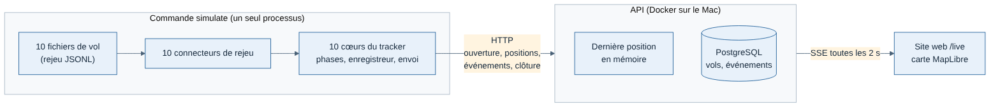
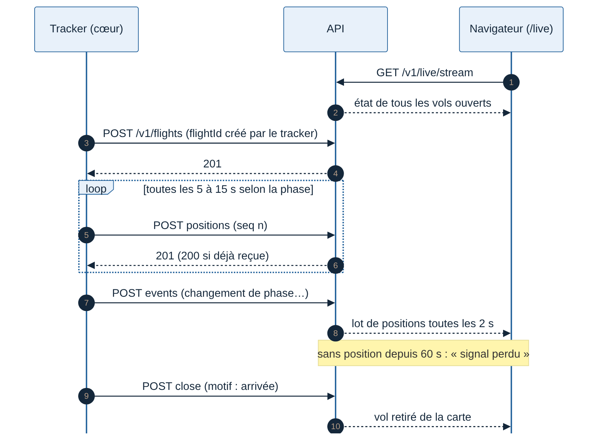
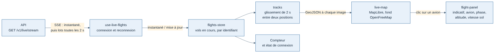

# Spécification J1 — 10 pilotes simulés sur la carte en direct

Rédigée le 11/11/2026. Jalon J1 du lot 1 (voir [Lots et feuille de route](../cadrage/04-lots-et-feuille-de-route.md)). Concerne les trois applications : tracker, API, site web.

## Objectif

Faire voler 10 pilotes simulés en même temps et suivre leur progression sur une carte en direct, en passant par le vrai tracker et la vraie API. Tout tourne sur le Mac de Greg, sans MSFS ni PC Windows.

**Critère de sortie** (tous obligatoires) :

1. 10 vols simulés vont de l'embarquement (BOARDING) à l'arrivée (ARRIVED), en même temps.
2. Aucune position perdue entre le tracker et l'API sur le réseau local (numéros de séquence sans trou).
3. Chaque avion en vol est mis à jour sur la carte au moins toutes les 20 secondes ; aucun avion figé ni fantôme.
4. Délai entre l'envoi par le tracker et l'affichage sur la carte inférieur à 3 secondes.
5. Les phases affichées correspondent aux phases attendues de chaque scénario.
6. Une coupure de l'API de 60 secondes ne fait perdre aucun événement ; les avions reprennent leur route sur la carte au retour.
7. Le test complet se lance en une seule commande et passe en accéléré (×10) dans l'intégration continue.

## Périmètre

| Dans J1 | Hors J1 (jalon prévu) |
| --- | --- |
| Connecteur de rejeu du tracker, sans interface | Connecteur MSFS (J2) |
| Ouverture de vol, positions en direct, événements, clôture | Rapport de vol complet et trajectoire compressée (J2) |
| Stockage minimal des vols ouverts et clos | Carnet de vol, page de vol (J2) |
| Flux en direct vers les navigateurs (SSE) | Comptes et connexion OAuth (J3) |
| Carte minimale MapLibre | Habillage, profil public, débriefing (J4) |
| Pilotes fictifs, jeton de développement fixe | Trafic VATSIM et IVAO, notation (plus tard) |

## La chaîne

Le cœur du tracker est **exactement le même code** que celui qui tournera avec MSFS. Seul le connecteur change. C'est ce qui rend J1 utile au-delà de la démonstration.

## 1. Connecteur de rejeu (tracker)

- Il implémente la même interface que le futur connecteur MSFS : il produit des objets `Sample`, `AircraftInfo` et `SimEvent` (spec T0, partie A).
- **Entrée** : un fichier de vol au format JSON Lines, une ligne par objet, horodaté. Format provisoire ; le point 3 de la spec T0 le finalisera avec un pilote, sans changer le principe.
- **Options** : vitesse de rejeu (×1 pour regarder, ×10 pour les tests), décalage du départ, indicatif et avion du pilote fictif.
- **Sources de vols**, par ordre de préférence :
  1. vols réels A32NX (fichiers `.fdr` convertis) ou Sky Dolly, si Houssine en obtient ;
  2. sinon, le générateur de vols synthétiques de T0, sur 10 routes réelles en Europe avec des avions et des durées variés.
- **Lancement** : une commande `simulate` démarre N cœurs de tracker sans interface, dans un seul processus Node, chacun avec son fichier et son pilote fictif. Un seul processus suffit pour 10 pilotes et simplifie le test [Confiance moyenne].

## 2. Messages entre le tracker et l'API

Les formats sont écrits une seule fois dans `packages/contrats` et partagés par le tracker et l'API.

| Message | Route | Contenu | Quand |
| --- | --- | --- | --- |
| Ouverture | `POST /v1/flights` | `flightId` (créé par le tracker), indicatif, avion, départ, arrivée prévue, version du tracker | Début du vol |
| Position | `POST /v1/flights/{flightId}/positions` | `seq`, heure UTC, `lat`, `lon`, `altMsl`, `gs`, `heading`, `vs`, `phase`, `onGround` | Selon la phase, voir ci-dessous |
| Événement | `POST /v1/flights/{flightId}/events` | `seq`, heure, type (changement de phase, pause, toucher…), contexte | Quand il se produit |
| Clôture | `POST /v1/flights/{flightId}/close` | Heure, motif (arrivée, abandon, crash) | Fin du vol |

**Fréquence des positions** : 5 s au décollage, en approche, en finale et à l'atterrissage ; 10 s au roulage, en montée et en descente ; 15 s en croisière ; aucune à l'arrêt (embarquement, arrivée).

**Règles** :
- Renvoyer un message déjà reçu (même `flightId` et même `seq`) ne crée jamais de doublon.
- Sans réponse de l'API, les événements et la clôture sont gardés et renvoyés ; les positions trop anciennes sont abandonnées, sauf la dernière.
- Authentification de J1 : un jeton fixe de développement, refusé par l'API hors du mode développement.

## 3. API

- **Vols** : table minimale dans PostgreSQL (identifiant, indicatif, avion, départ, arrivée, ouverture, clôture, motif, dernière phase).
- **Dernière position** : en mémoire, une par vol ouvert (choix de l'étape 2 pour le lot 1).
- **Événements** : enregistrés dans PostgreSQL, ils serviront au carnet de vol en J2.
- **Flux en direct** : `GET /v1/live/stream` en SSE.
  - À la connexion, l'API envoie l'état de tous les vols ouverts.
  - Ensuite, elle pousse les positions reçues par lots, toutes les 2 secondes.
  - Un battement toutes les 15 secondes garde la connexion ouverte.
- **Vol muet** : sans position depuis 60 secondes, le vol passe en « signal perdu ». Sans nouvelle depuis 10 minutes, il disparaît de la carte, sans être clos.

## 4. Carte minimale (site web)

- Une page `/live` dans Next.js, avec une carte MapLibre.
- Fonds de carte gratuits sans clé : OpenFreeMap (choisi au démarrage de J1).
- Un avion par vol ouvert, orienté selon son cap. Son déplacement est lissé entre deux positions pour éviter les sauts.
- Un clic sur un avion ouvre un panneau : indicatif, avion, départ, arrivée, phase, altitude, vitesse sol.
- Un compteur affiche le nombre de vols en cours. Les avions en « signal perdu » sont grisés.
- Aucun habillage : l'objectif est de vérifier la chaîne, pas de faire beau.

## 5. Tests

| Test | Type | Vérifie |
| --- | --- | --- |
| 10 vols en ×10 | Automatique, dans l'intégration continue | Critères 1, 2, 5 et 7 : séquences complètes, phases attendues, aucun trou |
| Client SSE de test | Automatique | Critères 3 et 4 : fréquence de mise à jour et délai |
| Coupure de l'API 60 s | Automatique | Critère 6 : rien de perdu, reprise propre |
| 10 vols en ×1 sur la carte | Manuel, par Greg | Aspect réel : fluidité, panneaux, états |

## Choix faits dans cette spécification

À contester si besoin, sinon ils s'appliquent :

- un seul processus pour les 10 pilotes simulés ;
- des requêtes HTTP simples du tracker vers l'API, et SSE de l'API vers les navigateurs (étape 2) ;
- des positions envoyées par lots toutes les 2 secondes aux navigateurs ;
- « signal perdu » à 60 secondes, disparition à 10 minutes.

## Choix faits pendant le développement (11/11/2026)

| Sujet | Choix | Pourquoi |
| --- | --- | --- |
| Fond de carte | OpenFreeMap, style « positron » | Gratuit, sans clé ni compte, sans quota annoncé ; à revoir avant l'ouverture publique si le trafic grossit [Confiance moyenne] |
| Cadence des positions | 5 s au décollage et de l'approche à l'atterrissage, 10 s au sol et en montée ou descente, 15 s en croisière, rien à l'embarquement et à l'arrivée | Plus précis là où l'avion change vite, moins de messages en croisière |
| Positions avant l'ouverture du vol | Gardées en mémoire par le tracker et envoyées une fois le vol accepté ; au-delà de 30 s, seule la plus récente est gardée | Pas de position pour un vol inconnu de l'API, pas de rafale après une coupure |
| Flux en direct | Public, sans connexion, autorisé depuis n'importe quel site (CORS) | Les données affichées sont celles de la carte publique ; la connexion arrive en J3 |
| Navigateur et API | Le navigateur se connecte directement à l'API, pas à travers Next.js | Next.js ne garde pas de connexion ouverte par visiteur |
| Test de sortie | `pnpm test:j1` : 10 pilotes à ×10 plus 2 pilotes privés de réseau pendant 70 s (au-delà des 60 s du critère 6, pour que le « signal perdu » à 60 s se déclenche à coup sûr), en même temps (environ 6 minutes) ; étape séparée de l'intégration continue, hors `pnpm check` | `pnpm check` reste rapide ; le test complet tourne quand même à chaque PR |
| Coupure de l'API | Simulée côté tracker : ses requêtes échouent pendant 70 s comme si l'API était injoignable | Même effet pour le tracker qu'une API arrêtée, sans perdre la carte en mémoire de l'API pendant le test |
| Délai mesuré | De l'envoi d'une position par le tracker à sa réception dans le flux | C'est le critère 4 ; l'attente avant l'envoi (0,5 s au plus) n'est pas comptée |
| Lissage | Chaque avion glisse en 2 s de sa position affichée vers la nouvelle, cap par le plus court | Même durée que les lots de l'API : pas de saut ni d'arrêt |

## Questions ouvertes

| Question | Qui | Bloquant pour |
| --- | --- | --- |
| Vols réels A32NX ou Sky Dolly disponibles ? | Houssine | Rien : repli sur les vols synthétiques |
| Organisation du code de l'API (Fastify par défaut, réponse de Thibault) | Thibault | Rien : Fastify par défaut |
