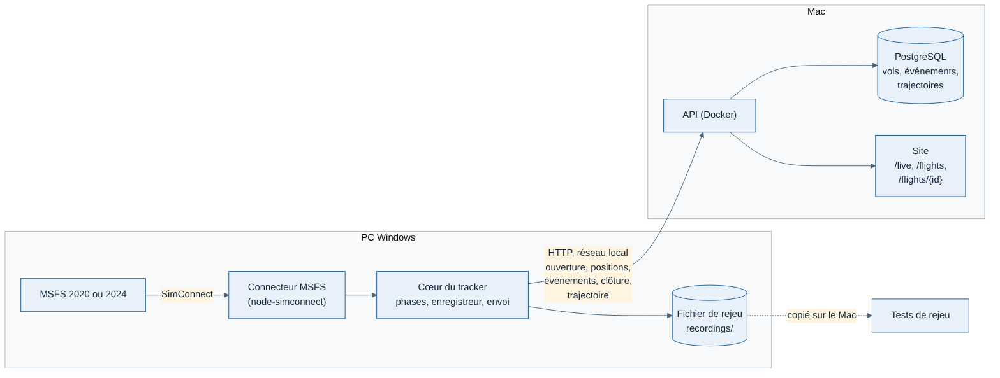
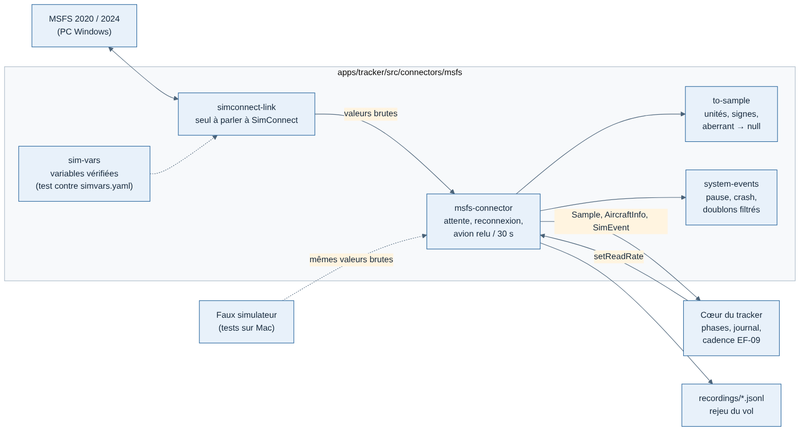
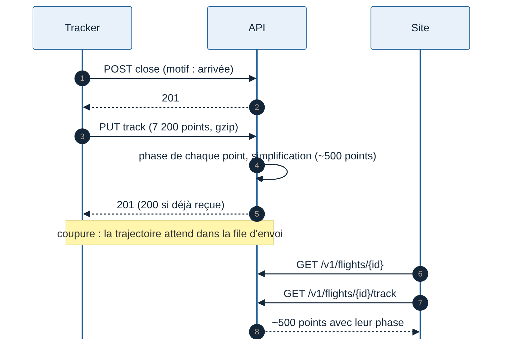

# Spécification J2 — Premier vrai vol

Rédigée le 11/11/2026. Jalon J2 du lot 1 (voir [Lots et feuille de route](../cadrage/04-lots-et-feuille-de-route.md)). Concerne les trois applications : le tracker (lot T1), l'API et le site. Le site est détaillé dans la [spécification du site minimal](web/spec-J2-site-minimal.md) ; ce document dit comment les trois parties s'assemblent.

## Objectif

Voler dans MSFS sur le PC Windows, puis retrouver le vol sur le site, sur le Mac : liste des vols, page de vol avec la trajectoire sur la carte, le profil vertical, les phases et le journal. Tout reste en réseau local, sans compte.

**Critère de sortie** (tous obligatoires) :

1. 10 vols de référence faits dans MSFS sur le PC s'affichent sur le site du Mac, avec des phases correctes (relues par Greg, vol par vol).
2. Chaque vol réel est aussi enregistré au format de rejeu, et le rejouer sur le Mac donne les mêmes phases et les mêmes événements qu'en direct.
3. L'impact du tracker sur les images par seconde est mesuré dans MSFS : objectif de moins de 2 % (ENF-01).
4. La page d'un vol de 2 heures s'affiche en moins de 2 secondes sur le Mac.
5. Le site est disponible en français et en anglais.
6. Un vol rejoué traverse automatiquement toute la chaîne dans l'intégration continue : il est relu sur l'API avec ses phases et sa trajectoire.

## Périmètre

| Dans J2 | Hors J2 (jalon prévu) |
| --- | --- |
| Connecteur MSFS (node-simconnect), MSFS 2020 et 2024 | Application Electron avec interface (J3) |
| Commande `pnpm fly` sur le PC Windows, sans interface | Paquet MSIX et Microsoft Store (J4 : il faut la micro-entreprise et le compte Store) |
| Trajectoire envoyée à la clôture, stockée par l'API | Comptes et connexion (J3) |
| Liste des vols et page de vol, sans compte | Notation et débriefing (après les critères vus avec un pilote) |
| Français et anglais | Habillage Weems (J4) |
| Enregistrement de chaque vol réel au format de rejeu | Aéroports, pistes et types d'avion de référence (quand la notation en aura besoin) |

**Écart avec la feuille de route** : le lot T1 du cahier des charges du tracker prévoyait le paquet MSIX soumis au Store dès T1. Il est repoussé à J4, car le compte Store doit être ouvert au nom de la micro-entreprise, créée seulement avant J4 (fondamentaux). Cela ne bloque rien : la commande `pnpm fly` suffit pour les vols de référence.

## La chaîne

Le cœur du tracker est le même qu'en J0 et J1. Seuls le connecteur et l'envoi de la trajectoire sont nouveaux.

## 1. Tracker (lot T1)

### Connecteur MSFS

- Bibliothèque `node-simconnect` (protocole SimConnect écrit en TypeScript, sans DLL Microsoft). Repli si elle ne suffit pas : connecteur C# séparé avec le SDK officiel, même interface (décision du cahier des charges du tracker).
- Il implémente l'interface `SimConnector` : il produit des `Sample`, `AircraftInfo` et `SimEvent` conformes à `packages/contrats`.
- **Variables lues** : uniquement celles de `apps/tracker/docs/reference/simvars.yaml` marquées `verified: true`. Une variable absente sur un avion devient « non mesurée » (`null`), jamais 0.
- **Événements système** : pause, crash, chargement de vol, changement d'avion, slew, accélération du temps (fiche `02-evenements-systeme.md`).
- **Cadence** : une fois par seconde en temps normal, à chaque image près du sol (EF-09). C'est le cœur qui décide.
- **Code organisé en couches**, pour tester sans simulateur (`apps/tracker/src/connectors/msfs/`) :
  1. `simconnect-link` : connexion, déclaration des variables, abonnements (seul fichier qui parle à MSFS, derrière l'interface `SimLink`) ;
  2. `sim-vars` : la liste des variables et leurs unités ; un test vérifie que chacune est `verified: true` dans `simvars.yaml`, avec la même unité ;
  3. `to-sample` : traduction des valeurs brutes en `Sample` (radians → degrés, ft/s → ft/min, livres → kg, valeurs aberrantes → `null`) ;
  4. `system-events` : événements système traduits, doublons de MSFS 2024 filtrés, état de pause ;
  5. `msfs-connector` : attente du simulateur, reconnexion, avion relu toutes les 30 s, testé avec un faux simulateur.

### Commande `pnpm fly`

- Lance le tracker sans interface sur le PC : `pnpm fly --api http://<adresse-du-mac>:3000`.
- Affiche dans la console l'état de la connexion, l'avion, la phase en cours et le nombre de messages en attente.
- `--from LFPG --to LFBO` renseigne départ et arrivée ; `--callsign` l'indicatif ; « fin » + Entrée clôt le vol à la main ; Ctrl+C quitte (un vol ouvert reprend au lancement suivant).
- Chaque vol est aussi écrit en fichier de rejeu dans `recordings/` (critère 2), à copier sur le Mac pour les tests.

### Trajectoire

- Le tracker garde déjà tous les échantillons dans SQLite. À la clôture du vol, il envoie la **trajectoire complète** par la file d'envoi (même garantie que les événements : rien n'est perdu en cas de coupure).
- Contenu : pour chaque échantillon, heure, position, altitudes, vitesses, cap, au sol ou non. Environ 7 200 points pour 2 heures à une fois par seconde.
- Format : JSON, environ 1,5 Mo pour 2 heures sur le réseau local ; l'API le garde compressé en gzip (environ 150 Ko) [Confiance moyenne].

## 2. API

| Route | Rôle |
| --- | --- |
| `POST /v1/flights/{flightId}/track` | Reçoit la trajectoire complète, une seule fois par vol. Renvoi identique : 200 ; trajectoire différente : 409 |
| `GET /v1/flights` | Liste des vols du plus récent au plus ancien, 50 par page, pagination par curseur, filtres période, avion, aéroport |
| `GET /v1/flights/{flightId}` | Déjà en place : en-tête, événements ; ajoute les durées (bloc, vol, pause) |
| `GET /v1/flights/{flightId}/track` | Trajectoire **simplifiée** : environ 500 points pour la carte et le profil, chacun avec sa phase |

- **Simplification** : algorithme de Douglas-Peucker sur la position et l'altitude, en gardant toujours les points de changement de phase et ceux du toucher. Calculée une fois à la réception, puis gardée.
- **Phase de chaque point** : déduite des événements `phaseChanged` du vol. Une seule source de vérité, celle du tracker.
- **Stockage de la trajectoire** : dans PostgreSQL (table `flight_tracks`, données compressées), derrière une interface `TrackStore`. Voir les choix ci-dessous.

## 3. Site

Voir la [spécification du site minimal](web/spec-J2-site-minimal.md) : liste `/flights` et page `/flights/{flightId}`. Choix techniques de J2 :

- traductions avec `next-intl`, adresses `/fr/...` et `/en/...`, le français par défaut ;
- Tailwind CSS pour la mise en forme ;
- carte MapLibre déjà en place (J1), trajectoire colorée par phase ;
- profil vertical dessiné en SVG, sans bibliothèque de graphiques tant qu'un seul graphique existe.

## 4. Sur le PC Windows

| Étape | Qui |
| --- | --- |
| Installer Git, Node.js 24 et pnpm, cloner le dépôt | Greg, avec le [guide PC Windows](../developpement/guide-pc-windows-j2.md) |
| Ouvrir le port 3000 du Mac au réseau local (pare-feu macOS) | Greg, avec le guide |
| Lancer MSFS, puis `pnpm fly --api http://<adresse-du-mac>:3000` | Greg |
| Faire les 10 vols de référence (liste ci-dessous) | Greg |
| Mesurer les images par seconde avec et sans tracker (compteur du mode développeur de MSFS) | Greg, avec le guide |

**Les 10 vols de référence** : courts (30 à 60 minutes) et variés, pour couvrir les cas du cœur.

| # | Vol | Avion | Ce qu'il vérifie |
| --- | --- | --- | --- |
| 1 | Tour de piste | Avion léger (C172) | Vol minimal, phases courtes |
| 2 | LFPG → LFBO | A320 (A32NX ou celui de MSFS) | Vol de ligne normal |
| 3 | Avec remise des gaz | A320 | Détection de la remise des gaz |
| 4 | Avec pause de 5 minutes en croisière | A320 | Pause exclue des temps |
| 5 | Avec accélération du temps en croisière | A320 | Accélération notée au journal |
| 6 | Décollage interrompu puis vol normal | A320 | Décollage interrompu |
| 7 | Atterrissage avec rebond | Avion léger | Rebond |
| 8 | Vol commencé en l'air (départ « en vol » de MSFS) | Au choix | Ouverture en l'air |
| 9 | Changement d'avion au parking | Au choix | Clôture « avion changé » |
| 10 | MSFS 2024 au lieu de 2020, vol normal | A320 | Compatibilité des deux versions |

## 5. Tests

| Test | Type | Vérifie |
| --- | --- | --- |
| Traduction des valeurs brutes MSFS | Automatique, sur le Mac | Unités, valeurs absentes, événements |
| Vol rejoué → API → trajectoire relue | Automatique, dans l'intégration continue | Critère 6 |
| Simplification de la trajectoire | Automatique | Points de changement de phase gardés, moins de 600 points |
| Page d'un vol de 2 heures | Automatique (navigateur sans écran) | Critère 4 |
| Les 10 vols de référence | Manuel, par Greg | Critères 1, 2 et 3 |

## Choix faits dans cette spécification

À contester si besoin, sinon ils s'appliquent :

| Sujet | Choix | Pourquoi |
| --- | --- | --- |
| Stockage des trajectoires | PostgreSQL, données compressées, derrière une interface `TrackStore` [Confiance moyenne] | Environ 150 Ko par vol : sans difficulté pour des milliers de vols. Pas de service de plus à faire tourner sur le Mac. Le passage à un stockage S3 (Scaleway) reste possible sans toucher au reste, quand le volume le demandera |
| Envoi de la trajectoire | En une fois, à la clôture | Le direct utilise déjà les positions ; la trajectoire complète ne sert qu'après le vol |
| Tracker sur le PC | Commande sans interface | Electron n'apporte rien aux vols de référence ; l'interface arrive en J3 avec la connexion |
| Simplification | Par l'API, une fois, à la réception | Tient le critère des 2 secondes sans travail dans le navigateur |

## Choix faits pendant le développement (11/11/2026)

| Sujet | Choix | Pourquoi |
| --- | --- | --- |
| Envoi de la trajectoire | `POST` comme les autres messages du tracker (même file d'envoi, mêmes règles de renvoi), JSON non compressé, 16 Mo au plus ; l'API compresse pour le stockage | Simple côté tracker ; sur le réseau local, 1,5 Mo passe en moins d'une seconde. La compression à l'envoi viendra avec l'alpha sur Internet si besoin |
| Renvoi de la trajectoire | Empreinte SHA-256 gardée avec les points : même empreinte 200, sinon 409 | Reconnaît un renvoi sans décompresser |
| Simplification | Douglas-Peucker en 3 dimensions, 1 000 ft d'écart comptent comme 1 NM ; décollages, atterrissages et changements de phase toujours gardés ; 500 points au plus | Le profil vertical reste fidèle à 200 ft près (vérifié par un test) |
| Phase de chaque point | Calculée à la lecture depuis les événements, pas stockée | Une seule source de vérité, comme la dernière phase en J0 |
| Temps de vol | Bloc : ouverture → clôture ; vol : fin du décollage (TAKEOFF → CLIMB) → dernier toucher ; pauses retirées des deux et affichées à part | EF-15 ; un vol commencé en l'air compte depuis son ouverture |
| Pastilles de la liste | pause, accélération du temps, slew, téléportation, crash | Les événements qui rendent un vol douteux |
| Liste des variables du connecteur | Écrite en TypeScript, contrôlée par un test contre `simvars.yaml` (au lieu de lire le YAML au lancement) | Pas d'analyseur YAML dans l'application ; une variable non vérifiée fait échouer `pnpm check` |
| Heure et vitesse de simulation (`ZULU TIME`, `SIMULATION RATE`) | Non lues : envoyées « non mesurées » | Non vérifiées dans la doc SDK. Conséquence : une accélération du temps n'est pas encore détectée. À vérifier sur le PC (`update-msfs-docs.sh`), puis à ajouter |
| N1 d'un moteur à pistons | `null` quand le simulateur donne 0 | `ENGINE TYPE` n'est pas dans la référence vérifiée ; un réacteur qui tourne n'a jamais un N1 nul |
| Cadence de lecture (EF-09) | Chaque image pendant le décollage, l'atterrissage et sous 1 000 ft en vol ; une fois par seconde ailleurs, roulage compris | Le roulage dure longtemps et n'a pas besoin de chaque image ; garde la base locale légère |
| Base locale de `pnpm fly` | `~/.weems-tracker/tracker.db`, gardée d'un lancement à l'autre | Un vol coupé (Ctrl+C, plantage) reprend au lancement suivant (ENF-02) |
| À confirmer au premier vol réel | Signe de l'assiette et de l'inclinaison, codes de `PUSHBACK STATE`, numéro de version MSFS 2020/2024 | Choisis d'après la doc ; listés dans `pieges.md`, vérifiés par les vols de référence |
| Pages du site | Rendues par le serveur du site, qui appelle l'API avec le jeton de développement ; seule la carte en direct appelle l'API depuis le navigateur | Le jeton ne part pas dans le navigateur ; une seule requête par page. Mesuré : vol de 2 h (7 200 points, 418 affichés) en 0,15 à 0,36 s |
| Filtres de la liste | Formulaire simple, filtres dans l'adresse (jours UTC entiers) | Fonctionne sans JavaScript, une adresse filtrée se partage |
| Fond de carte | Fond uni de secours si OpenFreeMap ne répond pas | La trajectoire reste visible sans réseau Internet |
| Atterrissage | Taux au toucher, rebonds, touchers, remises des gaz ; facteur de charge non affiché | Le facteur de charge au toucher n'est pas encore dans les événements du tracker : il viendra avec les critères de notation (point 4 de la spec T0) |
| Journal | Tous les événements sauf les changements de phase | Les phases ont leur propre frise |

## Questions ouvertes

| Question | Qui | Bloquant pour |
| --- | --- | --- |
| A32NX ou A320 d'origine de MSFS pour les vols 2 à 6 | Greg | Rien : les deux conviennent |
| Critères de notation et 20 scénarios (reste de J0) | Greg, avec un pilote | La notation, pas J2 |
