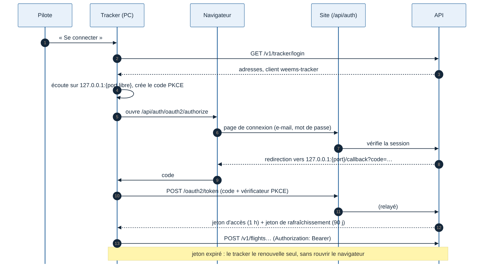

# J3 — Alpha fermée

Rédigée le 11/11/2026, pendant le développement (Greg a choisi de coder J3 sans spécification préalable). Ce document note ce qui est fait et les choix pris au fil de l'eau ; il se complète à chaque PR du jalon. Jalon J3 du lot 1 (voir [Lots et feuille de route](../cadrage/04-lots-et-feuille-de-route.md)).

## Objectif

5 pilotes testeurs installent le tracker sur leur PC, se connectent à leur compte et volent. Leurs vols arrivent sur l'API en ligne (machine virtuelle sur le serveur Hetzner de Greg) et ils les retrouvent sur le site, dans leur carnet personnel.

**Critère de sortie** (feuille de route) : 5 pilotes, 50 vols, zéro vol perdu, phases correctes sur au moins 95 % des vols vérifiés à la main.

## Périmètre

| Dans J3 | Hors J3 (jalon prévu) |
| --- | --- |
| Comptes pilotes, inscription sur invitation (alpha fermée) | Inscription libre (J4) |
| Connexion du site (e-mail et mot de passe) | Lien magique, mot de passe oublié par e-mail (il faut un service d'envoi d'e-mails) |
| Connexion du tracker par le navigateur (OAuth 2.1 avec PKCE) | Application iPad (lot 4) |
| Application tracker avec interface (Electron) et installateur Windows | Microsoft Store (J4 : micro-entreprise et compte Store) |
| Carnet personnel, page de vol réservée au pilote | Profil public, vols publics |
| Rapport de vol : phases, temps, atterrissage | **Note et débriefing** : les critères ne sont pas encore définis avec un pilote |
| Mise en ligne sur une machine virtuelle Hetzner, sauvegardes hors serveur | Scaleway (production publique) |

**Écart avec la feuille de route** : elle prévoyait le « recalcul de la note » côté API. Il n'y a pas encore de note : ses critères (point 4 de la spec T0) attendent la séance avec un pilote. Le rapport de vol montre donc les mesures, sans note.

## 1. Comptes (API)

- Bibliothèque : **Better Auth 1.7** dans l'API, avec ses extensions `jwt` et `oauth-provider`. Les tables sont dans la base PostgreSQL de l'API (`users`, `sessions`, `accounts`, clés de signature, clients et jetons OAuth).
- **Inscription** : seulement avec un code d'invitation créé pour cette adresse e-mail (`pnpm invite <e-mail>`), utilisable une fois.
- **Site** : session par cookie. Les routes `/api/auth/*` sont appelées à travers le site (même adresse que les pages), qui les relaie à l'API.
- **Tracker** : il demande à l'API comment se connecter (`GET /v1/tracker/login`), ouvre le navigateur du pilote, reçoit le code sur `127.0.0.1` (port libre), puis l'échange contre un jeton d'accès de 1 heure et un jeton de rafraîchissement de 90 jours. Le pilote ne se reconnecte que s'il reste plus de 90 jours sans voler.
- Chaque requête de l'API reconnaît le pilote par son jeton (tracker) ou par le cookie de session (site). Un pilote ne lit que ses propres vols (déjà vrai depuis J0, vérifié par un test avec deux pilotes).
- **Développement** : le jeton fixe `dev-token` reste accepté hors production (`pnpm simulate`, `pnpm fly`). Ses vols appartiennent au pilote de développement, qui peut se connecter au site avec `pilote@weems.local` et le mot de passe `weems-dev-password`.

## 2. Connexion du site

- Tout le site demande d'être connecté, sauf `/login` et `/signup`. Sans session, le visiteur passe par la page de connexion puis revient à la page demandée.
- `/signup?code=…` : l'adresse donnée par `pnpm invite` remplit le code d'invitation.
- L'en-tête montre le nom du pilote et un bouton de déconnexion.
- Tracker : l'API envoie le navigateur sur la page de connexion du site, dans la langue du navigateur. Après la connexion, le navigateur repart vers le tracker (`127.0.0.1`). Vérifié par un test navigateur (`pnpm test:j3`) avec le vrai site et la vraie API, jusqu'aux jetons.

## 3. Connexion du tracker

- Module `apps/tracker/src/account/`, sans Electron : il tourne et se teste sur Mac.
- Connexion : le tracker lit `GET /v1/tracker/login`, ouvre un petit serveur sur `127.0.0.1` (port libre, fermé dès la réponse ou après 10 min), ouvre le navigateur du pilote, vérifie le `state`, puis échange le code (PKCE).
- Jetons gardés dans un fichier chiffré par le système (Electron `safeStorage` : DPAPI sous Windows). Un fichier illisible équivaut à « déconnecté ».
- Le jeton d'accès est renouvelé 1 minute avant sa fin. Si le jeton de rafraîchissement est refusé, le pilote est déconnecté et l'envoi s'arrête (401) ; les vols restent dans la file locale et partent après la reconnexion. Une panne réseau pendant le renouvellement ne déconnecte pas.
- Testé contre la vraie API (`e2e/tracker-account.test.ts`) : connexion, renouvellement, refus du jeton de rafraîchissement.

## Choix faits pendant le développement

| Sujet | Choix | Pourquoi |
| --- | --- | --- |
| Bibliothèque de comptes | Better Auth 1.7.20 [Confiance moyenne] | TypeScript, gère à la fois les comptes du site et un vrai fournisseur OAuth 2.1 (PKCE, port libre sur 127.0.0.1 accepté, jetons de rafraîchissement tournants), adaptateur Drizzle. Lucia n'est plus maintenu comme bibliothèque ; écrire soi-même un serveur OAuth est à proscrire |
| Connexion du tracker | Code d'autorisation + PKCE, retour sur 127.0.0.1 (RFC 8252) | Standard des applications de bureau ; le tracker ne voit jamais le mot de passe (décision d'architecture) |
| Jetons du tracker | JWT signés, audience = l'API, vérifiés par l'API sans aller en base | Rapide, et prêt pour une API séparée du site plus tard |
| Client OAuth du tracker | `weems-tracker`, créé au démarrage de l'API, sans écran de consentement | C'est l'application de Weems, pas un tiers |
| Alpha fermée | Codes d'invitation liés à une adresse e-mail | Évite qu'un inconnu crée un compte ; pas besoin d'envoyer d'e-mails |
| Mot de passe oublié | Pas en J3 : Greg crée une nouvelle invitation après suppression du compte | 5 pilotes ; un service d'envoi d'e-mails n'est utile qu'avec l'inscription libre |
| Tables de Better Auth | Écrites à la main dans `apps/api/src/db/auth-schema.ts`, migrations Drizzle comme le reste | Une seule façon de faire évoluer la base. À comparer après chaque mise à jour de la bibliothèque |
| Identifiants | UUID v7 pour les pilotes aussi | Même convention que les vols (spec J0) |
| Look du site | Admin One React (justboil, licence MIT) : seuls les composants utiles sont recopiés, sans Redux ni pages de démonstration (choix de Greg) | Même rendu que le modèle, sans code mort ; PR séparée |
| Carte en direct | Le flux de l'API (`/v1/live/stream`) reste public en J3 (indicatif et position, sans nom ni e-mail) ; la page `/live` du site demande la connexion comme le reste | Rien de personnel n'y est montré. À revoir avant J4 |

## Questions ouvertes

| Question | Qui | Bloquant pour |
| --- | --- | --- |
| Nom de domaine de l'alpha (et risque de marque « Weems ») | Greg | La mise en ligne |
| Accès à une machine virtuelle sur le serveur Hetzner | Greg | La mise en ligne |
| Liste des 5 pilotes testeurs | Houssine | Les invitations |
| Entretiens pilotes (hypothèses H1 et H2) | Greg et Houssine | Rien techniquement ; prévu avant l'alpha |
| Vols de référence de J2 | Greg | La version du tracker donnée aux testeurs |
