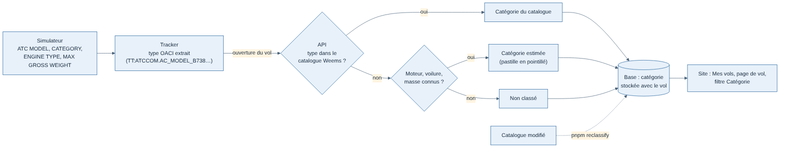
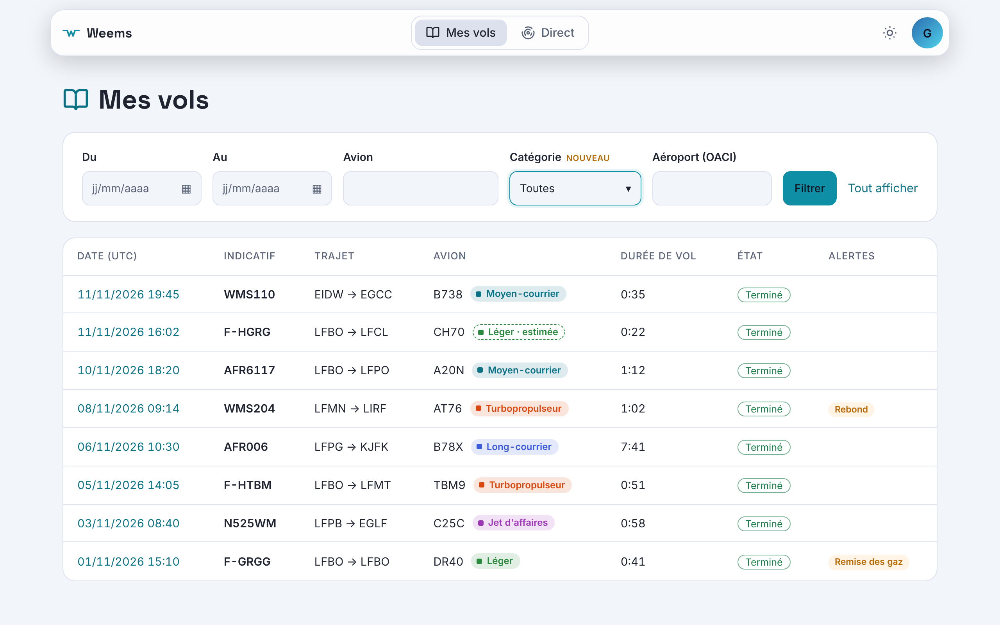
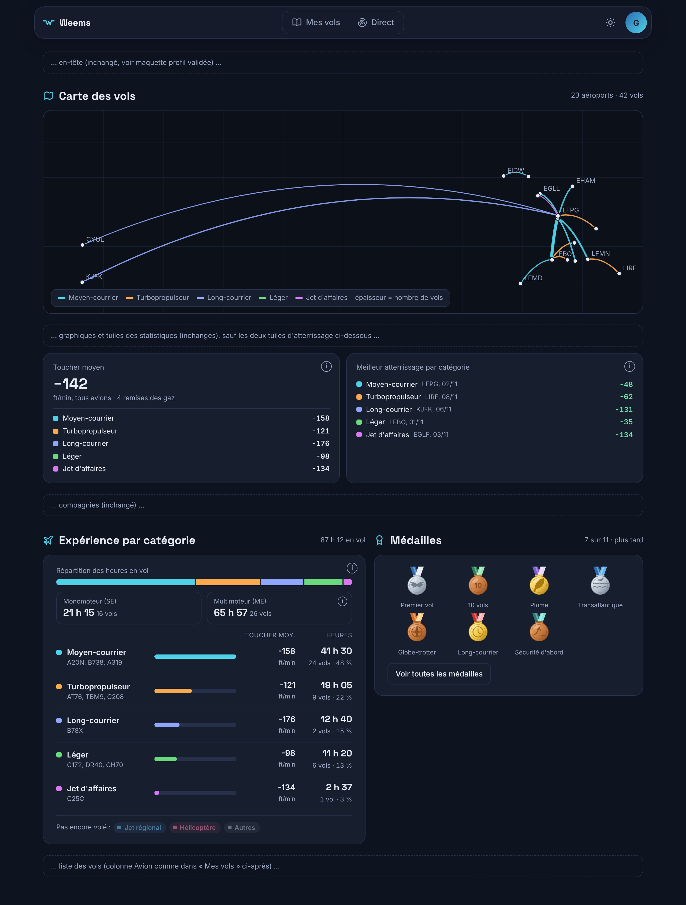
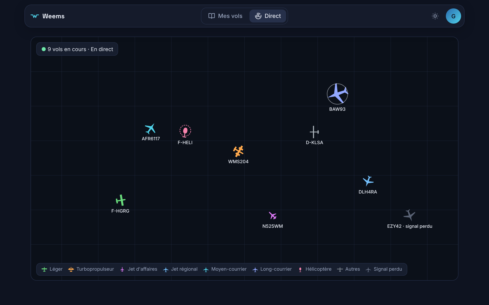

# Spec J4 — Catégories d'avion

Demande de Greg du 11/11/2026, maquettes validées le même jour (`/mnt/project-files/j4-categories/`, `maquette-categories.html?view=profil|vol|vols|direct`). Décision sur la source des données : [fiche 006](../decisions/006-catalogue-des-avions.md).

## Catégories

| Catégorie | Code | Exemples |
| --- | --- | --- |
| Léger | `light` | C172, DR40, SR22, DA62, VL3 |
| Turbopropulseur | `turboprop` | TBM9, PC12, C208, AT76, DH8D |
| Jet d'affaires | `businessJet` | C25C (CJ4), C700, PC24, SF50 |
| Jet régional | `regionalJet` | CRJ7, CRJ9, E175, E195 |
| Moyen-courrier | `narrowBody` | A20N, A321, B738, BCS3 |
| Long-courrier | `wideBody` | A359, B748, B77W, B78X |
| Hélicoptère | `helicopter` | AS50 (H125), EC35, R44, G2CA |
| Autres | `other` | planeurs, F/A-18, Concorde |

## D'où vient la catégorie

1. Le tracker lit `ATC MODEL` (le type OACI ; sur MSFS 2020, il extrait le type d'une clé du genre `TT:ATCCOM.AC_MODEL_B738.0.text`), `CATEGORY`, `ENGINE TYPE` et `MAX GROSS WEIGHT`, et les envoie à l'ouverture du vol (`AircraftInfo` : `engineType`, `airframe`, `maxGrossWeightKg`, nuls pour les anciens trackers, toujours acceptés).
2. L'API cherche le type dans le catalogue Weems. S'il est absent, elle estime : hélicoptère, pistons → léger, turbopropulseur, planeur → autres ; réacteur selon la masse maximale (moins de 30 t affaires, de 60 t régional, de 150 t moyen-courrier, au-delà long-courrier). Sans information, pas de catégorie.
3. La catégorie est stockée avec le vol (`aircraft_category`, `aircraft_category_estimated`) et renvoyée dans la liste et le détail (`aircraftClass`). `pnpm reclassify` la recalcule après une modification du catalogue.

## Livraison en deux demandes de fusion

Le profil public (PR #35) a été fusionné avant la fin du travail : son bloc a rejoint la première demande.

| PR | Contenu | Retour arrière |
| --- | --- | --- |
| #41 | Catalogue, données du tracker, API (stockage, filtre `category`), pastille dans « Mes vols » et sur la page de vol, filtre Catégorie ; profil public : bloc « Expérience par catégorie » (heures en vol, vols, toucher moyen par catégorie), monomoteur / multimoteur (colonnes SE / ME du carnet EASA), meilleur atterrissage par catégorie, trajets de la carte colorés par catégorie | — |
| 2 | Carte du direct : silhouette par famille d'avion et couleur de la catégorie | Greg n'est pas sûr d'aimer : la PR ne contient que ça, on l'annule sans toucher au reste |

## Règles d'affichage

- Pastille teintée de la couleur de la catégorie ; en pointillé avec « estimée » quand le type est absent du catalogue (bulle d'explication au survol). Rien quand la catégorie est inconnue.
- Couleurs : variables `--wm-cat-*` de `global.css`, en sombre et en clair.
- Heures comptées : heures en vol (roues en l'air), comme la tuile « Heures de vol » du profil.
- Bloc du profil (API : `stats.experience`, calcul dans `apps/api/src/modules/profiles/experience.ts`) : une ligne par catégorie volée, la plus volée en premier, avec ses trois types les plus volés, son toucher moyen et sa part des heures ; les catégories pas encore volées en pastilles grisées. Le bloc n'apparaît pas tant qu'aucun vol n'a de catégorie (vols des trackers plus anciens que le catalogue).
- Monomoteur : un moteur ; multimoteur : deux ou plus ; un planeur (zéro moteur) n'entre dans aucune des deux colonnes.
- Tuile « Toucher moyen » : moyenne de tous les avions, puis une ligne par catégorie. Tuile « Meilleur atterrissage par catégorie » : le toucher le plus doux de chaque catégorie, avec l'aéroport et la date ; le record global n'est plus affiché.
- Carte des vols du profil : chaque trajet prend la couleur de la catégorie la plus volée sur ce trajet (à égalité, la première rencontrée ; couleur habituelle des trajets sans catégorie) ; la légende ne montre que les catégories présentes.

## Hors champ

- Heures par type d'avion (écartée par Greg).
- Médailles par catégorie : dans la liste d'idées, avec les médailles.
- La notation (point 4 de la spec T0) devra utiliser la catégorie : les critères d'approche stabilisée diffèrent entre un C172 et un A320.
