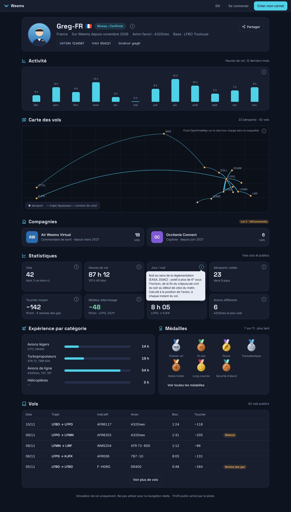
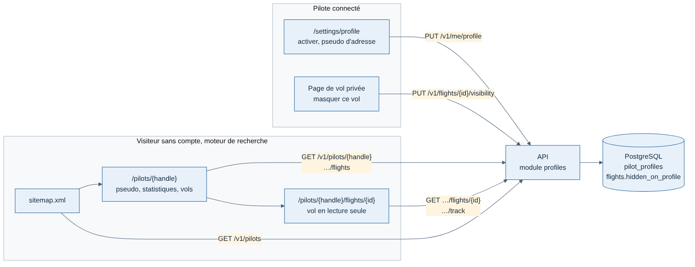
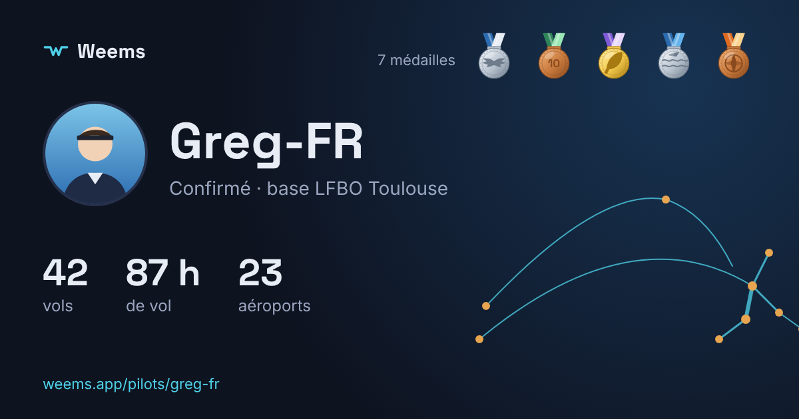

# J4 — Profil public du pilote

Rédigée le 11/11/2026, avant le code. Chantier « profil public » du jalon J4 (voir [Lots et feuille de route](../cadrage/04-lots-et-feuille-de-route.md)) ; la montée en charge du direct est traitée à part. Tout se développe et se teste en local (décision de Greg du 11/11/2026) : le référencement réel attend la mise en ligne.

## Objectif

Un pilote qui le souhaite obtient une page publique, partageable par un simple lien et trouvable par les moteurs de recherche : son pseudo, ses statistiques et ses vols. C'est le levier d'acquisition du lot 1 (« effet communauté », [parc et positionnement](../cadrage/01-parc-et-positionnement.md)).

**Critère de fin** : un pilote active son profil depuis le site ; un navigateur sans compte voit sa page et ses vols ; il désactive, la page répond 404 au rechargement suivant ; aucune donnée de la liste « jamais publique » n'apparaît dans les réponses publiques de l'API (vérifié par test).

## Périmètre

| Dans ce chantier | Hors chantier |
| --- | --- |
| Activation du profil par le pilote (désactivé par défaut), choix de l'adresse | Compagnies du pilote (nom, rang, vols pour la compagnie) : lot 3, VACommunity ; la maquette montre leur place |
| Photo, pays, aéroport de base, niveau déclaré, identifiants VATSIM, IVAO et SimBrief, carte des vols, activité par mois, heures de jour et de nuit, image de partage (ajouts de Greg du 11/11/2026) | Heures par catégorie d'avion (léger, turbopropulseur, ligne, hélicoptère) : attend le catalogue des avions |
| Page publique : pseudo, statistiques, liste des vols | Médailles de pilote (récompenses automatiques illustrées) : après la notation, dont dépendent les plus intéressantes ; maquette dans la liste des idées |
| Page de vol publique : trajet, carte, profil vertical, phases, atterrissage | Note et débriefing : les critères ne sont pas définis |
| Masquer un vol précis de son profil | Biographie, abonnés, commentaires, « j'aime », classements |
| Référencement : rendu serveur, métadonnées, plan du site, `robots.txt` | « En vol maintenant » sur le profil (dépend du direct, autre chantier) ; export et suppression du compte (RGPD, avant J5, chantier à part) |

**Maquette** (11/11/2026, données fictives ; les blocs « Compagnies », « Expérience par catégorie » et « Médailles » y montrent la suite, hors de ce chantier ; la carte y est dessinée sans fond, le site utilisera le fond OpenFreeMap) :

## 1. Adresse

- Profil : `/{langue}/pilots/{pseudo-url}`, par exemple `/fr/pilots/greg-fr`.
- Vol public : `/{langue}/pilots/{pseudo-url}/flights/{id}`.
- **Pseudo d'adresse** (`handle`) : choisi par le pilote à l'activation, unique, 3 à 30 caractères `a-z`, `0-9` et `-`, sans tiret au début ni à la fin. Proposé par défaut à partir de son pseudo affiché. Une liste de mots réservés (`admin`, `weems`, `support`, `settings`…) est refusée.
- Modifiable ; l'ancienne adresse répond alors 404, sans redirection (simple, et aucun lien n'est encore partagé en local) [Confiance moyenne : à revoir avant J5 si des pilotes changent souvent d'adresse].
- Pourquoi pas l'identifiant du compte (UUID) dans l'adresse : illisible, mauvais pour le partage et le référencement. Pourquoi pas le pseudo affiché : il n'est pas unique et peut contenir n'importe quel caractère.

## 2. Ce qui est public, ce qui ne l'est jamais

| Public quand le profil est activé | Jamais public |
| --- | --- |
| Pseudo affiché, pseudo d'adresse, date de création du compte | E-mail, identifiant interne du compte, sessions, jetons |
| Photo, pays, aéroport de base, niveau déclaré, identifiants VATSIM et IVAO (s'ils sont remplis) | Identifiant SimBrief (sert au tracker, EF-04 ; SimBrief n'a pas de page de profil publique [Confiance moyenne]) |
| Vols **clos** non masqués : indicatif, avion, départ, arrivée, heures UTC, temps bloc et en vol, phases, atterrissage, événements, trajectoire simplifiée | Vols en cours (pas de suivi d'une personne en temps réel par son profil) |
| Statistiques calculées sur ces vols | Vols masqués par le pilote, et leurs effets sur les statistiques |
| | Version du tracker, trajectoire complète (seule la simplifiée est montrée), avis du pilote sur les phases (alpha) |

Règles :

- **Désactivé par défaut** (cadrage, section RGPD). Rien n'est public tant que le pilote n'a pas activé lui-même le profil.
- **Désactivé ou inexistant = 404**, la même réponse dans les deux cas : on ne révèle pas qu'un pseudo existe.
- **Vol masqué** : bouton sur sa page de vol privée. Un vol masqué répond 404 en public et sort des statistiques.
- **Effet immédiat** : pas de cache côté site ni côté API pour ces pages en J4 ; une désactivation se voit au rechargement suivant.

## 3. Confidentialité et RGPD

- **Base légale** : le consentement du pilote (activation explicite, case à cocher qui dit ce qui sera visible), retirable à tout moment par le même interrupteur.
- **Minimisation** : un pseudo, aucune donnée d'identité réelle. Le formulaire d'activation rappelle de ne pas utiliser son vrai nom s'il ne le souhaite pas.
- **Retrait** : la désactivation retire la page tout de suite chez Weems et du plan du site. Les moteurs de recherche peuvent garder une copie quelques jours : le texte d'activation le dit [Confiance élevée].
- **Trace** : la date d'activation est gardée (preuve du consentement) ; la date de désactivation aussi.
- Les mentions de confidentialité (jalon J4, « CGU et confidentialité ») devront décrire ce traitement. Hors de ce chantier, noté pour ne pas l'oublier.

## 4. Contenu des pages

**Profil** (`/pilots/{handle}`)

Ordre des blocs (validé avec Greg sur la maquette) : en-tête ; activité ; carte des vols ; compagnies (lot 3) ; statistiques ; expérience par catégorie et médailles côte à côte (toutes deux plus tard) ; liste des vols.

- En-tête : photo (initiales à défaut), pseudo, drapeau et nom du pays, niveau déclaré, « sur Weems depuis » (création du compte), avion le plus volé, liens vers les pages VATSIM et IVAO du pilote, bouton « Partager ».
- Statistiques : nombre de vols, heures de vol (temps en vol) et heures bloc, aéroports différents visités, nombre d'avions différents, taux de chute moyen au toucher et meilleur atterrissage (le plus doux), plus long vol, nombre de remises des gaz, heures de jour et de nuit.
- **Heures de nuit** : définition réglementaire (EASA, DGAC) : de la fin du crépuscule civil du soir au début de celui du matin, soit le soleil à plus de 6° sous l'horizon. Calculées sur la trajectoire simplifiée (environ 500 points par vol), en vol seulement : la position du soleil est calculée au milieu de chaque intervalle entre deux points, à la position de l'avion. Précision de l'ordre de la minute, suffisante pour un carnet de simulation [Confiance élevée]. Un vol sans trajectoire compte en heures de vol mais ni de jour ni de nuit.
- **Activité par mois** : heures de vol des 12 derniers mois, un bâton par mois.
- **Aides** (demande de Greg) : une petite icône « i » en haut à droite des cases dont le calcul n'est pas évident (vols comptés, heures de vol et bloc, jour et nuit, aéroports, toucher moyen, meilleur atterrissage, plus long vol, avions, activité, carte, niveau déclaré) ; une bulle explique le calcul au survol, et au toucher sur mobile. Textes dans les fichiers de traduction.
- Liste des vols, du plus récent au plus ancien, 20 par page : date, indicatif, trajet, avion, temps bloc, pastilles (remise des gaz, rebond…). Même tableau que « Mes vols », sans filtres.
- **Carte des vols** : un arc par trajet entre départ et arrivée, plus épais quand le trajet est volé souvent, un point par aéroport. Les coordonnées viennent du premier et du dernier point de la trajectoire de chaque vol (pas besoin de l'import OurAirports) ; un vol sans trajectoire n'est pas dessiné. Une route API dédiée renvoie les trajets agrégés (`GET /v1/pilots/{handle}/routes`), pas les trajectoires complètes : la page reste légère quel que soit le nombre de vols.

**Vol public** (`/pilots/{handle}/flights/{id}`) : la page de vol existante (carte colorée par phase, profil vertical, phases, atterrissage, journal), en lecture seule, avec un lien vers le profil. Le vol doit appartenir au pilote de l'adresse, sinon 404.

**Réglages** (`/settings/profile`, connecté) : interrupteur, pseudo d'adresse, photo (envoyer, remplacer, retirer), pays, niveau, identifiants VATSIM, IVAO et SimBrief, lien « Voir mon profil public », rappel de ce qui est public. Ces champs sont gardés même profil désactivé (ils ne sont alors montrés à personne). Nouvelle entrée « Profil public » dans le menu.

**Champs saisis par le pilote** (tous facultatifs) :

| Champ | Valeurs acceptées | Affichage |
| --- | --- | --- |
| Aéroport de base | Code OACI (`LFBO`) | Texte dans l'en-tête |
| Pays | Code ISO 3166-1 alpha-2 (`FR`) | Nom traduit (`Intl.DisplayNames`) et drapeau en image (bibliothèque `flag-icons`, licence MIT : Windows n'affiche pas les drapeaux en émoji) |
| Niveau déclaré | `beginner`, `intermediate`, `advanced`, `real_pilot` (Débutant, Intermédiaire, Confirmé, Pilote réel) | Pastille ; déclaratif, rien ne le vérifie |
| VATSIM | Identifiant numérique (CID), 6 à 8 chiffres | Lien vers sa page de statistiques VATSIM |
| IVAO | Identifiant numérique (VID), 5 à 7 chiffres | Lien vers sa page de membre IVAO |
| SimBrief | Nom d'utilisateur ou identifiant de pilote, 1 à 32 caractères `A-Z a-z 0-9 _ . -` | Jamais public (import du plan de vol par le tracker, plus tard) |

Les adresses VATSIM et IVAO sont construites par le site à partir de l'identifiant, jamais saisies : aucun lien arbitraire sur une page publique.

**Photo** :

- Envoi par le pilote depuis ses réglages : JPEG, PNG ou WebP, 5 Mo au plus. L'API vérifie le vrai format du fichier (pas son nom), le recadre en carré, le réduit à 256 × 256 et le réencode en WebP : les métadonnées (position GPS de l'appareil photo, etc.) disparaissent au passage.
- Stockée dans PostgreSQL (une vingtaine de Ko par pilote), comme les trajectoires ; pas de stockage de fichiers à installer pour l'instant. À déplacer vers un stockage compatible S3 si le volume le demande [Confiance moyenne].
- Servie par l'API (`GET /v1/pilots/{handle}/photo`), seulement si le profil est public ; le pilote voit toujours la sienne.
- Bibliothèque de traitement d'image : `sharp` (licence Apache 2.0), la référence sous Node.js.
- **Modération** : pas de vérification automatique en J4. Les conditions d'utilisation (à rédiger, jalon J4) interdiront une image choquante ou le visage d'un tiers sans accord ; un bouton « signaler » et le retrait par Weems viendront avec la mise en ligne publique [Confiance moyenne : suffisant pour des testeurs connus, pas pour une inscription libre].

Textes en français et en anglais, comme le reste du site.

## 5. Référencement

- Pages rendues côté serveur (déjà le cas), titre et description par page (« Greg-FR — 42 vols sur Weems »), image de partage (Open Graph) générique Weems en J4.
- **Image de partage** (aperçu dans Discord, Facebook, forums) : générée par le site pour chaque profil, avec photo, pseudo, trois statistiques et la carte simplifiée des trajets (générateur d'images de Next.js, sans service externe).

  

- Adresse canonique et variantes de langue (`hreflang` fr et en).
- `sitemap.xml` : les profils activés, avec leur date de mise à jour ; `robots.txt` : tout le reste du site (pages connectées) est exclu.
- Pages connectées marquées `noindex`.
- Limite assumée [Confiance élevée] : en local, rien n'est indexé ; on vérifie les balises et le plan du site, pas le classement.

## 6. API

Nouveau module `profiles` : `routes.ts`, `service.ts`, `repository.ts`. Il lit les vols par le service du module `flights`, jamais par son `repository`.

| Route | Accès | Rôle |
| --- | --- | --- |
| `GET /v1/me/profile` | Pilote connecté | État du profil, pseudo d'adresse, pseudo proposé |
| `PUT /v1/me/profile` | Pilote connecté | Activer ou désactiver, changer le pseudo d'adresse (400 s'il est mal formé, 422 s'il est réservé ou absent alors qu'on publie, 409 s'il est pris) |
| `PUT /v1/flights/{id}/visibility` | Propriétaire du vol | Masquer ou montrer un vol sur le profil |
| `GET /v1/pilots/{handle}` | Public | Profil et statistiques |
| `GET /v1/pilots/{handle}/flights` | Public | Vols publics, par pages (même curseur que `/v1/flights`) |
| `GET /v1/pilots/{handle}/flights/{id}` et `…/track` | Public | Vol public et trajectoire simplifiée |
| `GET /v1/pilots/{handle}/routes` | Public | Trajets agrégés pour la carte (départ, arrivée, coordonnées, nombre de vols) |
| `GET`, `PUT` et `DELETE /v1/me/profile/photo` | Pilote connecté | Voir, envoyer (image brute, `Content-Type: image/jpeg`, `image/png` ou `image/webp`) ou retirer sa photo |
| `GET /v1/flights/{id}/visibility` | Propriétaire du vol | Savoir si le vol est masqué |
| `GET /v1/pilots/{handle}/photo` | Public | Photo en WebP 256 × 256 |
| `GET /v1/pilots` | Public | Profils activés et date de mise à jour, pour le plan du site |

- Base : nouvelle table `pilot_profiles` (compte, pseudo d'adresse unique, activé oui ou non, pays, aéroport de base, niveau, identifiants VATSIM, IVAO et SimBrief, dates d'activation, de désactivation et de mise à jour), une table `profile_hidden_flights` (vols masqués, avec le pilote) et une table `pilot_photos`. Ni la table `flights` ni celles de Better Auth ne changent : le module `profiles` n'écrit que dans ses tables, et lit les vols par le service du module `flights`.
- Formats des réponses publiques dans `packages/contrats`, **distincts** des formats privés : un format public ne contient que les champs de la colonne « public » ci-dessus. C'est ce qui empêche une fuite si on ajoute plus tard un champ privé à un vol.
- Statistiques calculées à la demande à partir des vols et de leurs événements. Suffisant en local et pour l'alpha ; à remplacer par des valeurs stockées à la clôture du vol si un profil dépasse quelques centaines de vols [Confiance moyenne].
- Routes publiques limitées en débit par adresse IP (protection contre l'aspiration des profils).

## 7. Site

- `proxy.ts` : `/pilots/*`, `sitemap.xml` et `robots.txt` ouverts sans compte ; le reste du site reste derrière la connexion.
- Les composants de la page de vol sont réutilisés tels quels (`src/flight/`) ; la page publique ne fait que changer la source des données (routes publiques, sans cookie).
- Nouveau dossier `src/profile/` : statistiques, en-tête, réglages.

## 8. Tests

| Exigence | Test |
| --- | --- |
| Désactivé par défaut | Un compte neuf : `GET /v1/pilots/{handle}` répond 404 |
| 404 identique | Profil désactivé et pseudo inexistant : même réponse |
| Vol d'un autre pilote | `/pilots/a/flights/{vol de b}` répond 404 |
| Vol masqué | 404 en public et absent des statistiques |
| Vol en cours | Absent de la liste et 404 en public |
| Aucune donnée privée | La réponse publique ne contient ni e-mail, ni identifiant de compte, ni version du tracker (test sur le contenu brut) |
| Pseudo d'adresse | Mal formé : 400 ; réservé : 422 ; déjà pris : 409 ; deux demandes simultanées : une seule gagne |
| Champs saisis | Pays, aéroport de base, niveau, VATSIM, IVAO ou SimBrief hors format : 400 ; SimBrief absent de la réponse publique |
| Photo | Fichier qui n'est pas une image JPEG, PNG ou WebP : 422 ; type annoncé non accepté : 415 ; plus de 5 Mo : 413 ; image rendue en WebP 256 × 256 sans métadonnées ; 404 si le profil est désactivé |
| Carte | Les trajets regroupent les vols dans les deux sens séparément ; vols masqués et sans trajectoire exclus |
| Droits | Masquer le vol d'un autre pilote : 404 |
| Site | Test navigateur : activer, ouvrir le profil sans session, désactiver, 404 |
| Référencement | Le plan du site liste les profils activés seulement ; les pages connectées portent `noindex` |

## 9. Ordre de livraison

1. Cette spec, validée par Greg.
2. API : table, routes, formats publics, tests (une PR).
3. Site : réglages, page de profil, page de vol publique, référencement, test navigateur (une PR).

## Choix proposés à Greg

| Sujet | Recommandation | Alternative écartée |
| --- | --- | --- |
| Adresse | `/pilots/{pseudo-url}`, pseudo d'adresse choisi et unique | Identifiant du compte : illisible ; pseudo affiché : pas unique |
| Granularité | Un interrupteur pour le profil, plus « masquer ce vol » | Tout ou rien : un vol raté pousserait à tout fermer ; vol par vol à activer : trop de clics, profils vides |
| Vols en cours | Jamais sur le profil | Les montrer : suivi d'une personne en temps réel, et dépend du chantier du direct |
| Référencement | Profil activé = référencé, sans réglage séparé | Case « ne pas référencer » : une option de plus pour un gain faible ; ajoutable plus tard |
| Photo | Dans la v1 (choix de Greg), stockée dans PostgreSQL, réduite et nettoyée par l'API | Stockage de fichiers S3 dès maintenant : un service de plus à faire tourner pour une vingtaine de Ko par pilote |
| Carte des vols | Arcs départ → arrivée à partir des trajectoires | Toutes les trajectoires sur la carte : des milliers de points par vol, page lourde |
| Niveau | Déclaré par le pilote en v1 ; heures par catégorie quand le catalogue des avions existera | Heures par catégorie tout de suite : demande de classer chaque avion de MSFS |
| Statistiques | Calculées à la demande | Stockées à la clôture : plus rapide, mais une migration et un recalcul en plus, inutiles à ce volume |
