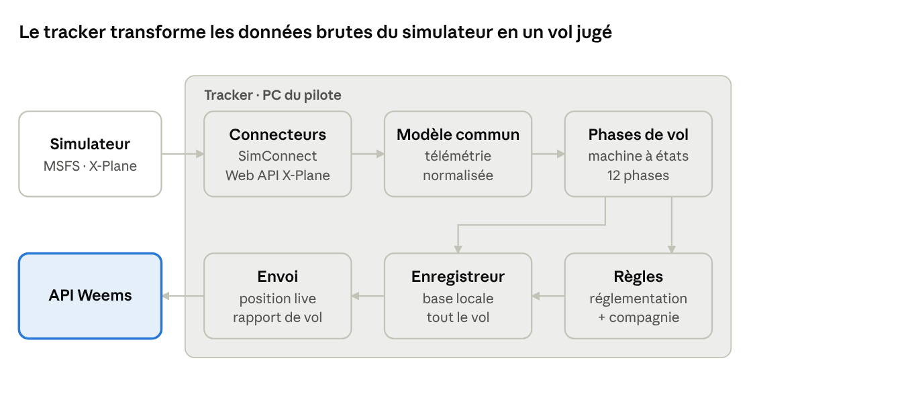

# Weems Tracker — Cahier des charges

10 novembre 2026 · Version en ligne : https://claude.ai/artifact/BKSjt3B1bQof9yqzCptkiq

## Contexte

Le tracker est la première brique à construire : c'est le seul composant de Weems qui produit des données de vol. Il tourne sur le PC du pilote, lit le simulateur pendant tout le vol, et envoie la position en direct puis un rapport de vol complet à l'API Weems.

**Weems** est un écosystème d'outils pour passionnés de simulation de vol, des amateurs aux semi-pros : tracker, API, suivi des vols (web et iPad), gestion de compagnie virtuelle. Modèle freemium. Le réalisme est la marque de fabrique : les vols sont jugés sur les règles et procédures réelles.

**Utilisateurs du tracker**

- Le pilote solo, qui veut un carnet de vol automatique et une analyse de ses vols.
- Le pilote membre d'une ou plusieurs compagnies virtuelles, qui veut que ses vols soient validés par sa compagnie sans changer d'outil.
- Plus tard, le staff de compagnie, qui définit les règles que le tracker contrôle.

**Objectifs du lot 1**

1. Enregistrer automatiquement un vol complet sous MSFS 2020 et 2024, du départ au parking, sans action du pilote en dehors du lancement.
2. Envoyer la position en direct pour la carte de suivi.
3. Produire un rapport de vol fiable : trajectoire, phases, carburant, atterrissage, écarts aux règles.
4. Survivre aux aléas : crash du simulateur, perte de réseau, pause, accélération du temps.

**Hors périmètre du lot 1 :** X-Plane (prévu dans l'architecture), gestion de compagnie, EFB, cartes sous licence.

**Décidé :** MSFS 2020 et 2024 seuls au lot 1 ; tracker sur Windows uniquement, puisque MSFS ne tourne que sur Windows et Xbox.

## Plan du cahier des charges

Toutes les sections sont rédigées. Le contrat avec l'API reste provisoire jusqu'à l'étape 2 (architecture et flux), et les seuils de notation seront calés sur de vrais vols pendant le prototype.

1. **Contexte** — rédigé.
2. **Fonctionnement d'un tracker** — principe général et schéma.
3. **Documentation technique** — SimConnect (MSFS) : ce qu'on peut lire, comment, et les limites.
4. **Étude de la concurrence** — fonctionnalités des trackers existants, données non exploitées, catalogue des données et capacités.
5. **Exigences fonctionnelles** — rédigé.
6. **Exigences non fonctionnelles** — rédigé.
7. **Contrat avec l'API** — version provisoire, à finaliser à l'étape 2.
8. **Choix techniques** — rédigé.
9. **Lotissement et critères d'acceptation** — rédigé.

## Fonctionnement d'un tracker

Un tracker est une chaîne en 5 étages : lire le simulateur, traduire les données dans un format commun, déduire la phase de vol, enregistrer localement, envoyer à l'API. La difficulté n'est pas la lecture des données mais leur interprétation fiable (phases, atterrissage, triche) et la résistance aux pannes.

1. **Connecteur simulateur** : un module par simulateur (SimConnect pour MSFS au lot 1 ; X-Plane plus tard, avec son propre connecteur). C'est la seule partie qui connaît le simulateur.
2. **Modèle de télémétrie commun** : position, altitudes, vitesses, attitude, moteurs, carburant, configuration (volets, train, feux), état du simulateur (pause, accélération, slew). Le reste du tracker ne voit que ce modèle, ce qui rend X-Plane ajoutable plus tard sans tout réécrire.
3. **Machine à états des phases** : embarquement, repoussage, roulage, décollage, montée, croisière, descente, approche, finale, atterrissage, roulage arrivée, arrivée. Chaque transition a des règles explicites et testées.
4. **Enregistreur local** : base locale sur le PC qui garde tout le vol (trajectoire, événements, échantillons fins autour du décollage et de l'atterrissage). Si le simulateur ou le réseau tombe, le vol n'est pas perdu.
5. **Envoi à l'API** : position en direct à basse fréquence pour la carte, puis rapport de vol complet à l'arrivée. File d'attente si le réseau est coupé.

Seuls les connecteurs dépendent du simulateur. Tout le reste resservira tel quel le jour où X-Plane arrivera.

Un moteur de règles se branche sur les étages 3 et 4 : il compare le vol aux règles réelles (250 kt sous le niveau 100, approche stabilisée, feux) et aux règles de la compagnie, puis note le vol.

**Propositions de fréquences, à valider à l'étape 2 :** lecture du simulateur à chaque image près du sol et 1 fois par seconde en croisière ; position en direct toutes les 5 à 15 secondes selon la phase ; rapport de vol en une seule fois à l'arrivée.

## Documentation technique

MSFS expose tout ce qu'il faut pour un tracker, gratuitement. Le vrai piège est ailleurs : les avions tiers complexes (Fenix, PMDG, FlyByWire) gardent une partie de leur état dans des variables internes que l'API standard lit mal, surtout sous MSFS 2024.

### MSFS 2020 et 2024 : SimConnect

| Sujet | Ce que dit la doc | Conséquence pour Weems |
| --- | --- | --- |
| Lecture des données | `SimConnect_RequestDataOnSimObject` sur l'avion du joueur (`SIMCONNECT_OBJECT_ID_USER`), avec une période (une fois, chaque seconde, chaque image…) et l'option « seulement si ça change » | Changer la fréquence selon la phase sans recréer la requête |
| Atterrissage | Variables dédiées : `PLANE TOUCHDOWN NORMAL VELOCITY` (vitesse verticale au toucher), tangage, inclinaison, cap, latitude et longitude au toucher | Taux d'atterrissage fourni par le simulateur, pas besoin de le recalculer. Doit être recoupé avec nos propres échantillons (rebonds, valeurs aberrantes) |
| Piste | `SURFACE TYPE`, `SURFACE CONDITION` (sèche, mouillée, gelée, neige) | Donnée rarement exploitée, voir plus bas |
| Triche | `IS SLEW ACTIVE` ; événements `Pause_EX1` (types de pause), `PositionChanged` (téléportation), `Crashed` | Détection fiable du slew, de la téléportation et du crash |
| Cycle de vie | Événements `SimStart`, `SimStop`, `FlightLoaded`, `AircraftLoaded` | Démarrage et reprise automatiques du suivi |
| Changement d'avion | Relire régulièrement le titre de l'avion | Détecter un changement d'avion en plein vol |
| Booléens | Vrai peut valoir 1 ou -1 | Toujours tester « différent de 0 » |

**Limites connues, signalées par les développeurs :**

- Sous MSFS 2024, les variables internes « scopées » des avions (`L:1:…`) ne sont pas lisibles par SimConnect. Il faut passer par un module WASM (FSUIPC, WASimCommander ou le nôtre). phpVMS exige déjà le module WASM de FSUIPC pour cette raison.
- Les événements de pause sont signalés comme peu fiables (mode photo, menu, avions PMDG qui génèrent des pauses en boucle). Il faut croiser avec l'évolution du temps de simulation.
- MSFS 2024 n'envoie pas toujours `SimStop` en revenant au menu principal.
- SimConnect ne tourne que sous Windows, donc le tracker MSFS est une application Windows.

### Plus tard : X-Plane

Hors lot 1, mais à garder en tête dès maintenant. X-Plane 12.1.1 et suivants offrent une Web API locale (REST et WebSocket, port 8086) qui suffit pour un tracker, sans plugin. X-Plane tourne sous Windows, macOS et Linux : le cœur du tracker ne doit donc pas dépendre de Windows, seul le connecteur MSFS le peut. Documentation dans les sources.

**Recommandation technique, à confirmer à l'étape 2 :** un cœur commun (modèle, phases, règles, enregistrement, envoi) et un connecteur MSFS, avec une frontière nette pour brancher X-Plane plus tard. Le langage dépendra de tes compétences ; les options matures sont C#/.NET (le SDK SimConnect officiel le supporte) ou Rust/TypeScript avec une bibliothèque SimConnect communautaire. [Confiance moyenne]

## Concurrence

Tous les trackers font la même base (position, phases, taux d'atterrissage, rapport de vol). Ils se différencient sur un seul axe chacun : le confort social pour Volanta, la compagnie virtuelle pour smartCARS, phpVMS et vAMSYS, l'atterrissage pour BeatMyLanding. **FlightLinq est le concurrent le plus proche du concept Weems** : il réunit déjà tracker, carnet de vol, gestion de compagnie et carte en direct.

| Tracker | Simulateurs | Modèle | Ce qu'il fait bien | Ce qui manque |
| --- | --- | --- | --- | --- |
| [Volanta](https://volanta.app/premium) (Orbx) | MSFS, X-Plane, P3D, FSX | Gratuit + Premium (± 3,50 £/mois) | Carte 2D/3D, import SimBrief, amis, vols en groupe, horaires réels, sauvegardes cloud, appli mobile (Premium) | Aucune notation opérationnelle ; pas de compagnie virtuelle |
| [smartCARS 3](https://kb.canadaairvirtual.ca/books/smartcars-3/export/markdown) (TFDi) | MSFS, X-Plane, P3D, FSX | Gratuit via les compagnies, Pro payant | Windows, macOS et Linux ; envoi automatique du rapport à l'arrêt des moteurs ; validation auto ou manuelle ; plugins | Notation abandonnée (« performance scores are no longer awarded ») ; dépend de la compagnie |
| [vmsACARS](https://docs.phpvms.net/acars/user-guide) (phpVMS) | MSFS (via FSUIPC WASM), X-Plane, P3D, FSX | Lié à phpVMS (libre) | Règles de phases documentées ; détection du poste de stationnement | Windows seulement ; pas de données de navigation ; installation lourde |
| [Pegasus](https://vamsys.io/iberiavirtual/rules) (vAMSYS) | MSFS, X-Plane, P3D | Compris dans l'abonnement de la compagnie | Règles par compagnie : accélération du temps, slew, pause > 5 % du vol, livrée, avion, taux d'atterrissage (idéal -150 à -200 fpm, rejet à -600) | Réservé aux membres d'une compagnie vAMSYS ; règles centrées sur l'anti-triche |
| [FSHub LRM](https://fshub.io/faqs) | MSFS, X-Plane 10/11, P3D, FSX, FS2004 | Gratuit | Taux d'atterrissage, captures d'écran en cloud, compagnies légères | Analyse peu poussée ; X-Plane 12 non listé |
| [BeatMyLanding](https://beatmyland.ing/about) | MSFS 2020 et 2024 | Non précisé | Notation fine de l'atterrissage : charge G, rebond, alignement, axe de piste, vent, pente ; classements | Atterrissage seulement |
| [FlightLinq](https://fselite.net/content/introducing-flightlinq-an-integrated-virtual-airline-management-and-acars-platform/) | MSFS 2020/2024, X-Plane 12 | Non précisé | Tout-en-un : tracker, carnet, compagnie, état et maintenance des avions, progression, carte en direct | Nouveau, à analyser en détail avant de figer le positionnement |

Autres acteurs vus pendant la recherche, non analysés : VABase, Stratos ACARS (pour phpVMS), RealAcars, A Pilot's Life, NeoFly. Les prix et fonctionnalités viennent des pages citées, consultées le 10 novembre 2026 ; certaines pages ne couvraient pas tout.

## Données non exploitées par la concurrence

La concurrence juge surtout **un instant** (le toucher) et **la triche** (pause, slew, accélération). Presque personne ne juge **la conduite du vol** comme le ferait une compagnie réelle. C'est l'angle « réalisme » de Weems, et toutes les données nécessaires sont déjà lisibles dans le simulateur.

« Non exploité » veut dire : aucun des 7 trackers étudiés ne le met en avant dans sa documentation. Je n'ai pas testé chaque logiciel, donc certains le font peut-être sans le dire. [Confiance moyenne]

| Donnée ou analyse | Source | Ce que Weems en fait | Déjà vu chez |
| --- | --- | --- | --- |
| **Approche stabilisée** (vitesse, taux de descente, configuration, alignement à 1 000 ft et 500 ft) | Simulateur : vitesse, vitesse verticale, volets, train, cap | Critère standard des compagnies réelles. Approche non stabilisée sans remise des gaz = pénalité | Personne |
| **Contexte de l'atterrissage** : état de piste, vent de travers, rafales, masse | `SURFACE CONDITION`, vent, masse de l'avion | Pondérer la note : -250 fpm sous 25 kt de vent de travers sur piste mouillée n'est pas un mauvais atterrissage | BeatMyLanding (vent, pente), sans l'état de piste |
| **Point de toucher et freinage** : distance au seuil, zone de toucher, distance de roulage, piste restante | Coordonnées au toucher + données de piste (OurAirports) | Juger un atterrissage long ou une sortie de piste évitée de peu | BeatMyLanding (axe de piste seulement) |
| **Carburant prévu contre réel** : carburant au départ, consommation par phase, réserve à l'arrivée | Simulateur + plan de vol SimBrief | Vérifier le respect de la réserve finale et la qualité de la préparation | Personne |
| **Respect de la route et des altitudes** : écart latéral au plan, altitude de croisière, profil de descente | Position + plan SimBrief | Mesurer la précision de navigation | Personne (vmsACARS lit le plan sans le noter) |
| **Limitations avion** : survitesse, volets ou train hors vitesse, alarme de décrochage, facteur de charge | Alarmes et vitesses du simulateur + limites par type d'avion | Pénalités réalistes, propres à chaque avion | Partiellement, selon les compagnies |
| **Procédures moteur et feux** : feu anticollision avant démarrage, phares sous le niveau 100, temps de refroidissement avant coupure | État des feux, régime moteur, horodatage | Une checklist automatique, configurable par la compagnie | Partiellement (feux, selon les compagnies) |
| **Confort passagers** : facteur de charge vertical et latéral, inclinaison, variations brusques de vitesse verticale | Accélérations du simulateur | Une note de confort lisible par tous, y compris les débutants | Personne |
| **Ponctualité** : heure réelle de bloc contre horaire prévu | Horloge + horaire de la compagnie | Taux de ponctualité, comme dans les vraies compagnies | Personne (Volanta propose les horaires, sans les mesurer) |
| **Progression sur plusieurs vols** : tendances, points faibles récurrents | Historique des rapports de vol | Coaching : « tes approches sont trop rapides à 1 000 ft sur tes 10 derniers vols » | Personne |

**Les 3 plus porteuses pour le lot 1**, car elles n'utilisent que des données du simulateur et des données gratuites : approche stabilisée, contexte de l'atterrissage, confort passagers. Le carburant et la route demandent l'intégration SimBrief, à prévoir dès le lot 1 si possible. La progression demande un historique, donc elle viendra plus tard.

**Limite à garder en tête :** la fiabilité de ces analyses dépend de l'avion. Un avion tiers complexe peut exposer ses volets ou ses alarmes dans des variables internes. Il faudra une table de compatibilité par avion.

## Catalogue des données : socle

Ces 12 familles de données sont le minimum pour égaler Volanta, smartCARS ou vmsACARS. Toutes sont lisibles via SimConnect sur n'importe quel avion, sans module supplémentaire.

Les noms de variables MSFS sont donnés pour guider les développeurs. Ceux marqués ✓ ont été vérifiés dans le SDK 2024 ; les autres viennent de ma connaissance du SDK et seront à confirmer au développement.

| # | Donnée | Variables MSFS (exemples) | Sert à |
| --- | --- | --- | --- |
| 1 | Position et altitude | `PLANE LATITUDE` ✓, `PLANE LONGITUDE` ✓, `PLANE ALTITUDE`, `PLANE ALT ABOVE GROUND` ✓, `INDICATED ALTITUDE` | Trajectoire, carte en direct, distance |
| 2 | Vitesses | `AIRSPEED INDICATED`, `AIRSPEED TRUE`, `AIRSPEED MACH`, `GROUND VELOCITY` ✓, `VERTICAL SPEED` ✓ | Phases, profil de vol |
| 3 | Attitude et cap | `PLANE PITCH DEGREES`, `PLANE BANK DEGREES`, `PLANE HEADING DEGREES TRUE` | Trajectoire, rejeu |
| 4 | État au sol | `SIM ON GROUND`, `BRAKE PARKING POSITION`, `ON ANY RUNWAY` | Début et fin de vol, roulage, décollage |
| 5 | Configuration | `GEAR HANDLE POSITION`, `FLAPS HANDLE INDEX`, `SPOILERS HANDLE POSITION` | Phases (finale, montée) |
| 6 | Moteurs | `NUMBER OF ENGINES`, `GENERAL ENG COMBUSTION:n`, `TURB ENG N1:n` | Bloc départ et arrivée (moteurs démarrés, coupés) |
| 7 | Carburant | `FUEL TOTAL QUANTITY WEIGHT` | Carburant au départ, à l'arrivée, consommé |
| 8 | Masse | `TOTAL WEIGHT`, `EMPTY WEIGHT` | Masse au décollage et à l'atterrissage |
| 9 | Atterrissage | `PLANE TOUCHDOWN NORMAL VELOCITY` ✓, `PLANE TOUCHDOWN PITCH DEGREES` ✓, `PLANE TOUCHDOWN BANK DEGREES` ✓, `G FORCE` | Taux d'atterrissage, facteur de charge |
| 10 | Identité de l'avion | `TITLE`, `ATC MODEL`, `ATC ID` | Type d'avion, immatriculation, changement d'avion |
| 11 | Temps | `ZULU TIME`, `SIMULATION RATE` | Heures de bloc, détection de l'accélération du temps |
| 12 | Intégrité du vol | `IS SLEW ACTIVE` ✓ ; événements `Pause_EX1`, `PositionChanged`, `Crashed`, `AircraftLoaded` ✓ | Anti-triche : pause, slew, téléportation, crash, changement d'avion |

**Sources externes du socle :** plan de vol SimBrief (aéroports, route, avion prévu) et base d'aéroports OurAirports (pour reconnaître l'aéroport de départ et d'arrivée). Tous les concurrents sérieux intègrent SimBrief.

## Catalogue des données : différenciation

Ces données sont lisibles aujourd'hui mais ne sont exploitées par aucun des 7 trackers étudiés, ou seulement en partie. Les trois premières familles suffisent à créer le suivi des passagers. La colonne « Fiabilité » dit si la donnée marche sur tous les avions ou dépend de l'avion.

| # | Donnée | Variables MSFS ou source | Fiabilité |
| --- | --- | --- | --- |
| 13 | Accélérations ressenties en cabine (verticale, latérale, longitudinale) | `ACCELERATION BODY X/Y/Z`, `G FORCE`, vitesses de rotation | Tous avions |
| 14 | Pressurisation | `PRESSURIZATION CABIN ALTITUDE` ✓, `PRESSURIZATION CABIN ALTITUDE RATE` ✓ | Avions pressurisés ; dépend du réalisme de l'avion |
| 15 | Consignes cabine | `CABIN SEATBELTS ALERT SWITCH` ✓, `CABIN NO SMOKING ALERT SWITCH` ✓ | Dépend de l'avion (avions complexes : variables internes) |
| 16 | Charge et passagers | Stations de charge (`PAYLOAD STATION WEIGHT:n`), nombre de passagers du plan SimBrief | Tous avions + SimBrief |
| 17 | Portes | `EXIT OPEN:n` | Dépend de l'avion |
| 18 | Feux | `LIGHT BEACON` ✓, `LIGHT LANDING` ✓, `LIGHT STROBE`, `LIGHT NAV`, `LIGHT TAXI` | Tous avions, sauf certains avions complexes |
| 19 | Alarmes de limites | `OVERSPEED WARNING` ✓, `STALL WARNING` ✓ + table de limites par type d'avion (VMO, VFE, VLE, facteur de charge max) | Alarmes : tous avions ; limites : table à construire |
| 20 | Pilote automatique | `AUTOPILOT MASTER`, modes engagés | Tous avions, sauf certains avions complexes |
| 21 | Moteurs et APU détaillés | Régime, démarrage moteur par moteur, `APU PCT RPM`, repoussage (`PUSHBACK STATE`) | Tous avions pour l'essentiel |
| 22 | Piste et surface | `SURFACE TYPE` ✓, `SURFACE CONDITION` ✓, latitude et longitude au toucher ✓ + seuils et longueur de piste (OurAirports) | Tous avions + base de pistes |
| 23 | Météo vue par l'avion | Vent, rafales, température, pression, visibilité, précipitations, nuages (`AMBIENT …`) | Tous avions |
| 24 | Météo réelle | METAR et TAF (aviationweather.gov) | Externe, gratuit |
| 25 | Plan de vol détaillé | SimBrief : route, niveaux, carburant prévu par phase, réserves, masses prévues, dégagements | Externe, gratuit |
| 26 | Réseau en ligne | Statut VATSIM ou IVAO du pilote (flux publics) | Externe, gratuit |
| 27 | Horaires | Horaire prévu de la compagnie virtuelle | Weems (gestion de compagnie, lot 2) |
| 28 | Usure de l'avion (MSFS 2024) | `WEAR AND TEAR …` ✓ | MSFS 2024 seulement |

**Point d'attention :** les familles 15, 17, 18 et 20 sont souvent gérées par les avions complexes (Fenix, PMDG, FlyByWire) dans leurs propres variables. Le tracker devra savoir dire « donnée indisponible sur cet avion » plutôt que pénaliser le pilote à tort.

## Capacités

Avec ces 28 familles de données, le tracker peut offrir une quarantaine de capacités. Une dizaine sont **courantes** (tout le monde les a : c'est le ticket d'entrée). Le reste est **rare** (un ou deux concurrents, en partie) ou **absent** (aucun des 7 trackers étudiés ne le met en avant). C'est dans les absentes que Weems se différencie.

Les numéros renvoient aux familles de données des deux tableaux précédents. Le lot proposé est une première proposition, à arbitrer ensemble.

### Socle (à avoir au lot 1)

| Capacité | Données | Concurrence |
| --- | --- | --- |
| Carnet de vol automatique : heures de bloc, temps de vol, distance, avion, aéroports | 1, 4, 6, 10, 11 | Courant |
| Carte en direct et trajectoire complète | 1, 2, 3 | Courant |
| Détection automatique des 12 phases de vol | 1, 2, 4, 5, 6 | Courant |
| Taux d'atterrissage et facteur de charge au toucher | 9 | Courant |
| Carburant consommé | 7 | Courant |
| Import du plan de vol SimBrief | Externe | Courant |
| Rapport de vol envoyé automatiquement à l'arrivée | Tout | Courant |
| Anti-triche : pause, slew, accélération, téléportation, changement d'avion | 11, 12 | Courant |
| Reprise après crash du simulateur ou coupure réseau | Enregistreur local | Rare |

### Passagers

C'est le domaine le plus vide du marché, et le plus parlant pour tous les niveaux : un débutant comprend immédiatement « mes passagers ont eu peur ».

| Capacité | Données | Concurrence | Lot |
| --- | --- | --- | --- |
| **Note de confort passagers** : secousses, virages trop inclinés, mises en descente brutales, freinages forts | 13, 3 | Absent | 1 |
| **Pressurisation** : montée ou descente cabine trop rapide (douleurs d'oreilles), oubli de pressurisation | 14 | Absent | 1 |
| **Consignes cabine** : ceinture allumée en turbulence, au décollage et à l'atterrissage | 15, 13 | Absent | 2 |
| **Satisfaction passagers** : note globale combinant confort, ponctualité et qualité d'atterrissage | 13, 14, 9, 27 | Absent | 2 |
| **Embarquement et débarquement** : durée, portes fermées avant repoussage | 16, 17 | Absent | Plus tard |

### Sol et roulage

| Capacité | Données | Concurrence | Lot |
| --- | --- | --- | --- |
| Vitesse de roulage excessive (limite configurable, par exemple 30 kt en ligne droite) | 2, 4 | Absent | 1 |
| Temps de roulage et attente au départ | 4, 11 | Rare | 1 |
| Procédure de démarrage : feu anticollision allumé avant le premier moteur | 18, 21 | Rare | 1 |
| Roulage sur un moteur, usage de l'APU | 21 | Absent | Plus tard |

### Décollage et montée

| Capacité | Données | Concurrence | Lot |
| --- | --- | --- | --- |
| Qualité du décollage : maintien de l'axe, assiette à la rotation (risque de toucher la queue, limite par type d'avion) | 3, 22, 19 | Absent | 2 |
| Rentrée du train et des volets dans les temps | 5, 2 | Absent | 2 |
| 250 kt maximum sous le niveau 100 | 1, 2 | Rare (selon compagnies) | 1 |
| Phares allumés sous le niveau 100 | 18, 1 | Rare (selon compagnies) | 1 |

### Croisière, descente et approche

| Capacité | Données | Concurrence | Lot |
| --- | --- | --- | --- |
| **Approche stabilisée** à 1 000 ft et 500 ft : vitesse, taux de descente, configuration, alignement | 2, 5, 3, 1 | Absent | 1 |
| **Remise des gaz détectée et valorisée** : une approche non stabilisée suivie d'une remise des gaz est une bonne décision, pas une faute | 1, 2, 5 | Absent | 1 |
| Respect de la route et du niveau de croisière prévus | 1, 25 | Absent | 2 |
| Profil de descente : début de descente et pente par rapport à l'idéal | 1, 2, 25 | Absent | 2 |
| Taux d'usage du pilote automatique | 20 | Absent | Plus tard |

### Atterrissage

| Capacité | Données | Concurrence | Lot |
| --- | --- | --- | --- |
| **Atterrissage remis en contexte** : vent de travers, rafales, piste mouillée ou gelée, masse | 9, 22, 23, 8 | Rare (BeatMyLanding : vent, pente) | 1 |
| Rebonds et facteur de charge sur toute la séquence | 9, 13 | Rare (BeatMyLanding) | 1 |
| Point de toucher : distance au seuil, zone de toucher, écart à l'axe | 9, 22 | Rare (BeatMyLanding : axe) | 2 |
| Distance de roulage et piste restante | 1, 2, 22 | Absent | 2 |
| Vitesse de dégagement de la piste | 2, 22 | Absent | Plus tard |

### Carburant, sécurité et limites

| Capacité | Données | Concurrence | Lot |
| --- | --- | --- | --- |
| Carburant prévu contre réel, par phase | 7, 25 | Absent | 2 |
| Réserve finale respectée à l'arrivée | 7, 25 | Absent | 2 |
| Empreinte CO₂ virtuelle du vol (3,16 kg de CO₂ par kg de kérosène) | 7 | Absent | Plus tard |
| Survitesse, décrochage, volets ou train sortis trop vite | 19, 2, 5 | Rare | 1 (alarmes), 2 (table de limites) |
| Atterrissage dur → inspection de l'avion dans la compagnie | 9, 28 | Rare (FlightLinq : maintenance) | 2 |
| Opération hors limites météo : vent de travers au-delà de la limite de l'avion | 23, 24, 19 | Absent | 2 |

### Pilote, compagnie et communauté

| Capacité | Données | Concurrence | Lot |
| --- | --- | --- | --- |
| **Débriefing après le vol** : les 3 points forts et les 3 points à travailler, en langage clair | Tout | Absent | 1 |
| **Coaching sur plusieurs vols** : tendances et points faibles récurrents | Historique | Absent | 2 |
| Ponctualité par rapport à l'horaire | 11, 27 | Absent | 2 |
| Vol réalisé sur VATSIM ou IVAO, bonus de réalisme | 26 | Rare | 2 |
| Météo réelle utilisée ou non | 23, 24 | Absent | Plus tard |
| Rejeu 3D du vol | 1, 3 | Rare (Volanta) | Plus tard |

**Ce que je retiens pour le lot 1** : le socle, plus 5 capacités absentes du marché qui ne demandent que des données du simulateur : note de confort passagers, pressurisation, approche stabilisée, remise des gaz valorisée, atterrissage remis en contexte. Le débriefing en langage clair les rassemble en un seul écran. C'est assez pour qu'un pilote voie la différence avec Volanta dès son premier vol.

## Exigences fonctionnelles

Chaque exigence porte un identifiant, repris dans les tests et les critères d'acceptation. Sauf mention contraire, tout est au lot 1.

### Démarrage et connexion

| ID | Exigence |
| --- | --- |
| EF-01 | Connexion au compte Weems par le navigateur. Le tracker ne voit et ne stocke jamais le mot de passe. |
| EF-02 | Détection automatique de MSFS 2020 ou 2024, et reconnexion automatique si le simulateur redémarre. |
| EF-03 | Lancement avec Windows en option, icône dans la zone de notification. |

### Préparation du vol

| ID | Exigence |
| --- | --- |
| EF-04 | Import du dernier plan de vol SimBrief du pilote (identifiant SimBrief saisi une fois dans le profil). |
| EF-05 | Vol libre sans plan : départ et arrivée déduits des aéroports les plus proches (OurAirports). |
| EF-06 | Contrôle avant départ : avion chargé conforme au type prévu, position à l'aéroport de départ. Le tracker alerte mais ne bloque pas. |

### Enregistrement du vol

| ID | Exigence |
| --- | --- |
| EF-07 | Début du vol automatique, au premier démarrage moteur ou repoussage après chargement au sol. |
| EF-08 | Détection des 12 phases. Chaque transition a une règle écrite et au moins un scénario de test. |
| EF-09 | Fréquence de lecture adaptative : chaque image sous 1 000 ft sol et autour du décollage et de l'atterrissage, 1 fois par seconde ailleurs. |
| EF-10 | Capture fine de l'atterrissage, du premier toucher jusqu'à 40 kt sol, rebonds compris. |
| EF-11 | Remise des gaz détectée : une remontée sans toucher après une descente sous 1 000 ft ouvre une nouvelle approche dans le même vol. |
| EF-12 | Fin du vol automatique au frein de parking avec moteurs coupés. Le pilote peut aussi clôturer à la main. |

### Intégrité du vol

| ID | Exigence |
| --- | --- |
| EF-13 | Journal daté des événements : pause, accélération du temps, slew, téléportation, changement d'avion, crash, rechargement du vol. |
| EF-14 | Aucun événement n'efface un vol. Le vol est marqué, et c'est la règle (solo ou compagnie) qui décide s'il est valide. |
| EF-15 | Le temps passé en pause est exclu des temps de vol et affiché à part. |

### Analyse et débriefing

| ID | Exigence |
| --- | --- |
| EF-16 | Moteur de règles déclaratif : règles décrites dans des fichiers versionnés, paramétrées par type d'avion, avec les règles réelles par défaut (250 kt sous le niveau 100, phares, approche stabilisée). |
| EF-17 | Les 5 capacités différenciantes du lot 1 : confort passagers, pressurisation, approche stabilisée à 1 000 et 500 ft, remise des gaz valorisée, atterrissage remis en contexte. |
| EF-18 | Le même code de notation tourne dans le tracker (affichage immédiat) et dans l'API (note officielle, recalculée à partir des données brutes). |
| EF-19 | Débriefing après le vol : 3 points forts et 3 points à travailler, en langage clair, chacun relié au moment du vol concerné. |

### Envoi et mode hors ligne

| ID | Exigence |
| --- | --- |
| EF-20 | Position en direct envoyée pendant le vol, pour la carte de suivi. |
| EF-21 | Rapport de vol envoyé à l'arrivée, renvoyé automatiquement jusqu'à l'accusé de réception de l'API. |
| EF-22 | Vol complet possible sans réseau : envoi au retour de la connexion, sans action du pilote. |

### Interface

| ID | Exigence |
| --- | --- |
| EF-23 | Un seul écran pendant le vol : état du simulateur et du réseau, phase, chronomètres, alertes. Aucune action requise. |
| EF-24 | Liste locale des vols pas encore envoyés, avec renvoi manuel. |
| EF-25 | Français et anglais dès le lot 1 : le marché est d'abord anglophone. |
| EF-26 | Mention « Ne pas utiliser pour la navigation réelle » visible dans l'application et à l'installation. |

## Exigences non fonctionnelles

Les chiffres sont des cibles de départ [Confiance moyenne] : ils seront mesurés au prototype sur le PC de référence, puis figés.

| ID | Domaine | Exigence |
| --- | --- | --- |
| ENF-01 | Performance | Aucune perte d'images par seconde mesurable dans le simulateur (moins de 2 %). Processeur moins de 3 % en moyenne, mémoire moins de 300 Mo. |
| ENF-02 | Fiabilité | Zéro vol perdu. Écriture locale au fil du vol ; après un crash du simulateur, du tracker ou du PC, le vol reprend ou se clôture proprement au redémarrage. |
| ENF-03 | Exactitude | Taux d'atterrissage égal à la valeur du simulateur à 10 ft/min près. Phases correctes sur 100 % des scénarios de référence. |
| ENF-04 | Compatibilité | MSFS 2020 et 2024, Windows 10 et 11 64 bits. Avions de référence : avions par défaut, plus FlyByWire A32NX, Fenix A320 et PMDG 737 (liste à confirmer avec la communauté). |
| ENF-05 | Sécurité | Jeton de connexion chiffré par Windows, échanges en HTTPS uniquement, aucun port ouvert sur le PC, mises à jour signées. |
| ENF-06 | Anti-triche | La note officielle est recalculée par l'API à partir des données brutes. Un tricheur déterminé peut toujours fabriquer des données : l'objectif est de rendre la triche coûteuse, pas impossible [Confiance élevée]. |
| ENF-07 | Mises à jour | Correctif publié sous 48 h après une mise à jour de MSFS qui casse le tracker (à confirmer selon le délai de validation du Store). L'API peut exiger une version minimale du tracker. |
| ENF-08 | Données personnelles | Conformité RGPD : export et suppression des vols par le pilote, profil public sur option. |
| ENF-09 | Support | Journaux exportables en un clic ; rapport de plantage anonyme, avec le consentement du pilote. |
| ENF-10 | Testabilité | Le cœur du tracker tourne sans Windows ni simulateur (Mac, intégration continue). Chaque bug corrigé ajoute un scénario de test. |

## Contrat avec l'API (provisoire)

Cette section fixe ce que le tracker envoie et reçoit. Elle sera finalisée à l'étape 2 avec le reste de l'architecture : les noms et formats exacts peuvent changer, pas les principes.

**Principes**

- API REST en JSON sur HTTPS, versionnée (`/v1`).
- Les formats sont décrits une seule fois, dans un paquet TypeScript partagé par le tracker et l'API : impossible qu'ils divergent.
- Connexion par le navigateur (OAuth 2 avec PKCE), jeton de courte durée renouvelé automatiquement.
- Chaque vol reçoit son identifiant dans le tracker, dès son ouverture. Renvoyer un message deux fois ne crée jamais de doublon : c'est ce qui rend le mode hors ligne sûr.
- Le tracker annonce sa version ; l'API peut refuser une version trop ancienne et demander la mise à jour.

| Message | Sens | Quand | Contenu |
| --- | --- | --- | --- |
| Ouverture du vol | Tracker → API | Début du vol | Identifiant du vol, simulateur, avion, départ, plan SimBrief, version du tracker |
| Position en direct | Tracker → API | Toutes les 5 à 15 s selon la phase | Position, altitude, vitesse sol, cap, vitesse verticale, phase (environ 150 octets) |
| Événement | Tracker → API | Quand il se produit | Type (phase, pause, crash, atterrissage…), heure, contexte |
| Rapport de vol | Tracker → API | Arrivée, ou retour du réseau | Résumé, trajectoire complète compressée, événements, mesures fines de l'atterrissage |
| Règles actives | API → Tracker | Au lancement et au début du vol | Jeu de règles du pilote ou de sa compagnie, avec sa version |
| Configuration | API → Tracker | Au lancement | Version minimale exigée, fréquences d'envoi |

**Ordre de grandeur :** une position toutes les 10 s par pilote, c'est 100 requêtes par seconde pour 1 000 pilotes en vol en même temps. C'est modeste ; le choix entre requêtes simples et connexion permanente se fera à l'étape 2. Ma recommandation pour le lot 1 : des requêtes simples, plus robustes derrière les box et les pare-feu [Confiance moyenne].

## Choix techniques (proposition)

**TypeScript pour tout le tracker**, comme le reste de l'équipe. Le connecteur MSFS est le seul point à risque, et l'architecture l'isole déjà : si la bibliothèque TypeScript ne tient pas, on réécrit ce seul module en C#, sans toucher au reste.

| Brique | Choix | Pourquoi | Risque |
| --- | --- | --- | --- |
| Langage | TypeScript (Node.js) | Langage de l'équipe ; même langage que l'API et le web | — |
| Connecteur MSFS | [node-simconnect](https://github.com/EvenAR/node-simconnect) | Implémentation du protocole SimConnect en TypeScript pur, MSFS 2024 supporté, sans dépendance native | Projet communautaire (licence LGPL-3.0) ; repli : petit connecteur C# séparé avec le SDK officiel |
| Application de bureau | Electron | Standard pour une application de bureau en TypeScript, multiplateforme (X-Plane plus tard) | Mémoire consommée à côté du simulateur : à mesurer au prototype |
| Enregistreur local | SQLite | Fiable, un seul fichier, survit aux crashs | — |
| Installation et mises à jour | Microsoft Store (paquet MSIX produit par electron-builder sur une machine Windows de GitHub Actions) | Mises à jour automatiques indispensables : MSFS change souvent | — |
| Tests | Rejeu de vols enregistrés + scénarios, exécutés sur GitHub Actions | Tester sans le simulateur | — |
| Signature du code | Assurée par le Microsoft Store, gratuitement ; certificat OV (~100 à 300 €/an) seulement si on propose aussi un téléchargement direct | Sans signature, Windows et les antivirus bloquent l'outil | Voir ci-dessous |
| Python | Hors tracker ; utile pour analyser les vols de test et régler les seuils | Compétence de l'équipe, adaptée à l'analyse de données | — |

**Signature du code, en France :**

- Le service de Microsoft à 9,99 $/mois (Artifact Signing, ex-Trusted Signing) n'est ouvert qu'aux particuliers des États-Unis et du Canada, et aux entreprises qui ont au moins 3 ans d'existence. Il ne convient donc pas au démarrage de Weems. [Confiance élevée] ([source](https://my-ssl.com/learn/azure-trusted-signing-vs-code-signing-certificate))
- **Certificat OV** auprès d'une autorité de certification : environ 99 $/an chez Certum, avec stockage de la clé dans le cloud ; les grands fournisseurs sont plus chers. C'est le choix par défaut. [Confiance moyenne]
- **Certificat EV** (~300 $/an) : inutile désormais, il ne supprime plus l'alerte SmartScreen. [Confiance élevée] ([Microsoft](https://learn.microsoft.com/en-us/windows/apps/package-and-deploy/smartscreen-reputation))
- **Microsoft Store** : Microsoft re-signe l'application, donc aucune alerte SmartScreen. L'inscription est gratuite pour les particuliers depuis 2025 et pour les entreprises depuis mai 2026. Retenu comme canal principal, à valider au prototype (paquet MSIX et connexion SimConnect). Aucun concurrent n'y est : tous distribuent en direct, sans doute pour publier leurs correctifs sans attendre la validation de Microsoft.
- Dans tous les cas, un nouvel éditeur garde des alertes pendant quelques semaines, le temps de construire sa réputation. Il faut donc signer dès la version alpha.

**Le prototype doit valider** : node-simconnect sur MSFS 2020 et 2024, la mémoire et l'impact d'Electron sur les images par seconde, et la lecture des avions complexes.

**Équipe sur Mac :** le cœur du tracker (phases, règles, enregistrement) se développe et se teste sur Mac, avec des vols synthétiques. Seuls le connecteur MSFS et la recette demandent un PC Windows avec MSFS. Ce PC est un prérequis du lot T1 ci-dessous, pas du démarrage.

## Lotissement et critères d'acceptation

Cinq lots, chacun avec un critère de sortie mesurable. On ne passe au lot suivant que si le critère est atteint. Les lots T0 à T4 sont internes au tracker ; ils s'insèrent dans le lot 1 de Weems (tracker, API, suivi web).

| Lot | Contenu | Prérequis | Critère de sortie |
| --- | --- | --- | --- |
| **T0 — Fondations** (Mac) | Dépôt de code, modèle de télémétrie, machine à états des 12 phases, générateur de vols synthétiques, enregistreur local, moteur de règles v0, intégration continue | — | 20 scénarios synthétiques passent automatiquement : vol normal, remise des gaz, rebond, touch-and-go, pause, accélération, crash du simulateur, coupure réseau… |
| **T1 — Prototype connecteur** | node-simconnect sur MSFS 2020 et 2024, mesure de l'impact sur les images par seconde, enregistrement de 10 vols de référence, paquet MSIX soumis au Store en diffusion privée | **PC Windows avec MSFS** | Décisions prises : node-simconnect gardé ou repli C#, Electron gardé ou non, Store ou téléchargement direct. ENF-01 mesuré. Les 10 vols rejoués donnent le même résultat qu'en direct. |
| **T2 — Alpha** (Houssine + 5 pilotes) | Socle complet, connexion au compte, envoi à l'API, rapport de vol | API minimale (comptes, vols) | 50 vols, zéro vol perdu, phases correctes sur au moins 95 % des vols vérifiés à la main |
| **T3 — Bêta** (communauté, environ 50 pilotes) | Les 5 capacités différenciantes, débriefing, diffusion limitée sur le Store | Carte de suivi web | 500 vols, moins de 1 % de vols en erreur, seuils de notation calés sur ces vols (analyse en Python), retours positifs sur le débriefing |
| **T4 — Version 1.0** | Diffusion publique sur le Store, français et anglais, support | — | Toutes les exigences du lot 1 validées ; une procédure de correctif d'urgence testée de bout en bout |

**Risque principal du planning :** T1 dépend du PC Windows. T0 peut avancer sans lui, mais au-delà, les seuils et les phases restent calés sur des données inventées.

## Sources

Pages consultées le 10 novembre 2026.

- [SimConnect_RequestDataOnSimObject — SDK MSFS 2024](https://docs.flightsimulator.com/msfs2024/retail/programming-apis/simconnect/api-reference/events-and-data/simconnect_requestdataonsimobject/index.md)
- [SimConnect_SubscribeToSystemEvent — SDK MSFS 2024](https://docs.flightsimulator.com/msfs2024/retail/programming-apis/simconnect/api-reference/general/simconnect_subscribetosystemevent/index.md)
- [Variables avion diverses (touchdown, surface, slew) — SDK MSFS 2024](https://docs.flightsimulator.com/msfs2024/retail/programming-apis/simvars/aircraft-simvars/aircraft-miscellaneous-variables/index.md)
- [Variables L:1 scopées et SimConnect — forum développeurs MSFS](https://devsupport.flightsimulator.com/t/how-to-access-scoped-lvars-l-with-simconnect/12540)
- [X-Plane Web API — Laminar Research](https://developer.x-plane.com/article/x-plane-web-api/)
- [RREF (UDP) — documentation XPPython3](https://xppython3.readthedocs.io/en/latest/development/udp/rref.html)
- [MSFS Landing Inspector — forum MSFS](https://forums.flightsimulator.com/t/msfs-landing-inspector-update-oct-1-freeware-tool-for-analyzing-landings/286918)
- [Volanta Premium](https://volanta.app/premium)
- [smartCARS 3 — base de connaissances Canada Air Virtual](https://kb.canadaairvirtual.ca/books/smartcars-3/export/markdown)
- [vmsACARS — guide utilisateur phpVMS](https://docs.phpvms.net/acars/user-guide)
- [Règles Pegasus d'Iberia Virtual — vAMSYS](https://vamsys.io/iberiavirtual/rules)
- [FSHub FAQ](https://fshub.io/faqs)
- [BeatMyLanding — à propos](https://beatmyland.ing/about)
- [Présentation de FlightLinq — FSElite](https://fselite.net/content/introducing-flightlinq-an-integrated-virtual-airline-management-and-acars-platform/)
