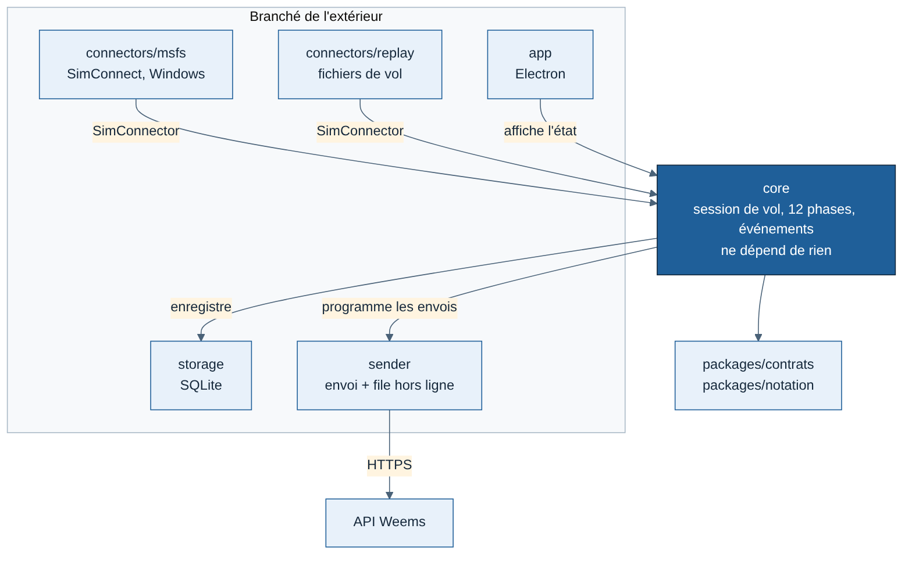
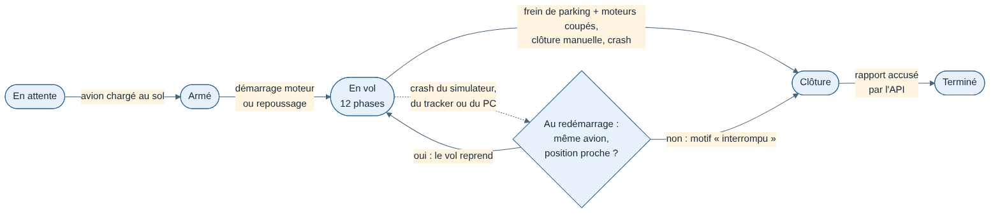
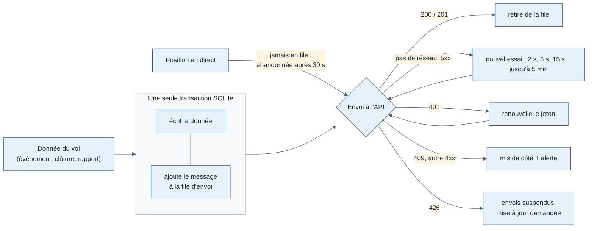

# Tracker — Architecture interne

Rédigée le 11/11/2026. Complète le [cahier des charges](CDC-Tracker.md) (exigences EF et ENF) et la [spécification T0](spec-T0.md) (données reçues, phases). Décrit comment le tracker est découpé à l'intérieur, pour que le code de J0 et J1 parte sur une base qui tiendra jusqu'à la version 1.0.

## Principe directeur

**Le cœur ne dépend de rien.** Il ne connaît ni Windows, ni SimConnect, ni Electron, ni SQLite, ni le réseau. Tout ce qui touche l'extérieur lui est branché par une interface. C'est ce qui permet :

- de le tester sur le Mac et dans l'intégration continue (ENF-10) ;
- de le faire tourner 10 fois en parallèle pour J1 ;
- d'ajouter X-Plane plus tard sans toucher au cœur.

## Découpage

```
packages/contrats/        formats Sample, AircraftInfo, SimEvent, Touchdown, messages de l'API (Zod)
packages/notation/        règles et calcul de la note (partagé avec l'API) : à créer, attend les critères (point 4 de la spec T0)

apps/tracker/
  src/core/               cœur : session de vol, machine à états des phases, détection d'événements
  src/connectors/
    msfs/                 SimConnect (Windows uniquement, à partir de T1)
    replay/               rejeu de fichiers de vol (J1 et tous les tests)
  src/storage/            enregistreur local SQLite
  src/sender/             envoi à l'API et file d'attente hors ligne
  src/runtime/            assemblage connecteur → cœur → enregistreur → envoi (partagé par l'app, simulate et fly)
  src/account/            compte du pilote : connexion OAuth avec PKCE, jetons chiffrés, renouvellement
  src/app/                application Electron : fenêtre, icône, état
  tools/
    simulate/             lance N cœurs sans interface (J1)
    fly/                  tracker sans interface sur le PC Windows (J2)
    generate-flights/     générateur de vols synthétiques
    import/               prévu : conversion des vols A32NX (.fdr) et Sky Dolly vers le format de rejeu
```



| Règle | Pourquoi |
| --- | --- |
| `core/` n'importe rien du reste du tracker (`connectors/`, `storage/`, `sender/`, `runtime/`, `account/`, `app/`, `tools/`) | Le cœur reste testable seul ; vérifié automatiquement par dependency-cruiser (`pnpm structure`) |
| `core/` reçoit l'horloge de l'extérieur | Le rejeu peut accélérer le temps (×10) sans fausser les durées |
| Seul `connectors/msfs/` peut dépendre de Windows | Tout le reste tourne sur Mac |

## 1. Interface d'un connecteur

Tout connecteur (MSFS, rejeu, X-Plane plus tard) fournit la même interface :

```ts
interface SimConnector {
  readonly name: string;                         // "msfs2020", "msfs2024", "replay"
  start(): Promise<void>;
  stop(): Promise<void>;
  setReadRate(rate: "high" | "normal"): void;     // EF-09 : chaque image ou 1 fois par seconde
  onStatus(cb: (s: "disconnected" | "connected" | "loading") => void): void;
  onAircraft(cb: (a: AircraftInfo) => void): void;
  onSample(cb: (s: Sample) => void): void;
  onEvent(cb: (e: SimEvent) => void): void;
}
```

- Le connecteur traduit et nettoie (unités, valeurs absentes en `null`) ; le cœur ne voit que des objets conformes à `packages/contrats`.
- C'est le cœur qui décide de la cadence (`setReadRate`) selon la hauteur et la phase.

## 2. Session de vol (cœur)

Une session suit un vol du chargement de l'avion à la clôture.



| État | Entrée | Sortie |
| --- | --- | --- |
| En attente | Tracker lancé, pas d'avion au sol | Avion chargé au sol → Armé |
| Armé | Avion au sol, moteurs coupés | Premier démarrage moteur ou repoussage (EF-07) → En vol |
| En vol | Enregistrement et envoi actifs ; machine à 12 phases de la spec T0 | Frein de parking + moteurs coupés (EF-12), clôture manuelle, crash → Clôture |
| Clôture | Calcul de la note locale, rapport | Rapport accusé par l'API → Terminé |

**Reprise après incident (ENF-02)** : au démarrage, le tracker cherche une session « En vol » non close dans sa base locale.
- Même avion, position proche de la dernière connue, moins de 30 minutes écoulées : la session reprend, avec un événement « reprise ».
- Sinon : la session est close avec le motif « interrompu », jamais effacée (EF-14).

## 3. Enregistreur local (SQLite)

| Table | Contenu |
| --- | --- |
| `sessions` | Identifiant du vol (UUID v7), avion, départ, arrivée, état, heures, motif de clôture |
| `samples` | Session, horodatage, échantillon complet (JSON) |
| `events` | Session, numéro de séquence, horodatage, événement (JSON) |
| `outbox` | Messages à envoyer : type, contenu, tentatives, prochaine tentative |
| `settings` | Préférences, identifiant SimBrief |

- Mode WAL et écriture groupée **chaque seconde** : un crash du PC fait perdre au plus 1 seconde de données.
- Ordre de grandeur : 7 200 échantillons pour un vol de 2 h à 1 par seconde, plus quelques milliers près du sol. SQLite tient sans difficulté.
- Une fois le rapport accusé par l'API, les échantillons sont gardés 30 jours en local, puis supprimés ; la fiche du vol reste.
- Bibliothèque : `node:sqlite`, le SQLite intégré à Node et à Electron (décidé en J3, 11/11/2026). `better-sqlite3`, choisi au départ, n'avait pas de binaire prêt pour Electron 45 : il aurait fallu le compiler sur chaque machine et dans la CI. Accès limité à `src/storage/sqlite.ts` (ouverture, WAL, transactions).

## 4. Envoi et file d'attente hors ligne

Tout message passe par la table `outbox`, écrit **dans la même transaction** que la donnée qu'il concerne. Rien ne peut donc être enregistré sans être programmé à l'envoi.

| Message | En file d'attente ? | Si l'API ne répond pas |
| --- | --- | --- |
| Ouverture, événements, clôture, rapport | Oui, jusqu'à l'accusé de réception (EF-21, EF-22) | Nouvel essai après 2 s, puis 5 s, 15 s… jusqu'à 5 minutes maximum entre deux essais, avec un léger décalage aléatoire |
| Position en direct | Non : seule la plus récente compte | Abandonnée si elle a plus de 30 secondes ; la suivante la remplace |



**Réponses de l'API :**

| Réponse | Action |
| --- | --- |
| 200 ou 201 | Message retiré de la file |
| 401 | Renouvellement du jeton, puis nouvel essai ; si impossible, demande de reconnexion au pilote |
| 409 | Conflit : message mis de côté, alerte dans le journal, jamais renvoyé en boucle |
| 426 | Version trop ancienne : envois suspendus, mise à jour demandée au pilote |
| Autre 4xx | Erreur du tracker : message mis de côté et signalé |
| 5xx, pas de réseau | Nouvel essai selon le rythme ci-dessus |

Les messages d'un même vol partent dans l'ordre. L'ouverture doit être acceptée avant tout le reste.

## 5. Format de rejeu

Un fichier JSON Lines (une ligne JSON par objet). Format provisoire : le point 3 de la spec T0 le finalisera.

```
{"format":"weems-replay","version":1,"source":"synthetic","seed":42}
{"type":"aircraft","t":0,"data":{...AircraftInfo}}
{"type":"sample","t":0,"data":{...Sample}}
{"type":"event","t":1520000,"data":{...SimEvent}}
```

- `t` en millisecondes depuis le début de l'enregistrement.
- Trois sources : générateur synthétique, conversion d'un vol A32NX (`.fdr` passé par fdr2csv), conversion d'un vol Sky Dolly.
- Le connecteur MSFS sait aussi **écrire** ce format : chaque vol réel enregistré sur le PC devient un vol rejouable sur le Mac.

## 6. Générateur de vols synthétiques

- **Entrée** : une description de scénario (aéroports de départ et d'arrivée, catégorie d'avion, niveau de croisière, vitesses), plus des perturbations à injecter : remise des gaz, rebond, pause, accélération du temps, slew, téléportation, crash du simulateur, coupure réseau.
- **Sortie** : un fichier de rejeu.
- **Déterministe** : même scénario et même graine donnent exactement le même fichier, donc des tests reproductibles.
- **Cinématique simple**, pas une simulation de vol : profils de vitesse et d'altitude plausibles, avec un léger bruit. Suffisant pour tester les phases et la chaîne ; les seuils fins se caleront sur les vrais vols (T1, puis bêta).
- **Tracé plausible** (fiche [006](../../decisions/006-vols-simules-pistes-et-virages.md)) : pistes réelles d'OurAirports, roulage et décollage dans l'axe, virages au taux standard, orthodromie, arrivée simplifiée et finale alignée, descente sur une pente de 3°, circuit après une remise des gaz.
- La liste des 20 scénarios de référence reste le point 3 de la spec T0, à faire avec un pilote ; le générateur doit savoir produire toutes les perturbations ci-dessus.

## 7. Application Electron

- Le processus principal fait tourner le cœur, le connecteur, l'enregistreur et l'envoi.
- La fenêtre (EF-23) ne fait qu'afficher : elle reçoit l'état une fois par seconde et ne contient aucune logique.
- La consommation de mémoire et l'impact sur les images par seconde (ENF-01) sont mesurés en T1. Si Electron dépasse les cibles, le cœur ne change pas : seule la coque change.

## Correspondance avec les exigences

| Exigence | Où |
| --- | --- |
| EF-07, EF-12, ENF-02 | Session de vol et reprise après incident |
| EF-08, EF-11 | Machine à états des phases (spec T0) dans `core/` |
| EF-09 | `setReadRate`, décidé par le cœur |
| EF-13, EF-14, EF-15 | Détection d'événements dans `core/` ; rien n'est jamais effacé |
| EF-20 à EF-22, EF-24 | Envoi et file d'attente hors ligne |
| ENF-10 | Connecteur de rejeu, générateur, cœur sans dépendance |
