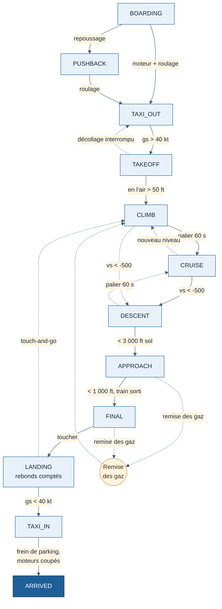

# Tracker — Spécification T0

10 novembre 2026 · Complète le [cahier des charges](CDC-Tracker.md) pour le lot T0 (fondations sur Mac).

Ce document fixe ce dont le cœur du tracker a besoin avant d'écrire du code : les données qu'il reçoit (partie A) et les règles des 12 phases de vol (partie B). Chaque seuil chiffré est une **valeur de départ, à valider avec un pilote** : il est nommé, rangé dans un seul fichier de paramètres, et jamais écrit en dur dans le code.

## État des 4 points à définir avant T0

| # | Point | État |
| --- | --- | --- |
| 1 | Règles des 12 phases | Proposé ci-dessous (partie B), **relecture pilote à faire** |
| 2 | Données reçues par le cœur | Proposé ci-dessous (partie A) |
| 3 | Format d'un vol enregistré et 20 scénarios de test | **En attente** : à faire avec un collègue pilote |
| 4 | Critères des premières règles de notation et leurs sources | **En attente** : à faire avec un collègue pilote |

Les points 3 et 4 doivent être traités avant la fin de T0 : sans eux, pas de scénarios de test ni de notation.

## Partie A — Données reçues par le cœur

### Principes

- **Le connecteur traduit, le cœur ne voit jamais SimConnect.** Conversions d'unités, valeurs aberrantes et noms de variables restent dans le connecteur MSFS. Un futur connecteur X-Plane produira exactement les mêmes objets.
- **Unités internes uniques** : degrés décimaux, pieds (ft), nœuds (kt), pieds par minute (ft/min), kilogrammes, g, secondes.
- **Donnée absente = `null`, jamais 0.** Une valeur inconnue (avion qui ne publie pas ses feux, valeur −999999 du simulateur) devient `null`. Le cœur affiche alors « non mesuré » et ne pénalise jamais le pilote.
- **Fréquence irrégulière acceptée.** Le cœur ne suppose jamais un intervalle fixe entre deux échantillons : il calcule avec l'horodatage.
- **Trois sortes d'objets** : l'échantillon (périodique), la fiche avion (au chargement et à chaque changement), l'événement (ponctuel).

### Échantillon (`Sample`)

| Champ | Unité | Source MSFS | Peut être `null` | Remarque |
| --- | --- | --- | --- | --- |
| `t` | ms | horloge locale monotone | non | Sert à tous les calculs de durée |
| `simTimeUtc` | s | ZULU TIME | oui | Non vérifiée dans le SDK (voir `simvars.yaml`) |
| `simRate` | facteur | SIMULATION RATE | oui | 1 = temps réel |
| `lat`, `lon` | degrés | PLANE LATITUDE / LONGITUDE | non | Convertis depuis les radians |
| `altMsl` | ft | PLANE ALTITUDE | non | |
| `altAgl` | ft | PLANE ALT ABOVE GROUND | non | |
| `altIndicated` | ft | INDICATED ALTITUDE | non | Pour la règle du niveau 100 |
| `ias`, `tas`, `gs` | kt | AIRSPEED INDICATED / TRUE, GROUND VELOCITY | non | |
| `mach` | Mach | AIRSPEED MACH | non | |
| `vs` | ft/min | VERTICAL SPEED | non | Convertie depuis ft/s (×60) |
| `pitch` | degrés | PLANE PITCH DEGREES | non | Cabré = positif, signe normalisé dans le connecteur |
| `bank` | degrés | PLANE BANK DEGREES | non | Droite = positif |
| `heading` | degrés vrais | PLANE HEADING DEGREES TRUE | non | |
| `onGround` | booléen | SIM ON GROUND | non | |
| `onRunway` | booléen | ON ANY RUNWAY | oui | Fiabilité à tester |
| `parkingBrake` | booléen | BRAKE PARKING POSITION | oui | Dépend de l'avion |
| `gearHandle` | 0 à 1 | GEAR HANDLE POSITION | oui | `null` si train fixe |
| `flapsIndex` | cran | FLAPS HANDLE INDEX | oui | |
| `spoilers` | 0 à 1 | SPOILERS HANDLE POSITION | oui | |
| `engines[]` | liste | GENERAL ENG COMBUSTION:n, TURB ENG N1:n | non (liste) | `{ running, n1 }`, `n1` à `null` pour un moteur à pistons |
| `fuelKg` | kg | FUEL TOTAL QUANTITY WEIGHT | oui | Converti depuis les livres |
| `weightKg` | kg | TOTAL WEIGHT | oui | |
| `gForce` | g | G FORCE | non | |
| `accel` | g | ACCELERATION BODY X/Y/Z | non | `{ lateral, vertical, longitudinal }`, convertis depuis ft/s² |
| `cabinAlt` | ft | PRESSURIZATION CABIN ALTITUDE | oui | |
| `cabinRate` | ft/min | PRESSURIZATION CABIN ALTITUDE RATE | oui | |
| `seatbelts` | booléen | CABIN SEATBELTS ALERT SWITCH | oui | |
| `lights` | booléens | LIGHT BEACON / LANDING / STROBE / NAV / TAXI | oui (chacun) | |
| `overspeed`, `stall` | booléen | OVERSPEED WARNING, STALL WARNING | oui | |
| `autopilot` | booléen | AUTOPILOT MASTER | oui | |
| `pushback` | booléen | PUSHBACK STATE | oui | Vrai si un repoussage est en cours |
| `surface` | `{ type, condition }` | SURFACE TYPE / CONDITION | oui | `condition` à `null` si SURFACE INFO VALID est faux |
| `wind` | `{ dir, speed }` | AMBIENT WIND DIRECTION / VELOCITY | non | Degrés, kt |
| `oat` | °C | AMBIENT TEMPERATURE | non | |
| `visibilityM` | m | AMBIENT VISIBILITY | non | |
| `slew` | booléen | IS SLEW ACTIVE | non | |
| `paused` | booléen | événements de pause | non | Calculé par le connecteur |

### Fiche avion (`AircraftInfo`)

| Champ | Source MSFS | Remarque |
| --- | --- | --- |
| `simulator` | connecteur | `msfs2020` ou `msfs2024` |
| `title` | TITLE | Lue une fois, puis relue régulièrement pour détecter un changement d'avion |
| `model`, `registration` | ATC MODEL, ATC ID | Peuvent être vides |
| `engineCount` | NUMBER OF ENGINES | |
| `emptyWeightKg` | EMPTY WEIGHT | |

### Données du toucher (`Touchdown`)

Émises par le connecteur à chaque passage de « en l'air » à « au sol » : vitesse verticale (ft/min), assiette, inclinaison, cap, position, issues des variables PLANE TOUCHDOWN. Le cœur les recoupe avec ses propres échantillons (voir `pieges.md` : la valeur du simulateur est écrasée au toucher suivant).

### Événements (`SimEvent`)

`simStarted`, `simStopped`, `paused`, `unpaused`, `flightLoaded`, `aircraftLoaded`, `positionChanged` (téléportation), `crashed`, `connectionLost`, `connectionRestored`. Chaque événement porte `t`. Les doublons connus de MSFS 2024 (`pieges.md`) sont filtrés par le connecteur.

## Partie B — Règles des 12 phases

### Principes

- **Une phase change seulement si sa condition tient pendant une durée de confirmation**, pour éviter les allers-retours sur une valeur bruitée.
- **Les durées sont mesurées en temps simulé** (`t` × `simRate`) : une accélération du temps ne fausse pas les phases.
- **En pause, aucune transition n'est évaluée**, et le temps de pause est décompté à part (EF-15).
- **Hauteur de référence** : hauteur au-dessus de l'aérodrome de destination quand il est connu (plan SimBrief ou aéroport le plus proche), sinon `altAgl`.
- Chaque transition produit un événement daté dans le journal du vol. Chaque ligne du tableau ci-dessous aura au moins un scénario de test (point 3).

### Les phases

| # | Phase | Code |
| --- | --- | --- |
| 1 | Embarquement | `BOARDING` |
| 2 | Repoussage | `PUSHBACK` |
| 3 | Roulage départ | `TAXI_OUT` |
| 4 | Décollage | `TAKEOFF` |
| 5 | Montée | `CLIMB` |
| 6 | Croisière | `CRUISE` |
| 7 | Descente | `DESCENT` |
| 8 | Approche | `APPROACH` |
| 9 | Finale | `FINAL` |
| 10 | Atterrissage | `LANDING` |
| 11 | Roulage arrivée | `TAXI_IN` |
| 12 | Arrivée | `ARRIVED` (état final, avec un motif de clôture) |

### Transitions

| De | Vers | Condition | Confirmation | Événement |
| --- | --- | --- | --- | --- |
| — | `BOARDING` | Simulateur connecté, avion au sol, `gs` < 1 kt | — | Ouverture du vol |
| `BOARDING` | `PUSHBACK` | `pushback` vrai | 2 s | Heure bloc départ |
| `BOARDING` ou `PUSHBACK` | `TAXI_OUT` | Au sol, `pushback` faux, au moins un moteur en marche, `gs` > `TAXI_MIN_GS` | 5 s | Heure bloc départ si pas encore notée |
| `TAXI_OUT` | `TAKEOFF` | Au sol, `gs` > `TAKEOFF_MIN_GS` et en accélération | 2 s | Début du roulement au décollage |
| `TAKEOFF` | `TAXI_OUT` | Au sol, `gs` < `RTO_MAX_GS` | 3 s | Décollage interrompu |
| `TAKEOFF` | `CLIMB` | En l'air, hauteur > `AIRBORNE_MIN_AGL` | 3 s | Heure de décollage (premier échantillon en l'air) |
| `CLIMB` | `CRUISE` | \|`vs`\| < `LEVEL_MAX_VS`, hauteur > 1 000 ft | 60 s | |
| `CRUISE` | `CLIMB` | `vs` > `CLIMB_MIN_VS` | 30 s | Changement de niveau |
| `CLIMB` ou `CRUISE` | `DESCENT` | `vs` < −`CLIMB_MIN_VS` | 30 s | Début de descente |
| `DESCENT` | `CRUISE` | \|`vs`\| < `LEVEL_MAX_VS` | 60 s | |
| `DESCENT` | `APPROACH` | Hauteur < `APPROACH_HEIGHT` | 10 s | |
| `APPROACH` | `FINAL` | Hauteur < `FINAL_HEIGHT` et train sorti (ou train fixe) | 3 s | |
| `FINAL` | `LANDING` | Au sol | immédiat | Toucher (données `Touchdown`) |
| `FINAL` ou `APPROACH` | `CLIMB` | Sans toucher : `vs` > `CLIMB_MIN_VS` et hauteur remontée de plus de `GA_MIN_GAIN` depuis le point le plus bas | 5 s | **Remise des gaz** (EF-11), nouvelle approche dans le même vol |
| `LANDING` | `LANDING` | Repasse en l'air moins de `BOUNCE_MAX_S`, puis retouche | — | Rebond (compté) |
| `LANDING` | `CLIMB` | En l'air depuis plus de `BOUNCE_MAX_S` et hauteur > `AIRBORNE_MIN_AGL` | — | Touch-and-go |
| `LANDING` | `TAXI_IN` | Au sol, `gs` < `LANDING_END_GS` | 3 s | Fin de l'atterrissage (EF-10) |
| `TAXI_IN` | `ARRIVED` | `parkingBrake` vrai et tous les moteurs arrêtés | 10 s | Heure bloc arrivée, motif « normal » (EF-12) |
| `TAXI_IN` | `ARRIVED` | Si `parkingBrake` est `null` : moteurs arrêtés et `gs` < 1 kt | 30 s | Idem |
| toute phase | `ARRIVED` | Clôture manuelle par le pilote | — | Motif « manuel » |

### Cas particuliers

| Situation | Comportement |
| --- | --- |
| Vol chargé directement en l'air | Démarre en `CLIMB` ou `CRUISE` selon `vs`, marqué « départ en vol ». La validité est décidée par la règle (solo ou compagnie), pas par le cœur |
| Crash (`crashed`) | Vol clôturé, motif « crash ». Rien n'est effacé (EF-14) |
| Simulateur fermé en vol | État sauvegardé. À la reconnexion : même avion et position à moins de 5 NM → le vol reprend ; sinon clôture, motif « interrompu » (ENF-02) |
| Téléportation, slew | Événement noté. Les phases continuent à partir de l'état réel de l'avion |
| Changement d'avion en cours de vol | Événement noté, vol clôturé, motif « changement d'avion » |
| Accélération du temps | Autorisée, notée avec sa durée. La décision (valide ou non) revient à la règle |

### Paramètres de départ, à valider avec un pilote

| Paramètre | Valeur | Rôle |
| --- | --- | --- |
| `TAXI_MIN_GS` | 3 kt | Début du roulage |
| `TAKEOFF_MIN_GS` | 40 kt | Début du roulement au décollage |
| `RTO_MAX_GS` | 30 kt | Décollage interrompu |
| `AIRBORNE_MIN_AGL` | 50 ft | Avion réellement en l'air |
| `LEVEL_MAX_VS` | 300 ft/min | Vol en palier |
| `CLIMB_MIN_VS` | 500 ft/min | Montée ou descente franche |
| `APPROACH_HEIGHT` | 3 000 ft | Entrée en approche |
| `FINAL_HEIGHT` | 1 000 ft | Entrée en finale (porte de l'approche stabilisée) |
| `GA_MIN_GAIN` | 200 ft | Remise des gaz confirmée |
| `BOUNCE_MAX_S` | 5 s | Au-delà, c'est un touch-and-go, pas un rebond |
| `LANDING_END_GS` | 40 kt | Fin de la capture fine de l'atterrissage |

**Point à trancher avec le pilote** [Confiance moyenne] : ces valeurs conviennent à un avion de ligne. Pour un petit avion à pistons (rotation vers 55 kt, croisière à 3 000 ft), plusieurs seuils seront faux. Proposition : un jeu de paramètres par catégorie d'avion (léger, turbopropulseur, avion de ligne), choisi d'après la fiche avion.
