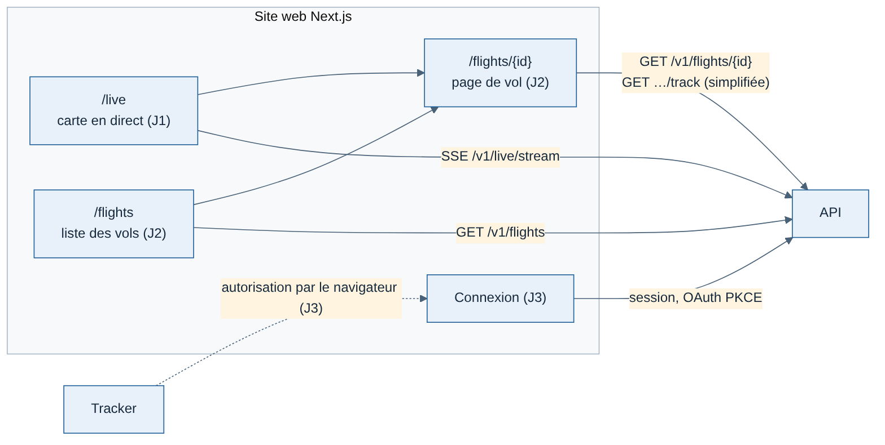
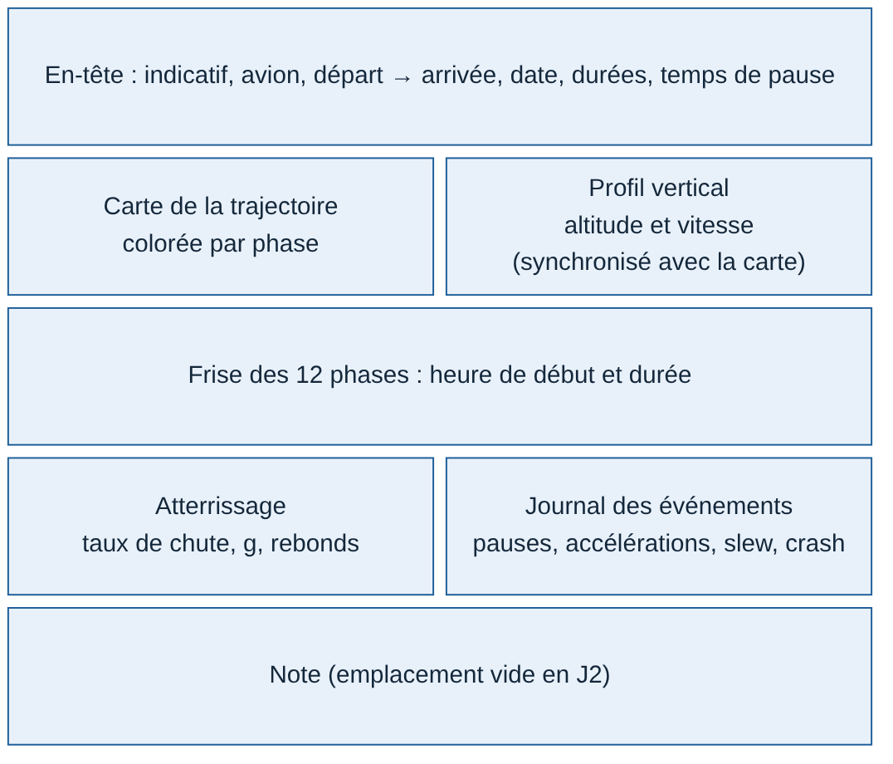

# Site web — Spécification minimale (J2 et J3)

Rédigée le 11/11/2026. Site Next.js de suivi des vols, version minimale du lot 1. La carte en direct est déjà définie dans la [spécification J1](../spec-J1-pilotes-simules.md).

## Objectif

Qu'un pilote retrouve ses vols et comprenne chacun d'eux d'un coup d'œil : où il est allé, comment s'est déroulé le vol, ce qui s'est passé d'anormal.

| Jalon | Ce que le site apporte |
| --- | --- |
| J1 | Carte en direct (`/live`) |
| **J2** | Liste des vols et page de vol, sans compte (un seul pilote de développement) |
| **J3** | Connexion, carnet personnel, vols privés par défaut |
| J4 | Profil public, débriefing, habillage aux couleurs de Weems |

## Critère de sortie

**J2** :
1. Les 10 vols de référence enregistrés sur le PC sont consultables sur le site.
2. Les phases affichées sont identiques à celles calculées par le tracker.
3. La page d'un vol de 2 heures s'affiche en moins de 2 secondes sur le Mac.
4. Tout le site est disponible en français et en anglais.

**J3** :
1. Un pilote testeur se connecte, ne voit que ses vols et ne peut ouvrir ceux d'un autre pilote, même avec l'adresse exacte.
2. Les 5 pilotes de l'alpha consultent leurs vols sans aide.

## Pages

### Liste des vols (`/flights`)

Une ligne par vol, du plus récent au plus ancien, 50 par page :
- date ;
- départ et arrivée (codes OACI) ;
- avion ;
- durée de vol ;
- état : terminé, interrompu ou en cours ;
- pastilles d'alerte (pause, accélération, slew, crash).

Filtres simples : période, avion, aéroport.

### Page de vol (`/flights/{flightId}`)

| Bloc | Contenu |
| --- | --- |
| En-tête | Indicatif, avion, départ → arrivée, date, durée bloc (moteurs) et durée de vol (décollage → atterrissage), temps de pause affiché à part (EF-15) |
| Carte de la trajectoire | Tracé complet, coloré par phase ; départ et arrivée marqués ; survol d'un point = heure, altitude, vitesse, phase |
| Profil vertical | Courbe altitude et vitesse en fonction du temps, phases en fond de couleur. Un clic sur la courbe montre le point sur la carte, et inversement |
| Frise des phases | Les 12 phases avec leur heure de début et leur durée |
| Atterrissage | Taux de chute au toucher, facteur de charge, rebonds, distance du seuil si connue (à partir de J4 pour le contexte complet) |
| Journal | Événements datés : pauses, accélérations, slew, téléportation, changement d'avion, crash |
| Note | Emplacement prévu, vide en J2 ; la note arrive avec la notation |

Une donnée absente s'affiche « non mesuré », jamais 0 (règle de la spec T0).

### Connexion (J3)

- Connexion par e-mail avec lien magique ou mot de passe, via la bibliothèque d'authentification choisie (décision 3). Le choix précis se fait au démarrage de J3.
- Le tracker se connecte par le navigateur (OAuth 2 avec PKCE) : le site fournit la page d'autorisation.
- **Vols privés par défaut.** Le profil public et les vols publics arrivent en J4, sur option (RGPD).

## Affichage

- **Unités** : celles de l'aviation, en pieds, nœuds et ft/min. Le carburant est en kilogrammes, avec un réglage kg ou lb. Une option métrique ne viendra que si les pilotes la demandent.
- **Heures** : en UTC, comme en aviation, avec l'heure locale du pilote en complément.
- **Écrans** : pensé pour l'ordinateur, utilisable sur téléphone, car les pilotes regardent leurs vols sur mobile.
- **Langues** : français et anglais dès J2, dans des fichiers de traduction, jamais écrites en dur.
- **Apparence** : sobre et sans habillage jusqu'à J4. Tailwind CSS pour la mise en forme [Confiance moyenne]. L'identité visuelle (piste « Waterline ») s'applique en J4.

## Ce que le site demande à l'API

| Route | Usage | Jalon |
| --- | --- | --- |
| `GET /v1/flights` | Liste paginée, filtres | J2 |
| `GET /v1/flights/{flightId}` | En-tête, phases, journal, atterrissage | J2 |
| `GET /v1/flights/{flightId}/track` | Trajectoire **simplifiée par l'API** (quelques centaines de points pour la carte et le profil), au lieu des 7 200 échantillons bruts | J2 |
| Routes de connexion | Session du site, autorisation du tracker | J3 |

La simplification de la trajectoire côté API est ce qui tient le critère des 2 secondes.

## Gratuit et payant

Tout ce qui est décrit ici est **gratuit**, conformément aux fondamentaux : carnet, page de vol, carte en direct. Les fonctions de l'abonnement pilote (lot 2), comme le rejeu animé, les statistiques avancées ou l'historique illimité, ne sont pas développées au lot 1. La page de vol est simplement conçue pour pouvoir les accueillir.

## Questions ouvertes

| Question | Qui | Bloquant |
| --- | --- | --- |
| Quelles informations un pilote regarde en premier sur une page de vol ? | Pilotes (guide d'entretien) | Non : l'ordre des blocs pourra changer |
| Liste exacte des données d'atterrissage affichées | Point 4 de la spec T0, avec un pilote | Non pour J2 |
