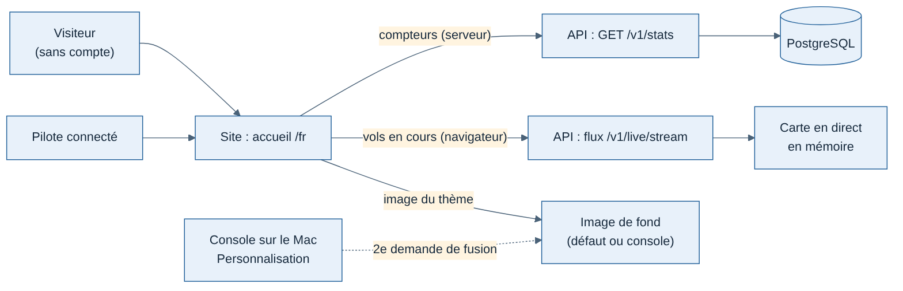

# Spécification J4 — Page d'accueil publique

Date : 12/11/2026. Demande de Greg : « créer une nouvelle page qui sera la page d'accueil : image pleine page, garder le menu en haut, quelques compteurs par-dessus l'image (pilotes, vols, vols en direct), le logo et un slogan ».

Maquettes validées par Greg le 12/11/2026 entre 1 h 45 et 2 h 30 : piste F « tableau des départs », barre v2, pied de page P2, icône « Mon compte » (copies dans le dossier du projet `accueil/`).

## 1. Ce que voit le visiteur

| Zone | Contenu |
| --- | --- |
| Fond | Image plein écran, une par thème (clair, sombre), voile dégradé pour la lisibilité du texte ; sans image, dégradé « coucher de soleil » |
| Texte (à gauche) | Logo Waterline et « Weems », slogan « Décollez. Weems s'occupe du carnet. », phrase d'accroche, deux boutons : « Créer mon compte gratuit » (pilote connecté : « Mes vols ») et « Voir les vols en direct » |
| Tableau des départs (en bas) | En-tête « En vol · In flight » et trois compteurs à palettes : pilotes, vols, en vol ; puis les vols en cours : indicatif, départ, arrivée, phase (étiquette colorée), niveau |
| Pied de page P2 | Une ligne centrée : © année Weems · Mentions légales · Conditions d'utilisation · Confidentialité · Contact (pages fictives pour l'instant) |

Sur téléphone : texte en haut, tableau en bas (sans la colonne Niveau), pied de page sur deux lignes.

## 2. Barre du haut des pages publiques (barre v2)

Elle remplace la barre publique de J4 sur toutes les pages publiques (accueil, carte en direct sans compte, profils publics). Les pages du pilote connecté gardent leur barre (fiche 003).

| Position | Visiteur | Pilote connecté |
| --- | --- | --- |
| À gauche après le logo, groupe à part | « Découvrir Weems » (renvoie à l'accueil pour l'instant), « Vols en direct » | idem |
| À droite | « Créer un compte », icône silhouette « Se connecter » | bouton silhouette « Mon compte » (vers Mes vols) |
| Tout à droite | bouton thème (soleil / lune), choix de langue FR \| EN | idem |

Sous 768 px : logo, icône silhouette, thème, FR | EN, bouton menu qui ouvre « Découvrir Weems », « Vols en direct » et « Créer un compte » (ou « Mes vols »).

## 3. Décisions de Greg (12/11/2026, 2 h 22)

1. Image par défaut : une photo libre de droits (Unsplash) avec son crédit, remplaçable depuis la console. La photo d'exemple (iStock) n'entre jamais dans le dépôt.
2. Compteurs toujours affichés, sans seuil.
3. L'accueil et la carte en direct deviennent publics. Le direct ne montre déjà aucun nom de pilote (format `LiveFlight`).

## 4. Compteurs : `GET /v1/stats`

Route publique (module `stats` de l'API), format `SiteStats` de `packages/contrats` :

| Champ | Calcul |
| --- | --- |
| `pilots` | Comptes non désactivés |
| `flights` | Tous les vols enregistrés |
| `liveFlights` | Vols sur la carte en direct à cet instant |

Limite de débit par adresse comme les pages publiques ; réponse gardée 30 s en cache (`public, max-age=30`), les nombres n'ont pas besoin d'être exacts à la seconde. Le site lit les compteurs côté serveur ; le nombre de vols en direct suit ensuite le flux `/v1/live/stream`, comme les lignes du tableau.

## 5. Tableau des vols en cours

- Source : le flux public `/v1/live/stream` (déjà utilisé par la carte), lu par le navigateur.
- Lignes : au plus 5 vols, ceux dont la position est la plus récente ; signal perdu exclu.
- Niveau : altitude en centaines de pieds, `FL350` au-dessus de 10 000 ft, sinon en pieds (`4 500 ft`), « Sol » au sol.
- Phase : les 12 phases du tracker regroupées en 5 étiquettes (Au sol, Montée, Croisière, Descente, Approche).
- Aucun vol : « Aucun vol en ce moment » à la place des lignes.

## 6. Images par thème (console, deuxième demande de fusion)

Page « Personnalisation » de la console (groupe Site) : une image par thème, aperçu de l'accueil et du recadrage téléphone, « Remplacer », « Image par défaut », point important (gauche, centre, droite), crédit et licence obligatoires, case « même image pour les deux thèmes ». Les images passent par l'API (la console ne tourne que sur le Mac, fiche 009) : stockage sur disque en local, stockage d'objets en ligne. Détail dans la spec de cette deuxième demande.

## 7. Critères d'acceptation

1. `/fr` et `/en` s'ouvrent sans compte et montrent l'accueil ; un pilote connecté y voit « Mon compte » et « Mes vols ».
2. Les compteurs montrent les nombres de `GET /v1/stats` ; le nombre « en vol » et les lignes suivent le direct sans recharger.
3. `/live` s'ouvre sans compte, avec la barre publique ; connecté, avec la barre du pilote.
4. La barre v2 et le pied de page P2 apparaissent sur l'accueil et les profils publics, en clair et en sombre, sur bureau et téléphone.
5. Tous les textes existent en français et en anglais.
