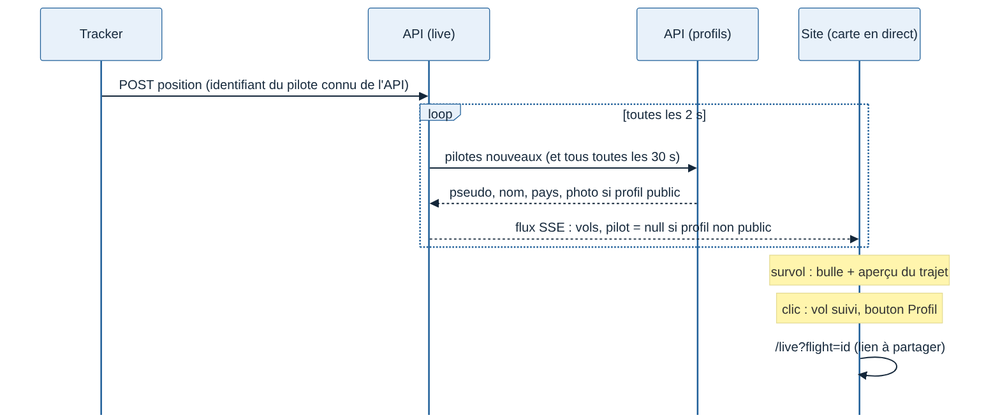
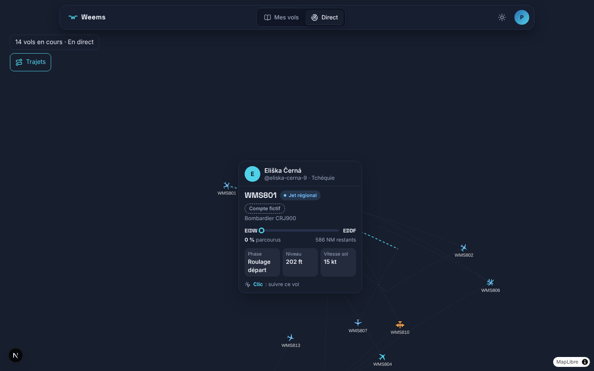
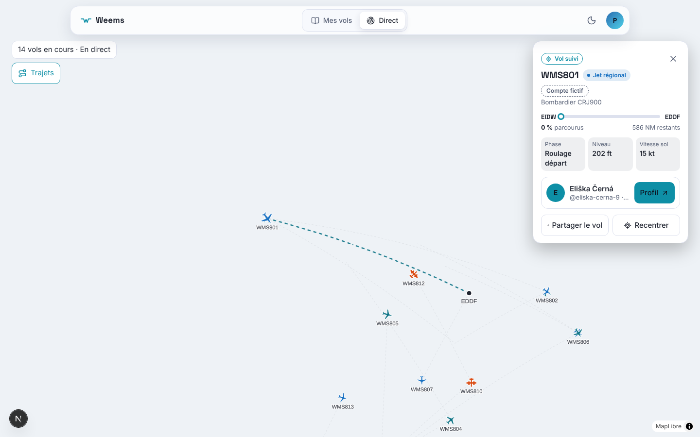

# Spécification J4 — Pilote sur la carte en direct (survol, vol suivi)

Date : 12/11/2026. Demande de Greg : « sur la carte en direct, affiche la bulle info au survol de la souris sur un avion, un clic sur la page publique de l'utilisateur ». Maquettes dans le dossier du projet `j4-direct-survol/` ; Greg a choisi la variante B le 12/11/2026 à 3 h 25 : **le clic suit le vol**, le panneau donne le lien vers le profil.

Pourquoi pas « clic = profil » (variante A) : le profil public est désactivé par défaut, donc la plupart des avions n'en ont pas ; le même clic aurait ouvert un profil sur certains avions et suivi le vol sur les autres, et fait quitter la carte.

## 1. Ce que voit le spectateur

| Geste | Rendu |
| --- | --- |
| Souris sur un avion (ordinateur) | Bulle : pilote, indicatif, catégorie, avion, départ → arrivée avec barre de progression, % parcouru, NM et temps restants, phase, niveau, vitesse sol, « Clic : suivre ce vol ». Le trajet de l'avion passe en surbrillance (aperçu), même si les trajets sont masqués |
| Clic sur un avion | Vol suivi : panneau à droite avec les mêmes informations, la carte du pilote et son bouton « Profil », « Partager le vol » et « Recentrer » ; trace réelle et aéroports comme avant ([spec trajectoire](spec-J4-trajectoire-direct.md)) |
| Toucher un avion (téléphone, pas de survol) | Même panneau, en feuille en bas de l'écran ; la carte se décale pour garder l'avion au-dessus |
| Lien partagé `/live?flight=<id>` | La page s'ouvre sur ce vol suivi et centre la carte dessus |

Niveau : « FL300 » à partir de 10 000 ft, sinon en pieds (`4 500 ft`).

## 2. Pilote : seulement si son profil est public

- Le flux `/v1/live/stream` porte `pilot: { handle, name, country, hasPhoto }` (format `LivePilot` de `packages/contrats`), ou `null` si le profil n'est pas public. Un pilote au profil non public reste « Pilote Weems · Profil non public » : aucun nom, aucun lien, aucun identifiant interne envoyé.
- L'API garde les pilotes en mémoire (`modules/live/live-pilots.ts`) : un pilote nouveau est lu au lot suivant (2 s), tous sont relus toutes les 30 s. Un pilote qui désactive son profil disparaît donc de la carte en moins de 30 s ; son vol est renvoyé au lot suivant.
- Conséquence assumée : un profil public rend aussi visible en direct la position de son pilote.

## 3. Critères d'acceptation

1. Profil public : le vol arrive dans le flux avec le pseudo, le nom, le pays et la présence d'une photo ; profil non public : `pilot` vaut `null` (test `profiles.test.ts`).
2. Profil désactivé pendant le vol : `pilot` repasse à `null` au plus 30 s après (tests `live-pilots.test.ts`, `live-board.test.ts`).
3. La bulle n'apparaît qu'à la souris, jamais sur un écran tactile ; elle passe à gauche de l'avion près du bord droit (test `card-position.test.ts`).
4. Le bouton « Profil » n'existe que pour un profil public et ouvre `/pilots/{pseudo}`.
5. `/live?flight=<id>` ouvre le vol suivi ; fermer le panneau retire `flight` de l'adresse.
6. Textes en français et en anglais.
