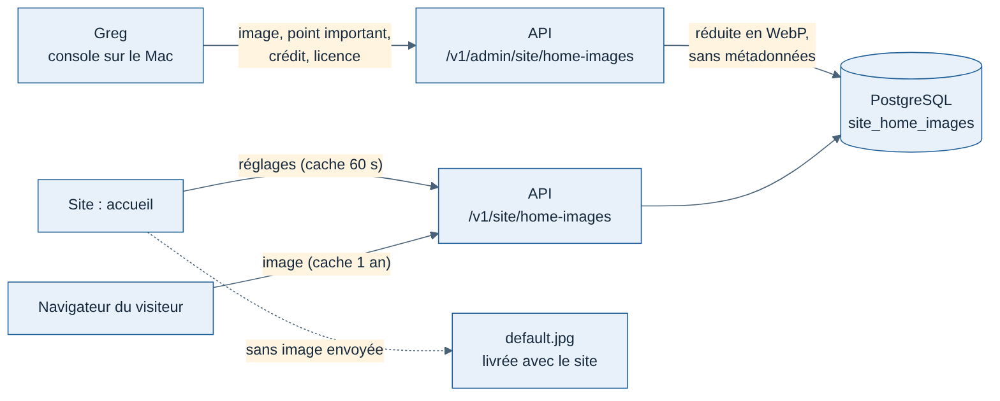

# Spécification J4 — Personnalisation de l'accueil (console)

Date : 12/11/2026. Suite de la spec `spec-J4-accueil.md` (partie 6). Maquette validée par Greg le 12/11/2026 à 2 h 17 (« parfait ») : `accueil/maquette-admin-personnalisation.html` dans le dossier du projet.

## 1. Ce que fait Greg

Dans la console (groupe « Site », page « Personnalisation »), une carte par thème, clair et sombre :

| Élément | Rôle |
| --- | --- |
| Aperçu | L'image avec le voile de l'accueil, et le recadrage téléphone |
| « Remplacer » | Choisir une image JPEG, PNG ou WebP (15 Mo au plus) |
| Point important | Gauche, centre ou droite : ce que garde le recadrage, surtout sur téléphone |
| Crédit et licence | Obligatoires (exemple : « Image maison Weems », « Tous droits réservés ») |
| « Image par défaut » | Revenir à l'image livrée avec le site |
| « Même image pour les deux thèmes » | L'image envoyée sert au clair et au sombre |

Un seul bouton Enregistrer (modèle C, fiche 008). Une image de moins de 2 560 px de large est acceptée avec un avertissement (floue sur un écran Retina) ; moins de 1 024 px est refusé.

## 2. Où vont les images

La console ne parle jamais à la base (fiche 009) : elle passe par l'API, avec la session d'un administrateur, comme la page Comptes (connexion automatique en local, fiche 012).

- **Stockage** : dans PostgreSQL (table `site_home_images`, une ligne par thème), comme les photos de profil. Une image réduite pèse quelques centaines de Ko : pas besoin de stockage d'objets tant qu'il n'y en a que deux. Si les images se multiplient (galerie, plusieurs pages), passer au stockage d'objets Scaleway.
- **Traitement** : l'API relit le format dans le fichier (pas dans son nom), refuse les images de plus de 40 mégapixels, applique l'orientation, réduit à 2 560 px de large au plus, encode en WebP et retire toutes les métadonnées (position GPS, auteur, signature d'un générateur).
- **Sans image envoyée** : l'accueil garde l'image livrée avec le site (`apps/web/public/home/default.jpg`, point important à gauche).

## 3. Routes de l'API

Module `site`, formats `HomeImages`, `HomeImageSettings` de `packages/contrats`.

| Route | Accès | Rôle |
| --- | --- | --- |
| `GET /v1/site/home-images` | Public | Les deux thèmes : adresse de l'image, point important, crédit, licence, taille ; `null` sans image envoyée. Cache 60 s |
| `GET /v1/site/home-images/{theme}/image?v=…` | Public | L'image WebP ; `v` change à chaque envoi, d'où un cache d'un an |
| `PUT /v1/admin/site/home-images/{theme}?focus=…&credit=…&licence=…` | Administrateur | Envoie l'image (corps brut `image/jpeg`, `image/png` ou `image/webp`) |
| `PATCH /v1/admin/site/home-images/{theme}` | Administrateur | Change le point important, le crédit ou la licence (404 sans image) |
| `DELETE /v1/admin/site/home-images/{theme}` | Administrateur | Revient à l'image par défaut |

## 4. Critères d'acceptation

1. Une image envoyée depuis la console apparaît sur l'accueil du thème choisi au plus tard une minute après (cache), sans redémarrer le site.
2. « Même image pour les deux thèmes » change les deux thèmes.
3. Le point important déplace le recadrage de l'image sur l'accueil.
4. « Image par défaut » ramène l'image livrée avec le site.
5. Sans crédit ou sans licence, Enregistrer reste impossible ; l'API refuse aussi (400).
6. Un pilote non administrateur reçoit 403 sur les routes `/v1/admin/site/*` ; sans session, 401.
