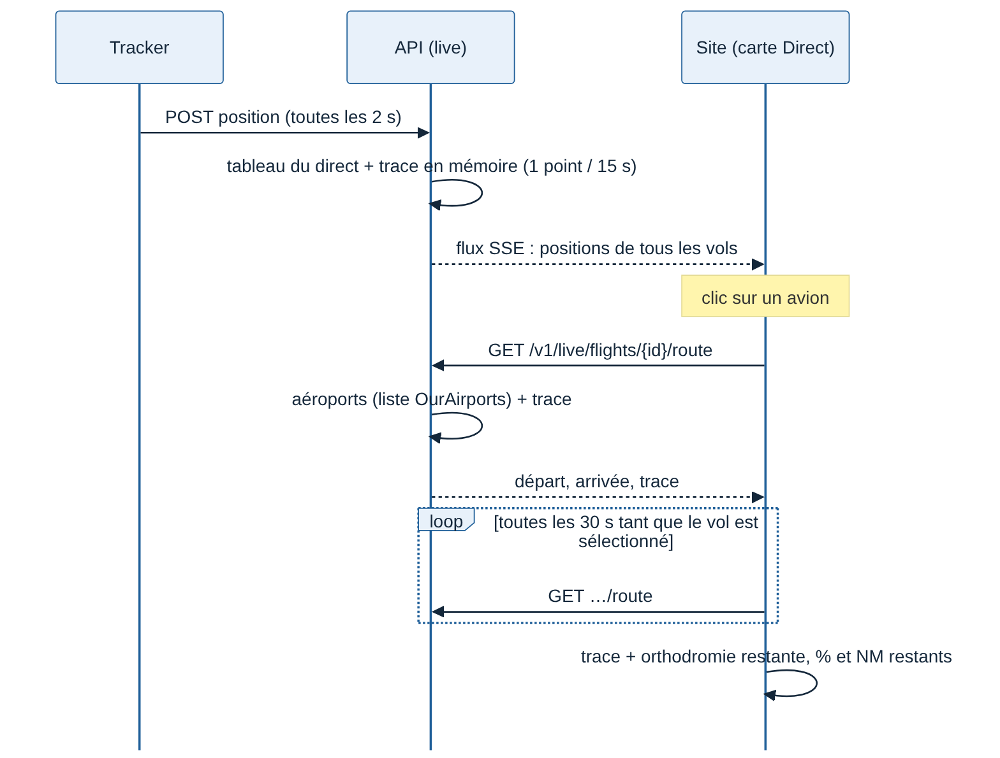

# Spécification J4 — Trajectoire et progression sur la carte en direct

Date : 11/11/2026. Demande de Greg : « sur la vue direct, ajoute la trajectoire d'un aéroport à l'autre avec la progression ».

## 1. Ce que voit le spectateur

Quand il clique sur un avion de la carte `/live` :

| Élément | Rendu |
| --- | --- |
| Trace parcourue | Trait plein, couleur des avions, du premier point reçu par l'API jusqu'à l'avion |
| Reste à parcourir | Orthodromie (route la plus courte sur le globe) de l'avion à l'aéroport d'arrivée, en pointillés |
| Aéroports | Point et code OACI du départ et de l'arrivée |
| Progression (panneau du vol) | Barre, pourcentage, distance restante en NM, temps restant estimé (h:mm) à la vitesse sol actuelle |

Par défaut (demande de Greg, 11/11/2026, 21 h 32), **tous les avions** montrent aussi leur trajet, en plus fin et plus pâle : orthodromie départ → avion en trait plein (approximation : la vraie trace n'est chargée que pour le vol sélectionné) et avion → arrivée en pointillés. Un bouton « Trajets » sous le compteur les masque ; le choix est gardé dans le navigateur.

## 2. Règles de calcul

- Progression = distance directe départ → avion / (départ → avion + avion → arrivée). Elle ne recule pas sur un détour et vaut 100 % à l'arrivée. La trace n'entre pas dans le calcul : elle est perdue au redémarrage de l'API.
- Distance restante : orthodromie avion → arrivée, rayon terrestre moyen 3 440,065 NM.
- Temps restant : distance restante / vitesse sol ; absent sous 50 kt (sol, attente).
- Une route qui passe l'antiméridien est dessinée par le côté court.

## 3. Aéroport inconnu

L'arrivée n'est connue que si le pilote la saisit dans le tracker (obligatoire depuis la [fiche 007](../../decisions/007-depart-et-arrivee-obligatoires.md) ; null reste possible pour les vols plus anciens). Sans départ ou sans arrivée, ou si le code n'est pas dans la liste d'aéroports de Weems, le panneau le dit et n'affiche pas de progression ; la trace parcourue reste dessinée.

## 4. API

- `GET /v1/live/flights/{flightId}/route` (format `LiveRoute` de `packages/contrats`) : départ, arrivée (ou `null`), trace `[lon, lat]`. Publique comme le flux du direct. 404 si le vol n'est pas sur la carte.
- Trace en mémoire dans le module `live` : un point toutes les 15 s de vol (heure de l'échantillon), au plus 1 500 points par vol (au-delà, un point sur deux est retiré). 500 vols tiennent sous 30 Mo.
- Aéroports : liste OurAirports dans `apps/api/data/airports.csv`, chargée au démarrage (fiche 005).
- Le site lit la route du vol sélectionné une seule fois, à la sélection ; ensuite la trace s'allonge avec les positions du flux `/v1/live/stream` (un point toutes les 15 s de vol, même règle que l'API, `apps/web/src/live/followed-trail.ts`), sans nouvelle requête ; le trait suit l'avion à chaque image.
- `GET /v1/airports?codes=LFPG,LFBO` (format `AirportList`, 100 codes au plus, publique, mise en cache un jour) : le site ne demande que les codes qu'il ne connaît pas encore, une fois par page.
- Trajets de tous les vols : recalculés à chaque lot de positions (toutes les 2 s), pas à chaque image ; un point tous les 100 NM. Mesure : 500 vols = 4 250 points, 2,5 ms de calcul par lot. Le bout de la ligne peut avoir jusqu'à 2 s d'avance sur l'avion qui glisse.

## 5. Critères d'acceptation

1. Un vol simulé LFPG → LFBO sélectionné montre la trace, l'orthodromie restante, les deux aéroports et une progression qui croît jusqu'à 100 %.
2. Un vol sans arrivée montre la trace et le message « Départ ou arrivée non renseigné ».
3. Avec 500 vols sur la carte, sélectionner un vol ne fait qu'une requête, et aucune ensuite tant qu'il reste sélectionné.
4. À l'ouverture, les trajets de tous les vols sont visibles ; « Trajets » les masque, et le choix tient après rechargement.
