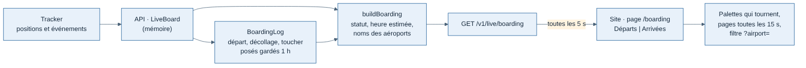

# Page Boarding : tableau des départs et des arrivées

Demandée par Greg le 13/11/2026 (maquette dense validée : `/mnt/project-files/boarding/maquette-boarding-dense.html`). Page publique, même nom en français et en anglais, voisine de « Vols en direct » : un tableau à palettes façon aérogare avec les vols de tous les membres.

## Ce que voit le visiteur

- **Adresse** : `/boarding` (`/fr/boarding`, `/en/boarding`), ouverte sans compte (liste `PUBLIC_PAGES` du site).
- **Barre** : pastille « Boarding » ambre à droite du compteur « N en vol », dans le même style (choix de Greg) ; sur téléphone, l'icône seule et l'entrée dans le menu.
- **En-tête sur une ligne** : titre, filtre par terrain (code OACI, touche « / »), les 3 terrains les plus actifs en un clic, horloges UTC et locale (ville du fuseau du navigateur).
- **Largeur** : 1 200 px au plus, comme les autres pages du site (`SectionMain`).
- **Deux tableaux côte à côte** (l'un sous l'autre sous 1 280 px) :

| Tableau | Lignes | Heure | Colonnes |
| --- | --- | --- | --- |
| Départs | Tous les vols pas encore posés, le départ le plus récent en haut | Décollage, ou mise en route tant que l'avion est au sol | Heure, vol, vers, avion, pilote, statut |
| Arrivées | Vols en l'air par heure estimée, puis posés depuis moins d'une heure (le plus récent en haut, grisés) | Estimée (« EST ») d'après la distance restante et la vitesse sol, puis heure du toucher | Heure, vol, de, avion, pilote, statut (« Posé −118 » : toucher en ft/min) |

- **Pages** : 12 lignes par tableau ; au-delà, le tableau passe seul à la page suivante toutes les 15 s (« 1/3 »).
- **Nom des terrains** : code OACI seul dans la ligne ; nom dans une bulle au survol (et au clavier) (demande de Greg du 13/11, 8 h).
- **Avion** : silhouette de la catégorie dans sa couleur, comme sur la carte en direct, puis le type.
- **Pilote** : seulement sa pastille (photo ou initiale), son nom dans une bulle au survol, un clic ouvre sa page ; puis insigne de grade, badge fondateur et drapeau du pays. Profil privé : pastille grise avec un fantôme, « Pilote masqué » dans la bulle (choix de Greg : le vol reste affiché ; plus de nom ni de texte dans la ligne depuis le 13/11, 8 h).
- **Effet de palettes** : quand un texte change (vol, terrain), chaque case fait défiler le tambour jusqu'au bon caractère. Sans animation si le système demande moins de mouvement. Son des palettes coupé par défaut : il suit le bouton son de la barre du site, à côté du thème (demande de Greg du 13/11 : plus de haut-parleur sur la page), choix gardé dans le navigateur (`site/sound-setting.ts`).
- **Clics** (demande de Greg du 13/11) :

| Clic sur | Ouvre |
| --- | --- |
| L'indicatif d'un vol clos dont le pilote est public | La page publique du vol (`/pilots/{pseudo}/flights/{id}`) |
| L'indicatif d'un vol encore en cours | Le vol sur la carte en direct (`/live?flight=<id>`) : sa page publique n'existe qu'après la clôture |
| L'indicatif d'un vol clos au pilote masqué | Rien (aucune page ne le montre) |
| Un pilote public | Sa page (`/pilots/{pseudo}`) ; « Pilote masqué » n'est pas cliquable |
| Un terrain | Les tableaux de ce terrain, comme le filtre |
| Un avion | Les deux tableaux réduits à ce type, pastille « A320 × » à côté du filtre |

- **Lien partageable** : `/boarding?airport=LFML` ouvre directement le tableau de ce terrain, `?aircraft=A320` celui d'un type ; les deux se combinent.
- **Bandeau « En ce moment »** : nombre de départs et d'arrivées, terrain le plus actif, toucher le plus doux de l'heure.
- **Affichage en direct**, sans délai (choix de Greg) : le site suit le flux `GET /v1/live/boarding/stream` (SSE) ; l'API y renvoie les deux tableaux à la connexion puis dès qu'ils changent (vérifié toutes les 2 s, rien n'est calculé sans spectateur). Aucune relecture périodique côté site.

## Statuts

Les 12 phases du tracker regroupées en 8 statuts (`BoardingStatus`, `packages/contrats`) :

| Statut | Phases |
| --- | --- |
| Embarquement | BOARDING |
| Repoussage | PUSHBACK |
| Roulage | TAXI_OUT |
| Décollé | TAKEOFF, puis 15 min après le décollage |
| En vol | CLIMB, CRUISE, DESCENT |
| Approche | APPROACH, FINAL |
| Posé | LANDING, TAXI_IN, ARRIVED, ou un toucher reçu |
| Perdu | aucune position depuis 60 s |

Pas de « Prévu » ni de « Retardé » : les pilotes ne déclarent pas d'heure prévue. Elles viendront avec des vols planifiés (idée « compagnie Weems », `docs/suivi/idees-fonctionnalites.md`).

## API

`GET /v1/live/boarding` (format `Boarding`, public, `cache-control: no-store`), module `live` :

- `live/boarding-log.ts` garde en mémoire, par vol du direct, l'heure de la première position, du décollage (passage TAKEOFF → CLIMB) et du dernier toucher avec sa vitesse verticale ; un vol clos après un toucher reste une heure (`BOARDING_LANDED_KEEP_MS`).
- `live/boarding.ts` (fonctions pures) dit si le vol est clos (`closed`, pour le lien vers sa page publique), calcule le statut, l'heure estimée (orthodromie restante / vitesse sol, à partir de 50 kt) et trie les deux tableaux ; noms des aéroports par le service `airports`.
- Le pilote suit la règle de la carte : seulement si son profil est public, relu toutes les 30 s, posés récents compris.
- Limite connue : tout est en mémoire, comme les trajets du direct. Après un redémarrage de l'API, l'heure de décollage des vols en l'air et les posés de l'heure sont perdus (heure affichée : la mise en route vue après le redémarrage).

## Formules

Clé `boarding` du catalogue (groupe « Voler et suivre »), dans toutes les formules, disponible (`NOW`). Explication et illustration sur la page Fonctionnalités.

## Code du site

`apps/web/src/boarding/` : lecture (`use-boarding.ts`), lignes et filtres (`board-rows.ts`, testé), tambour des palettes (`flap-roll.ts`, testé ; `flap-text.tsx`), son des palettes (`use-flap-sound.ts`, allumé par le bouton son de la barre ; une seule sortie audio pour tout le site, `siteAudio()` de `site/sound-setting.ts`, démarrée dans le clic du bouton, seul moment où les navigateurs l'autorisent ; si le son était déjà allumé à l'ouverture de la page, il reste muet jusqu'au premier clic ou à la première touche sur la page, qui le réveille), cellules et tableaux (`board-cells.tsx`, `boarding-table.tsx`), liens des indicatifs (`board-links.ts`, testé), filtres (`airport-filter.tsx`, `aircraft-chip.tsx`, `use-board-filters.ts`, `use-url-choice.ts`), horloges, bandeau, assemblage (`boarding-view.tsx`). Pastille de la barre : `site/boarding-link.tsx`.
