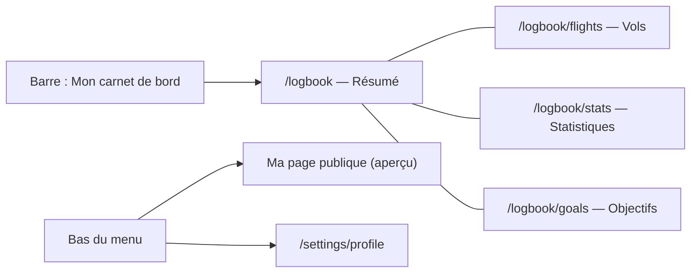

# Spécification — Carnet de vol privé

Date : 12/11/2026. Demande de Greg : faire de « Mon carnet de bord » (`/logbook`) un vrai carnet privé de suivi et d'apprentissage, et non plus la page publique vue par son pilote. Puis, le 12/11 à 23 h 12 : « mettre déjà ça en ligne », c'est-à-dire intégrer au site les pages validées avant de maquetter les suivantes.

Maquettes validées (dossier du projet `carnet/`) :

| Page | Version validée | Affichage retenu |
| --- | --- | --- |
| Résumé | v6 (12/11, 22 h 10) | dernier vol C (profil d'altitude par phase + 6 petites cartes), régularité sous la progression des touchers |
| Vols | v8 (12/11, 22 h 42) | B : liste à gauche, fiche du vol à droite ; bandes de vol au-dessus du profil d'altitude |
| Statistiques | v10 (12/11, 22 h 55) | B : par thème (Activité, Avions et routes, Atterrissages, Technique) ; graphiques calés en bas de leur carte |
| Objectifs | v12 (12/11, 23 h 12) | B : liste avec anneaux de progression, suivi détaillé à droite |

« Notes de vol » n'est pas une page : les notes vivent dans la fiche d'un vol (décision du 12/11, 23 h 08).

## 1. Organisation

- Bureau : menu à gauche (pilote, formule, 4 pages, puis « Ma page publique » et « Réglages du profil »), contenu à droite.
- Téléphone : les 4 pages en onglets sous la barre, sans menu de gauche.
- L'ancienne page `/logbook` (page publique vue par son pilote, en aperçu tant qu'elle n'est pas publique) devient « Ma page publique » : `/logbook/public`.
- Tout le carnet est privé : il compte **tous** les vols du pilote, y compris ceux masqués sur sa page publique.

## 2. Formules (Pilot Free / Pilot Pro)

Principes validés par Greg le 12/11 à 21 h 10 :

1. Toutes les données de tous les pilotes sont enregistrées dès le premier jour, quelle que soit la formule.
2. L'API décide de ce qui est verrouillé, d'après la formule (`GET /v1/me/plan` et le catalogue, fiche 015). Le site teste une clé de fonction, jamais un nom de formule.
3. Une carte réservée à Pilot Pro a un état « verrouillé » : aperçu flou avec des **données fictives** (jamais le vrai résultat), cadenas, phrase et bouton « Découvrir Pilot Pro ». Le pilote ne perd jamais l'accès à ses propres vols et à leur historique.

Pour tester : le bouton Free | Pro de la barre (hors production, PR #77).

## 3. Résumé (`/logbook`)

| Bloc | Contenu | Clé | Données |
| --- | --- | --- | --- |
| Dernier vol | route, avion, catégorie, horaires ; 6 petites cartes : toucher, durée, distance, carburant, rebonds, alertes ; profil d'altitude coloré par phase avec la durée de chaque phase ; « Voir le vol » | `logbookSummary` | vol + trajectoire existants ; carburant : voir § 7 |
| 4 chiffres | heures ce mois (écart avec le mois précédent), toucher moyen des 10 derniers (écart avec les 10 d'avant), atterrissages propres sur 30 jours, série en cours (record) | `logbookSummary` | vols du pilote |
| Prochain vol | dernier plan SimBrief : route, avion, départ prévu, croisière, durée, distance, carburant, passagers | `simbriefNextFlight` | identifiant SimBrief du profil, API SimBrief |
| Prévu ou réel | carburant et horaire réels comparés au plan | `plannedVsActual` (Pro) | § 7 |
| Vous et la communauté | percentiles par catégorie d'avion | `community` (Pro) | à calculer sur tous les pilotes |
| Progression des touchers | 30 derniers touchers, moyenne glissante sur 5, zone propre | `logbookSummary` | `recentLandings` existant |
| Régularité | jours de vol des 17 dernières semaines | `logbookSummary` | vols du pilote |
| À travailler | rebonds, vols avec alertes, remises de gaz, sur les 10 derniers vols | `workOnBasic` | événements existants |
| Analyse détaillée | arrondi, vitesse et pente à 1 000 et 500 ft | `workOnDetailed` (Pro) | critères d'approche stabilisée encore à fixer avec un pilote |
| Mes objectifs | objectifs en cours (voir § 6) | `goals` | § 6 |
| Vols récents | 4 derniers vols, toucher coloré | `flightHistory` | existant |

## 4. Vols (`/logbook/flights`)

Liste compacte à gauche (filtres, verdict Propre / Ferme / Rebond / Non conforme, note), fiche du vol choisi à droite ; sur téléphone, la liste seule, un appui ouvre la fiche en pleine page. Fiche : en-tête, 6 petites cartes, trajet, **bandes de vol** (une colonne par minute, une ligne par paramètre, survol = toutes les valeurs de la minute), profil d'altitude, dernière approche, note privée avec étiquettes, chronologie. Pilot Pro : repères à revoir encadrés sur les bandes (`flightBandsMarks`), analyse de l'approche (`approachAnalysis`), comparaison avec les vols du même avion (`sameAircraftComparison`).

## 5. Statistiques (`/logbook/stats`)

Sous-menu collant : Activité (heures, jours de vol, régularité 12 mois, heures par mois et par jour de la semaine, heure de décollage jour / nuit), Avions et routes (catégories, avions, aéroports, routes favorites), Atterrissages (répartition, 30 derniers, par catégorie), Technique (temps par phase, bonnes pratiques). Pilot Free : 30 jours ou 12 mois (`statsPeriod`) ; Pilot Pro : toute la période, tendances par catégorie (`categoryTrends`), temps par phase (`phaseTime`), bonnes pratiques (`goodPractices`).

## 6. Objectifs (`/logbook/goals`)

Liste des objectifs en cours (anneau de progression, barre avec le repère « où vous devriez être aujourd'hui », badge En avance / En retard), suivi détaillé de l'objectif choisi (courbe cumulée, rythme attendu, projection, vols qui comptent, périodes précédentes), suggestions, objectifs atteints et manqués, formulaire de création (8 types : heures, vols, toucher doux, série propre, catégorie ou avion, aéroports, régularité, bonnes pratiques). Pilot Free : 1 objectif actif (en créer un remplace l'actuel) ; Pilot Pro : illimités (`goals`), suggestions (`goalSuggestions`), type « Bonnes pratiques » (`goalGoodPractices`). Nouvelle table dans l'API.

## 7. Données qui manquent aujourd'hui

[Confiance élevée] Le traqueur mesure carburant, volets, train, aérofreins, N1, pilote automatique, feux… (format `Sample`), mais la trajectoire envoyée à l'API (`TrackPoint`) ne garde que position, altitudes, vitesses, vario, cap et sol. Les bandes de vol, le carburant du dernier vol et « Prévu ou réel » demandent d'ajouter ces champs, facultatifs, à `TrackPoint`, côté traqueur et côté API (PR des Vols). Les vols déjà enregistrés n'auront pas ces lignes : la carte affiche « non mesuré ».

**Fait le 12/11/2026 (#83)** : `TrackPoint` (`packages/contrats/src/api/tracks.ts`) porte ces champs, facultatifs, envoyés par le traqueur et gardés par l'API. Restent à faire : le plan SimBrief (« Prochain vol », « Prévu ou réel »).

## 8. Découpage

| PR | Contenu | État au 13/11/2026 |
| --- | --- | --- |
| #77 | Bouton de test Free \| Pro | Fusionnée |
| #81 | Cadre du carnet (menu, onglets, `/logbook/public`) et Résumé (sans Prochain vol ni communauté réelle : cartes verrouillées ou « bientôt ») | Fusionnée |
| #83 | Vols : liste + fiche, trajectoire enrichie, bandes de vol (repères à revoir sur critères provisoires : 250 kt sous 10 000 ft, inclinaison > 30°, plus de 1 000 ft/min de descente sous 1 000 ft, à valider : liste Houssine) ; dernière approche, analyse, note, chronologie et comparaison plus tard | Fusionnée |
| #86 | Statistiques par thème (`GET /v1/me/logbook/stats`). Bonnes pratiques mesurées avec les critères provisoires des bandes (pas encore d'« approche stabilisée », critères à fixer avec un pilote) | Fusionnée |
| à venir | Objectifs (table, routes, page) | À faire |
| plus tard | Prochain vol SimBrief, communauté, analyse d'approche (critères à fixer avec un pilote), notes de vol | À faire |
