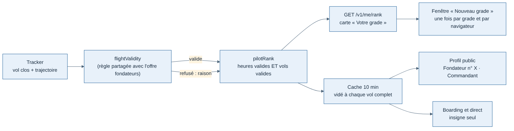
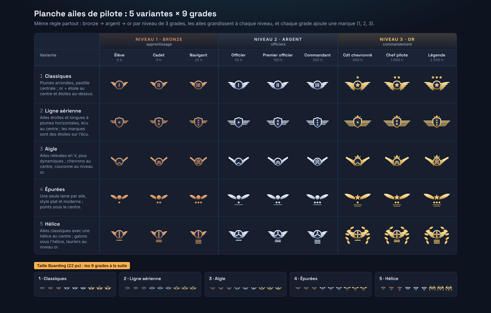

# Grades des pilotes

Date : 13/11/2026. Demandé par Greg (fil « Créer les grades des pilotes ») : au lieu d'un niveau au-dessus de « Pilote fondateur » (statut figé), des grades pour **tous** les pilotes, gagnés en volant. Échelle validée le 13/11 (« oui »), insignes choisis sur la planche `/mnt/project-files/grades/planche-ailes.html` (variante 1, « ailes classiques »). Fiche [018](../../decisions/018-grades-heures-et-vols-valides.md).

## Échelle

9 grades aux noms inventés (aucune licence réelle), en 3 niveaux de 3. Il faut **les deux seuils** :

| Niveau | Grade (FR / EN) | Heures valides | Vols valides |
| --- | --- | --- | --- |
| Bronze | Élève / Student | 0 | 0 |
| Bronze | Cadet / Cadet | 5 | 3 |
| Bronze | Navigant / Flyer | 20 | 10 |
| Argent | Officier / Officer | 50 | 25 |
| Argent | Premier officier / First officer | 100 | 50 |
| Argent | Commandant / Captain | 250 | 100 |
| Or | Commandant chevronné / Senior captain | 500 | 200 |
| Or | Chef pilote / Chief pilot | 1 000 | 350 |
| Or | Légende / Legend | 2 500 | 700 |

Source unique : `RANK_THRESHOLDS` (`packages/contrats/src/api/ranks.ts`).

## Règles

- **Vol valide** : même règle que l'offre fondateurs (`flightValidity`, `apps/api/src/modules/flights/validity.ts`) : simulateur réel, décollage et atterrissage, 15 min en l'air, 20 NM de trajectoire, ni avion déplacé ni crash.
- **Heures** : temps en l'air (décollage → dernier toucher, pauses retirées) des vols valides, en **temps réel** : les heures des messages du tracker viennent de l'horloge du PC, l'accélération du simulateur ne les gonfle pas.
- Un grade **ne se perd jamais** ; il est recalculé sur tout l'historique (vols masqués de la page publique compris), donc personne ne repart de zéro.
- Date d'obtention : clôture du vol qui a fait atteindre le grade.
- Limite connue : un long vol en pilote automatique sans personne devant compte ; le seuil de vols freine cet abus sans l'empêcher.

## Insignes

Ailes de pilote, dessinées dans `apps/web/src/ui/rank-insignia.tsx` (seul endroit à changer pour changer d'insigne) : le métal change à chaque niveau (bronze, argent, or : variables `--wm-rank-*` de `global.css`), les ailes grandissent (2, 3, 4 plumes) ; dans un niveau, 1 à 3 barres, puis au niveau or une étoile au centre et 1 à 3 étoiles au-dessus.

## Où on le voit

| Où | Quoi | Source |
| --- | --- | --- |
| Carnet › Résumé | Carte « Votre grade » : insigne, date, prochain grade, barres heures et vols, ce qui manque ; 5 derniers vols avec les heures comptées ou la raison du refus | `GET /v1/me/rank` (`MyRank`) |
| Carnet › Résumé | Fenêtre « Nouveau grade », une fois par grade et par navigateur (`localStorage` `weems-rank-seen` ; un navigateur neuf n'annonce qu'un grade de moins de 7 jours) | idem |
| Profil public | Badge grade à côté du badge fondateur (« Pilote fondateur n° 127 » · « Commandant ») | `PilotPage.rank` |
| Boarding, carte en direct | Insigne seul à côté du pilote public, nom et seuils au survol | `LivePilot.rank` |

Les pages publiques et le direct lisent le grade dans un cache de 10 min par pilote (`RanksService`), vidé à la réception de la trajectoire d'un de ses vols (`TracksService.whenCompleted`). Rien n'est stocké en base.

## Formule

Gratuit pour tous : clé `pilotRanks` du catalogue (groupe « Voler et suivre », disponible).

## Niveau déclaré

Le niveau déclaré du profil (Débutant / Intermédiaire / Confirmé) faisait doublon : il est retiré (migration `0013_declared_real_pilot`). Reste la mention « Pilote breveté (déclaré) », non vérifiée.
