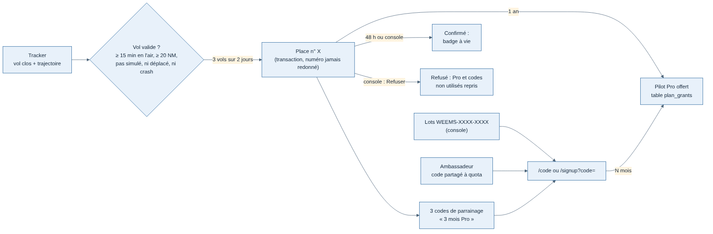

# Offre « Pilote fondateur » et codes d'offre

Date : 13/11/2026. Demandé par Greg ; choix tranchés dans le fil « Offrir Pro aux 500 premiers inscrits ». Maquette validée (« code-la ») : `/mnt/project-files/fondateurs/maquette-fondateurs.html`.

## Ce qui est offert

| Qui | Quoi | Comment |
| --- | --- | --- |
| Les 500 premiers pilotes avec **3 vols valides sur au moins 2 jours** (UTC) | Pilot Pro **1 an**, badge « Pilote fondateur n° X » **à vie**, 3 codes de parrainage, **-30 % à vie** sur Pilot Pro ensuite (affiché seulement : pas de paiement avant le lot 2) | Automatique, à la réception de la trajectoire du 3e vol |
| Un pilote parrainé par un fondateur | Pilot Pro 3 mois | Code `WEEMS-XXXX-XXXX` à usage unique, valable 90 jours |
| Un club, un événement | Pilot Pro N mois (1 à 24) | Lot de codes `WEEMS-XXXX-XXXX` créé dans la console, export CSV, hors quota des 500, sans badge |
| La communauté d'un ambassadeur (streamer, club) | Pilot Pro N mois | Code **partagé** à quota (`CAPTAINSIM`, 50 places), page publique `/ambassadors/<adresse>` |

Les mois offerts s'additionnent : un nouveau cadeau commence à la fin de ceux en cours. Un code d'offre ouvre aussi l'inscription pendant l'alpha fermée (champ « Code d'invitation ou d'offre » de `/signup`). Les comptes administrateurs, fictifs ou désactivés ne prennent pas de place.

## Vol valide (contre la triche)

Le tracker et le simulateur sont publics : un vol peut être fabriqué. L'API ne compte qu'un vol :

- clos, avec trajectoire reçue ;
- simulateur réel (pas `replay`), décollage et atterrissage connus ;
- au moins **15 min en l'air** et **20 NM** de trajectoire ;
- sans avion déplacé (slew, changement de position) ni crash.

Règle partagée avec les grades des pilotes : fonction pure `flightValidity` (`apps/api/src/modules/flights/validity.ts`, seuils `VALID_FLIGHT` et raisons `FlightValidity` dans `packages/contrats`).

Une place gagnée est **en vérification 48 h** (Pilot Pro déjà actif) : la console peut la confirmer plus tôt ou la **refuser** (Pro et codes non utilisés repris, numéro perdu, jamais redonné). Les numéros viennent d'une séquence PostgreSQL ; l'attribution se fait en transaction sous verrou (`pg_advisory_xact_lock`) pour ne jamais dépasser 500.

## Codes

- Usage unique : `WEEMS-` + 2 × 4 caractères sans 0/O/1/I/L ; comparés sans tenir compte de la casse ni des espaces.
- Partagé : 4 à 20 lettres, chiffres ou tirets, ne commence pas par `WEEMS`.
- Un pilote n'utilise qu'une fois une même offre ; pas son propre code de parrainage.
- **5 essais par heure** au plus (adresse + session) ; réponses : 404 inconnu, 409 déjà utilisé, 410 expiré, épuisé ou annulé, 429 trop d'essais.

## Pages

| Où | Contenu |
| --- | --- |
| Site `/plans` | Bandeau de l'offre (« Plus que X places » seulement sous 100), derniers fondateurs, progression du pilote vol par vol avec la raison d'un vol refusé |
| Site `/code` | Saisie d'un code (pilote connecté), pré-rempli par `?code=` |
| Site `/settings/plan` « Mon abonnement » | Formule, Pro offert jusqu'à quand, place de fondateur, codes de parrainage à copier (code ou lien d'inscription) |
| Site `/ambassadors/<adresse>` | Photo, présentation FR/EN, citation, liens, code, places restantes, bouton vers `/signup?code=` ou `/code?code=` |
| Profil public, Boarding | Badge « Pilote fondateur · n° X » (confirmé seulement) |
| Console `/founders` | Compteurs, liste, Confirmer / Refuser |
| Console `/codes` | Ambassadeurs (fiche, photo 5 Mo réduite en WebP 256 px, **accord écrit obligatoire**), lots, CSV, annulation |

## API

| Route | Accès |
| --- | --- |
| `GET /v1/founders` | Public, cache 60 s |
| `GET /v1/me/founder`, `GET /v1/me/codes`, `POST /v1/me/codes/redeem` | Pilote connecté |
| `GET /v1/ambassadors/{adresse}`, `/photo` | Public |
| `GET /v1/admin/founders`, `POST /v1/admin/founders/{n}/confirm` et `/refuse` | Administrateur |
| `GET /v1/admin/codes`, `POST /v1/admin/codes/batches`, `GET /v1/admin/codes/{id}/csv`, `POST /v1/admin/codes/{id}/cancel` | Administrateur |
| `GET /v1/admin/ambassadors`, `PUT /v1/admin/ambassadors/{adresse}`, `PUT …/photo` | Administrateur |

`GET /v1/me/plan` dit d'où vient un Pilot Pro offert (`offered`), et la page Comptes de la console affiche la formule offerte. Tables : `plan_grants`, `founders`, `offer_campaigns`, `offer_codes`, `offer_redemptions`, `ambassadors` (migration `0012_offers.sql`).

## Hors de cette spec

- Rappel 30 jours avant la fin du Pro offert : il faudra l'envoi d'e-mails (l'API n'en envoie pas encore).
- Grades des pilotes au-delà de fondateur (heures de vol) : fil séparé.
- Prix fondateur appliqué au paiement : lot 2.
