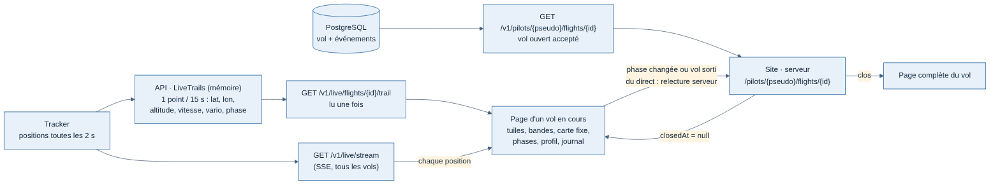

# Page d'un vol en cours

Demandée par Greg le 13/11/2026 (« ouvrir le vol en cours »), maquette unique sombre validée le même jour : `/mnt/project-files/vol-en-cours/maquette-vol-en-cours.html`. Lancée en code le 13/11 à 9 h 04 (« go »).

## Principe

- **Une adresse par vol, stable** : `/pilots/{pseudo}/flights/{id}`, celle de la page publique du vol. Tant que le vol est ouvert, elle le suit en direct ; une fois clos, la même adresse montre la page complète du vol. Un lien partagé pendant le vol reste bon après l'atterrissage.
- **Pilotes publics seulement**. Un vol au pilote masqué n'a pas de page : le Boarding et la carte du direct mènent à la carte du direct, comme avant.
- **Un vol masqué** par son pilote répond 404, en cours comme clos.
- **En continu** sur le flux SSE du direct (choix de Greg du 13/11) : chiffres à chaque position, trace lue une fois puis complétée point par point, relecture de la page par le serveur quand la phase change (phases et journal à jour) ou quand le vol quitte le direct (page complète à la clôture).

## Ce que voit le visiteur (de haut en bas)

| Bloc | Contenu |
| --- | --- |
| Haut | « Profil de {pilote} », « Voir sur la carte du direct », copier le lien (icône seule), « Partager » |
| En-tête | Indicatif · immatriculation, route, avion et sa catégorie ; pastille « En direct » + phase, heure de la dernière position |
| Progression | Départ (heure), barre parcourue avec l'avion qui lève ou baisse le nez selon le vario (±1° par 100 ft/min, 20° au plus), arrivée estimée |
| 6 tuiles | Altitude (niveau de vol au-dessus de 10 000 ft), vitesse sol, cap, vario, temps écoulé, distance restante (parcouru, %) |
| Ligne pilote | Photo, nom, drapeau, grade, vols, heures, terrains, avion préféré, membre depuis, lien « Voir sa page publique » |
| Bandes de vol | 4 bandes seulement (Greg : « pas de 15 lignes ») : phase, altitude, vitesse, vario ; une case par minute, remplies jusqu'à maintenant, cases vides jusqu'à l'arrivée estimée |
| Carte (à gauche) | Fixe (ni zoom ni déplacement), centrée sur l'avion ; voir ci-dessous |
| Phases (à droite) | Faites (heure UTC), en cours en surbrillance, à venir en gris ; arrivée estimée et temps restant |
| Profil d'altitude | Altitude et vitesse, couleurs des phases, se remplit au fil du vol |
| Journal | Événements du vol (UTC) |

Les autres bandes (inclinaison, commandes, cabine) et l'analyse de l'atterrissage restent sur la page complète : la trajectoire détaillée n'arrive qu'à la clôture du vol (le tracker l'envoie à ce moment-là ; l'envoyer par morceaux en vol a été écarté par Greg).

### Carte du trajet

- Fixe, zoom 5,6, recentrée sur l'avion à chaque image.
- Autres vols du direct très discrets, avec leurs trajets.
- Ajouts validés par Greg (« 1 à 4 ok ») :
  1. trace volée colorée selon l'altitude (dégradé 0 / 10 000 / 25 000 / 40 000 ft), avec sa légende ;
  2. vecteur vitesse : position dans 3 minutes au cap et à la vitesse sol actuels (rien au sol) ;
  3. repères de phase avec leur heure, écrits sur la carte (pas de survol, la carte est fixe) : décollage, fin de montée, début de descente ;
  4. route directe départ → arrivée en pointillés, et dans l'encart : coordonnées de l'avion (degrés et minutes) et écart à la route directe (« 2,4 nm à droite »).
- Pas de bouton « Couches » : la carte est fixe, tout est affiché.
- Hors périmètre : espaces aériens, balises, vent, piste en service.

## API

| Route | Changement |
| --- | --- |
| `GET /v1/pilots/{pseudo}/flights/{id}` | Accepte un vol ouvert (`closedAt: null`) ; toujours 404 pour un vol masqué ou d'un autre pilote |
| `GET /v1/pilots/{pseudo}/flights/{id}/track` | 404 tant que le vol est ouvert (la trajectoire n'existe qu'à la clôture) |
| `GET /v1/live/flights/{id}/trail` | Nouvelle, publique : points du vol gardés en mémoire (`LiveTrail` : heure, lat, lon, altitude, vitesse sol, vario, phase), 1 toutes les 15 s, 1 500 au plus ; 404 si le vol n'est pas sur le direct |

Limite connue : la trace en mémoire est perdue au redémarrage de l'API ; la page la reconstruit alors à partir des positions suivantes.

## Liens vers la page

- **Boarding** : un clic sur l'indicatif d'un vol au pilote public ouvre sa page, en cours ou clos.
- **Carte du direct** : le panneau du vol suivi a un bouton « Page du vol » quand le pilote est public.

## Catalogue des formules

Clé `liveFlightPage`, groupe « Voler », toutes les formules, disponible (`NOW`).

## Code

| Où | Quoi |
| --- | --- |
| `apps/api/src/modules/live/live-trails.ts` | Points gardés avec altitude, vitesse, vario, phase |
| `apps/api/src/modules/live/routes.ts`, `service.ts` | Route `trail` |
| `apps/api/src/modules/profiles/public-service.ts` | Vol ouvert accepté, trajectoire refusée tant qu'il est ouvert |
| `apps/web/src/live-flight/` | La page : lecture du direct (`use-live-flight.ts`, `use-live-trail.ts`, `use-live-flight-view.ts`), calculs testés (`live-bands.ts`, `map-detail.ts`, `phase-steps.ts`, `attitude.ts`, `coordinates.ts`, `live-trail.ts`), blocs (`live-flight-*.tsx`, `route-bar.tsx`, `live-tiles.tsx`, `pilot-strip.tsx`, `live-phases.tsx`), calques de la carte (`detail-layers.ts`) |
| `apps/web/src/app/[locale]/(public)/pilots/[handle]/flights/[flightId]/page.tsx` | Vol ouvert → page en cours ; clos → page complète |
