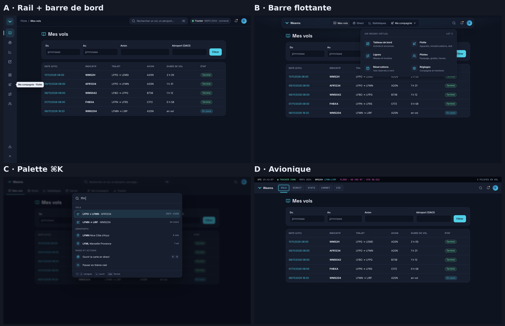

# 003 — Navigation : barre flottante translucide

Date : 11/11/2026. Décidé par Greg (« partons sur la maquette B barre flottante »). Remplace, dans la fiche 001, le menu latéral de 240 px et la barre du haut de 52 px.

## Contexte

Greg aime la mise en page des contenus, mais trouve l'en-tête et le menu datés : menu latéral à libellés, bloc cyan sur la page active, barre du haut presque vide. Huit directions ont été maquettées (`/mnt/project-files/j4-navigation/`, `maquette-navigation.html?v=a…h`) : rail d'icônes, barre flottante, palette de commande, avionique, bandeau cockpit, dock vertical, espaces par compagnie, carte en bandeau.

## Choix

Direction B :

- une barre translucide (flou d'arrière-plan) détachée des bords, collée en haut au défilement, alignée sur la largeur des contenus ;
- le logo à gauche, les pages en onglets segmentés au centre (la page active est en relief), le menu du pilote à droite (initiale, nom sur grand écran, langue et déconnexion dans un menu) ;
- un bouton soleil / lune dans la barre pour passer en thème clair ou sombre (ajout de Greg) : le choix est gardé dans le navigateur (`localStorage`), sinon le site suit le réglage du système ; un petit script dans l'en-tête de la page applique le thème avant l'affichage, sans clignotement (`src/site/theme.ts`, testé) ;
- une lueur douce en haut de la page, couleur de l'accent ;
- sur téléphone (moins de 768 px), les onglets passent dans un dock flottant en bas de l'écran, à portée du pouce (remplacé le 12/11 par le bouton menu, voir plus bas) ;
- la carte en direct passe sous la barre.

Les couleurs « verre », lueur et ombres sont des variables du thème (`global.css`), en sombre et en clair.

## Conséquences

- **Limite assumée : 5 entrées au plus dans la barre.** Le menu final estimé en compte environ 13 (lot 3, compagnie virtuelle). La compagnie (« Ma compagnie ») ouvrira un menu déroulant, et le compte (réglages, abonnement, tracker) ira dans le menu du pilote. Recommandation contraire de Claude : rail d'icônes (direction A), qui accepte plus d'entrées sans menu caché. Si un pilote peut appartenir à plusieurs compagnies, il faudra revoir la question au lot 3.
- `src/site/aside-menu.tsx` est supprimé ; la page active est calculée par `src/site/current-page.ts` (testé).
- Les cartes (direct, page de vol) suivent le bouton sans rechargement : le fond de carte est remplacé par celui du nouveau thème et nos calques (avions, trajectoire) sont redessinés dans ses couleurs (`src/map/base-map.ts`).
- Écarts assumés avec la maquette : « Statistiques », « Ma compagnie », la recherche et les notifications n'apparaîtront qu'avec leurs pages (pas de lien mort).
- Les menus déroulants partagent `src/ui/use-dismiss.ts` (Échap, clic à l'extérieur).

## Mise à jour du 12/11/2026 : une seule barre sur tout le site

Demande de Greg (« la nouvelle barre de menu qui est sur l'accueil doit être la même sur toutes les pages du site, masquer « Découvrir Weems », y placer les boutons du compte « Mes vols » ») : la barre v2 de l'accueil (spec J4 accueil) devient la barre de toutes les pages, pilote connecté ou visiteur (`src/site/site-shell.tsx`).

- Après le logo, groupe de liens avec la page active en relief : « Mes vols » (pilote connecté) et « Vols en direct » (tous). Les entrées et qui les voit sont dans `src/site/menu-items.ts` (`menuFor`) ; la limite de 5 entrées reste, pour chaque public. Mise à jour du 12/11/2026 : chaque entrée a un public (`pilot`, `visitor` ou `everyone`). « Découvrir » (`/discover`) est pour les visiteurs seulement (Découvrir, Vols en direct, Offres) : le pilote connecté connaît déjà Weems et garde ses 4 entrées ; tout le monde retrouve « Découvrir Weems » dans le pied de page. La future page « Fonctionnalités » suivra la même règle.
- « Découvrir Weems » est retiré (il renvoyait à l'accueil, comme le logo).
- À droite : « Créer un compte » et l'icône de connexion pour un visiteur ; l'initiale du pilote et son menu (« Mon profil public », déconnexion) une fois connecté ; puis thème et FR | EN pour tous. La langue sort du menu du pilote (FR | EN est toujours visible).
- Sous 768 px : bouton menu avec les mêmes liens, partout. **Le dock flottant du bas est supprimé** (une seule navigation au lieu de deux selon la page) ; le menu du pilote s'ouvre sur toute la largeur.
- Pied de page P2 sur l'accueil et les profils publics, pas sur les pages du pilote ni la carte en direct.

## Mise à jour du 12/11/2026 : « Mon carnet de bord »

Demande de Greg : un bouton « Mon carnet de bord » avant « Mes vols » (pilote connecté), qui montre sa page publique ; c'est la page d'arrivée après connexion. La barre compte maintenant 3 entrées sur 5 (carnet, mes vols, direct). Détails dans la spec J4 profil public, section 7.
