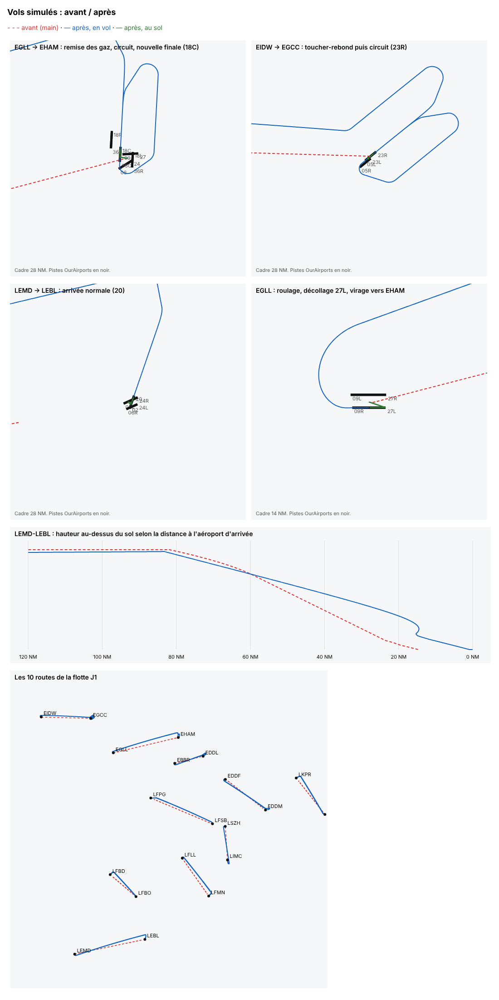

# 006 — Vols simulés : pistes réelles, virages et pente de 3°

Date : 11/11/2026. Choisi par Greg (options 1 + 2 de la proposition « Rendre les vols simulés plus réalistes »).

## Contexte

Le générateur de vols (`apps/tracker/tools/generate-flights/`) faisait avancer l'avion sur une ligne droite en latitude et longitude, selon la distance parcourue. Mesuré sur les 16 premiers vols de `fleetOf` :

- vols normaux : toucher **9 à 17 NM avant l'aéroport** (descente calée sur le temps, pas sur la distance) ;
- vols perturbés (rebond, décollage interrompu, toucher-rebond, remise des gaz) : arrivée au-dessus de l'aéroport à 12 500 ft, puis **immobile jusqu'à 8 min 30** ;
- roulage le long de la route : décollage à 2,3 NM de l'aéroport ;
- toucher toujours à environ −700 ft/min ; aéroports à 0 ft ; cap fixe, jamais d'inclinaison ;
- trajet différent de l'orthodromie que trace la carte du direct.

## Options

| Option | Pour | Contre |
| --- | --- | --- |
| 1. Corriger le modèle linéaire | Petit | Travail jeté dès qu'on ajoute les virages |
| 2. Pilotage par cap et vitesse, pistes réelles (retenue avec 1) | Base de tout le reste (vent, attente, circuits) ; pistes OurAirports libres | Plus de code dans le générateur |
| SID/STAR réels | Tracé exact | Données AIRAC sous licence (Navigraph, Jeppesen), impossibles dans un dépôt public ; CIFP de la FAA limité aux États-Unis |
| Modèle de vol (JSBSim) | Physique réelle | Disproportionné pour un outil de test |

## Choix

L'avion avance selon son cap et sa vitesse sol. Un navigateur lui donne le cap à suivre le long d'une liste de segments, comme un FMS :

- **pistes réelles** : fichier figé `airports/airports.json` (aéroports de la flotte, altitude, extrémités de piste d'au moins 7 000 ft en dur), extrait d'OurAirports (domaine public) par `pnpm --filter @weems/tracker airports:simulated` ; piste tirée par la graine parmi celles face au vent des échantillons (270°) ;
- **au sol** : repoussage, roulage en ligne droite du point de référence de l'aéroport au seuil (pas de données de taxiways), alignement, roulement au décollage dans l'axe ; à l'arrivée, roulage jusqu'au point de référence ;
- **départ** : montée dans l'axe jusqu'à 5 NM après la piste, puis cap direct vers l'arrivée (orthodromie) ;
- **arrivée simplifiée** : en ligne droite si l'avion arrive par l'arrière de la piste, par une étape de base s'il arrive par le côté, par une vent arrière s'il arrive de face ; finale interceptée à 30° au plus, alignée vers 8 NM ;
- **virages** au taux standard (3°/s), limités à 25° d'inclinaison (à grande vitesse le virage est plus lent) ;
- **profil vertical** : niveau de croisière abaissé si la route est trop courte, descente sur une pente de 3° calculée sur la distance restante, palier si l'avion est sous la pente, arrondi dans les 20 derniers pieds ;
- **remise des gaz et toucher-rebond** : circuit main gauche (2 000 ft ou 1 500 ft), puis nouvelle finale ;
- **altitudes** : altitude au-dessus de la mer = terrain + hauteur, le terrain passant de l'altitude du départ à celle de l'arrivée ;
- **toucher** : taux de chute tiré par la graine (−60 à −700 ft/min, la plupart sous −300).

## Conséquences

- Toujours déterministe : les choix d'un vol (pistes, taux de toucher, cap au parking) viennent d'un tirage séparé de celui du bruit, à partir de la même graine. Le fichier d'aéroports est figé : une mise à jour d'OurAirports ne change les vols que si on relance la commande.
- Les phases attendues ne changent pas : vérifié sur les 10 routes J1, sur `fleetOf(16)` et, une fois, sur 400 vols × 7 perturbations.
- Les vols durent un peu plus longtemps (roulage réel, circuits) : 43 à 97 min sur les 16 premiers vols.
- Restent pour plus tard (options 3 à 5) : vitesses et taux par catégorie d'avion (avec le catalogue des avions), 250 kt sous le FL100, vent et dérive, attente, aéroports hors flotte.
- Les calculs d'orthodromie sont dans `apps/tracker/src/core/geo.ts`. Si le site garde son propre calcul (PR #39), les deux iront dans un paquet partagé de `packages/`.
