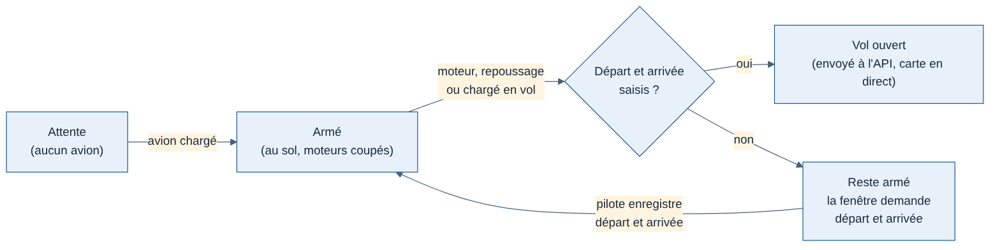

# 007 — Départ et arrivée obligatoires dans le tracker

Date : 11/11/2026. Décidé par Greg (« oui tu as raison », sur la recommandation du chantier des trajets de la carte en direct). Remplace l'exigence EF-05 du [cahier des charges du tracker](../cahiers-des-charges/tracker/CDC-Tracker.md) (vol libre sans plan, aéroports déduits).

## Contexte

La carte en direct affiche le trajet prévu et la progression d'un vol. Sans aéroport d'arrivée, elle ne peut afficher ni l'un ni l'autre. Jusqu'ici, départ et arrivée étaient facultatifs dans le tracker (fenêtre et `pnpm fly`) et le vol partait en « inconnu ».

## Options

1. **Saisie obligatoire avant le vol** (retenue) : simple, sans dépendance, vaut pour l'application, `pnpm fly` et la simulation.
2. Lire le plan de vol chargé dans MSFS : plus confortable, mais dépend de ce que MSFS expose (plan souvent absent en vol libre, comportement à vérifier sur PC Windows). Reportée.
3. Déduire les aéroports les plus proches (ancienne EF-05) : donne le départ, jamais l'arrivée avant l'atterrissage. Ne règle pas le problème de la carte.

## Choix

- Le cœur (`FlightSession`) n'ouvre jamais de vol sans plan de vol : l'option `flightPlan` est obligatoire et vaut `null` tant que le pilote n'a rien saisi. La session reste « armée » ; le simulateur reste lu et affiché.
- Application : les deux champs sont obligatoires (4 lettres OACI). Tant qu'ils manquent, la carte « Vol en cours » le dit en rouge. Un fichier de réglages d'avant cette décision, sans aéroports, se charge toujours (l'indicatif est gardé).
- `pnpm fly` refuse de démarrer sans `--from` et `--to`.
- Simulation (`pnpm simulate`) : chaque pilote simulé avait déjà un départ et une arrivée ; c'est désormais imposé par le type.
- Le même aéroport au départ et à l'arrivée reste permis (tours de piste, vols locaux).

## Conséquences

- **Saisie tardive** : si le pilote démarre les moteurs avant d'enregistrer départ et arrivée, rien n'est enregistré jusque-là ; à l'enregistrement, le tracker redémarre et ouvre le vol au premier échantillon (moteurs tournants ou en vol). Le début du vol est perdu, pas le vol.
- **Aéroports périmés** : les réglages sont gardés d'un vol à l'autre. Un pilote qui oublie de les changer envoie le trajet du vol précédent. Garde-fou possible plus tard : comparer la position de l'avion à l'ouverture avec l'aéroport de départ (EF-06), avec la base d'aéroports de l'API.
- **Existence des codes** : seul le format est vérifié (4 lettres). Vérifier qu'un code existe passera par `GET /v1/airports?codes=` quand cette route sera fusionnée.
- **API inchangée** : le contrat accepte toujours `departureIcao` et `plannedArrivalIcao` à `null` (vols déjà enregistrés, anciens trackers). Le rendre obligatoire côté API serait une décision séparée.
- La bulle « champ obligatoire » de la fenêtre vient du navigateur intégré : sa langue suit celle du système.
