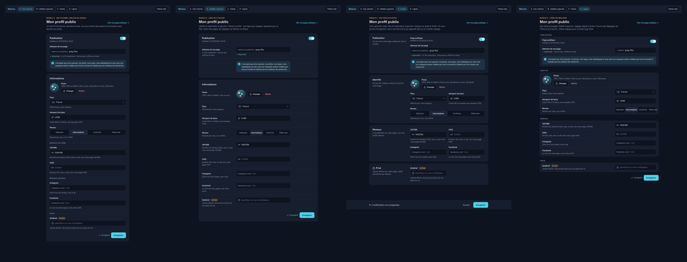
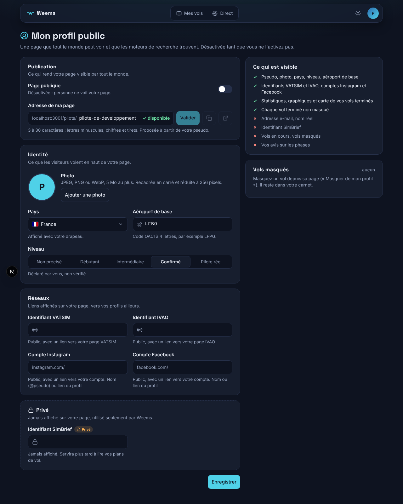

# 008 — Modèle de formulaire : sections en cartes

Date : 11/11/2026. Décidé par Greg (« celle-ci », sur la planche comparative, modèle C). Vaut pour tous les formulaires du site, y compris l'administration.

## Contexte

Le bloc « Informations » des réglages du profil public était peu lisible : listes natives plus basses que les champs (Safari ignore la hauteur d'un `<select>`), une case vide dans la grille, des aides de longueurs inégales et un texte orange sous SimBrief qu'on prenait pour une erreur. Quatre modèles ont été maquettés sur ce formulaire réel, en thème sombre et clair, sur bureau et mobile (`/mnt/project-files/j4-formulaires/`, `maquette-formulaires.html?m=a…d`) :

| Modèle | Principe | Limite |
| --- | --- | --- |
| A | Une colonne, libellés au-dessus | Page longue et étroite sur bureau |
| B | Libellés à gauche (GitHub, Stripe) | Allers-retours de l'œil, retombe sur A en mobile |
| **C** | **Une carte par sujet, titre à gauche, champs en grille, barre d'enregistrement** | Plus de hauteur que B |
| D | Lignes de réglages (iPad, macOS) | Libellé loin de son champ sur grand écran |

## Choix

Modèle C :

- une carte par sujet (`FormSection`) : titre et explication à gauche quand la carte fait au moins 768 px, au-dessus sinon ; la carte suit sa propre largeur (requête de conteneur), pas celle de l'écran. Un sujet jamais affiché (données privées) a un bord en pointillés et un cadenas ;
- les champs côte à côte, deux par ligne dès que la carte dépasse 576 px de contenu (`FieldGrid`), sinon une colonne : sur téléphone, le modèle C devient le modèle A ;
- un champ (`Field`) = libellé au-dessus, éventuellement un badge (« Privé »), le contrôle, une ligne d'aide en gris. Jamais d'aide en couleur : l'orange et le rouge sont réservés aux avertissements et aux erreurs ;
- tous les contrôles font 44 px de haut et ont le même anneau de focus (bordure accent et halo) ;
- une liste courte (moins d'une dizaine de choix) : `Select`, la liste native du navigateur redessinée (`appearance-none` et chevron) ; quatre ou cinq choix à voir d'un coup : `Segmented`, des boutons radio en barre ;
- une longue liste à chercher (pays) : `SearchSelect`, liste avec recherche ;
- une saisie avec repère : `TextInput`, avec icône, préfixe fixe (`instagram.com/`) ou statut à droite (« ✓ disponible ») ;
- un seul bouton Enregistrer par formulaire (`SaveBar`) ; dès qu'un champ change, la barre colle au bas de l'écran (au-dessus du dock mobile) et compte les modifications non enregistrées.

## Bibliothèque ajoutée : React Aria Components

La liste avec recherche est le seul contrôle qu'on ne peut pas faire correctement à la main : clavier (flèches, Échap, Entrée), lecteurs d'écran (rôle `combobox`, annonce des résultats), tactile, position de la liste au bord de l'écran. Options comparées :

- **React Aria Components (Adobe)** : choisi. Mûr, accessibilité de référence, sans style imposé (Tailwind s'applique directement), envoie la valeur au formulaire par un champ caché comme un champ natif ;
- Ariakit : plus léger, mais moins répandu ;
- `<datalist>` natif : ne se met pas en forme et se comporte différemment selon les navigateurs ;
- composant fait maison : à éviter, l'accessibilité d'une liste avec recherche est difficile.

Seul `packages/ui/src/forms/search-select.tsx` l'importe. Version fixée (1.22.1).

## Conséquences

- Les composants sont dans `packages/ui/src/forms/` (paquet `@weems/ui`, déplacés depuis `apps/web/src/ui/` le 11/11/2026 pour servir aussi à la console d'administration) : `button.tsx`, `form-field.tsx`, `form-section.tsx` (`FormSection`, `FieldGrid`), `field.tsx` (`Field`, `FieldBadge`), `text-input.tsx`, `select.tsx`, `segmented.tsx`, `search-select.tsx`, `save-bar.tsx`, et `use-form-changes.ts` (compteur de modifications, logique testée dans `form-changes.ts`). Les classes communes sont dans `input-class.ts`. Une application les importe depuis `@weems/ui` et ajoute `@source "…/packages/ui/src"` à son CSS pour que Tailwind génère leurs classes ; la console, qui garde ses propres styles, n'importe de Tailwind que le thème et les utilitaires (sans remise à zéro), et relie les couleurs du paquet à ses variables.
- Un nouveau formulaire (administration comprise) part de ces composants : on n'écrit plus un `<select>` ou un champ à la main.
- Les réglages du profil passent en quatre cartes (Publication, Identité, Réseaux, Privé). « Ce qui est visible » et « Vols masqués » restent dans la colonne de droite (demande de Greg) : la colonne du formulaire est trop étroite pour mettre les titres à gauche, ils passent donc au-dessus des champs, qui restent deux par ligne.
- Les formulaires de connexion et d'inscription et le filtre de catégorie de « Mes vols » utilisent déjà `Field` et `Select`.
- Le niveau « Non précisé » est un choix comme un autre dans la barre du niveau : le pilote peut revenir en arrière.
