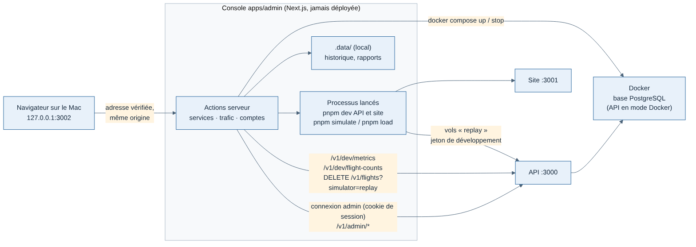

# 009 — Console locale, sans connexion sauf pour les comptes

Date : 11/11/2026. Proposé par Claude, validé par Greg avec la spec et les maquettes (`docs/cahiers-des-charges/console/spec-console.md`). Complétée par la fiche 012 (connexion automatique en local). Le 13/11/2026, l'application `apps/admin` a été renommée `apps/console` (`pnpm console`) à la demande de Greg ; « admin » ne désigne plus que le rôle d'un compte.

## Contexte

Greg fait tout en ligne de commande sur son Mac : démarrer la base, l'API et le site, lancer `pnpm simulate` ou `pnpm load`, créer des invitations (`pnpm invite`). Il veut un écran simple pour cela. Deux pouvoirs sont en jeu : lancer des commandes sur le Mac (services, trafic) et gérer les comptes des pilotes.

## Options étudiées

| Option | Pour | Contre |
| --- | --- | --- |
| Pages d'administration dans le site `apps/web` | Une seule application | Le site est public : y mettre « lancer une commande » ou « arrêter Docker » est un risque grave ; le site ne peut pas démarrer l'API dont il dépend |
| Console locale `apps/console`, connexion pour tout | Une seule règle d'accès | Impossible de démarrer l'API depuis une console qui a besoin de l'API pour se connecter |
| **Console locale `apps/console`, connexion seulement pour Comptes** | Marche API arrêtée ; les comptes passent par l'API et ses droits | Deux règles d'accès à expliquer |

## Choix

- Application Next.js `apps/console`, lancée par `pnpm console`, à l'écoute de **127.0.0.1:3002 seulement**, jamais déployée.
- **Services et Trafic sans connexion** : mêmes droits que le Terminal de Greg. Protections : écoute sur 127.0.0.1, refus de toute requête dont l'adresse n'est pas `127.0.0.1:3002` ou `localhost:3002` (`src/proxy.ts`, contre le « DNS rebinding »), actions serveur de Next.js (refus d'une autre origine).
- **Comptes avec connexion administrateur** : la console n'écrit jamais dans la base. Son serveur se connecte à l'API comme le site (`/api/auth/sign-in/email`, origine de la console autorisée hors production seulement) et garde le cookie de session de l'API dans son propre cookie (`httpOnly`, `SameSite=Strict`). Les routes `/v1/admin/*` vérifient le rôle à chaque appel.
- Rôles Pilote et Administrateur (colonne `users.role`) ; le premier administrateur est nommé par `pnpm --filter @weems/api make-admin <e-mail>`.
- Désactiver un compte supprime ses sessions et ses jetons du tracker ; les jetons d'accès déjà émis (JWT d'une heure) sont refusés à chaque requête par la vérification du compte.

## Conséquences

- Ne jamais ajouter de route ou de page de la console qui écrit directement dans la base : passer par l'API.
- Ne jamais lancer la console sur un serveur : elle démarre des processus avec les droits de l'utilisateur.
- Les routes `/v1/admin/*` pourront servir à une administration en ligne plus tard ; elle devra alors être une autre application, avec connexion pour tout.
- Le trafic simulé n'efface que les vols « replay » du pilote de développement : ses vrais vols MSFS (`pnpm fly`) restent.
