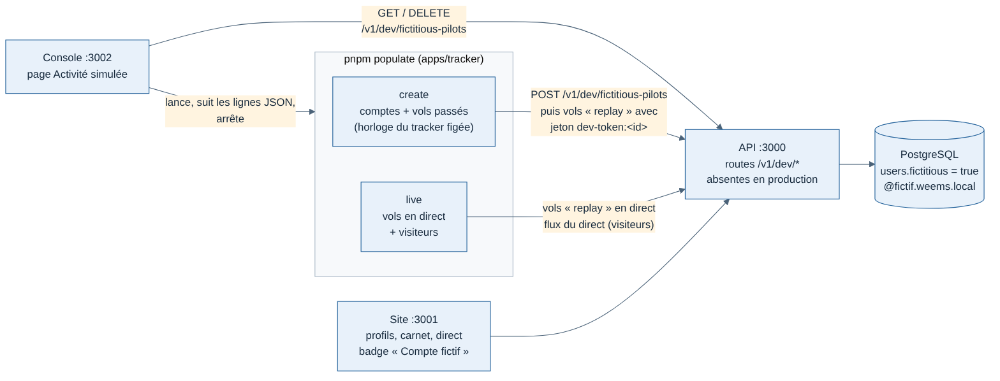

# 011 — Activité simulée : comptes fictifs et vols passés

Date : 12/11/2026. Choisi par Greg (proposition A, maquettes `/mnt/project-files/admin/activite/`).

## Contexte

Le trafic simulé (`pnpm simulate`, `pnpm load`) met tous ses vols au nom d'un seul pilote, le pilote de développement. Le site reste donc vide ailleurs que sur la carte : un seul profil, un seul carnet, des graphiques sans variété. Greg veut remplir **tout** le site (profils publics, carnets, compteurs, graphiques, carte en direct) pour le voir et le tester comme avec de vrais pilotes.

## Options

| Option | Pour | Contre |
| --- | --- | --- |
| Insérer comptes et vols en SQL | Rapide | Profils vides ou faux : compteurs et graphiques sont calculés à partir des événements et des trajectoires, que seul le vrai chemin produit |
| Rejouer les vols par le vrai tracker, horloge figée dans le passé (retenue) | Mêmes données qu'un vrai vol, dates réparties sur des mois | Environ 2,5 vols par seconde (traitement des trajectoires par l'API) |
| Trois réglages tels quels (visiteurs, comptes, vols par compte) | Simple | Profils identiques, carte vide sans vols en direct, impossible de relancer le direct sans tout recréer |

## Choix

Deux blocs dans une page « Activité simulée » de la console :

- **Population fictive** (reste en base) : nombre de comptes, vols par compte en écart min–max, période d'historique (1, 6 ou 12 mois), part de profils publics. Remplace la population précédente.
- **Activité en direct** (temporaire) : vols en direct, visiteurs, durée, vitesse. Les vols sont relayés à l'atterrissage pour garder le même nombre en l'air. Demande une population.

Règles :

- **Marquage** : colonne `users.fictitious`, e-mail en `@fictif.weems.local`, badge « Compte fictif » sur le profil public, dans la bulle du direct et dans la page Comptes de la console.
- **Connexion** : les comptes fictifs se connectent avec un mot de passe commun (`weems-fictif`), affiché dans la console. Local seulement : les routes de création n'existent pas en production.
- **Jeton** : `dev-token:<id du pilote>` vole au nom d'un compte fictif actif. Tout autre identifiant est refusé (401) : le jeton de développement ne peut pas voler au nom d'un vrai compte.
- **Vols** : simulateur `replay`, rejoués par le vrai tracker. Un vol passé part avec l'horloge du tracker figée à sa date de départ et rejoue ses échantillons d'un coup. Heures réalistes (matin, midi, soir, week-end plus chargé), trajets enchaînés depuis la base du pilote, avion favori dans 60 % des vols, quelques rebonds et remises des gaz.
- **Suppression** : « Tout supprimer » efface les comptes fictifs, leurs vols, profils et photos. Ni les comptes réels ni le pilote de développement.
- **Un seul lancement à la fois**, partagé avec la page Trafic simulé.

## Conséquences

- Les visiteurs ne se voient nulle part sur le site : ils chargent l'API (flux du direct), comme les spectateurs de `pnpm load`.
- Les trajets se ressemblent d'un profil à l'autre : le générateur ne connaît que 20 aéroports.
- 50 comptes à 5–40 vols : environ 1 100 vols, 7 à 8 minutes sur le conteneur de développement.
- La première maquette de la console mettait les comptes simulés hors périmètre ; cette fiche les fait entrer.
