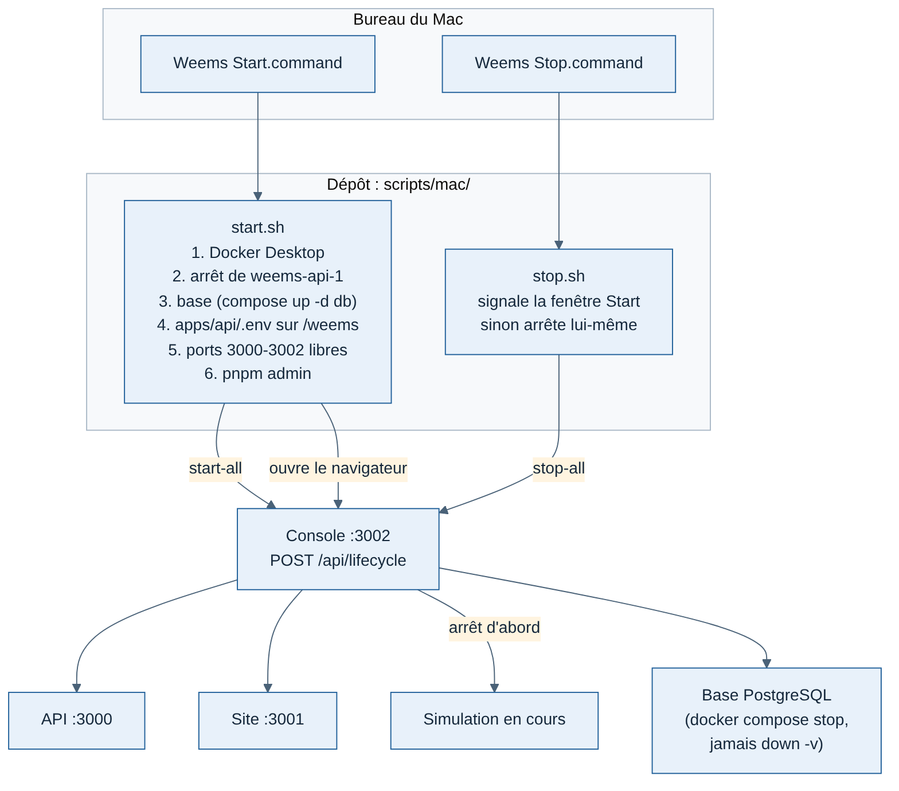

# 011 — Démarrer et arrêter Weems par deux icônes, pas par un conteneur

> Mise à jour du 13/11/2026 : les deux icônes sont remplacées par l'app Mac « Weems » (fiche 020). Les scripts et le principe de cette fiche (la console est le seul chef d'orchestre) restent.

Date : 11/11/2026. Proposé par Claude, validé par Greg (« deux icônes sur le bureau, un start qui lance tout, un stop qui arrête tout »).

## Contexte

Lancer Weems en local demandait quatre onglets de Terminal (`README.md`), et les lancements mélangés (Terminal, console, conteneur `weems-api-1`) ont créé des conflits de ports. Greg voulait un seul geste, et a d'abord pensé à mettre la console dans Docker.

## Options étudiées

| Option | Pour | Contre |
| --- | --- | --- |
| Console dans un conteneur Docker | Un clic dans Docker Desktop | Depuis un conteneur, la console ne voit pas les programmes du Mac ; il faudrait lui donner le contrôle de Docker (fragile, risqué) ; rechargement du code lent dans Docker sur Mac ; deux façons de lancer, donc des conflits de ports |
| Tout en Docker (API, site, console) | Proche de la future production | Débogage plus dur, rechargement lent ; la console perd son rôle de chef d'orchestre |
| **Deux icônes `.command` vers des scripts du dépôt** | Un double-clic ; la console reste le seul chef d'orchestre ; les scripts sont versionnés | Propre au Mac (macOS seulement) |

## Choix

- `scripts/mac/start.sh` et `stop.sh`, versionnés ; sur le bureau, deux lanceurs de trois lignes posés par `install-desktop-icons.sh`.
- Start démarre Docker Desktop et la base, puis la console ; **la console démarre l'API et le site** (route `POST /api/lifecycle`), pour pouvoir les arrêter ensuite.
- Stop passe par la console (simulation, site, API, base), puis arrête la console ; à défaut, il retrouve les programmes Weems par leurs ports et leur dossier de travail. Un programme étranger n'est jamais arrêté.
- Jamais `docker compose down -v`.

## Conséquences

- Une seule façon recommandée de lancer : les icônes. Les commandes à la main restent possibles (`README.md`).
- Le « tout Docker » reviendra pour la mise en ligne (images pour Hetzner), pour la production seulement.
