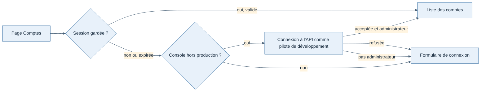

# 012 — Console d'administration : connexion automatique en local

Date : 12/11/2026. Demandé par Greg, proposé par Claude. Complète la fiche 009 (la page Comptes garde ses droits d'administrateur).

## Contexte

Greg veut ouvrir la page Comptes de la console locale sans passer par l'écran « Connexion administrateur ». Les comptes et la connexion existent depuis J3, mais il ne veut pas encore s'en servir au quotidien. Le pilote de développement (`pilote@weems.local`, mot de passe public `weems-dev-password`) existe déjà : l'API le crée à son démarrage hors production seulement.

## Options étudiées

| Option | Pour | Contre |
| --- | --- | --- |
| Routes `/v1/admin/*` ouvertes au jeton de développement | Aucune connexion du tout | Agrandit ce que donne le jeton public `dev-token` : si `WEEMS_ENV` était oublié sur un serveur, n'importe qui lirait les e-mails et désactiverait des comptes |
| Pilote de développement nommé administrateur par l'API à son démarrage | Aucune commande à taper | Même risque : un compte administrateur au mot de passe public dès que `WEEMS_ENV` manque |
| **La console se connecte seule avec le pilote de développement ; le rôle reste donné à la main** | API inchangée, mêmes contrôles qu'une connexion normale ; une commande, une seule fois par base | Le bouton de déconnexion ne sert plus en local (la console se reconnecte) |

## Choix

- Sans session (ou avec une session expirée), la console se connecte d'elle-même à l'API avec le pilote de développement (`src/server/accounts/dev-login.ts`), puis garde le cookie comme après une connexion à la main.
- Jamais quand la console tourne en production (`NODE_ENV=production`) ; l'API refuse de toute façon ce compte en production, où il n'existe pas.
- Le rôle administrateur du pilote de développement reste donné à la main, une fois par base : `pnpm --filter @weems/api make-admin pilote@weems.local`. Tant qu'il ne l'est pas, le formulaire de connexion s'affiche avec cette commande, et la page s'ouvre seule dès qu'elle a été lancée.
- L'identifiant du pilote de développement est écrit une seule fois, dans `packages/contrats` (`DEV_PILOT_LOGIN`), pour l'API, la console et les tests de bout en bout.

## Conséquences

- La connexion à la main reste possible (autre compte administrateur) ; le bouton de déconnexion, en local, ne fait que relancer la connexion automatique.
- Le jour d'une administration en ligne (fiche 009), elle sera une autre application, sans connexion automatique.
