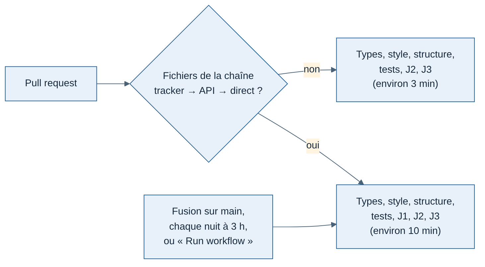

# 013 — Intégration continue : J1 seulement sur les PR qui touchent sa chaîne

Date : 12/11/2026. Demandé par Greg, proposé par Claude. Change la ligne « Test de sortie » de la [spécification J1](../cahiers-des-charges/spec-J1-pilotes-simules.md) (partie 5), qui faisait tourner J1 à chaque PR.

## Contexte

Le test de sortie J1 (`pnpm test:j1` : 10 pilotes simulés à ×10 plus 2 pilotes privés de réseau) dure environ 7 minutes, sur une intégration continue d'environ 10 minutes (mesuré sur la PR #63 le 12/11 : J1 7 min 02 s ; navigateur, J2 et J3 ensemble 42 s). Il ne protège que la chaîne tracker → ingestion de l'API → flux du direct. La plupart des PR récentes changent le site ou la console et attendaient quand même ces 7 minutes.

## Options étudiées

| Option | Pour | Contre |
| --- | --- | --- |
| J1 à chaque PR (avant) | Rien ne passe sans J1 | 7 minutes d'attente sur chaque PR, même de documentation |
| J1 seulement sur main et la nuit | PR toujours courtes | Une régression de la chaîne n'est vue qu'après fusion, même quand la PR touche le tracker |
| **J1 sur les PR qui touchent la chaîne, toujours sur main, chaque nuit** | PR du site courtes ; PR de la chaîne toujours vérifiées avant fusion | Une PR qui casse J1 par un chemin imprévu ne le voit qu'après fusion |
| J1 dans un workflow séparé filtré par `paths` | Rien à écrire dans `ci.yml` | Si on le rend obligatoire dans la protection de branche, une PR qui ne le déclenche pas attend un résultat qui ne vient jamais |

## Choix

- Une seule tâche `check`, inchangée pour la protection de branche. Sur une PR, l'étape « Fichiers de la chaîne J1 modifiés ? » (`dorny/paths-filter`) décide si l'étape J1 tourne ; elle est sautée (grisée) sinon.
- Fichiers qui déclenchent J1 (liste dans `.github/workflows/ci.yml`) : tout `apps/tracker` ; dans l'API, les modules `flights`, `live`, `tracks`, `aircraft`, `airports`, `accounts`, le câblage (`app.ts`, `config.ts`, `server.ts`), `db/client.ts`, `plugins/`, `testing/` et `package.json` ; dans `packages/contrats`, les contrats de vol, de télémétrie et du direct ; `e2e/j1` ; les fichiers de toute la base (lockfile, `package.json`, `tsconfig.base.json`, `.nvmrc`, ce workflow).
- Volontairement exclus : modules `profiles`, `stats`, `site`, `alpha`, `reviews`, `health`, migrations et schéma de la base (couverts par `pnpm test`, qui migre la même base), site, console, `packages/ui`, documentation.
- J1 tourne toujours après une fusion sur main, chaque nuit à 2 h UTC (3 h à Paris en hiver) et sur « Run workflow ».
- J2 et J3 restent à chaque PR : 42 secondes en tout, et ils couvrent le site, que touchent la plupart des PR.

## Conséquences

- Sur les 25 dernières fusions dans main, 11 n'auraient pas lancé J1 (environ 3 minutes de CI au lieu de 10) ; les 14 autres touchaient vraiment la chaîne ou le lockfile.
- Un nouveau module de l'API lu par le direct ou l'ingestion doit être ajouté à la liste des chemins, sinon ses PR sautent J1.
- Si main ou la tâche de nuit rougit sur J1, la PR fautive est la dernière fusionnée : la corriger avant toute autre fusion.
