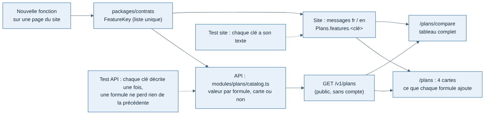

# 015 — Catalogue des formules dans l'API, page Offres tenue à jour

Date : 12/11/2026. Demandé par Greg (« fabrique la page en fictive pour le moment, garde à jour la liste et la grille des fonctionnalités au fur et à mesure que l'on crée les autres pages », « tout par l'API »). Cadrage : [05 — Formules d'abonnement](../cadrage/05-formules-abonnement.md).

## Contexte

Quatre formules : Pilot Free, Pilot Pro, Company, Holding. Le paiement n'existe pas encore (lot 2). Greg veut une page Offres réelle dès maintenant, avec des prix fictifs, dont la liste des fonctions suit chaque nouvelle page du site sans être réécrite à la main.

## Options étudiées

| Option | Pour | Contre |
| --- | --- | --- |
| Liste des fonctions écrite dans la page du site | Rapide | Le site déciderait des droits ; deuxième liste à tenir le jour où l'API vérifiera les droits ; oubli certain |
| **Catalogue dans l'API, clés dans `packages/contrats`, textes dans le site** | Une seule liste ; l'API décide ; les mêmes clés serviront aux droits (`/v1/me`) ; des tests repèrent un oubli | Trois fichiers à toucher pour une nouvelle fonction |
| Catalogue en base, modifiable depuis la console | Changer une offre sans déploiement | Prématuré : pas de paiement, pas de client ; une migration et une page de console de plus |

## Choix

- `packages/contrats/src/api/plans.ts` : `FeatureKey` est la **liste unique** des fonctions qu'une formule peut contenir ; `PlanCatalog` est le format de `GET /v1/plans`.
- `apps/api/src/modules/plans/catalog.ts` : pour chaque clé, son groupe, si elle figure sur les cartes, et sa valeur dans chaque formule (`false`, `true`, une limite, `"unlimited"`). Prix en centimes, marqués `indicativePrices: true` tant qu'ils sont fictifs.
- `GET /v1/plans` (public, limite de débit, cache 5 min) et `GET /v1/me/plan` (pilote connecté ; tout le monde est en Pilot Free tant qu'il n'y a pas d'abonnement).
- Le site (`apps/web/src/plans/`) ne fait qu'afficher : chaque carte liste ce que la formule **ajoute** à celle qu'elle contient, calculé depuis le catalogue ; `/plans/compare` montre tout.
- Textes : `Plans.features.<clé>` dans `messages/fr.json` et `en.json`.

## Page Fonctionnalités (12/11/2026)

Greg a demandé une page qui explique chaque fonction de Weems (maquette A choisie : une ligne par fonction, sommaire à gauche) et qui reste **à jour automatiquement** avec les autres pages du site et les choix sur les formules. Elle ne contient donc aucune liste écrite à la main :

- `/features` lit `GET /v1/plans` comme la page Offres : groupes, fonctions, première formule qui contient chaque fonction (« Gratuit », « Dès Pilot Pro »…), limites formule par formule.
- Chaque fonction du catalogue porte `availability` : `available` (utilisable aujourd'hui) ou `soon` (annoncée, pas encore codée). La page affiche « Bientôt » pour `soon`. Le catalogue décrit l'offre visée ; ce champ évite de promettre comme existant ce qui ne l'est pas. Au 12/11 : tracker, carte en direct, profil public, historique, fiche de vol et statistiques de base sont disponibles ; le reste est « bientôt ». Au 13/11 (#81, #83, #86), sont aussi disponibles : résumé du carnet, bandes de vol et leurs repères, points à travailler, période des statistiques, tendances par catégorie, temps par phase, bonnes pratiques. Restent « bientôt » : prochain vol SimBrief, notes de vol, objectifs, analyse d'approche, analyse détaillée, prévu ou réel, communauté, comparaison de vols, export et toutes les fonctions de compagnie.
- Textes : `Features.items.<clé>.title` et `.text` (FR et EN), à côté du libellé court `Plans.features.<clé>.label` ; illustration dans `apps/web/src/features/illustrations/`.
- Lien « Fonctionnalités » dans la barre des visiteurs (fiche 003) et dans le pied de page pour tous.

## Règle

**Toute nouvelle fonction visible par le pilote, ou toute modification d'une fonction existante, met à jour le catalogue dans la même PR** : clé dans `FeatureKey`, ligne dans `catalog.ts` (avec sa disponibilité), libellé et explication FR et EN, illustration. **Une fonction qui devient utilisable passe de `soon` à `available` dans la PR qui la livre.** La page Offres, le tableau et la page Fonctionnalités suivent seuls. Des tests bloquent un oubli : chaque clé est décrite une fois par l'API, chaque clé a son libellé et son explication, chaque clé a son illustration (sinon le site ne compile pas), une formule ne perd jamais une fonction de la formule qu'elle contient.

## Conséquences

- Les fonctions du carnet de vol privé sont entrées dans le catalogue avant d'être codées : la page décrit l'offre visée, pas seulement ce qui existe. Au 13/11, les pages Résumé, Vols et Statistiques sont livrées, les Objectifs restent à faire.
- Les boutons « Passer à Pilot Pro », « Choisir Company » et « Choisir Holding » n'agissent pas (« Paiement bientôt disponible ») jusqu'au lot 2.
- Le jour où l'API vérifiera les droits, elle lira ce même catalogue : le code testera une clé (`approachAnalysis`), jamais un nom de formule.
- Bouton de test Free | Pro (12/11/2026, demande de Greg) : hors production, la barre du site propose à un pilote connecté de passer son compte en Pilot Free ou Pilot Pro (`PUT /v1/dev/me/plan`, table `test_plans`), pour essayer chaque page avec ses cartes verrouillées. La route n'existe pas en production, où `GET /v1/me/plan` répond toujours Pilot Free et `testSwitch: false`. Bouton, route et table seront retirés avant la 1.0, quand les abonnements répondront.
