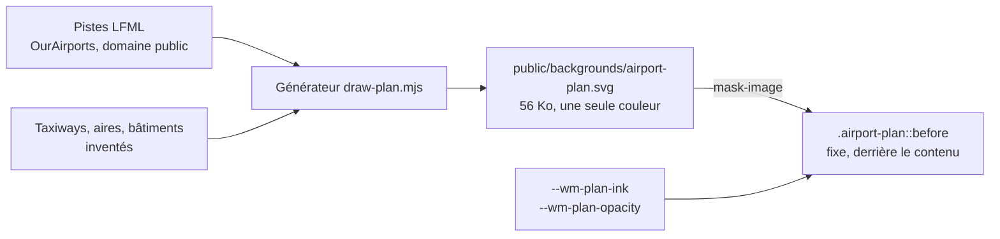

# 016 — Fond du site : plan d'aéroport inventé, très léger

Date : 13/11/2026. Demandé par Greg (« le site est très blanc »), intensité B choisie par Greg sur maquettes A/B.

## Contexte

Les pages du site posent leurs cartes sur un fond uni (`--wm-bg`). Greg voulait un arrière-plan sur tout le site : un plan d'aéroport détaillé façon carte de navigation (Marseille Provence), à peine visible.

## Source du dessin et licence

| Source | Licence | Retenue |
| --- | --- | --- |
| OpenStreetMap (taxiways, aires, bâtiments réels) | ODbL : mention « © contributeurs OpenStreetMap » obligatoire | Non : Greg ne veut aucune mention |
| Cartes SIA, IGN | Protégées / Licence Ouverte avec mention | Non |
| **Plan inventé** | Dessin original, aucune mention | **Oui** |

Seules les deux pistes reprennent LFML (13L/31R 3 500 m et 13R/31L 2 370 m, 303 m d'écart, orientation 134°/314°), d'après OurAirports, domaine public. Taxiways, aires, terminaux, hangars, rivage et quadrillage sont dessinés librement, ainsi que le tracé technique (voir plus bas). Ce n'est donc pas le vrai plan de Marseille. Aucune donnée OSM n'a servi.

## Choix

- Fichier `apps/web/public/backgrounds/airport-plan.svg` (une seule couleur, seule l'opacité de chaque trait compte).
- Utilitaire `airport-plan` (`apps/web/src/app/global.css`) : pseudo-élément fixe sous le contenu, teinté par `--wm-plan-ink` à travers le SVG en masque. Posé sur le cadre de toutes les pages (`site/site-shell.tsx`) et sur les pages de connexion (`auth/auth-page.tsx`).
- Intensité B : 12 % en clair, 15 % en sombre, puis « à peine plus foncé » à la demande de Greg (13/11) : **14 % en clair** (encre `#1f3a66`), **17 % en sombre** (encre `#9fb4d9`). La maquette A (7 % / 9 %) était recommandée.
- Retouche du 13/11 (Greg) : roses des vents supprimées, aéroport dézoomé (échelle 0,55) et tracé technique ajouté : prolongements d'axe, cônes d'approche gradués en NM, cercles DME 1-2-3 NM et radiales, cotes des pistes, attente, obstacles. Les cartes cachant le centre, les marges portent des encarts : règles graduées sur les deux bords, profil d'approche (pente 3°, MDA) et détail de seuil à gauche, circuit d'attente, tableau de minimums et détail de poste à droite. Valeurs fictives.
- Masqué quand le système demande plus de contraste (`prefers-contrast: more`).
- Le générateur (script Node, hors dépôt) est dans les fichiers du projet : `fond/draw-plan.mjs`. Pour retoucher le plan, le relancer et remplacer le SVG.

## Conséquences

- Contraste : les cartes sont opaques, le plan ne passe que dans les marges et derrière les titres. Pile sur un trait plein, en thème clair à 14 %, le texte principal reste à 11:1, le texte secondaire tombe à 4,4:1 et un lien à 4,1:1 (sous AA) ; en sombre à 17 %, tout reste au-dessus de 5,5:1. Si cela gêne, baisser `--wm-plan-opacity` (7 % en clair = 4,6:1).
- Coût : un SVG de 56 Ko mis en cache, aucun JavaScript.
