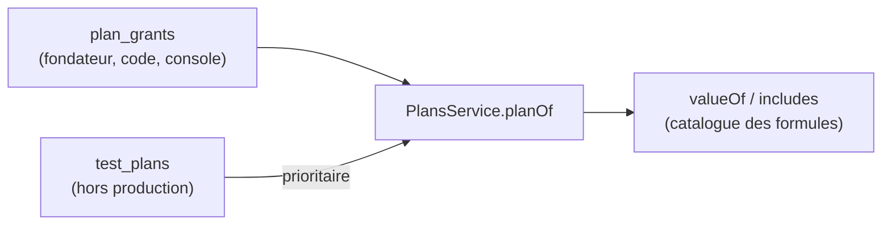

# 017 — Offre fondateurs : des droits offerts, hors catalogue des formules

Date : 13/11/2026. Spec : `../cahiers-des-charges/web/spec-offre-fondateurs.md`.

## Contexte

La règle permanente (section 12 des règles de développement, fiche 015) veut que toute fonction visible par le pilote ait sa ligne dans le catalogue des formules (`FeatureKey`). L'offre fondateurs, les codes d'offre et les ambassadeurs sont visibles, mais ils ne sont pas une **fonction d'une formule** : ils **donnent** une formule (Pilot Pro) pendant un temps.

## Choix

- Pas de nouvelle clé `FeatureKey` : la grille de la page Offres ne change pas. L'offre a son bandeau à part au-dessus des cartes.
- Une table `plan_grants` (formule, source `founder` | `code` | `admin`, début, fin, retrait) est lue par `PlansService.planOf` : un Pilot Pro offert vaut un Pilot Pro payé pour toutes les fonctions. Hors production, l'interrupteur de test Free | Pro reste prioritaire.
- Les cadeaux s'enchaînent (le suivant commence à la fin du précédent) au lieu de se chevaucher.
- Badge fondateur : donnée publique du profil (`founderNumber`), affiché seulement une fois la place confirmée.

## Conséquences

- Le paiement (lot 2) ajoutera une autre source de droits à côté de `plan_grants`, sans toucher au catalogue.
- Une fonction réservée à Pilot Pro s'ouvre aux fondateurs sans aucun code en plus.
