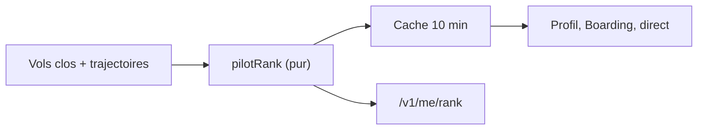

# 018 — Grades des pilotes : heures et vols valides, calculés à la lecture

Date : 13/11/2026. Spec : `../cahiers-des-charges/web/spec-grades-des-pilotes.md`.

## Contexte

Greg voulait un niveau au-dessus de « Pilote fondateur » au bout d'environ 50 vols. Le badge fondateur est un statut figé (numéro à vie) ; un compteur de vols seul se gonfle avec des tours de piste, des heures seules avec un long vol en pilote automatique.

## Choix

- Grades pour tous, séparés du badge fondateur, affichés ensemble.
- Deux seuils à atteindre : heures valides **et** vols valides ; règle du vol valide partagée avec l'offre fondateurs (`flights/validity.ts`), jamais dupliquée.
- Jamais de rétrogradation.
- Aucune table : le grade se déduit des vols. Calcul pur (`modules/ranks/rank.ts`) à chaque lecture du carnet ; cache mémoire de 10 min par pilote pour les pages publiques et le direct (relus toutes les 30 s), vidé à la fin de chaque vol.

## Conséquences

- Changer un seuil ou la règle du vol valide change les grades de tout le monde à la lecture suivante, sans migration.
- Coût : chaque calcul lit tous les vols et trajectoires simplifiées du pilote. Suffisant pour l'alpha ; au-delà de quelques milliers de pilotes en direct, ranger le grade dans une table mise à jour à la fin du vol.
- L'annonce « Nouveau grade » est gardée dans le navigateur : elle peut réapparaître sur un autre appareil (grade de moins de 7 jours).
