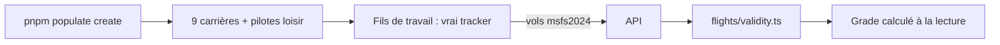

# 019 — Comptes fictifs : vols variés, carrières jusqu'aux 9 grades, départs aléatoires

Date : 13/11/2026. Demande de Greg : « plus de vols différents, ajouter les grades, espacer les départs pour être plus aléatoire ». Complète la fiche 011 (activité simulée) et la fiche 018 (grades).

## Contexte

- Les comptes fictifs volaient 6 types d'avions de ligne entre 20 grands aéroports.
- Un vol `replay` n'est jamais valide (fiche 017, `flights/validity.ts`) : tous les comptes fictifs restaient au grade Élève.
- La Légende demande 2 500 h et 700 vols valides : des milliers d'heures à rejouer par le vrai tracker, qui n'utilisait qu'un cœur.
- Les départs du « Trafic simulé » partaient à intervalle fixe, ceux du direct en rafale puis dès chaque atterrissage.

## Choix

- **Vols variés** : 21 types (C172, DR400, DA40, SR22, TBM 930, PC-12, ATR 72, Dash 8, PC-24, Challenger 350, E190, CRJ900, A319, A320neo, A321neo, 737-800, 737 MAX 8, A350, 787-9, 777-300ER, A330-900), chacun avec ses performances simplifiées, son rayon d'action et la piste qu'il lui faut ; 71 aéroports (OurAirports). Chaque pilote fictif a un style (aéroclub, voyage, affaires, court-courrier, ligne, long-courrier, mixte) et un avion préféré.
- **Vols comptés** : les vols des comptes fictifs se déclarent `msfs2024`, pas `replay`. Ils restent à part par leur **compte** (`users.fictitious`, fiche 011) : l'offre fondateurs et la Supervision les excluent déjà par le compte. La règle du vol valide n'est pas touchée. `pnpm simulate` (Trafic simulé, compte de développement) reste en `replay`.
- **Carrières** : les 9 premiers comptes d'une population (publics) ont chacun l'historique d'un grade, d'Élève à Légende : juste au-dessus des deux seuils (heures +12 %, la durée estimée d'un vol est juste à ±10 %), loin du grade suivant. Le grade n'est jamais écrit : l'API le calcule depuis les vols, comme pour un vrai pilote. Option « Couvrir les 9 grades » de la console, `--no-careers` en ligne de commande.
- **Débit** : les vols passés se rejouent dans des fils de travail (`worker_threads`, un par cœur moins un) : ≈ 9 h de vol par seconde mesurées sur 4 cœurs, contre ≈ 3 avant.
- **Départs aléatoires** : Trafic simulé, écarts tirés (loi exponentielle) autour du décalage moyen, bornés à 0,15 et 4 fois ce décalage (`--seed` pour rejouer les mêmes) ; le test de charge et J1 gardent des départs réguliers. Direct : premier départ tiré dans la première minute, puis 5 à 45 min au sol (temps simulé) entre deux vols d'une même place.

## Conséquences

- Une population avec les 9 grades rejoue ≈ 5 000 h de vol de plus : ≈ 10 min de plus sur un Mac. Sans `--no-careers`, c'est le prix d'une Légende réaliste.
- Mémoire : ≈ 2,5 Go pendant la création (un tracker par vol en cours dans chaque fil).
- Un vol fictif affiche « MSFS 2024 » comme simulateur sur le site.
