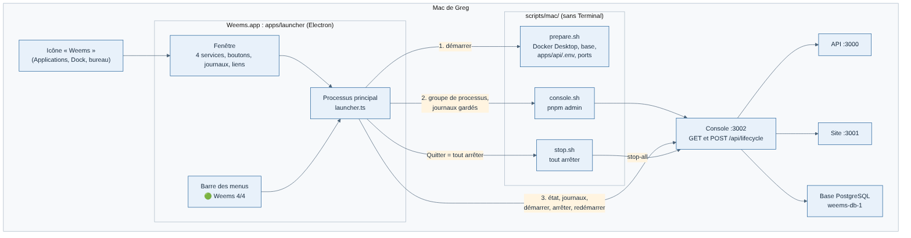

# 020 — Une app Mac « Weems » pour démarrer, arrêter et redémarrer, sans Terminal

Date : 13/11/2026. Proposé par Claude, validé par Greg sur maquette (« je valide, go »). Complète la fiche 011 (démarrage par icônes) : les scripts restent, l'app remplace les deux icônes.

## Contexte

Les icônes Weems Start et Weems Stop (fiche 011) marchent, mais ouvrent des fenêtres Terminal qu'il faut garder ouvertes. Greg veut **une seule icône** qui ouvre une petite application : état de chaque service, allumer, éteindre, redémarrer, journaux, sans Terminal.

## Options étudiées

| Option | Pour | Contre |
| --- | --- | --- |
| **Electron (`apps/launcher`)** | Déjà dans la pile (tracker) ; TypeScript ; testable sur Mac et en CI ; garde les journaux des processus qu'elle lance | Environ 250 Mo ; pas signée par Apple (signature locale « ad hoc », suffisante sur le Mac qui la construit) |
| SwiftUI (barre des menus) | Légère, native | Swift réservé à l'app iPad ; Xcode ; un deuxième langage à maintenir pour un outil interne |
| Platypus ou AppleScript autour des scripts | Très vite fait | Pas d'état en direct ni de vrais journaux : un Start.command plus joli |
| Console seule dans le navigateur | Rien à construire | Quelque chose doit lancer la console : c'est justement le rôle du Terminal aujourd'hui |

## Choix

- Une app Electron `apps/launcher`, construite et installée sur le Mac par `scripts/mac/install-launcher.sh` (`/Applications/Weems.app`, raccourci « Weems » sur le bureau, anciennes icônes mises à la corbeille).
- **La console reste le chef d'orchestre** (fiche 011) : l'app lance seulement `scripts/mac/prepare.sh` (Docker Desktop, base, `apps/api/.env`, ports, extraits de `start.sh`) puis la console (`scripts/mac/console.sh`), et demande le reste à la console par `/api/lifecycle` : `GET` (état et journaux d'un service), `POST` (tout, ou un service : démarrer, arrêter, redémarrer). Format dans `@weems/contrats` (`tools/local-services.ts`).
- La gestion des processus (groupe de processus, journaux, arrêt SIGTERM puis SIGKILL) passe de la console au paquet partagé `@weems/local-process`, utilisé par les deux applications.
- Ouvrir l'app démarre ce qui est arrêté. Fermer la fenêtre laisse tourner Weems (pastille dans la barre des menus). **Quitter l'app arrête tout** par `stop.sh`, données gardées (jamais `down -v`).
- Les boutons de la console d'administration agissent sur tout : l'API et le site lancés par la console s'arrêtent avec elle.
- Local seulement : l'app ne pilotera jamais le site en ligne (même règle que la console, fiche 009).

## Conséquences

- `start.sh` et `stop.sh` restent utilisables en Terminal (dépannage) ; `install-desktop-icons.sh` reste, mais n'est plus la façon recommandée.
- Mise à jour du lanceur : `bash scripts/mac/install-launcher.sh` après un `git pull` qui touche `apps/launcher` (le dépôt est écrit dans l'app à sa construction ; un dépôt déplacé demande aussi de relancer cette commande).
