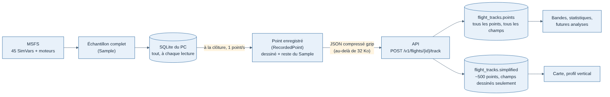

# 021 — Le tracker envoie au serveur tout ce qu'il lit, compressé

Date : 14/11/2026. Proposé par Claude, validé par Greg (« donc on ajoute ? », puis « le simulateur d'activité doit aussi remplir ces nouveaux champs »).

## Contexte

Le tracker lit 45 SimVars à chaque échantillon, plus l'état de chaque moteur, et garde tout dans sa base SQLite locale. Mais à la clôture du vol, il n'envoyait au serveur que 22 champs par point (ceux que la page de vol et les bandes dessinent). Le reste n'existait que sur le PC du pilote : perdu en cas de changement de machine, et impossible à analyser après coup. Une analyse ajoutée plus tard (assiette au toucher, vent, alarmes) n'aurait valu que pour les vols suivants.

Mesure faite sur un vol synthétique LFPG-LFBO (1 h 12, 4 312 points) : environ 960 octets de JSON par point complet, soit 4,1 Mo, 380 Ko une fois compressés en gzip. La limite d'envoi de l'API était de 16 Mo : un vol de 4 h y arrivait, un long-courrier de 10 h la dépassait (et la dépassait déjà presque avec les 22 champs).

## Options étudiées

| Option | Pour | Contre |
| --- | --- | --- |
| Garder 22 champs, ajouter au cas par cas | Rien à faire | Chaque champ ajouté ne vaut que pour les vols suivants ; les vols de l'alpha ne serviront jamais à ces analyses |
| **Envoyer tout l'échantillon, compressé** | Rien n'est perdu ; analyses possibles sur tous les vols passés | Environ 2 fois plus de données stockées (compressées : quelques centaines de Ko par heure de vol) |
| Envoyer tout, sans compression | Simple | Un vol de 10 h dépasse 30 Mo : envoi lent, limite à relever très haut |

## Choix

- Nouveau format `RecordedPoint` (`packages/contrats/src/api/tracks.ts`) : le `TrackPoint` dessiné **plus le reste de l'échantillon** (assiette, vitesse vraie, Mach, altitude indiquée, chaque moteur, masse totale, accélérations, variation d'altitude cabine, tous les feux, alarmes de survitesse et de décrochage, sur la piste, repoussage, surface, vent, température, visibilité, pause, slew, accélération du temps, heure du simulateur). Champs **facultatifs** : les vols reçus avant le 14/11/2026 ne les ont pas ; à l'intérieur, `null` quand le simulateur ne donne pas la valeur.
- L'API garde ces points complets dans l'enregistrement compressé (`flight_tracks.points`, lu par `TracksService.recorded`). Les **points simplifiés** des pages (`flight_tracks.simplified`, `GET /v1/flights/{id}/track`) ne gardent que les champs dessinés : les pages ne deviennent pas plus lourdes.
- Le tracker compresse en gzip tout corps de requête de plus de 32 Ko (`Content-Encoding: gzip`) ; le délai d'attente s'allonge d'une seconde par 50 Ko envoyés (connexions lentes). L'API décompresse avant de lire (`plugins/gzip-body.ts`), refuse une archive cassée (400) et tout autre encodage (415). La limite de la route de trajectoire porte sur la taille **décompressée** : 128 Mo, de quoi couvrir les 100 000 points que le contrat accepte.
- Le simulateur d'activité (générateur de vols synthétiques) remplit ces champs de façon plausible : météo tirée pour l'aéroport de départ et pour celui d'arrivée, puis mélangée le long de la route (vent qui forcit avec l'altitude, température de l'atmosphère standard avec un écart, visibilité, pistes mouillées), carburant qui baisse selon la phase et masse totale qui suit, vitesse indiquée plus faible en altitude que la vitesse vraie, Mach, accélérations et facteur de charge, N1 selon la phase (aucun pour les moteurs à pistons), feux allumés comme le ferait un équipage, cabine pressurisée qui suit un programme (environ 22 % de l'altitude de l'avion, 8 000 ft au plus, jamais sous le terrain) à +450 / -280 ft/min au plus, sauf un vol sur dix plus brutal (+800 / -600 ft/min) pour que les repères à revoir aient des cas ; pas de pressurisation pour les moteurs à pistons (`cabin.ts`).

## Conséquences

- Aucune migration : la table `flight_tracks` garde déjà tout ce qu'on lui envoie.
- Le stockage des trajectoires double environ. Il reste dans PostgreSQL ; un stockage compatible S3 viendra si le volume l'exige (spec J2).
- Les données « dépendent de l'avion » (`simvars.yaml`) restent à valider sur de vrais vols MSFS : les avoir sur le serveur permettra justement de repérer, après coup, les avions dont une SimVar reste figée.
- Une analyse qui lit ces champs doit lire l'enregistrement complet (`TracksService.recorded`, comme les bandes de vol), jamais les points simplifiés.
- Changement visible dans l'activité simulée : la vitesse indiquée des vols simulés n'est plus égale à la vitesse sol en altitude, le carburant consommé et le facteur de charge ne sont plus constants.
- Effet de bord à connaître : un JSON de 128 Mo occupe plusieurs centaines de Mo de mémoire à la lecture. Acceptable sur l'alpha (vols de cette taille très rares) ; à revoir avant la 1.0 (lecture en flux ou stockage objet).
