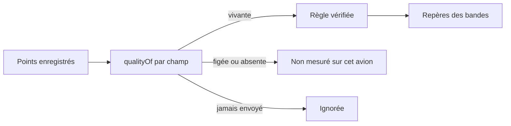

# 022 — Repères des bandes de vol : nouvelles règles et qualité de la donnée

Date : 14/11/2026. Spec : `../cahiers-des-charges/web/spec-carnet-prive.md` (§ 4). Dépend de la fiche 021 (point complet envoyé à l'API).

## Contexte

Depuis le 14/11/2026, le tracker envoie le point complet (feux, alarmes, piste, variation cabine, moteurs). Ces valeurs viennent de SimVars qui **dépendent de l'avion** (`apps/tracker/docs/reference/simvars.yaml`) : sur certains add-ons elles restent nulles ou figées. Un feu toujours éteint peut être une SimVar morte, pas un oubli du pilote. Aucun vol réel MSFS n'a encore été enregistré (J2) : rien ne dit quels avions mentent.

## Choix

- Sept nouveaux repères (Pilot Pro, `flightBandsMarks`, critères provisoires, liste Houssine) : alarme de survitesse en vol, alarme de décrochage en vol, feu anticollision éteint moteur en marche, feux à éclats éteints sur la piste, phares éteints en vol sous 10 000 ft, roulage (phases TAXI_OUT / TAXI_IN, hors piste) à plus de 30 kt de vitesse sol, variation cabine au-delà de +500 / -300 ft/min sur un avion pressurisé.
- **Qualité de la donnée**, par vol et par champ (`modules/logbook/data-quality.ts`) : vivante (connue et changeante), figée (connue, toujours la même), absente (jamais connue). Une règle ne marque que si tous ses champs sont vivants ; sinon elle est rendue dans `unmeasured` et la fiche affiche « Non mesuré sur cet avion ».
- Exception des alarmes : ne jamais sonner est le cas normal. Une alarme toujours éteinte est donc vivante ; toujours allumée, elle est figée.
- Un champ jamais envoyé (vols d'avant le 14/11) : la règle est ignorée sans mention ; « sur cet avion » serait faux.
- Cabine : la règle ne s'applique qu'à un avion pressurisé (cabine au moins 2 000 ft sous l'avion à un moment du vol). Sur un avion non pressurisé, la variation cabine n'est que le vario : ni repère ni mention.
- Les règles sont regroupées dans `modules/logbook/marks.ts` (une règle = raison, ligne des bandes, champs requis, test d'un point) ; `bands.ts` ne fait plus que les minutes.
- Nouvelles lignes des bandes : feu anticollision, feux à éclats, variation cabine (groupe « Feux et cabine »).
- Ni les grades ni la validité d'un vol ne dépendent de ces données.

## Conséquences

- Un champ figé sur tout le vol pour une bonne raison (feu anticollision allumé avant le démarrage du tracker, moteur déjà en marche) donne « non mesuré » : faux négatif accepté, jamais de faux reproche.
- Les Statistiques et les objectifs « Bonnes pratiques » lisent les trajectoires simplifiées, sans ces champs : les nouveaux repères n'y comptent pas. Les y ajouter demandera de lire l'enregistrement complet de chaque vol de la période (coût à mesurer).
- Seuils à valider avec un pilote et avec les 10 vols de référence du J2 sur 2 ou 3 avions variés ; ajuster alors la qualité (par exemple une liste d'avions connus pour mentir).
